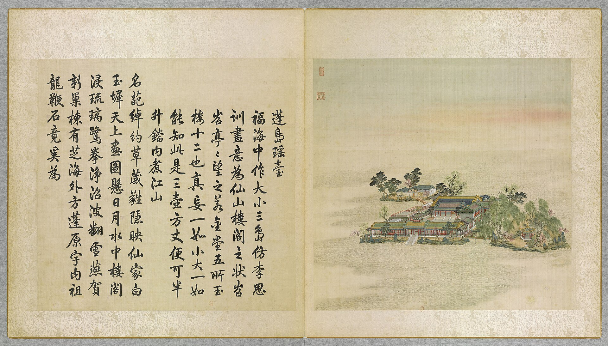

<!-- generated:start (scripts/building_pages.py): do not edit between these markers -->

# YM32-03: 畅襟楼 Changjin Lou

Yuanming Yuan

**3D object:** 1 box. Open it: `/reconstruction/3d.html?b=YM32-03`

**Part of:** YM32 蓬岛瑶台

## What we know

- **Name:** 畅襟楼 Changjin Lou (S05, S01, S201, S360 · confidence A)
- **Garden:** Yuanming Yuan (S05, S01, S201, S360)
- **Type:** tower (S05, S01, S201, S360 · confidence A)
- **Built:** by 1767 (first dated item) (S05, S01, S201, S360)
- **Changed:** Plaque 暢襟樓 set up 丁亥 1767 (S05, S01, S201, S360)
- **Destroyed:** 1860 (S05, S01, S201, S360)
- **Position:** 40.00815, 116.29843. S01 guess (S01 · confidence C)
- **Bays:** 1x1 on the plan (S05, S01, S201, S360)
- **Size in the inventory:** 28.0 × 12.1 m. S01 plan px / hall scale (S01)
- **Plan reader's note:** 畅襟楼: east range, 殿前东. After resize. (S01) *(research copy, not public)*
- **How it was read:** guess (S01) *(research copy, not public)*
- **Plan pixels:** 7075, 2977 (S01) *(research copy, not public)*

## Our model now

On the block drawn on the Qing plan S01: position and frontage from the plan, heights and roof from the typology of its hall class, its form drawn by the hall kit. It will be updated as the research goes on.

- **Box:** 24.95 × 9.92 m, storeyed hall
- **Heights:** platform 0.45 m, eave 5.95 m, ridge 9.17 m above the ground
- **Roof:** hip-and-gable 歇山, rolled ridge 卷棚, green tile
- **Faces:** 263.4° from north
- **Fit:** reduced towards the size drawn on the plan, to stand clear of its neighbours or the water; moved 0.9 m
- **Drawn:** by the hall kit: 9 bays, the middle widest, a porch front and back, steps on the back, front, 歇山 hip-and-gable with a rolled ridge 卷棚, green tile, a painted beam under the eave. From its own figures and readings where the dossier gives them (roof read: halls.csv S08 A; tiles read: halls.csv S08 A), the rest from the typology of its hall class.
- **Confidence:** C

## Pictures (1)

- **P0032** (likely): 蓬島瑶臺 Pengdao yaotai [Terrasse de jade sur l'île d'Immortalité] (圓明園四十景, 第32景) (1744 (BnF record: 1744年，清朝乾隆九年)). https://commons.wikimedia.org/wiki/File%3A%E5%9C%93%E6%98%8E%E5%9C%92%E5%9B%9B%E5%8D%81%E6%99%AF_-_%28%E6%B8%85%29%E5%94%90%E5%B2%B1%E3%80%81%E6%B2%88%E6%BA%90%E5%90%88%E7%95%AB_%3B_%28%E4%B9%BE%E9%9A%86%E5%90%9F%E8%AF%97%EF%BC%8C%E6%B1%AA%E7%94%B1%E6%95%A6%E4%BB%A3%E4%B9%A6%29_-_btv1b55008362z_%28097_of_124%29.jpg

  

## Texts and drawings (11)

- **E1933** (text, sure): 日下舊聞考 蓬岛瑶台、福海. 1780s (乾隆 敕撰) · j82:16b-17a · S05. https://github.com/kanripo/KR2k0036/blob/master/KR2k0036_082.txt
  > 蓬島瑶臺在福海中央門三楹南嚮正殿七楹殿前東為暢襟樓西為神洲三島東偏為隨安室西偏為日日平安報好音由蓬島瑶臺東南度橋為東島有亭為瀛海仙山西北度橋為北島正宇三楹（圓明園册）臣等謹按蓬島瑶臺四十景之一舊名蓬萊洲後易今名額為皇上御書門額曰鏡中閣與暢襟樓隨安室額皆御書神洲三島日日平安報好音瀛海仙山諸額皆世宗御書
  Centre of 福海: a three-bay gate facing south and seven-bay main hall, with 暢襟樓, 神洲三島, 隨安室 and 日日平安報好音; bridges to an east isle with the pavilion 瀛海仙山 and a north isle with a three-bay range. Formerly 蓬萊洲.
- **E1938** (poem, sure): 御製 題暢襟樓. 1767 (御製詩三集) · KR4f0005_226:27b · S201. https://github.com/kanripo/KR4f0005/blob/master/KR4f0005_226.txt
  > 題暢襟樓 湖心軒榭寫蓬瀛（是䖏在福海中央即蓬島瑶臺為圓眀園四十景之一）旁有書樓俯碧清豈是虚無候仙侣居然經史樂平生逺隄四面栁桃繪春水一泓鳬雁鳴設問暢襟真暢䖏端惟時雨與時晴
  In the middle of the lake 福海: a tower for books looking over the water, with willows and peach on the far dykes.
- **E1941** (poem, sure): 御製 暢襟樓. c. 1795, inferred from the last dated heading (御製詩五集) · KR4f0005_488:26a · S201. https://github.com/kanripo/KR4f0005/blob/master/KR4f0005_488.txt
  > 暢襟樓 石梯拾級試登臨舊有樓題曰暢襟小坐七年迅瞥眼（樓在蓬島瑶臺之側丁亥始顔此額題以句并自後壬辰乙未丙午戊申共詩五首懸之楣間閲今又七年矣）㡬曽一暢本来心
  Note: the plaque went up in 丁亥 1767, and his five earlier poems hang on its lintel. Reached by a stone stair.
- **E1942** (poem, sure): 御製 暢襟樓. 1796 (御製詩餘集) · KR4f0005_500:9b · S201. https://github.com/kanripo/KR4f0005/blob/master/KR4f0005_500.txt
  > 暢襟樓 樓據湖中央（是湖為園中㝡廣廓者向名福海）四面雅宜望因有暢襟名畫意鏡面漾是實還是虚胸襟原可暢而我值盼捷南瞻益惆悵似樓隠笑人底須拾級訪
  Written in retirement. The tower stands in the middle of the lake that the note calls the widest in the garden, 福海.
- **E1928** (poem, sure): 畅襟楼: 乾隆三十二年 poem of the Qianlong Emperor. 乾隆三十二年 (1767), date from the compilation · p.256 item (1), under 畅襟楼 · S360. https://www.yuanmingyuanpark.cn/xs/yjbg/202007/P020200730387572832602.pdf#page=256
  > 湖心轩榭写蓬瀛，旁有书楼俯碧清。岂是虚无候仙侣，居然经史乐平生。远堤四面柳桃绘，春水一泓鳬雁鸣。设问畅襟真畅处，端惟时雨与时晴。
  Poem of the Qianlong Emperor at 畅襟楼, 1767. Year as given by the compilation.
- **E1939** (poem, sure): 畅襟楼. 乾隆三十七年 (1772) · v2 p.392, under 蓬岛瑶台; source ref 11-257 · S361. https://www.yuanmingyuanpark.cn/xs/yjbg/202008/P020200803382343267004.pdf#page=395
  > 拾级上书楼，新波眼底浮。茁犹勒蒲芷，浴已下凫鸥。菱格斜窗展，柳丝远岸柔。须臾襟畅耳，难忘是先忧。
  Poem 畅襟楼 by the Qianlong Emperor, 1772, filed by the editors under 蓬岛瑶台.
- **E1930** (poem, sure): 畅襟楼: 嘉庆元年 poem of the Qianlong Emperor. 嘉庆元年 (1796), date from the compilation · p.256 item (5), under 畅襟楼 · S360. https://www.yuanmingyuanpark.cn/xs/yjbg/202007/P020200730387572832602.pdf#page=256
  > 楼据湖中央，（是湖为园中最广廓者向名福海）四面雅宜望。因有畅襟名，画意镜面漾。是实还是虚，胸襟原可畅。而我值盼捷，南瞻益惆怅。似楼隐笑人，底须拾级访。
  Poem of the Qianlong Emperor at 畅襟楼, 1796, on the view. Year as given by the compilation.
- **E1932** (poem, sure): 畅襟楼: 嘉庆八年 poem of the Jiaqing Emperor. 嘉庆八年 (1803), date from the compilation · p.256 item (6), under 畅襟楼 · S360. https://www.yuanmingyuanpark.cn/xs/yjbg/202007/P020200730387572832602.pdf#page=256
  > 千顷碧波绕蓬岛，层楼高出凌苍颢。四面沧浪心镜舒，尘虑于兹可暂扫。登临岂独畅襟怀，虑澹清漪天水浩。西峰云气接遥林，静俟甘霖起枯槁。
  Poem of the Jiaqing Emperor at 畅襟楼, 1803, on the view. Year as given by the compilation.
- **E1940** (poem, likely): 题畅襟楼. 乾隆四十年 (1775) · v2 p.392, under 蓬岛瑶台; source ref 12-671 · S361. https://www.yuanmingyuanpark.cn/xs/yjbg/202008/P020200803382343267004.pdf#page=395
  > 高楼耐可纵遐观，日丽风和了不寒。试问吾襟何以畅，曰惟物阜与民安。
  Poem 题畅襟楼 by the Qianlong Emperor, 1775, filed by the editors under 蓬岛瑶台.
- **E1934** (description, sure): 圆明园百景史事分景汇编: 畅襟楼. 1767-1803 · from p.256, under 蓬岛瑶台 · S360. https://www.yuanmingyuanpark.cn/xs/yjbg/202007/P020200730387572832602.pdf#page=256
  畅襟楼: 6 dated items, 1767-1803, of which 6 poems (Qianlong, Jiaqing); recurring themes: the view. First dated 1767, last dated 1803.
- **E1937** (description, sure): 圆明园五朝御制诗文集注 v2, editors' note on 蓬岛瑶台. 2020 edition · v2 p.388 · S361. https://www.yuanmingyuanpark.cn/xs/yjbg/202008/P020200803382343267004.pdf#page=391
  Yongzheng's 蓬莱洲, on the islands in 福海. Gate 镜中阁, seven-bay two-roll main hall with a five-bay annex, 畅襟楼, 神洲三岛, 留春殿, 日日平安报好音; an east island with a hexagonal pavilion and a north island. The editors say being in the water spared it in 1860, and it burned in the seventh month of 1870.

**On the plan:** Drawn on the plan of the gardens (S01) with no label, 1x1 cells: a building stood here, its name unknown. https://artmuseum.princeton.edu/collections/objects/138657

## Evidence for the set of buildings

- Evidence for the whole compound 蓬岛瑶台: see YM32
- Reconstructions and comparables for the whole garden, 圆明园 Yuanming Yuan: see GARDEN-YM
- Standing buildings comparable to a storeyed hall (not this building): see CLASS-storeyed_hall

## Open questions

None that name it.

<!-- generated:end -->

## Notes

<!-- Yours: regeneration never touches this part. It goes on the public site; what you write below a line holding only %% private %% stays in the research copy. -->
