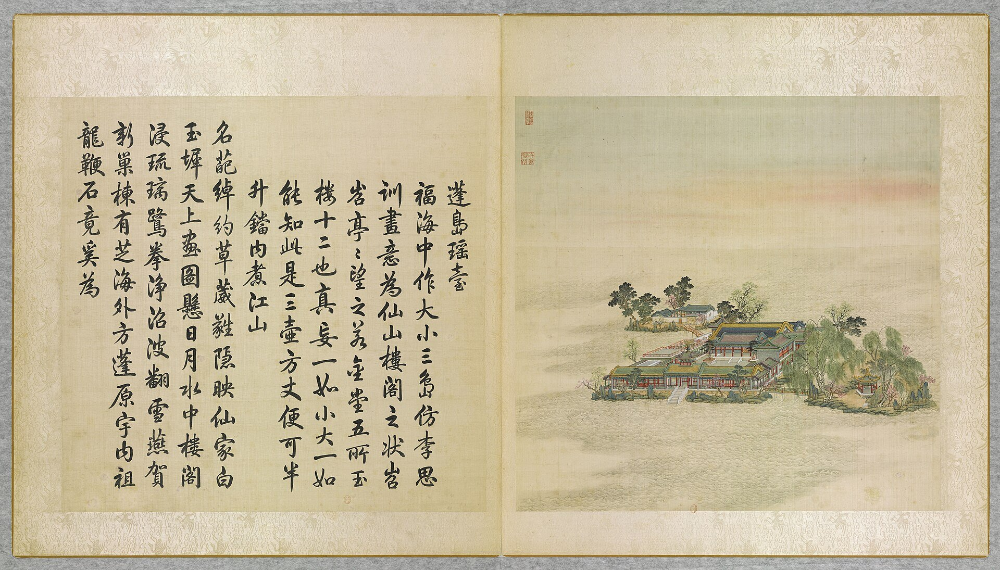

<!-- generated:start (scripts/building_pages.py): do not edit between these markers -->

# YM32-08: 北岛正宇 Beidao zhengyu

Yuanming Yuan

**3D object:** 1 box. Open it: `/reconstruction/3d.html?b=YM32-08`

**Part of:** YM32 蓬岛瑶台

## What we know

- **Name:** 北岛正宇 Beidao zhengyu (S05, S01 · confidence B)
- **Written on the plan:** 值房 (S01 · confidence B)
- **Garden:** Yuanming Yuan (S05, S01)
- **Type:** other (S05, S01 · confidence B)
- **Destroyed:** 1860 (S05, S01)
- **Position:** 40.00858, 116.29762. S01 likely (S01 · confidence B)
- **Bays:** 3 in the texts / 3x1 on the plan (S05, S01)
- **Size in the inventory:** 12.2 × 7.9 m. S01 plan px / hall scale (S01)
- **Note:** S06 calls north islet 北屿仙居. (S05, S01)
- **Plan reader's note:** Label south of the north island reads 值房, a service use. Text: 北岛正宇三楹. Bay count fits. (S01) *(research copy, not public)*
- **How it was read:** likely (S01) *(research copy, not public)*
- **Plan pixels:** 6778, 2708 (S01) *(research copy, not public)*

## Our model now

On the block drawn on the Qing plan S01: position and frontage from the plan, heights and roof from the typology of its hall class, its form drawn by the hall kit. It will be updated as the research goes on.

- **Box:** 12.2 × 7.9 m, side hall
- **Heights:** platform 0.54 m, eave 3.64 m, ridge 6.6 m above the ground
- **Roof:** gable 硬山 or 悬山, rolled ridge 卷棚, grey tile
- **Faces:** 170.7° from north
- **Drawn:** by the hall kit: 3 bays, the middle widest, a porch front and back, steps on the front, 硬山 flush gable with a rolled ridge 卷棚, grey tile, a painted beam under the eave. From its own figures and readings where the dossier gives them (tiles read: halls.csv S08 A), the rest from the typology of its hall class.
- **Confidence:** B

## Pictures (1)

- **P0032** (likely): 蓬島瑶臺 Pengdao yaotai [Terrasse de jade sur l'île d'Immortalité] (圓明園四十景, 第32景) (1744 (BnF record: 1744年，清朝乾隆九年)). https://commons.wikimedia.org/wiki/File%3A%E5%9C%93%E6%98%8E%E5%9C%92%E5%9B%9B%E5%8D%81%E6%99%AF_-_%28%E6%B8%85%29%E5%94%90%E5%B2%B1%E3%80%81%E6%B2%88%E6%BA%90%E5%90%88%E7%95%AB_%3B_%28%E4%B9%BE%E9%9A%86%E5%90%9F%E8%AF%97%EF%BC%8C%E6%B1%AA%E7%94%B1%E6%95%A6%E4%BB%A3%E4%B9%A6%29_-_btv1b55008362z_%28097_of_124%29.jpg

  

## Texts and drawings (3)

- **E1933** (text, sure): 日下舊聞考 蓬岛瑶台、福海. 1780s (乾隆 敕撰) · j82:16b-17a · S05. https://github.com/kanripo/KR2k0036/blob/master/KR2k0036_082.txt
  > 蓬島瑶臺在福海中央門三楹南嚮正殿七楹殿前東為暢襟樓西為神洲三島東偏為隨安室西偏為日日平安報好音由蓬島瑶臺東南度橋為東島有亭為瀛海仙山西北度橋為北島正宇三楹（圓明園册）臣等謹按蓬島瑶臺四十景之一舊名蓬萊洲後易今名額為皇上御書門額曰鏡中閣與暢襟樓隨安室額皆御書神洲三島日日平安報好音瀛海仙山諸額皆世宗御書
  Centre of 福海: a three-bay gate facing south and seven-bay main hall, with 暢襟樓, 神洲三島, 隨安室 and 日日平安報好音; bridges to an east isle with the pavilion 瀛海仙山 and a north isle with a three-bay range. Formerly 蓬萊洲.
- **E1935** (description, likely): Six paintings, I: 蓬岛瑶台 Pengdao Yaotai. before 1799 · pp.190-195, Tableau I · S258. https://archive.org/details/BIUSante_40644
  > offre une vaste étendue d'eau qui embrasse trois îles liées l'une à l'autre par deux ponts.
  Delatour owned six Chinese paintings of the garden, described by the garden writer Morel. Identifications here are mine, by form. Three islands, two bridges; large island with four building ranges round a square court on a stone plinth, one pavilion with an upper floor; smaller island with two ranges and walls; smallest with a mound and an open hexagonal kiosk on six columns; water lilies.
- **E1936** (description, likely): Scene 32, 蓬岛瑶台 Pengdao Yaotai. 1934 · p.93 · S02. https://archive.org/details/historyofpekings00malo
  > The central island was occupied by a little palace courtyard, decorated with glazed tile, and connected by bridges with the smaller islands lying to the northwest and east.
  Central island with a small palace court and glazed tile; bridges to the north-west island, also built over, and the east island, a rustic retreat with pavilion, rocks and trees. Decorated after a painting by the Tang artist 李思训 Li Sixun.

**On the plan:** Drawn on the plan of the gardens (S01), labelled 值房, 3x1 cells. https://artmuseum.princeton.edu/collections/objects/138657

## Evidence for the set of buildings

- Evidence for the whole compound 蓬岛瑶台: see YM32
- Reconstructions and comparables for the whole garden, 圆明园 Yuanming Yuan: see GARDEN-YM
- Standing buildings comparable to a side hall (not this building): see CLASS-side_hall

## Open questions

None that name it.

<!-- generated:end -->

## Notes

<!-- Yours: regeneration never touches this part. It goes on the public site; what you write below a line holding only %% private %% stays in the research copy. -->
