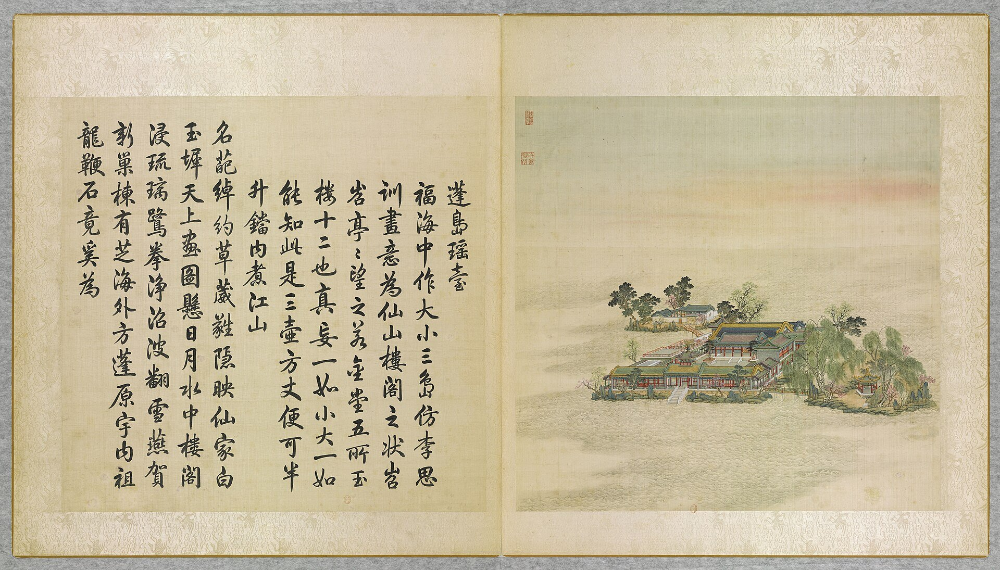
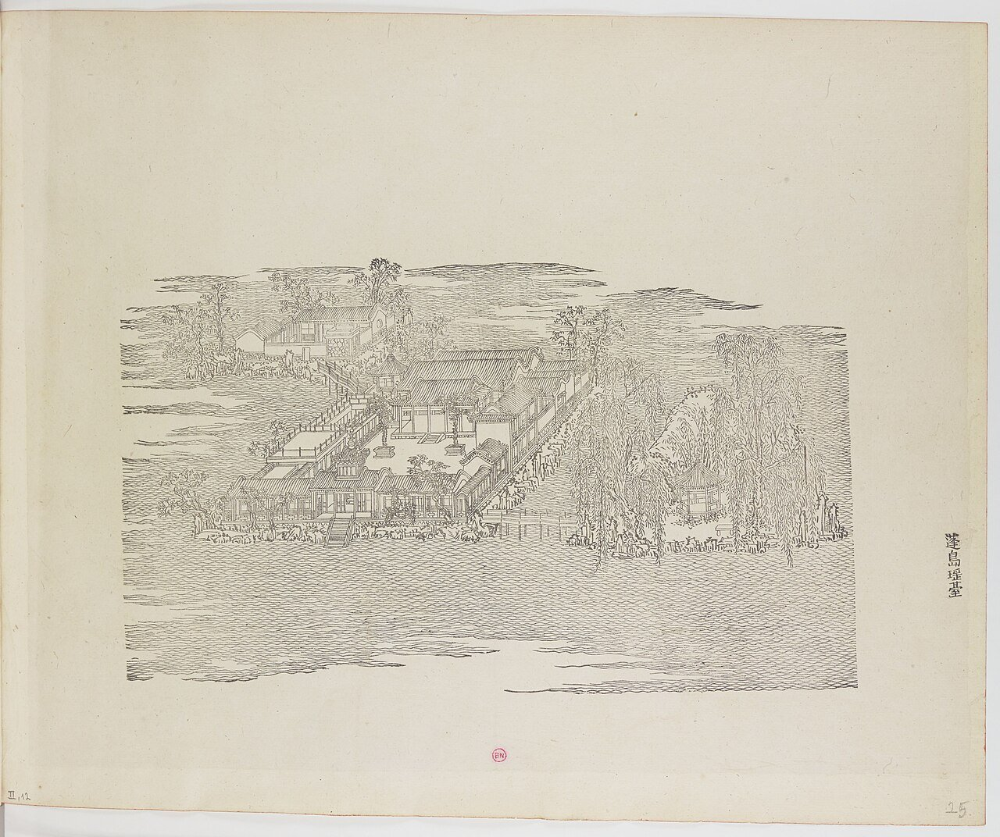
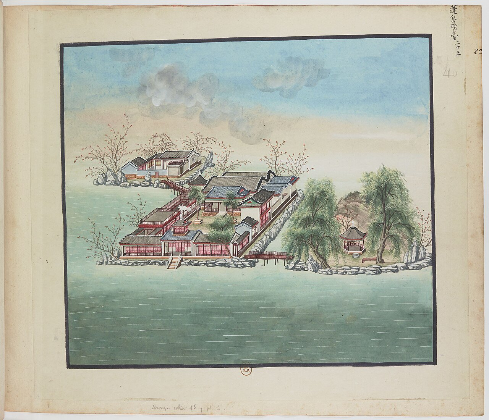
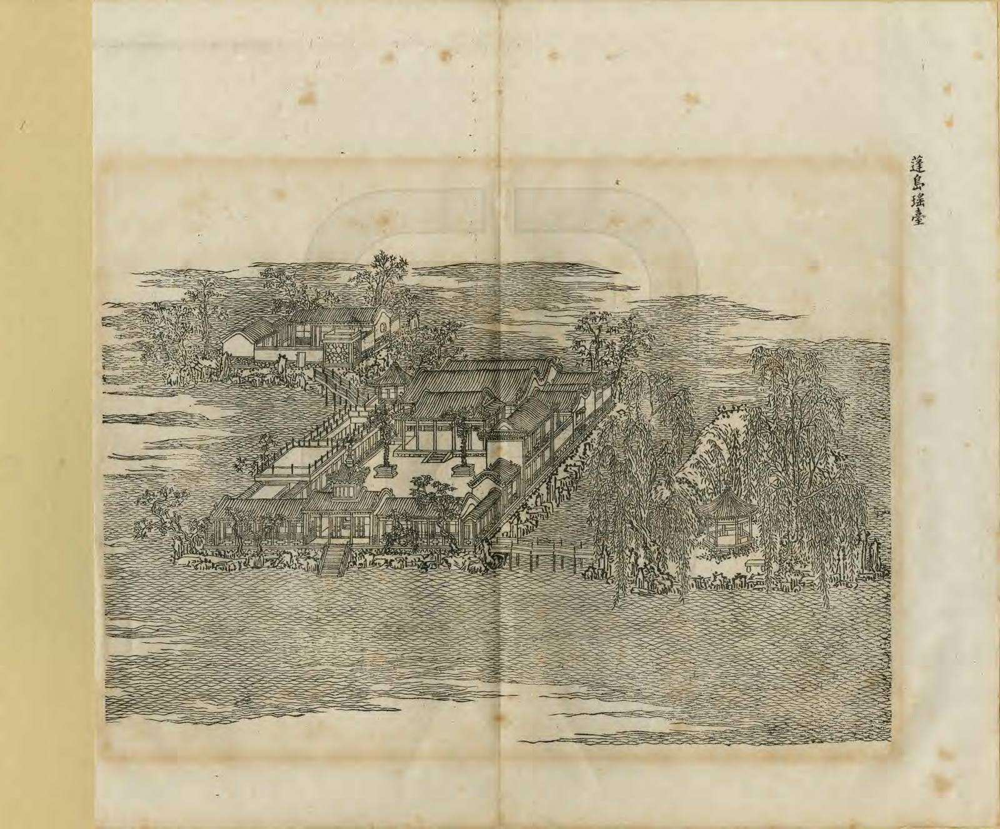
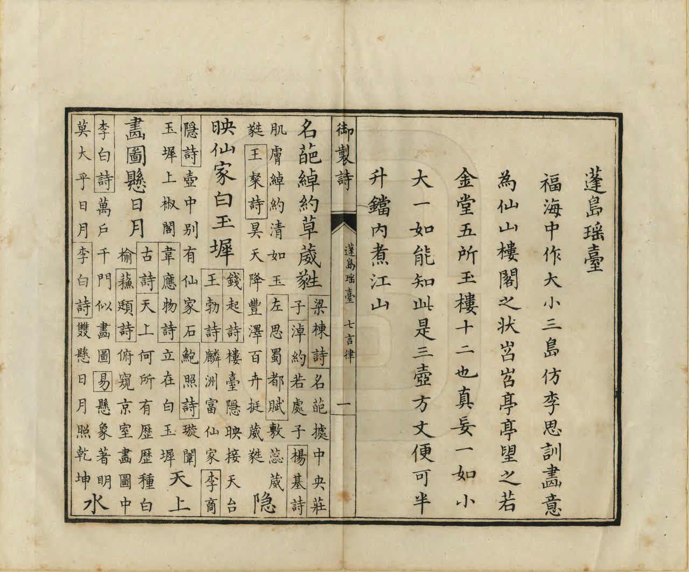
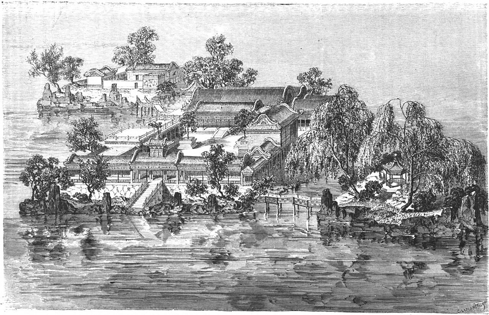
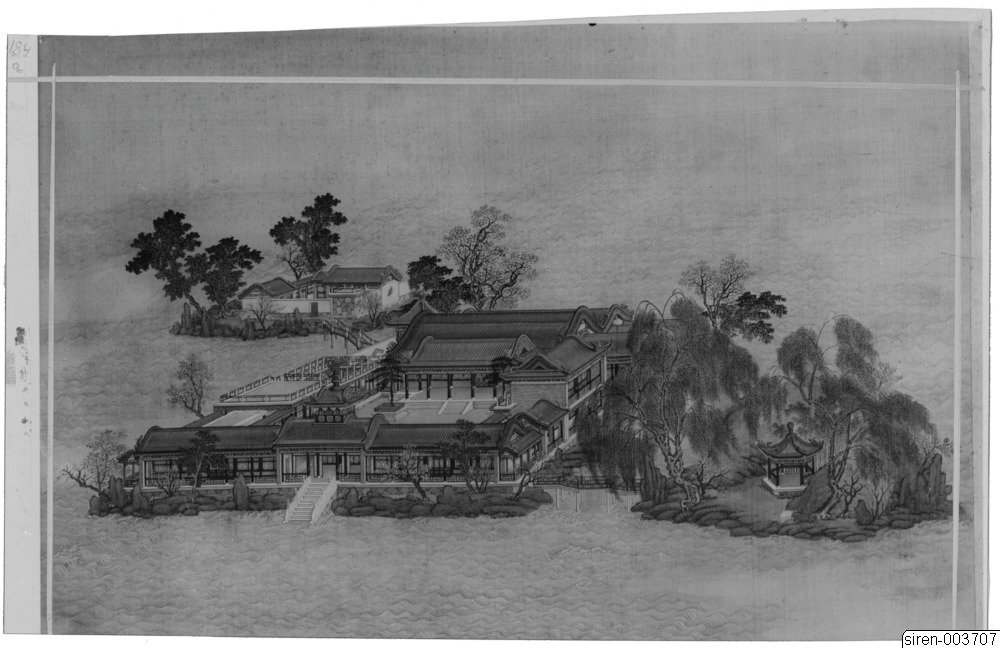
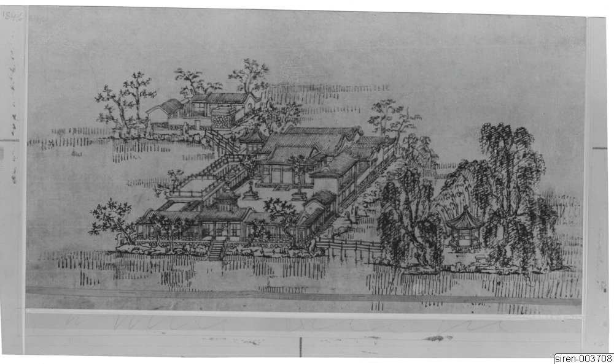
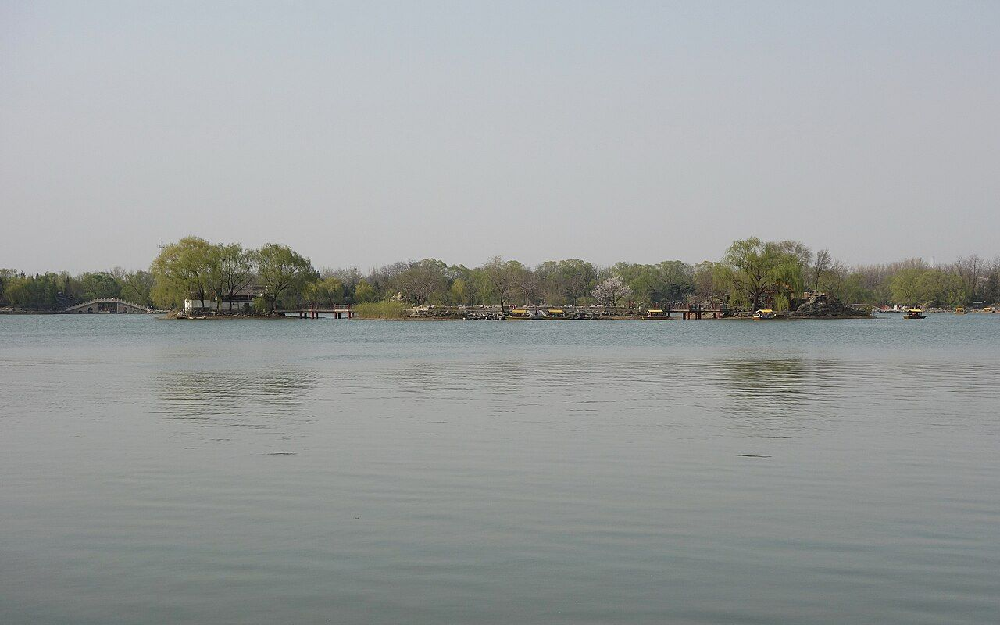
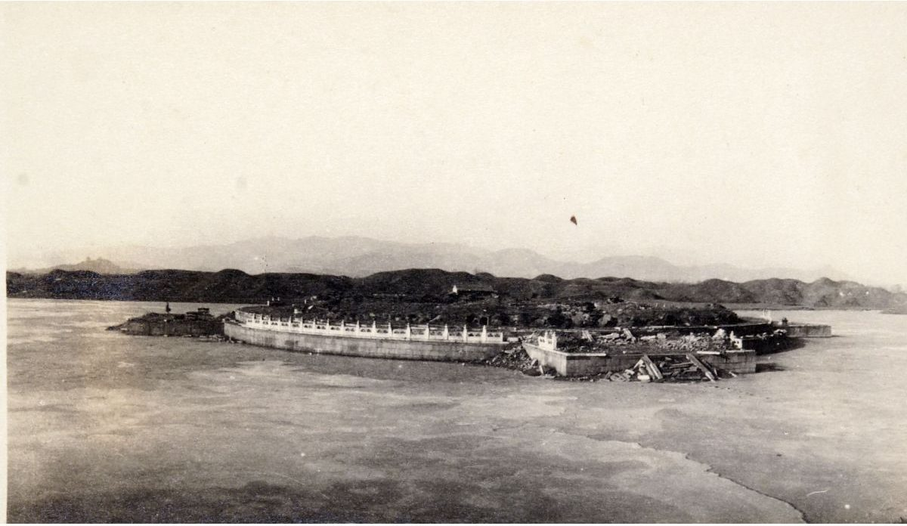

<!-- generated:start (scripts/building_pages.py): do not edit between these markers -->

# YM32: 蓬岛瑶台 Pengdao Yaotai

The Three Islands in the Happy Sea (Paradise Island of the Enameled Green Terrace) · Yuanming Yuan

**3D object:** 9 boxes. Open it: `/reconstruction/3d.html?b=YM32`

## What we know

- **Name:** 蓬岛瑶台 Pengdao Yaotai (S05, S02, S08, S43, S06, S01, S203, S337, S361 · confidence A)
- **English:** The Three Islands in the Happy Sea (Paradise Island of the Enameled Green Terrace) (S05, S02, S08, S43, S06, S01, S203, S337, S361)
- **Garden:** Yuanming Yuan (S05, S02, S08, S43, S06, S01, S203, S337, S361)
- **Type:** scene (S05, S02, S08, S43, S06, S01, S203, S337, S361 · confidence A)
- **Built:** 雍正初年 (S43), 旧名蓬莱洲 [j82:16b] (S05, S02, S08, S43, S06, S01, S203, S337, S361)
- **Changed:** 1744 (乾隆九年): 蓬萊洲 renamed 蓬島瑶臺 (S05, S02, S08, S43, S06, S01, S203, S337, S361)
- **Destroyed:** 1860; on the 1873 survival list (S06); Some rooms still standing on the island in 1871; survived 1860; later loss; spared in 1860; burned in 1870 (S05, S02, S08, S43, S06, S01, S203, S337, S361)
- **Position:** 40.00832, 116.29824. S01 sure (S01 · confidence B)
- **Plan reader's note:** Three islands. Label (6985,2985) in the main court. Malone 32 at (7030,3265). (S01) *(research copy, not public)*
- **How it was read:** sure (S01) *(research copy, not public)*
- **Plan pixels:** 7012, 2880 (S01) *(research copy, not public)*

## Our model now

9 boxes stand in this compound, 9 on blocks drawn on the plan, 0 assumed. Its halls are listed below.

## Inside it (11)

- YM32-01 门
- YM32-02 正殿
- YM32-03 畅襟楼
- YM32-04 神洲三岛
- YM32-05 随安室
- YM32-06 日日平安报好音
- YM32-07 瀛海仙山亭
- YM32-08 北岛正宇
- YM32-B0455
- YM32-B0497
- YM32-B0519

## Pictures (10)

- **P0032** (sure): 蓬島瑶臺 Pengdao yaotai [Terrasse de jade sur l'île d'Immortalité] (圓明園四十景, 第32景) (1744 (BnF record: 1744年，清朝乾隆九年)). https://commons.wikimedia.org/wiki/File%3A%E5%9C%93%E6%98%8E%E5%9C%92%E5%9B%9B%E5%8D%81%E6%99%AF_-_%28%E6%B8%85%29%E5%94%90%E5%B2%B1%E3%80%81%E6%B2%88%E6%BA%90%E5%90%88%E7%95%AB_%3B_%28%E4%B9%BE%E9%9A%86%E5%90%9F%E8%AF%97%EF%BC%8C%E6%B1%AA%E7%94%B1%E6%95%A6%E4%BB%A3%E4%B9%A6%29_-_btv1b55008362z_%28097_of_124%29.jpg

  

- **P0085** (sure): 中国皇帝的宫殿与庙宇. 第25幅图, 蓬島瑶臺 - (清)孙祜、沈源Pengdao yaotai - (Qing)Sun Hu, Shen Yuan (1745 (Commons, from the BnF record)). https://commons.wikimedia.org/wiki/File%3A%E4%B8%AD%E5%9B%BD%E7%9A%87%E5%B8%9D%E7%9A%84%E5%AE%AB%E6%AE%BF%E4%B8%8E%E5%BA%99%E5%AE%87._%E7%AC%AC25%E5%B9%85%E5%9B%BE%2C_%E8%93%AC%E5%B3%B6%E7%91%B6%E8%87%BA_-_%28%E6%B8%85%29%E5%AD%99%E7%A5%9C%E3%80%81%E6%B2%88%E6%BA%90Pengdao_yaotai_-_%28Qing%29Sun_Hu%2C_Shen_Yuan_-_btv1b10520701r.jpg

  

- **P0123** (sure): 海淀(镇)：中国皇帝的行宫. 第23幅图, 蓬島瑶臺Pengdao yaotai (1750-1792 (BnF, cb43831905b; ex coll. Bertin)). https://commons.wikimedia.org/wiki/File%3A%E6%B5%B7%E6%B7%80%28%E9%95%87%29%EF%BC%9A%E4%B8%AD%E5%9B%BD%E7%9A%87%E5%B8%9D%E7%9A%84%E8%A1%8C%E5%AE%AB._%E7%AC%AC23%E5%B9%85%E5%9B%BE%2C_%E8%93%AC%E5%B3%B6%E7%91%B6%E8%87%BAPengdao_yaotai_-_btv1b10520638r.jpg

  

- **P0263** (sure): 蓬島瑤臺 Pengdao Yaotai (御製圓明園圖詠, 1887 石印本, 下卷 (Commons 卷二), 第32景; printed title in the right margin of the picture) (光緒十三年 1887 (Commons/NLC record; colophon 光緒十三年七月天津石印書屋 in the SSID copy, S98 PDF p.2); design after the woodblock of 1745 by 孫祜 Sun Hu and 沈源 Shen Yuan). https://commons.wikimedia.org/wiki/File%3ANLC403-312001107375-14034_%E7%A6%A6%E5%88%B6%E5%9C%93%E6%98%8E%E5%9C%92%E5%9C%96%E8%A9%A0_%E5%8D%B7%E4%BA%8C.pdf?page=41

  

- **P0539** (sure): 蓬島瑤臺 Pengdao Yaotai: 乾隆 Qianlong's preface and poem with the courtiers' commentary, 御製圓明園圖詠 1887 (poem 1744 (乾隆九年); this printing 1887). https://commons.wikimedia.org/wiki/File%3ANLC403-312001107375-14034_%E7%A6%A6%E5%88%B6%E5%9C%93%E6%98%8E%E5%9C%92%E5%9C%96%E8%A9%A0_%E5%8D%B7%E4%BA%8C.pdf?page=42

  

- **P0145** (likely): Le Tour du monde 10: The palace of genies and precious stones, p. 101 (1 July 1864 (Commons)). https://commons.wikimedia.org/wiki/File%3ALe_Tour_du_monde-10-p101.jpg

  

- **P0205** (sure): Sirén, Enligt text under Pl. 184a Kinas trädgårdar Vol. I: Yuanmingyuan. Pengdao Yaotai, ”De Odödligas Öar och Gröna Terrasser”, mitt i Fuhai, ”Lycksalighetens Sjö”. Målad av Shen Yuan m. fl (undated by holder; Sirén's second trip 1921-23 for this group). http://kulturarvsdata.se/SMVK-OM/Bildarkiv/198816 Research-only: link card.

  

- **P0206** (sure): Sirén, Enligt text under Pl. 184b Kinas trädgårdar Vol. I: Yuanmingyuan. Pengdao Yaotai, ”De Odödligas Öar och Gröna Terrasser”, mitt i Fuhai, ”Lycksalighetens Sjö”. Tecknad av Piper efter e (undated by holder; Sirén's second trip 1921-23 for this group). http://kulturarvsdata.se/SMVK-OM/Bildarkiv/198817 Research-only: link card.

  

- **P0387** (sure): 蓬岛瑶台 20130414.JPG (2013-04-14 16:15:23 (Commons DateTimeOriginal)). https://commons.wikimedia.org/wiki/File:%E8%93%AC%E5%B2%9B%E7%91%B6%E5%8F%B0_20130414.JPG

  

- **P0289** (guess): Fotografija Ruševine harema v Stari poletni palači (album: "Ruinen von Yüen-Ming-Yüen") (20th c., album bought 1914-1920 (holder)). https://vazcollections.si/predmeti/fotografija-rusevine-harema-v-stari-poletni-palaci/

  

## Texts and drawings (27)

- **E1925** (poem, sure): 御製蓬島瑶臺詩（圓明園四十景詩）. 1744 (乾隆九年) · printed in S05 j82:17a-17b · S40. https://github.com/kanripo/KR2k0036/blob/master/KR2k0036_082.txt
  > 乾隆九年 御製蓬島瑶臺詩 福海中作大小三島仿李思訓畫意為仙山樓閣之狀岧岧亭亭望之若金堂五所玉樓十二也真忘一如小大一如能知此是三壺方丈便可半升鐺内煮江山 名葩綽約草葳㽔隠映仙家白玉墀天上畫圖懸日月水中樓閣浸琉璃鷺拳淨沼波翻雪燕賀新巢棟有芝海外方蓬原宇内祖龍鞭石竟奚為
  Large and small islands in 福海, made after 李思訓's paintings as immortal towers on peaks; they look like the 'five golden halls and twelve jade towers'. Size is an illusion, he says: know that, and these are the sacred isles.
- **E1933** (text, sure): 日下舊聞考 蓬岛瑶台、福海. 1780s (乾隆 敕撰) · j82:16b-17a · S05. https://github.com/kanripo/KR2k0036/blob/master/KR2k0036_082.txt
  > 蓬島瑶臺在福海中央門三楹南嚮正殿七楹殿前東為暢襟樓西為神洲三島東偏為隨安室西偏為日日平安報好音由蓬島瑶臺東南度橋為東島有亭為瀛海仙山西北度橋為北島正宇三楹（圓明園册）臣等謹按蓬島瑶臺四十景之一舊名蓬萊洲後易今名額為皇上御書門額曰鏡中閣與暢襟樓隨安室額皆御書神洲三島日日平安報好音瀛海仙山諸額皆世宗御書
  Centre of 福海: a three-bay gate facing south and seven-bay main hall, with 暢襟樓, 神洲三島, 隨安室 and 日日平安報好音; bridges to an east isle with the pavilion 瀛海仙山 and a north isle with a three-bay range. Formerly 蓬萊洲.
- **E1927** (poem, sure): 御製 端陽日奉皇太后觀龍舟. 1764 (御製詩三集) · KR4f0005_202:11b-12a · S201. https://github.com/kanripo/KR4f0005/blob/master/KR4f0005_202.txt
  > 端陽日奉皇太后觀龍舟 麥臨芒種蔚禾田應莭亶宜侍糉筵沅浦寜須問芳芷湯泉恰已貢新蓮欣陪鳯扇如恒月訝指龍舟忽隔年蓬島瑶䑓（在福海中為圓明園四十）（景之一嵗嵗扵此奉皇太后觀龍舟）仙樂奏董雙成至按氷絃
  Dragon boat day. His note says that every year he brought his mother to 蓬島瑶臺 to watch the boats.
- **E1938** (poem, sure): 御製 題暢襟樓. 1767 (御製詩三集) · KR4f0005_226:27b · S201. https://github.com/kanripo/KR4f0005/blob/master/KR4f0005_226.txt
  > 題暢襟樓 湖心軒榭寫蓬瀛（是䖏在福海中央即蓬島瑶臺為圓眀園四十景之一）旁有書樓俯碧清豈是虚無候仙侣居然經史樂平生逺隄四面栁桃繪春水一泓鳬雁鳴設問暢襟真暢䖏端惟時雨與時晴
  In the middle of the lake 福海: a tower for books looking over the water, with willows and peach on the far dykes.
- **E1929** (poem, sure): 御製 蓬島瑤臺. 1772 (御製詩四集) · KR4f0005_282:2a · S201. https://github.com/kanripo/KR4f0005/blob/master/KR4f0005_282.txt
  > 蓬島瑤臺 蓬島瑶臺福海中（蓬島瑶臺圓明圍四十景之一福海亦舊名也）往來祇藉舟相通昨近冰脆魚陟負拕床弗可舟艱衝還宮四日倐瞥眼再來春水呈溶溶鳴榔直到鏡中閣（臺南門也）迴看畫舫浮雲空若臺若榭皆熟境庭松峙翠盆花紅不如可望不可即引人企思翻無窮
  Reached only by boat, and over ice when the water is frozen. His note calls 鏡中閣 the south gate of the terrace, and he mentions courtyard pines and potted flowers.
- **E1941** (poem, sure): 御製 暢襟樓. c. 1795, inferred from the last dated heading (御製詩五集) · KR4f0005_488:26a · S201. https://github.com/kanripo/KR4f0005/blob/master/KR4f0005_488.txt
  > 暢襟樓 石梯拾級試登臨舊有樓題曰暢襟小坐七年迅瞥眼（樓在蓬島瑶臺之側丁亥始顔此額題以句并自後壬辰乙未丙午戊申共詩五首懸之楣間閲今又七年矣）㡬曽一暢本来心
  Note: the plaque went up in 丁亥 1767, and his five earlier poems hang on its lintel. Reached by a stone stair.
- **E0415** (poem, sure): 王闓運 圓明園詞. 1871 (同治十年) · whole poem; copy without the 自注 · S203. https://www.douban.com/group/topic/46378693/
  > 宜春苑中萤火飞，建章长乐柳十围。 离宫从来奉游豫，皇居那复在郊圻？ 旧池澄绿流燕蓟，洗马高梁游牧地。 北藩本镇故元都，西山自拥兴王气。 九衢尘起暗连天，辰极星移北斗边。 沟洫填淤成斥卤，宫庭映带觅泉原。 渟泓稍见丹棱泮，陂陀先起畅春园。 畅春风光秀南苑，霓旌凤盖长游宴。 地灵不惜瓮山湖，天题更创圆明殿。 圆明始赐在潜龙，因回邸第作郊宫。 十八篱门随曲涧，七楹正殿倚乔松。 轩堂四十皆依水，山石参差尽亚风。 甘泉避暑因留跸，长杨扈从且弢弓。 纯皇缵业当全盛，江海无波待游幸。 行所留连赏四园，画师写放开双境。 谁道江南风景佳，移天缩地在君怀。 当时只拟成灵囿，小费何曾数露台。 殷勤毋佚箴骄念，岂意元皇失恭俭！ 秋狝俄闻罢木兰，妖氛暗已传离坎。 吏治陵迟民困痛，长鲸跋浪海波枯。 始惊计吏忧财赋，欲卖行宫助转输。 沉吟五十年前事，厝火薪边然已至。 揭竿敢欲犯阿房，探丸早见诛文吏。 此时先帝见忧危，诏选三臣出视师。 宣室无人侍前席，郊坛有恨哭遗黎。 年年辇路看春草，处处伤心对花鸟。 玉女投壶强笑歌，金杯掷酒连昏晓。 四时景物爱郊居，玄冬入内望春初。 袅袅四春随凤辇，沉沉五夜递铜鱼。 内装颇学崔家髻，讽谏频除姜后珥。 玉路旋悲车毂鸣，金銮莫问残灯事。 鼎湖弓剑恨空还，郊垒风烟一炬间。 玉泉悲咽昆明塞，惟有铜犀守荆棘。 青芝岫里狐夜啼，绣漪桥下鱼空泣。 何人老监福园门，曾缀朝班奉至尊。 昔日暄阗厌朝贵，于今寂寞喜游人。 游人朝贵殊暄寂，偶来无复金闺客。 贤良门闭有残砖，光明殿毁寻颓壁。 文宗新构清辉堂，为近前湖纳晓光。 妖梦林神辞二品，佛城舍卫散诸方。 湖中蒲稗依依长，阶前蒿艾萧萧响。 枯树重抽盗作薪，游鳞暂跃惊逢网。 别有开云镂月台，太平三圣昔同来。 宁知乱竹侵苔落，不见春风泣露开。 平湖西去轩亭在，题壁银钩连倒薤。 金梯步步度莲花，绿窗处处留蠃黛。 当时仓卒动铃驼，守宫上直余嫔娥。 芦笳短吹随秋月，豆粥长饥望热河。 上东门开胡雏过，正有王公班道左。 敌兵未爇雍门荻，牧童已见骊山火。 应怜蓬岛一孤臣，欲持高洁比灵均。 丞相避兵生取节，徒人拒寇死当门。 即今福海冤如海，谁信神州尚有神！ 百年成毁何匆促，四海荒残如在目。 丹城紫禁犹可归，岂闻江燕巢林木？ 废宇倾基君好看，艰危始识中兴难。 已惩御史言修复，休遣中官织锦纨。 锦纨枉竭江南赋，鸳文龙爪新还故。 总饶结彩大宫门，何如旧日西湖路。 西湖地薄比郇瑕，武清暂住已倾家。 惟应鱼稻资民利，莫教莺柳斗宫花。 词臣讵解论都赋，挽辂难移幸雒车。 相如徒有上林颂，不遇良时空自嗟。
  A long lament on the garden's rise and destruction. It names the eighteen fence gates, the seven-bay main hall and forty halls by water, then the ruined 賢良門 and 光明殿, the new 清輝堂 of Xianfeng, 舍衛城, 鏤月開雲, and 福海 where the official 文豐 died.
- **E0433** (text, sure): 徐樹鈞 圓明園詞序. 1871 (同治十年立秋), recording a visit of 四月十日 · preface, whole · S203. https://www.douban.com/group/topic/46378693/
  > 圆明园在京城西，出平则门三十里，畅春园北里许，世宗皇帝藩邸赐园也。圣祖常游豫西郊，次于丹棱沜，乐其川原，因明武清侯李伟清华园旧址，筑畅春园，藩邸赐园，故在其旁。雍正三年，乃大宫殿朝署之规以避暑听政，前临西山，环以西湖。湖水发源玉泉山，曰瓮山，度宫墙东流入清河，《水经注》所谓“蓟县西湖，绿水澄澹，燕之旧池”者也。东流为洗马沟，东南合高梁之水，故鱼稻饶衍，陂泉交绮。高宗皇帝嗣位，海宇殷阗，八方无事，每岁缔构，专饰园居。大驾南巡，流览湖山风景之胜，图画以归，若海宁安澜园、江宁瞻园、钱塘小有天园、吴县狮子林，皆仿其制，增制园中。列景四十，以四字题匾者为一胜区，一区之内，斋馆无数。复东拓长春，西辟清漪，离宫别馆，月榭风亭，属之西山，所费不计亿万。园地多明权珰别业，或传崇祯末，诸奄皆以珍宝窟宅于兹，乾隆间浚池，发金银数百万，时国运方兴，地不爱宝，上心悦豫，殚精构造，曲尽游观之妙，元明以来，未之闻也。每岁夏幸园中，冬初还宫，内廷大臣，赐第相望，文武侍从，并直园林，入直奏对，昕夕往来，络绎道路，历雍乾嘉道，百余年于兹矣。文宗初，粤寇踞金陵，盗贼蜂起，上初即位，求直言，得胜保、曾国藩、袁甲三三臣，既以塞 、程、徐、陆，先朝重望，相继倾覆，始擢用前言事者，各畀重任，三臣支柱，贼不犯畿。然迭胜迭败，东南数省，蹂躏无完土，上悯苍生之颠沛，慨左右之无人。九年冬，郊宿于斋宫，夜分痛哭，侍臣凄恻。大考翰詹，以宣室前席发题，忧心焦思，伤于祸乱，然后稍自抑解，寄于文酒。以宫中行止有节，尤喜园居，冬至入宫，初正即出。时园中传有四春之宠，皆汉女，分居亭馆，所谓杏花春、武陵春、牡丹春、海棠春者也。然上明于料兵，委权阃外，超次用人，海内称哲。而部寺诸臣，无所磨励，颇袭旧敝。晚得肃顺，敢言自任，故委以谋议。先是道光二十年，英吉利夷船，至广东香港，求通商不得，又以烧烟起衅，执政议和，予海关税银千八百万。英夷请立约，广督耆英，与期十年。届期而徐广缙督两广，夷使至广州，拒不许入，以受封爵，夷酋恨焉，志入广州。咸丰元 [ 九 ] 年，英吉利、法兰西、美利坚各国，乘粤寇鸱张，中国多故，复以轮舶直入大沽台。王僧格林沁，托团练之名，焚其二船，尽击走之。夷人知大皇帝无意于战，特臣民之私愤，乃潜至海岸，买马数千，募群盗为军，半年而成，再犯天津，称西洋马队，闻者恐栗，夷马步登岸，我未陈而敌骑长驱矣。十年六 [ 八 ] 月十六日，上方园居，闻夷骑至通州，仓卒率后嫔幸热河，道路初无供帐，途出密云，御食豆乳麦粥而已。十七日，英夷帅叩东便门，或有闭城者，闻炮而开，王公请和，和议将定。十九日，夷人至圆明园宫门，管园大臣文丰当门说止之，夷兵已去。文都统知奸民将起，环问守卫禁兵，无一在者，乃自索马还内，投福海死。奸人乘时纵火，入宫劫掠，夷人从之，各园皆火发，三昼夜不熄，非独我无官府诘问，夷帅亦不能知也。初英夷使臣巴夏里，已拘刑部，和议成，以礼释囚。于是巴夏里与英帅，各陈兵仗至礼部，订约五十七条，予以海关税银三千六百万，而夷人抵偿圆明园银二十万。王公奏言，未敢斥夷，文丰与主事惠丰，同死于园，不称殉节，但言遭兵燹而已。十一年七月，文宗晏驾热河，今上即位，奉两宫皇太后还京，垂帘十载，巨寇削平。而夷人通商江海，往来贸易，设通商王大臣，以接夷使。然常言：“某省士民毁天主教堂，某省不行其教，某省民教构衅。”日以难我，应之不暇，盖岌岌乎华夷杂处，又忽忽十有一年。园居荒墟，鞠为茂草，西山大寺，夷妇深居，予旅京师，恻然不敢过也。同治十年春，同年王壬父重至辇下，追话旧游，张子雨珊亦以计偕来，约访故宫，因驻守参将廖承恩许为道主。四月十日，命仆马同过绣漪桥，寻清漪园遗迹，颓垣断瓦，零乱榛芜，宫树苍苍，水鸣呜咽。由辇路登廓如亭，南望万寿山，但见牧童樵子，往来林莽间。暮从昆明湖归，桥上铜犀卧荆棘中，犀背御铭，琅然可诵。明日访守园者，得董监，自言：“年七十有余，自道光初入寺园中，今秩五品，居福园门旁。”导予等从瓦砾中，循出入贤良门而北，指勤政、光明、寿山、太和四殿遗址，前湖圆明寝殿五楹，后为奉三无私殿、九州清晏殿各七楹，坏壁犹立，拾级可寻。董监言：“东为天地一家春，后居也，西为乐安和，诸妃嫔贵人居也，洞天深处，皇子居也。清辉殿为文宗重建，与五福堂、镂月开云台、朗吟阁皆不可复识。”镂月开云者，即所谓牡丹春者也。世宗为皇子时，迎圣祖至赐园，而高宗年十二，以皇孙召侍左右，三天子福寿冠前古，集于一堂，高宗后制诗，尝夸乐之。经其废基，裴回惄焉。东渡湖，为苏堤、长春仙馆、藻园，又北为月地云居、舍卫城、日天琳宇、水木明瑟、濂溪乐处，仅约略指视所在。东北至香雪廊，阶前茅荻萧萧，废池可辩，有老监奉茶自石畔出，讶客所从来，颇似桃源人逢渔郎也。渡桥循福海西行，为平湖秋月，水光溶溶，一泻千顷。望蓬岛瑶台，岛上殿宇，犹存数楹，惜无方舟不达。其下流水潺湲，激石成响，董监示予：“此管园大臣文公死所也。”西北至双鹤斋，又西过规月桥，登绮吟堂，经采芝径，折而东，仍出双鹤斋。园中残毁几遍，独存此为劫灰之余，乱草侵阶，窗棂宛在，尤动人禾黍悲耳。双鹤斋西，为溪月松风，翠柏苍藤，沿流覆道，斜日在林，有老宫人驱羊豕下来。东过碧桐书院，地跨池上，东为金鳌，西为玉蝀，坊楔犹存。又东去，皆败坏难寻，遂不复往。莫色沈沈，栖乌乱飞，揖董监，出福园门，还于廖宅。廖，沣州人，字枫亭，少从塞尚阿、僧格林沁军，亦能言行间事，感予来游，颇尽宾主之欢。既夕言归，则礼部放榜日也。雨珊既落第南去，予与壬父每相过从，念言园游，辄惘惘不自得。壬父又曰：“园之盛时，纯皇勒记，必殷殷踵事之戒，然仁宗始罢南幸，宣宗尤忧国贫，秋狝之礼，辍而不举。惟夫张弛之道宜及，嘉道时，补纯皇倦勤之功，而内外大臣，惟务慎节，监司宽厚，牧令昏庸，讳盗容奸，以为安静。八卦妖徒，连兵十载，无生天主，教目滋繁，由游民轻法，刑废不用故也。江淮行宫，既皆斥卖，国之所患，岂在乏财。”又曰：“燕地经安史戎马之迹，爰及辽金，近沙漠之风矣。明太宗以燕王旧居，不务改宅，仍而至今，地利竭矣。又园居单外，非所以驻万乘，废而不居，盖亦时宜。” 予曰：“然，前年御史德泰，请按户亩鳞次捐输，复修园宫。大臣以侈端将启，请旨切责，谪戍未行，愤悔自死。自此莫敢言园居者。而比年备办大婚，费已千万，结彩宫门，至十余万，公奏朝廷动用钱粮，婚以成礼，岂在华饰，若前明户部司官得以谏争，予且建言矣。又予闻慈安太后在文宗时，有脱簪之谏，《关雎》《车舝》之贤，中兴之由也。又园宫未焚前一岁，妖言传上坐寝殿，见白须老翁，自称园神，请辞而去，上梦中加神二品阶，明日，至祠谕祀之，未一期而园毁，岂能定欤？子能诗者，达于政事，曷以风人之意，备《繁霜》《云汉》之采？”于是壬父为《圆明园词》一篇。而周学士（即大学士周祖培）、潘侍郎见之，并叹其伤心感人，笔墨通于情性。予以此诗可传后来，虑夫代远年逝，传闻失实，词中所述，罔有征者，乃为文以序之。同治十年立秋日，长沙徐树钧撰。
  A walk through the ruins eleven years after the destruction, guided by an old eunuch who had served since the 1820s. It says which sites could still be read, and that 雙鶴齋 with its surroundings alone stood, as did some rooms on 蓬島瑶臺 and the 金鼇 and 玉蝀 arches. Its account of 1860 credits the first fires to local robbers, which differs from the British and French record in S02.
- **E0451** (text, sure): 圆明园遗址的遗产价值与申遗构想: the buildings left after 1860, citing 刘敦桢 1933. post n.d. · ylfj, note 34: 刘敦桢, 同治重修圆明园史料, 营造学社汇刊 1933(2) · S337. http://iqh.ruc.edu.cn/old/qdhjylyjzx/xszl/ylfj/9a322b5384ab4c17af0dd577d4f96ca6.htm
  Lists 17 buildings left after the burning of 1860, after 刘敦桢: 紫碧山房, 顺木天, 鱼跃鸢飞, 课农轩, 藏舟坞, 慎修思永, 知过堂, 双鹤斋, 蓬岛瑶台, 魁星楼, 文昌阁, 林渊锦镜, 春雨轩; 海岳开襟; 庄严法界, 正觉寺 and a 大宫门 in 万春园. The paper's aim is to hold any new display to this 1860 state.
- **E1889** (text, sure): 養吉齋叢錄 卷十四. mid-19th c. (printed 1890s), on earlier reigns · 卷十四, line 954 of the corpus file · S202. https://raw.githubusercontent.com/garychowcmu/daizhigev20/master/%E5%8F%B2%E8%97%8F/%E5%BF%97%E5%AD%98%E8%AE%B0%E5%BD%95/%E5%85%BB%E5%90%89%E6%96%8B%E4%B8%9B%E5%BD%95.txt
  > 自后遇午日，宫中每以龙舟酬节。圣祖御制有五日泛舟赐大臣侍卫宴诗。乾隆间，五日则奉慈舆至御园观龙舟。圣驾在望瀛洲，亭名。王公大臣及内廷诃臣亦得与宴赏。其东则蓬岛、瑶台，皇太后观竞渡处也。嘉庆间，移于澄虚榭宴赏。高宗诗云：「中流九龙舟，谁肯相参差。」仁宗诗云：「九龙顺轨原无竞。」据此可识龙舟之数。又按：北地四、五月往往少雨，如届节未沛甘霖，即罢此戏。道光初年，尚沿竞 渡故事。其后停止。
  Dragon boat day on 福海: the emperor in the 望瀛洲 pavilion under Qianlong with his mother on the 蓬島瑶臺 to the east; moved to 澄虛榭 under Jiaqing; stopped under Daoguang. Nine boats by the poems.
- **E1926** (poem, sure): 蓬岛瑶台雪中即景. 乾隆十九年 (1754) · v2 p.389, under 蓬岛瑶台; source ref 5-187 · S361. https://www.yuanmingyuanpark.cn/xs/yjbg/202008/P020200803382343267004.pdf#page=392
  > 瑞景离奇宝镜开，镜中楼阁是瑶台。三壶玉积长青柏，万树花装不馥梅。徐福漫驱千户去，子登常按八琅来。纽芽莩甲知何许，验取心田茁道荄。
  Poem 蓬岛瑶台雪中即景 by the Qianlong Emperor, 1754, filed by the editors under 蓬岛瑶台.
- **E1928** (poem, sure): 畅襟楼: 乾隆三十二年 poem of the Qianlong Emperor. 乾隆三十二年 (1767), date from the compilation · p.256 item (1), under 畅襟楼 · S360. https://www.yuanmingyuanpark.cn/xs/yjbg/202007/P020200730387572832602.pdf#page=256
  > 湖心轩榭写蓬瀛，旁有书楼俯碧清。岂是虚无候仙侣，居然经史乐平生。远堤四面柳桃绘，春水一泓鳬雁鸣。设问畅襟真畅处，端惟时雨与时晴。
  Poem of the Qianlong Emperor at 畅襟楼, 1767. Year as given by the compilation.
- **E1939** (poem, sure): 畅襟楼. 乾隆三十七年 (1772) · v2 p.392, under 蓬岛瑶台; source ref 11-257 · S361. https://www.yuanmingyuanpark.cn/xs/yjbg/202008/P020200803382343267004.pdf#page=395
  > 拾级上书楼，新波眼底浮。茁犹勒蒲芷，浴已下凫鸥。菱格斜窗展，柳丝远岸柔。须臾襟畅耳，难忘是先忧。
  Poem 畅襟楼 by the Qianlong Emperor, 1772, filed by the editors under 蓬岛瑶台.
- **E1940** (poem, sure): 题畅襟楼. 乾隆四十年 (1775) · v2 p.392, under 蓬岛瑶台; source ref 12-671 · S361. https://www.yuanmingyuanpark.cn/xs/yjbg/202008/P020200803382343267004.pdf#page=395
  > 高楼耐可纵遐观，日丽风和了不寒。试问吾襟何以畅，曰惟物阜与民安。
  Poem 题畅襟楼 by the Qianlong Emperor, 1775, filed by the editors under 蓬岛瑶台.
- **E1930** (poem, sure): 畅襟楼: 嘉庆元年 poem of the Qianlong Emperor. 嘉庆元年 (1796), date from the compilation · p.256 item (5), under 畅襟楼 · S360. https://www.yuanmingyuanpark.cn/xs/yjbg/202007/P020200730387572832602.pdf#page=256
  > 楼据湖中央，（是湖为园中最广廓者向名福海）四面雅宜望。因有畅襟名，画意镜面漾。是实还是虚，胸襟原可畅。而我值盼捷，南瞻益惆怅。似楼隐笑人，底须拾级访。
  Poem of the Qianlong Emperor at 畅襟楼, 1796, on the view. Year as given by the compilation.
- **E1931** (poem, sure): 蓬岛瑶台. 嘉庆元年 (1796) · v2 p.396, under 蓬岛瑶台; source ref 1-114 · S361. https://www.yuanmingyuanpark.cn/xs/yjbg/202008/P020200803382343267004.pdf#page=399
  > 福海御园东，瑶台峙水中。三山连阁迥，万顷漾波融。映日辉珠阙，凌霞接阆风。玉京欣可到，灵境一舟通。
  Poem 蓬岛瑶台 by the Jiaqing Emperor, 1796, filed by the editors under 蓬岛瑶台.
- **E1932** (poem, sure): 畅襟楼: 嘉庆八年 poem of the Jiaqing Emperor. 嘉庆八年 (1803), date from the compilation · p.256 item (6), under 畅襟楼 · S360. https://www.yuanmingyuanpark.cn/xs/yjbg/202007/P020200730387572832602.pdf#page=256
  > 千顷碧波绕蓬岛，层楼高出凌苍颢。四面沧浪心镜舒，尘虑于兹可暂扫。登临岂独畅襟怀，虑澹清漪天水浩。西峰云气接遥林，静俟甘霖起枯槁。
  Poem of the Jiaqing Emperor at 畅襟楼, 1803, on the view. Year as given by the compilation.
- **E1943** (poem, sure): 瀛海仙山（133）. 道光三年 (1823) · v2 p.408, under 蓬岛瑶台 · S361. https://www.yuanmingyuanpark.cn/xs/yjbg/202008/P020200803382343267004.pdf#page=411
  > 仙瀛偶访步层峦，半月高台夏亦寒。入望烟岚云外赏，凌虚楼阁画中看。穿林窈窕青松磴，护岸周遭白石栏。雨霁空明澄万象，畅观只觉水天宽。
  Poem 瀛海仙山（133） by the Daoguang Emperor, 1823, filed by the editors under 蓬岛瑶台.
- **E1944** (poem, sure): 瀛海仙山口号（173）. 道光四年 (1824) · v2 p.410, under 蓬岛瑶台 · S361. https://www.yuanmingyuanpark.cn/xs/yjbg/202008/P020200803382343267004.pdf#page=413
  > 天光云影湛晴波，习习南薰静里过。知命乐天慎修德，长生仙药竟如何。
  Poem 瀛海仙山口号（173） by the Daoguang Emperor, 1824, filed by the editors under 蓬岛瑶台.
- **E2367** (description, sure): Attiret: 福海 and 蓬岛瑶台. 1743 · [pp.16-17] · S157. https://faculty.bard.edu/~louis/gardens/attiretaccount.html
  > But what is the most charming Thing of all, is an Island or Rock in the Middle of this Sea; rais'd, in a natural and rustic Manner, about Six Foot above the Surface of the Water. On this Rock there is a little Palace; which however contains a hundred different Apartments. It has Four Fronts;
  Lake near five miles round in this translation. Island palace on a rock about 6 ft above the water, a hundred rooms, four fronts, with views of all shores. Identified with 福海 by S02 p.135.
- **E1936** (description, sure): Scene 32, 蓬岛瑶台 Pengdao Yaotai. 1934 · p.93 · S02. https://archive.org/details/historyofpekings00malo
  > The central island was occupied by a little palace courtyard, decorated with glazed tile, and connected by bridges with the smaller islands lying to the northwest and east.
  Central island with a small palace court and glazed tile; bridges to the north-west island, also built over, and the east island, a rustic retreat with pavilion, rocks and trees. Decorated after a painting by the Tang artist 李思训 Li Sixun.
- **E2370** (description, sure): 福海 Fu Hai, the Happy Sea. 1934 · p.93 · S02. https://archive.org/details/historyofpekings00malo
  > It was roughly square in shape, measured almost a half mile on a side, and contained three small but beautiful islands in the middle.
  Also called the East Lake, the largest lake of the garden, about half a mile a side, joined by a narrow opening to the lake before 方壶胜境. Eight of the forty views belong to it, scenes 30 to 37.
- **E1935** (description, likely): Six paintings, I: 蓬岛瑶台 Pengdao Yaotai. before 1799 · pp.190-195, Tableau I · S258. https://archive.org/details/BIUSante_40644
  > offre une vaste étendue d'eau qui embrasse trois îles liées l'une à l'autre par deux ponts.
  Delatour owned six Chinese paintings of the garden, described by the garden writer Morel. Identifications here are mine, by form. Three islands, two bridges; large island with four building ranges round a square court on a stone plinth, one pavilion with an upper floor; smaller island with two ranges and walls; smallest with a mound and an open hexagonal kiosk on six columns; water lilies.
- **E1216** (description, sure): Site status table, about 2011: remains tidied up. c. 2011 · 系列06 repost, status table · S356. https://blog.sina.com.cn/s/blog_c27029650101itzz.html
  A blogger's table of what was then visible. These scenes have building remains that have been cleared and tidied. Dated about 2011, so digs since then are not reflected.
- **E1934** (description, sure): 圆明园百景史事分景汇编: 畅襟楼. 1767-1803 · from p.256, under 蓬岛瑶台 · S360. https://www.yuanmingyuanpark.cn/xs/yjbg/202007/P020200730387572832602.pdf#page=256
  畅襟楼: 6 dated items, 1767-1803, of which 6 poems (Qianlong, Jiaqing); recurring themes: the view. First dated 1767, last dated 1803.
- **E1937** (description, sure): 圆明园五朝御制诗文集注 v2, editors' note on 蓬岛瑶台. 2020 edition · v2 p.388 · S361. https://www.yuanmingyuanpark.cn/xs/yjbg/202008/P020200803382343267004.pdf#page=391
  Yongzheng's 蓬莱洲, on the islands in 福海. Gate 镜中阁, seven-bay two-roll main hall with a five-bay annex, 畅襟楼, 神洲三岛, 留春殿, 日日平安报好音; an east island with a hexagonal pavilion and a north island. The editors say being in the water spared it in 1860, and it burned in the seventh month of 1870.
- **E1745** (description, sure, search index only): 鱼跃鸢飞; 西峰秀色; 鸿慈永祜; 日天琳宇; 汇芳书院; 蓬岛瑶台; 廓然大公 (search-index text). n.d. · mhymy jqjs, tag and ysltd pages · S340. https://www.mhymy.com/ymss/jqjs/ymy
  Short notes: 鱼跃鸢飞 inside 大北门, Yongzheng, about 2,500 m2; 西峰秀色 on an islet north of 舍卫城, 1728, open only west toward the hills; 安佑宫 1740-43, its marble columns now at Peking University and the National Library; 日天琳宇 the 佛楼, early Yongzheng; 汇芳书院 1742; 廓然大公 320 x 160 m, lost in 1900.

**On the plan:** Drawn on the plan of the gardens (S01), labelled 蓬岛瑶台. https://artmuseum.princeton.edu/collections/objects/138657

## Open questions

- Q9: Bay counts, plan against text
- Q47: How much burned, and when

<!-- generated:end -->

## Notes

<!-- Yours: regeneration never touches this part. It goes on the public site; what you write below a line holding only %% private %% stays in the research copy. -->
