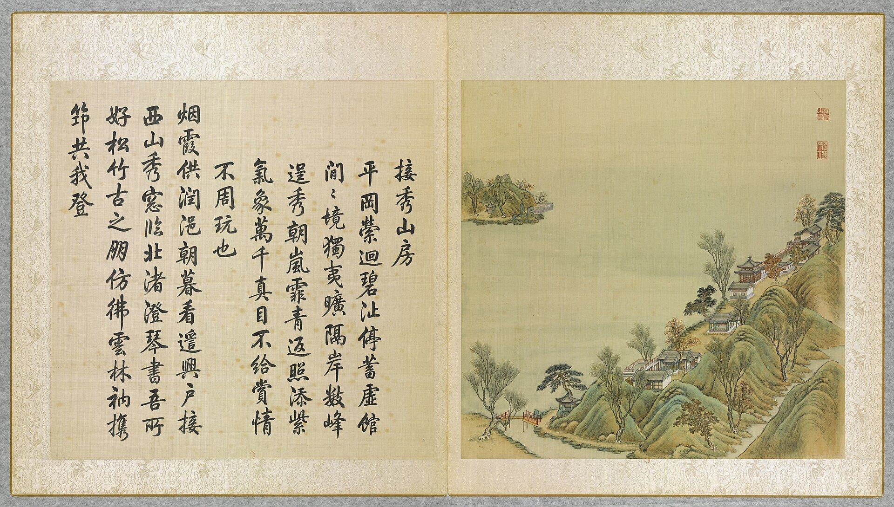
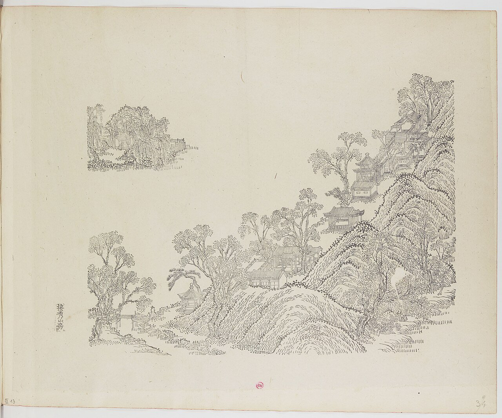
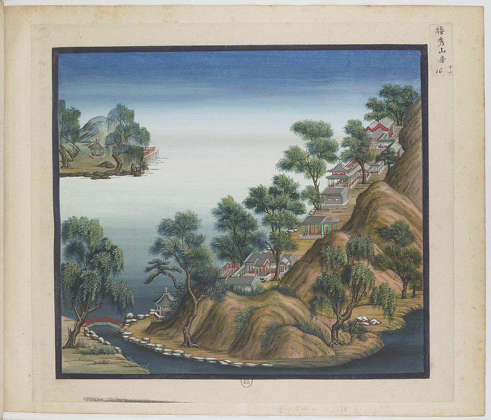
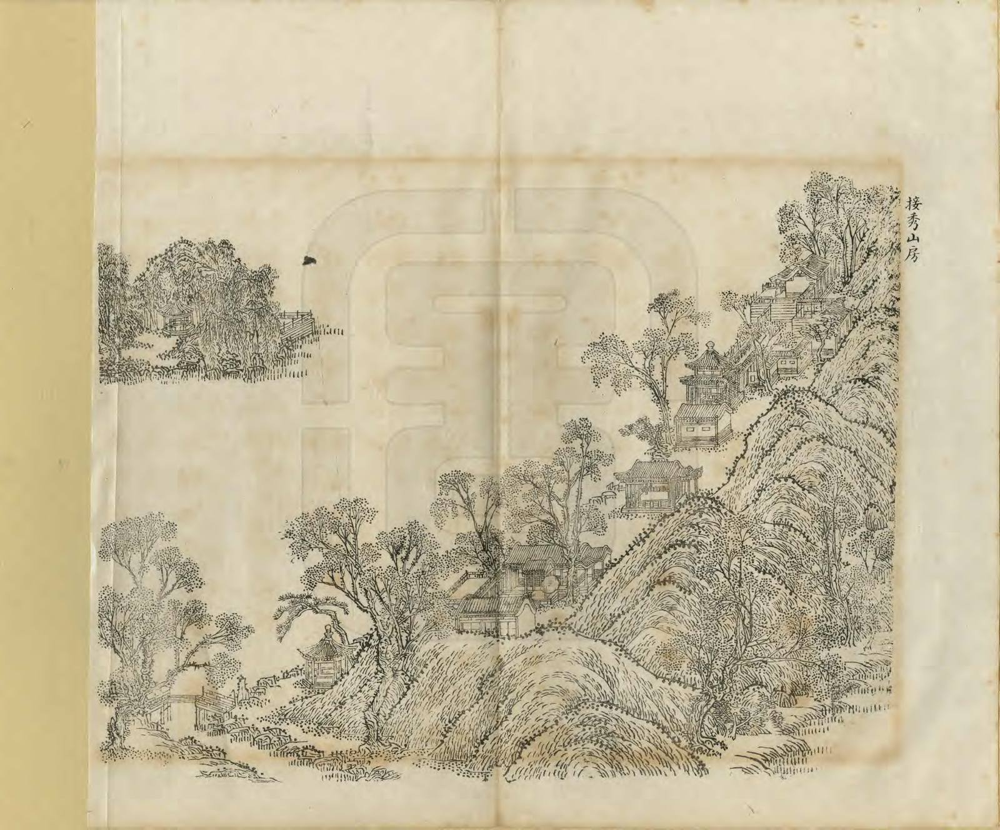
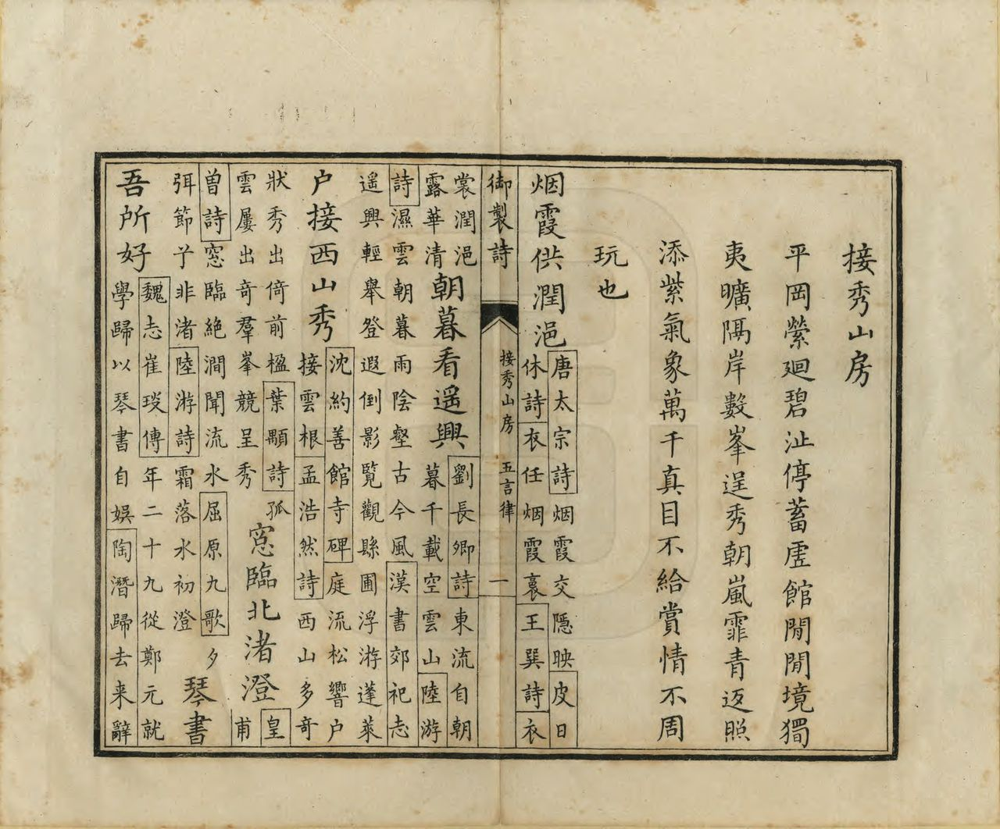
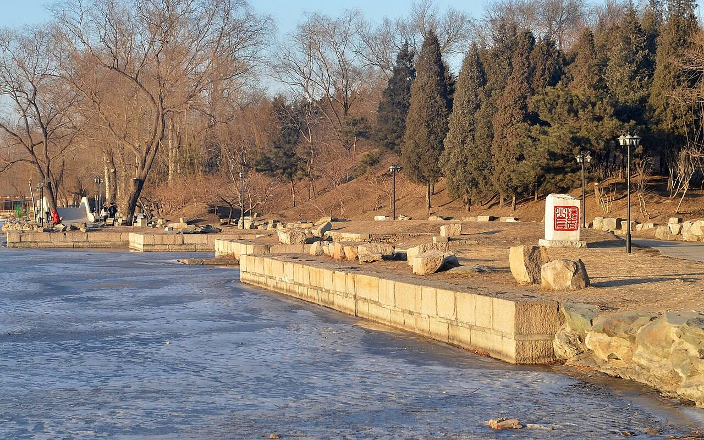

<!-- generated:start (scripts/building_pages.py): do not edit between these markers -->

# YM33: 接秀山房 Jiexiu Shanfang

The House Which Meets the Beauty of the Hills · Yuanming Yuan

**3D object:** 5 boxes. Open it: `/reconstruction/3d.html?b=YM33`

## What we know

- **Name:** 接秀山房 Jiexiu Shanfang (S05, S02, S08, S41, S51, S01, S361, S945 · confidence B)
- **English:** The House Which Meets the Beauty of the Hills (S05, S02, S08, S41, S51, S01, S361, S945)
- **Written on the plan:** 观澜堂 (S01 · confidence B)
- **Garden:** Yuanming Yuan (S05, S02, S08, S41, S51, S01, S361, S945)
- **Type:** scene (S05, S02, S08, S41, S51, S01, S361, S945 · confidence B)
- **Built:** 雍正时期 (S51); 1731 (S05, S02, S08, S41, S51, S01, S361, S945)
- **Changed:** 观鱼跃 replaced by 观澜堂 c. 1817 (S51); differs on plans (S41); Under Jiaqing a small court modelled on Yangzhou's 九峰园 was rebuilt as 观澜堂, then the largest three-roll hall in the gardens (S05, S02, S08, S41, S51, S01, S361, S945)
- **Destroyed:** 1860 (S05, S02, S08, S41, S51, S01, S361, S945)
- **Position:** 40.00687, 116.30149. S01 sure (S01 · confidence B)
- **Note:** Album does not show the 1860 state here (S41). (S05, S02, S08, S41, S51, S01, S361, S945)
- **Plan reader's note:** Plan names only 观澜堂; no 接秀山房 label. Malone 33 at (8020,3560). S111: after about 1817 the scene was in fact called 观澜堂. (S01) *(research copy, not public)*
- **How it was read:** sure (S01) *(research copy, not public)*
- **Plan pixels:** 8156, 3725 (S01) *(research copy, not public)*

## Our model now

5 boxes stand in this compound, 5 on blocks drawn on the plan, 0 assumed. Its halls are listed below.

## Inside it (11)

- YM33-01 接秀山房正宇
- YM33-02 琴趣轩
- YM33-03 寻云楼
- YM33-04 澄练楼
- YM33-05 怡然书屋
- YM33-06 安隐幢
- YM33-07 揽翠亭
- YM33-08 观澜堂
- YM33-B0629
- YM33-N01
- YM33-N02

## Pictures (7)

- **P0033** (sure): 接秀山房 Jiexiu shanfang [Hameau de montagne pour accueillir l'élégance] (圓明園四十景, 第33景) (1744 (BnF record: 1744年，清朝乾隆九年)). https://commons.wikimedia.org/wiki/File%3A%E5%9C%93%E6%98%8E%E5%9C%92%E5%9B%9B%E5%8D%81%E6%99%AF_-_%28%E6%B8%85%29%E5%94%90%E5%B2%B1%E3%80%81%E6%B2%88%E6%BA%90%E5%90%88%E7%95%AB_%3B_%28%E4%B9%BE%E9%9A%86%E5%90%9F%E8%AF%97%EF%BC%8C%E6%B1%AA%E7%94%B1%E6%95%A6%E4%BB%A3%E4%B9%A6%29_-_btv1b55008362z_%28100_of_124%29.jpg

  

- **P0093** (sure): 中国皇帝的宫殿与庙宇. 第34幅图, 接秀山房 - (清)孙祜、沈源Jiexiu shanfang - (Qing)Sun Hu, Shen Yuan (1745 (Commons, from the BnF record)). https://commons.wikimedia.org/wiki/File%3A%E4%B8%AD%E5%9B%BD%E7%9A%87%E5%B8%9D%E7%9A%84%E5%AE%AB%E6%AE%BF%E4%B8%8E%E5%BA%99%E5%AE%87._%E7%AC%AC34%E5%B9%85%E5%9B%BE%2C_%E6%8E%A5%E7%A7%80%E5%B1%B1%E6%88%BF_-_%28%E6%B8%85%29%E5%AD%99%E7%A5%9C%E3%80%81%E6%B2%88%E6%BA%90Jiexiu_shanfang_-_%28Qing%29Sun_Hu%2C_Shen_Yuan_-_btv1b105207026.jpg

  

- **P0116** (sure): 海淀(镇)：中国皇帝的行宫. 第16幅图, 接秀山房Jiexiu shanfang (1750-1792 (BnF, cb43831905b; ex coll. Bertin)). https://commons.wikimedia.org/wiki/File%3A%E6%B5%B7%E6%B7%80%28%E9%95%87%29%EF%BC%9A%E4%B8%AD%E5%9B%BD%E7%9A%87%E5%B8%9D%E7%9A%84%E8%A1%8C%E5%AE%AB._%E7%AC%AC16%E5%B9%85%E5%9B%BE%2C_%E6%8E%A5%E7%A7%80%E5%B1%B1%E6%88%BFJiexiu_shanfang_-_btv1b10520640k.jpg

  

- **P0264** (sure): 接秀山房 Jiexiu Shanfang (御製圓明園圖詠, 1887 石印本, 下卷 (Commons 卷二), 第33景; printed title in the right margin of the picture) (光緒十三年 1887 (Commons/NLC record; colophon 光緒十三年七月天津石印書屋 in the SSID copy, S98 PDF p.2); design after the woodblock of 1745 by 孫祜 Sun Hu and 沈源 Shen Yuan). https://commons.wikimedia.org/wiki/File%3ANLC403-312001107375-14034_%E7%A6%A6%E5%88%B6%E5%9C%93%E6%98%8E%E5%9C%92%E5%9C%96%E8%A9%A0_%E5%8D%B7%E4%BA%8C.pdf?page=44

  

- **P0540** (sure): 接秀山房 Jiexiu Shanfang: 乾隆 Qianlong's preface and poem with the courtiers' commentary, 御製圓明園圖詠 1887 (poem 1744 (乾隆九年); this printing 1887). https://commons.wikimedia.org/wiki/File%3ANLC403-312001107375-14034_%E7%A6%A6%E5%88%B6%E5%9C%93%E6%98%8E%E5%9C%92%E5%9C%96%E8%A9%A0_%E5%8D%B7%E4%BA%8C.pdf?page=45

  

- **P0388** (sure): 接秀山房遗址 20130201.JPG (2013-02-01 16:52:08 (Commons DateTimeOriginal)). https://commons.wikimedia.org/wiki/File:%E6%8E%A5%E7%A7%80%E5%B1%B1%E6%88%BF%E9%81%97%E5%9D%80_20130201.JPG

  

- **P0792** (likely): 雪趣 - Have Fun with Snow - 2012.12 - panoramio.jpg (Taken on 21 December 2012 (Commons file page)). https://commons.wikimedia.org/wiki/File:%E9%9B%AA%E8%B6%A3_-_Have_Fun_with_Snow_-_2012.12_-_panoramio.jpg

## Texts and drawings (29)

- **E1945** (poem, sure): 御製接秀山房詩（圓明園四十景詩）. 1744 (乾隆九年) · printed in S05 j82:18a-18b · S40. https://github.com/kanripo/KR2k0036/blob/master/KR2k0036_082.txt
  > 乾隆九年 御製接秀山房詩 平岡縈迴碧沚停蓄虛館閒閒境獨夷曠隔岸數峯逞秀朝嵐霏青返照添紫氣象萬千真目不給賞情不周玩也 烟霞供潤浥朝暮㸔適興户接西山秀窻臨北渚澄琴書吾所好松竹古之朋仿彿雲林衲攜笻共我豋
  Low ridges and a green-water pool make a quiet, open place. Across the water peaks show their beauty, blue-green at morning and purple at dusk, more than the eye can take in.
- **E1954** (text, sure): 日下舊聞考 接秀山房、福海. 1780s (乾隆 敕撰) · j82:17b-18a · S05. https://github.com/kanripo/KR2k0036/blob/master/KR2k0036_082.txt
  > 接秀山房在福海東隅正宇三楹西嚮後稍東為琴趣軒其北方樓為尋雲東南為澄練樓樓後為怡然書屋尋雲樓稍東佛室為安隠幢接秀山房之南為攬翠亭（圓明園册）臣等謹按接秀山房四十景之一與攬翠亭額皆世宗御書琴趣軒尋雲諸額皆皇上御書
  East of 福海: 接秀山房, three bays facing west, with 琴趣軒, the square tower 尋雲, 澄練樓, 怡然書屋, the Buddha room 安隠幢 and 攬翠亭.
- **E1946** (poem, sure): 接秀山房: 乾隆十八年 poem of the Qianlong Emperor. 乾隆十八年 (1753), date from the compilation · p.272 item (1), under 接秀山房 · S360. https://www.yuanmingyuanpark.cn/xs/yjbg/202007/P020200730387572832602.pdf#page=272
  > 雨足诸凡好，西山送秀来。爽真在襟袖，润直到根荄。圣日常悬照，薫风正阜财。徘徊瞻宝额，讶似过庭纔。
  Poem of the Qianlong Emperor at 接秀山房, 1753, on the view. Year as given by the compilation.
- **E1960** (poem, sure): 琴趣轩. 乾隆二十八年 (1763) · v3 p.2, under 接秀山房; source ref 8-676 · S361. https://www.yuanmingyuanpark.cn/xs/yjbg/202008/P020200803382569071850.pdf#page=5
  > 不学陶家弦亦无，底夸李氏宝称孤。暗泉滴处声同调，只有徵招意廑吾。
  Poem 琴趣轩 by the Qianlong Emperor, 1763, filed by the editors under 接秀山房.
- **E1962** (poem, sure): 题澄练楼. 乾隆二十八年 (1763) · v3 p.2, under 接秀山房; source ref 8-682 · S361. https://www.yuanmingyuanpark.cn/xs/yjbg/202008/P020200803382569071850.pdf#page=5
  > 湖上乘舟至，登楼更望湖。一层高位置，万象顿形殊。岂藉天孙织，分明少女铺。今朝宜有喜，喜在稻苗腴。
  Poem 题澄练楼 by the Qianlong Emperor, 1763, filed by the editors under 接秀山房.
- **E1964** (poem, sure): 怡然书屋偶题. 乾隆二十八年 (1763) · v3 p.2, under 接秀山房; source ref 8-673 · S361. https://www.yuanmingyuanpark.cn/xs/yjbg/202008/P020200803382569071850.pdf#page=5
  > 架是琳琅笥，床非玳瑁筵。识名探义府，玩象汲神渊。少暇惭茧纸，多愁忆麦田。甘膏渥盈尺，今日始怡然。
  Poem 怡然书屋偶题 by the Qianlong Emperor, 1763, filed by the editors under 接秀山房.
- **E1961** (poem, sure): 琴趣轩口号. 乾隆二十九年 (1764) · v3 p.3, under 接秀山房; source ref 8-747 · S361. https://www.yuanmingyuanpark.cn/xs/yjbg/202008/P020200803382569071850.pdf#page=6
  > 无弦亦不壁间悬，琴趣居然在目前。小矣高山流水志，企之解愠阜财篇。
  Poem 琴趣轩口号 by the Qianlong Emperor, 1764, filed by the editors under 接秀山房.
- **E1963** (poem, sure): 题澄练楼. 乾隆二十九年 (1764) · v3 p.3, under 接秀山房; source ref 8-775 · S361. https://www.yuanmingyuanpark.cn/xs/yjbg/202008/P020200803382569071850.pdf#page=6
  > 乘舟偶至临湖楼，不爱舟中爱楼上。于楼为静舟为动，一例澄湖披荡漾。是时春仲景方明，况当雨后波新涨。倒影花光漪浅纹，冰夷窃得天孙样，设如拟议浣纱溪，洗尽越吴机械障。
  Poem 题澄练楼 by the Qianlong Emperor, 1764, filed by the editors under 接秀山房.
- **E1965** (poem, sure): 怡然书屋. 乾隆二十九年 (1764) · v3 p.4, under 接秀山房; source ref 8-792 · S361. https://www.yuanmingyuanpark.cn/xs/yjbg/202008/P020200803382569071850.pdf#page=7
  > 好春倏度箭催弦，候入清和宜雨天。问我迩来心所托，即时膏澍始怡然。
  Poem 怡然书屋 by the Qianlong Emperor, 1764, filed by the editors under 接秀山房.
- **E1947** (poem, sure): 接秀山房: 嘉庆元年 poem of the Jiaqing Emperor. 嘉庆元年 (1796), date from the compilation · p.272 item (2), under 接秀山房 · S360. https://www.yuanmingyuanpark.cn/xs/yjbg/202007/P020200730387572832602.pdf#page=272
  > 山房得地崇，径曲巧相就。近览一湖清，遥接千峰秀。明霞衬疎林，秋高净宇宙。颢气下松风，翠影仍繁茂。极浦印征鸿，飞鸣问古堠。喜趁片时闲，看云出远岫。
  Poem of the Jiaqing Emperor at 接秀山房, 1796, on the view. Year as given by the compilation.
- **E1948** (poem, sure): 接秀山房. 嘉庆二年 (1797) · v3 p.7, under 接秀山房; source ref 1-229 · S361. https://www.yuanmingyuanpark.cn/xs/yjbg/202008/P020200803382569071850.pdf#page=10
  > 远接西山秀，晴空印翠螺。窗虚延列嶂，柳细荫平坡。梅雨期须继，花风信早过。抚时念耕作，农事近如何。
  Poem 接秀山房 by the Jiaqing Emperor, 1797, filed by the editors under 接秀山房.
- **E1949** (poem, sure): 接秀山房. 嘉庆二年 (1797) · v3 p.7, under 接秀山房; source ref 1-280 · S361. https://www.yuanmingyuanpark.cn/xs/yjbg/202008/P020200803382569071850.pdf#page=10
  > 山房舒眺景高爽，福海凭临印影峩。日映金波冲岸角，林飘锦叶下岩阿。遥辉绝壁翻红树，直接群峰滴翠螺。鼓棹还过前浦去，东篱花事问如何。
  Poem 接秀山房 by the Jiaqing Emperor, 1797, filed by the editors under 接秀山房.
- **E1950** (poem, sure): 接秀山房: 嘉庆三年 poem of the Jiaqing Emperor. 嘉庆三年 (1798), date from the compilation · p.272 item (4), under 接秀山房 · S360. https://www.yuanmingyuanpark.cn/xs/yjbg/202007/P020200730387572832602.pdf#page=272
  > 掩映西峰秀相接，山房高敞挹虚峦。冥冥花雾云边合，落落松风天半寒。霞绘三霄青嶂表，日烘五色翠崖端。游神八极归冲漠，漫挟飞仙驾彩鸾。
  Poem of the Jiaqing Emperor at 接秀山房, 1798. Year as given by the compilation.
- **E1951** (poem, sure): 观澜堂: 嘉庆二十四年 poem of the Jiaqing Emperor. 嘉庆二十四年 (1819), date from the compilation · p.272 item (1), under 观澜堂 · S360. https://www.yuanmingyuanpark.cn/xs/yjbg/202007/P020200730387572832602.pdf#page=272
  > 福海新波千顷宽， 堂开东岸对漪澜。金鳞映日轻霞漾，碧浪含风薄縠攒。和蔼韶光明远岫，微茫云影印遥滩。田功肇始仲春届，观我观民得大观。
  Poem of the Jiaqing Emperor at 观澜堂, 1819, on the view. Year as given by the compilation.
- **E1952** (poem, sure): 观澜堂: 嘉庆二十四年 poem of the Jiaqing Emperor. 嘉庆二十四年 (1819), date from the compilation · p.273 item (2), under 观澜堂 · S360. https://www.yuanmingyuanpark.cn/xs/yjbg/202007/P020200730387572832602.pdf#page=273
  > 八窗印晴晖，空明临碧沼。远岭写春霞，绮影绘天表。蓬岛水中央，金碧浮㵿渺。漪澜送暖飔，岸角迭环绕。昨岁驻渝关，沧溟观浩淼。心境养虚明，眼界随大小。
  Poem of the Jiaqing Emperor at 观澜堂, 1819, on the view. Year as given by the compilation.
- **E1966** (poem, sure): 观澜堂. 嘉庆二十四年 (1819) · v3 p.14, under 接秀山房; source ref 7-161 · S361. https://www.yuanmingyuanpark.cn/xs/yjbg/202008/P020200803382569071850.pdf#page=17
  > 冰奁雪沼映银澜，堂挹虚明欣畅观。北峙群峰印云素，西排列岫染霞丹。境开琼岛心源澈，春满瑶京画幅宽。徒倚回廊舒远目，东风料峭不知寒。
  Poem 观澜堂 by the Jiaqing Emperor, 1819, filed by the editors under 接秀山房.
- **E1967** (poem, sure): 观澜堂. 嘉庆二十四年 (1819) · v3 p.14, under 接秀山房; source ref 7-203 · S361. https://www.yuanmingyuanpark.cn/xs/yjbg/202008/P020200803382569071850.pdf#page=17
  > 堂临福海岸东偏，坐对晴澜得景全。远叠金鳞涵锦浪，平铺碧縠趁澄渊。霞烘遥渚涤余霭，风度繁林卷密烟。眼界无遮清旷极，又欣快澍润原田。
  Poem 观澜堂 by the Jiaqing Emperor, 1819, filed by the editors under 接秀山房.
- **E1953** (poem, sure): 观澜堂: 咸丰七年 poem of the Xianfeng Emperor. 咸丰七年 (1857), date from the compilation · p.274 item (13), under 观澜堂 · S360. https://www.yuanmingyuanpark.cn/xs/yjbg/202007/P020200730387572832602.pdf#page=274
  > 御苑东偏蓬岛南，山妆翠髻水拖蓝。连云远树分浓淡，点浪轻鸥见两三。鼓枻湖心波皛皛，停桡岸角柳毶毶。虚堂旷览足怡悦，霁景澄鲜上下含。
  Poem of the Xianfeng Emperor at 观澜堂, 1857, on boating. Year as given by the compilation.
- **E1874** (description, sure): Scenes 30, 31, 33, 36, 37: the shores of 福海. 1934 · p.93 · S02. https://archive.org/details/historyofpekings00malo
  > These scenes show scattered houses, pavilions, terraces, and bridges which occupied the narrow strip of shore and the surrounding hills on the north, east, and west of the Happy Sea.
  澡身浴德, 平湖秋月, 接秀山房, 涵虚朗鉴, 廓然大公: scattered houses, pavilions, terraces and bridges on the shore strip and hills north, east and west of 福海. Malone gives no more for these five.
- **E2366** (description, guess): Attiret: shores of 福海, aviaries and fish. 1743 · [pp.17-20] · S157. https://faculty.bard.edu/~louis/gardens/attiretaccount.html
  > It takes up a very large Space; and is all surrounded with a Lattice-work of Brass-wire: in which the Openings are so very fine and small, as to prevent the fish from wandering into the main waters.
  Quays of smooth stone or rock-work, terraces, palaces rising in tiers, groves of several kinds. Network houses half in the water for waterfowl, small menageries, and the largest fish reservoir, closed by brass wire. Which shore is not stated.
- **E1216** (description, sure): Site status table, about 2011: remains tidied up. c. 2011 · 系列06 repost, status table · S356. https://blog.sina.com.cn/s/blog_c27029650101itzz.html
  A blogger's table of what was then visible. These scenes have building remains that have been cleared and tidied. Dated about 2011, so digs since then are not reflected.
- **E2017** (description, sure): 老北京的记忆(125): 涵虚朗鉴 and 接秀山房, quoting 《圆明园百景图志》. 2017 · post 125 · S111. https://blog.sina.com.cn/s/blog_88741e0d0102x6gc.html
  Gives scene sizes and hall by hall measures: 涵虚朗鉴 200 x 60 m, 接秀山房 250 x 50 m. 接秀山房 became 观澜堂 in late Jiaqing. 1855 interior drawing at the NLC. Notes the names of the east-shore scenes were swapped around 1744, and that some modern plans mislabel the halls.
- **E2019** (description, sure): 圆明园福海东岸历史建筑方位考, 圆明园研究 78期. 2024-03-04 · xs/ktsb/202403/t20240304_4643616 · S338. https://www.yuanmingyuanpark.cn/xs/ktsb/202403/t20240304_4643616.html
  Shows that plans disagree on which hall is which along the east shore of 福海: the 1936 Beiping survey, the 1979 He and Zeng plan and the 2010 百景图志 each label differently. Checking Yangshi Lei drawings and texts against the sites, it reads the surviving bases north to south as 贻兰亭, 会心不远, 寻云榭, 惠如春, 雷峰夕照, 临众芳, 云锦墅, 观澜堂. It notes no scientific dig has been done here.
- **E1955** (description, sure): 圆明园百景史事分景汇编: 接秀山房. 1753-1798 · from p.272, under 接秀山房 · S360. https://www.yuanmingyuanpark.cn/xs/yjbg/202007/P020200730387572832602.pdf#page=272
  接秀山房: 4 dated items, 1753-1798, of which 4 poems (Qianlong, Jiaqing); recurring themes: the view. First dated 1753, last dated 1798.
- **E1956** (description, sure): 圆明园百景史事分景汇编: 观澜堂. 1819-1857 · from p.272, under 观澜堂 · S360. https://www.yuanmingyuanpark.cn/xs/yjbg/202007/P020200730387572832602.pdf#page=272
  The compiler says 观鱼跃 was pulled down about 1817 for a new south-facing hall of five bays in three rolls, like 慎德堂 and the largest on 福海. 观澜堂: 13 dated items, 1819-1857, of which 13 poems (Jiaqing, Daoguang, Xianfeng); recurring themes: the view, boating, rain. First dated 1819, last dated 1857.
- **E1957** (description, sure): 圆明园五朝御制诗文集注 v3, editors' note on 接秀山房. 2020 edition · v3 p.1 · S361. https://www.yuanmingyuanpark.cn/xs/yjbg/202008/P020200803382569071850.pdf#page=4
  Begun 1731 on the south-east shore of 福海, a three-bay west-facing hall, with 琴趣轩, 寻云楼, 云锦墅, 澄练楼, 怡然书屋 and 揽翠亭 under Qianlong. Late Jiaqing replaced the main hall with five bays in three rolls, 观澜堂. The editors say that hall survived 1860, Cixi came in 1898, and it was lost around 1900.
- **E1958** (drawing, sure): 观澜堂平面图. 咸丰五年 (1855) 八月初十日 · 国家图书馆善本部 样042-11-2号 · S310. https://www.mhymy.com/dasl/ysltd/6932.html
  Survey base plan of the Guanlan Tang hall dated 10th of the 8th month, 1855. No image here; the site may ask a small payment for the full record.
- **E0540** (drawing, sure): 圆明园河道泊岸总平面图. 乾隆四十至四十九年, 嘉庆八至十六年间局部修改 (dating on the record) · 国家图书馆善本部 样043-1号 · S310. https://www.mhymy.com/dasl/ysltd/9509.html
  Plan of Yuanming Yuan's waterways and embankments, c. 1775-84 with changes between 1803 and 1811, about 1:200, damaged in places, with a sketch of Zao Yuan in the lower right corner. No image here; the site may ask a small payment for the full record.
- **E1959** (drawing, sure): 《国家图书馆藏样式雷图档·圆明园卷初编》: 接秀山房. mostly 道光, 咸丰, 同治 per the publisher · 初编 目录: 接秀山房, pp.446-459 · S13. https://www.nlcpress.com/ProductView.aspx?Id=7642
  The printed facsimile of the National Library of China's Yangshi Lei sheets has a section on this place at pp.446-459 (14 pages, section length worked out from the next heading); sheet titles and numbers are in the volume, ordered from a library.

**On the plan:** Drawn on the plan of the gardens (S01), labelled 观澜堂. https://artmuseum.princeton.edu/collections/objects/138657

## Reconstructions by others (5)

Modern interpretation, not evidence.
- **R0073** (3D model, likely): 《圆明园四十景数字化复原及应用》. 圆明园管理处 with 中央美院, 圆明园管理处; 中央美术学院, 2025. https://news.bjd.com.cn/2026/10/16/11997513.shtml Research-only: link card.
- **R0002** (paper figure, likely): 三幅样式雷圆明园河道全图辨析: west road of 九洲清晏 after 1828. after 2024. http://iqh.ruc.edu.cn/old/qdhjylyjzx/xszl/jzys/59b83e20f7ab4840b746a6208a550939.htm Research-only: link card.
- **R0308** (paper figure, sure): 《圆明园新证》: reading of Palace Museum plan No. 1704, stripped of its later paste-ups to the Qianlong layout of about 1779. . http://iqh.ruc.edu.cn/old/qdhjylyjzx/xszl/xstl/1c9094aef4f041148f15883c7c266cb9.htm Research-only: link card.
- **R0309** (paper figure, sure): 《一幅样式雷圆明园全图的年代推断》: NLC plan 043-001 dated by the outlines of scenes. . http://iqh.ruc.edu.cn/old/qdhjylyjzx/xsdt/xsxl/794b73c241ef4fa79b8d6720f31bac13.htm Research-only: link card.
- **R0310** (paper figure, likely): 《“样式雷”图与圆明园》: survey of about 1700 Yangshi Lei plans, naming scenes changed after 1744. assumed: the author of 《圆明园变迁史探微》. http://iqh.ruc.edu.cn/old/qdhjylyjzx/xszl/ylfj/7c89633b1d0247b7bd91da2ff25c61f8.htm Research-only: link card.

## Evidence for the set of buildings

- Reconstructions and comparables for the whole garden, 圆明园 Yuanming Yuan: see GARDEN-YM

## Open questions

- Q1: Target state
- Q3: Which state does S01 draw?
- Q42: East shore of 福海
- Q89: YM33-08 观澜堂 (about 1817)
- Q94: YM09 and YM33
- Q99: Wolseley (S240), M'Ghee (S242), Loch (S244)
- Q106: Brief calls YM33 "观澜堂"
- Q118: YM33 接秀山房
- Q119: Digs
- Q129: The brief says the album views are roughly from the south

<!-- generated:end -->

## Notes

<!-- Yours: regeneration never touches this part. It goes on the public site; what you write below a line holding only %% private %% stays in the research copy. -->
