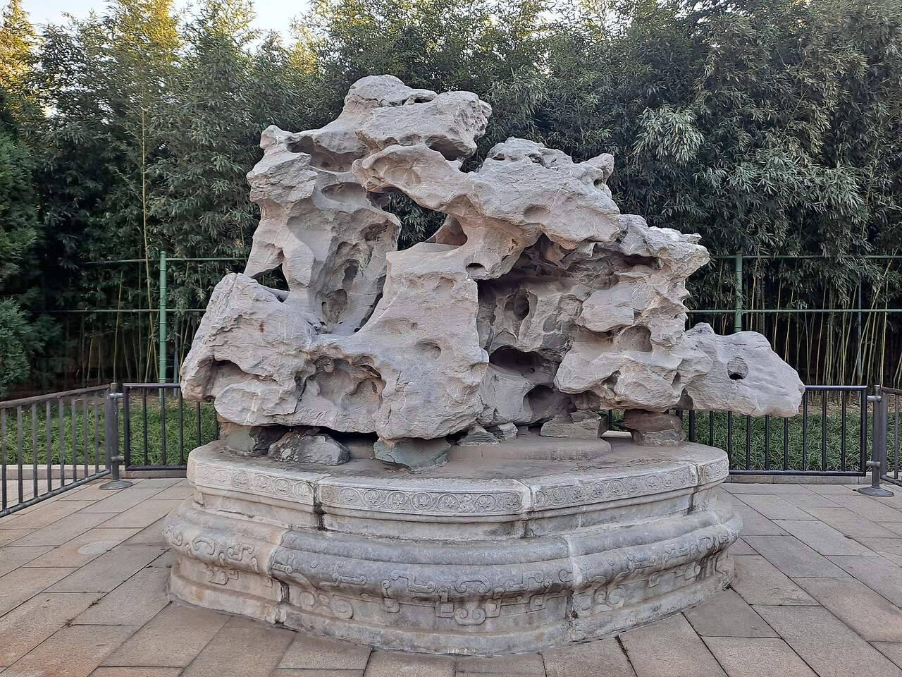

<!-- generated:start (scripts/building_pages.py): do not edit between these markers -->

# YM34-04: 时赏斋 Shishang Zhai

Yuanming Yuan

**3D object:** 1 box. Open it: `/reconstruction/3d.html?b=YM34-04`

**Part of:** YM34 别有洞天

## What we know

- **Name:** 时赏斋 Shishang Zhai (S05, S01, S111 · confidence B)
- **Garden:** Yuanming Yuan (S05, S01, S111)
- **Type:** other (S05, S01, S111 · confidence B)
- **Destroyed:** 1860 (S05, S01, S111)
- **Position:** 40.00593, 116.30092. S01 sure (S01 · confidence B)
- **Bays:** 3 in the texts / 2x1 on the plan (S05, S01, S111)
- **Size in the inventory:** 7.04 × 5.76 m. stated: S111, post 133 (S01)
- **Roof:** 卷棚硬山 (S05, S01, S111)
- **Plan reader's note:** Label inside a walled court, this hall north of it. Text: 阁西稍北. (S01) *(research copy, not public)*
- **How it was read:** sure (S01) *(research copy, not public)*
- **Plan pixels:** 7842, 4192 (S01) *(research copy, not public)*

## Our model now

On the block drawn on the Qing plan S01: position and frontage from the plan, heights and roof from the typology of its hall class, its form drawn by the hall kit. It will be updated as the research goes on.

- **Box:** 6.9 × 6.6 m, pavilion square
- **Heights:** platform 0.48 m, eave 3.68 m, ridge 6.75 m above the ground
- **Roof:** gable 硬山 or 悬山, rolled ridge 卷棚, grey tile
- **Faces:** 176.4° from north
- **Drawn:** by the hall kit: 3 bays, the middle widest, a porch front, steps on the front, 硬山 flush gable with a rolled ridge 卷棚, grey tile, a painted beam under the eave. From its own figures and readings where the dossier gives them (roof read: buildings.csv B), the rest from the typology of its hall class.
- **Confidence:** B

## Pictures (1)

- **P0491** (likely): Zhongshan Park, Beijing 13.jpg (2023-11-18 (Commons DateTimeOriginal)). https://commons.wikimedia.org/wiki/File:Zhongshan_Park,_Beijing_13.jpg

  

## Texts and drawings (4)

- **E1978** (text, sure): 日下舊聞考 别有洞天. 1780s (乾隆 敕撰) · j82:18b-19a · S05. https://github.com/kanripo/KR2k0036/blob/master/KR2k0036_082.txt
  > 接秀山房之南有敞宇北依山南臨河為别有洞天五楹西為納翠樓西南為水木清華之閣閣西稍北為時賞齋（圓明園册）臣等謹按别有洞天四十景之一額與納翠樓水木清華之閣諸額皆皇上御書
  South of 接秀山房, hill behind and stream before: the five-bay 别有洞天, with 納翠樓, 水木清華之閣 and 時賞齋.
- **E1991** (poem, likely): 时赏斋作歌. 乾隆三十一年 (1766) · v3 p.29, under 别有洞天; source ref 9-218 · S361. https://www.yuanmingyuanpark.cn/xs/yjbg/202008/P020200803382569071850.pdf#page=32
  > 一年惟四时，时各九十日。一日十二时，昼夜分半疾。丁丁莲漏无停声，积日为月积月年。又成及时行乐有，其语设如其语斯，非所无逸而凛旦。明旸时旸兮雨时雨，始得纾烦忧兮惬怀绪，时赏之意实在兹，讵曰珍禽奇卉罗庭宇。
  Poem 时赏斋作歌 by the Qianlong Emperor, 1766, filed by the editors under 别有洞天.
- **E1992** (poem, likely): 题时赏斋. 乾隆三十二年 (1767) · v3 p.29, under 别有洞天; source ref 9-266 · S361. https://www.yuanmingyuanpark.cn/xs/yjbg/202008/P020200803382569071850.pdf#page=32
  > 庶征有五要惟时，省岁殷勤念在兹。又用咸休协心赏，艰哉夫岂易言之。
  Poem 题时赏斋 by the Qianlong Emperor, 1767, filed by the editors under 别有洞天.
- **E1986** (description, sure): 老北京的记忆(133): 圆明园别有洞天遗址, quoting 《圆明园百景图志》. blog · post 133 · S111. https://blog.sina.com.cn/s/blog_88741e0d0102xbym.html
  Scene by scene history and sizes. 1751 main hall rebuilt as three linked rolls and 纳翠楼 added; about 1761 the west side redone after 保定 莲池书院, naming Qianlong's own note. 水木清华之阁 two storeys, 时赏斋 a raised hall. Second-hand: blog quoting 百景图志.

**On the plan:** Drawn on the plan of the gardens (S01), labelled 时赏斋, 2x1 cells. https://artmuseum.princeton.edu/collections/objects/138657

## Evidence for the set of buildings

- Evidence for the whole compound 别有洞天: see YM34
- Reconstructions and comparables for the whole garden, 圆明园 Yuanming Yuan: see GARDEN-YM
- Standing buildings comparable to a square pavilion (not this building): see CLASS-pavilion_square

## Open questions

None that name it.

<!-- generated:end -->

## Notes

<!-- Yours: regeneration never touches this part. It goes on the public site; what you write below a line holding only %% private %% stays in the research copy. -->
