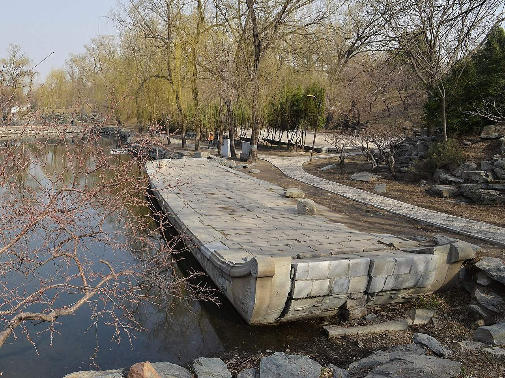

<!-- generated:start (scripts/building_pages.py): do not edit between these markers -->

# YM34-07: 石舫 Shi fang

Yuanming Yuan

**3D object:** 1 box. Open it: `/reconstruction/3d.html?b=YM34-07`

**Part of:** YM34 别有洞天

## What we know

- **Name:** 石舫 Shi fang (S06, S01 · confidence C)
- **Garden:** Yuanming Yuan (S06, S01)
- **Type:** other (S06, S01 · confidence C)
- **Destroyed:** 1860 (S06, S01)
- **Position:** 40.00561, 116.30196. S01 guess (S01 · confidence C)
- **Size in the inventory:** 9.6 × 9.1 m. S01 plan px / hall scale (S01)
- **Where the text puts it:** (S06) (S06, S01) *(research copy, not public)*
- **Plan reader's note:** 石舫 candidate: small boat-like outline. rect=30,40,0 (S01) *(research copy, not public)*
- **How it was read:** guess (S01) *(research copy, not public)*
- **Plan pixels:** 8255, 4395 (S01) *(research copy, not public)*

## Our model now

A plain box on the block drawn on the Qing plan S01: position and frontage from the plan, heights and roof from the typology of its hall class. It will be updated as the research goes on.

- **Box:** 9.6 × 9.1 m, small house
- **Heights:** platform 0.45 m, eave 3.2 m, ridge 6.32 m above the ground
- **Roof:** gable 硬山 or 悬山, rolled ridge 卷棚, grey tile
- **Faces:** 85.6° from north
- **Confidence:** C

## Pictures (1)

- **P0389** (sure): Bieyou Dongtian Marble Boat 20130323.jpg (2013-03-23 15:32:26 (Commons DateTimeOriginal)). https://commons.wikimedia.org/wiki/File:Bieyou_Dongtian_Marble_Boat_20130323.jpg

  

## Texts and drawings (0)

None of its own.

**On the plan:** Drawn on the plan of the gardens (S01) with no label: a building stood here, its name unknown. https://artmuseum.princeton.edu/collections/objects/138657

## Evidence for the set of buildings

- Evidence for the whole compound 别有洞天: see YM34
- Reconstructions and comparables for the whole garden, 圆明园 Yuanming Yuan: see GARDEN-YM
- Standing buildings comparable to a small house (not this building): see CLASS-small_house

**Searched and not found:** No text or drawing names it in 日下旧闻考 j80-82, the Qianlong poems on Kanripo, 養吉齋叢錄, Malone 1934, the witnesses of 1860, what search indexes show of the Yangshi Lei drawings.

## Open questions

None that name it.

<!-- generated:end -->

## Notes

<!-- Yours: regeneration never touches this part. It goes on the public site; what you write below a line holding only %% private %% stays in the research copy. -->
