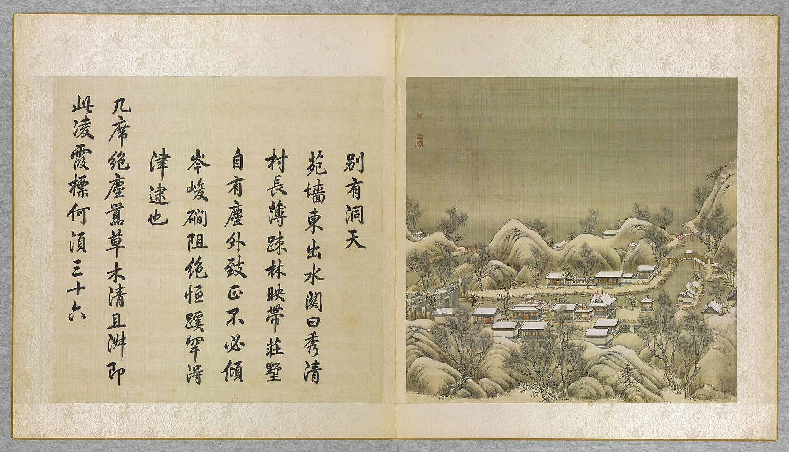
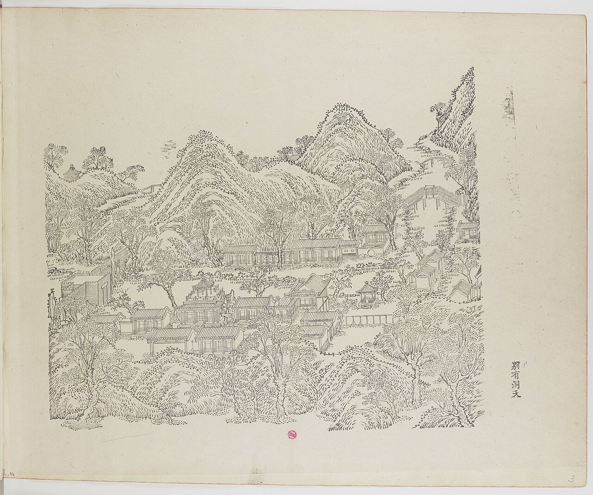
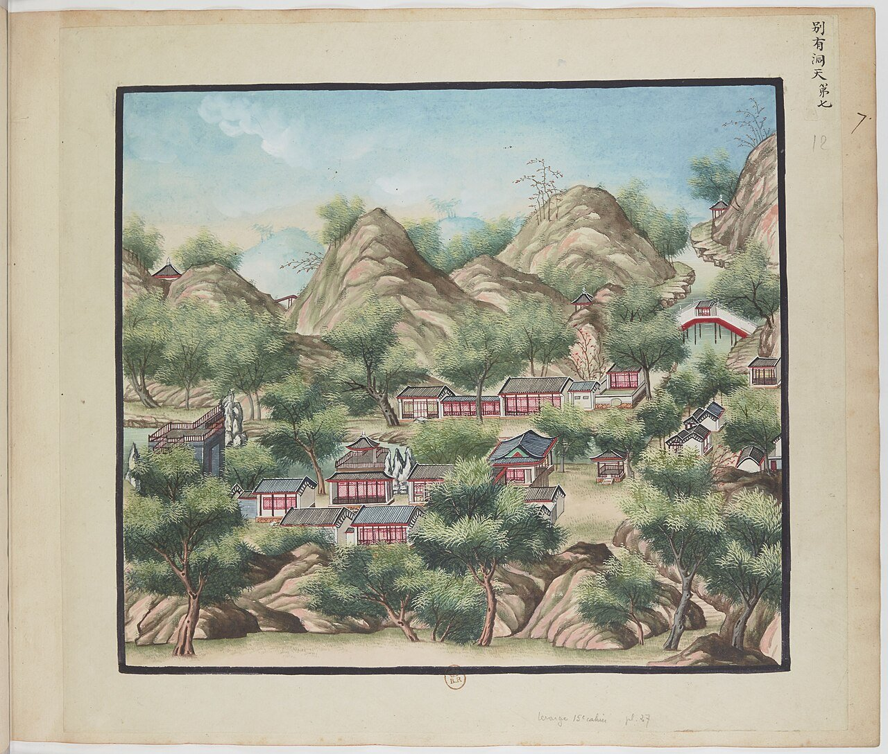
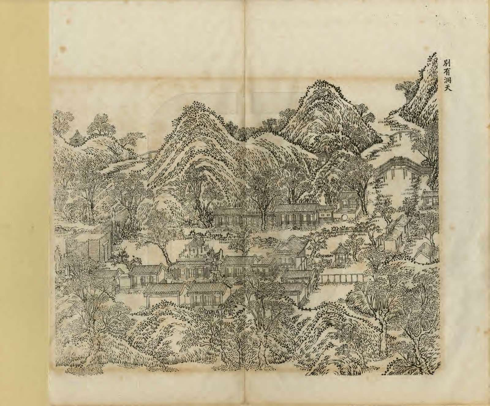
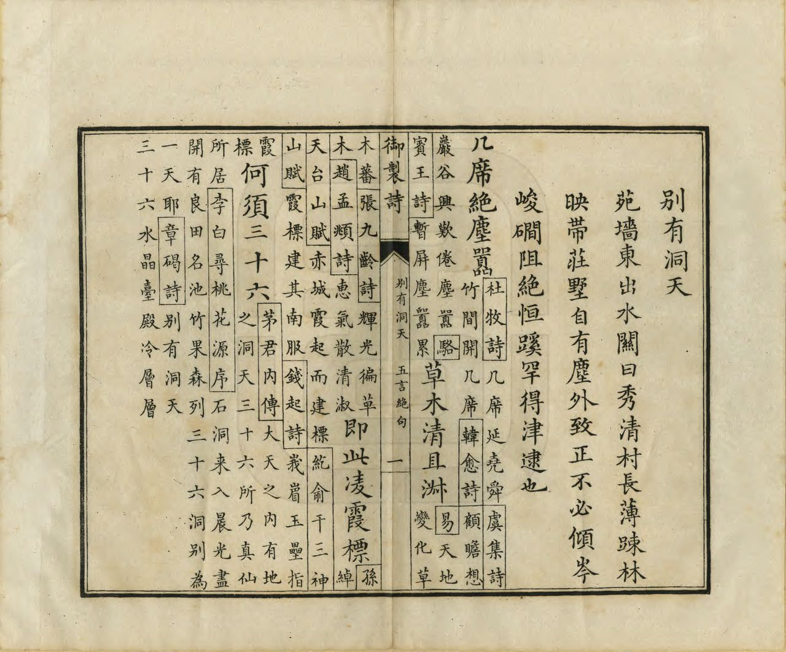
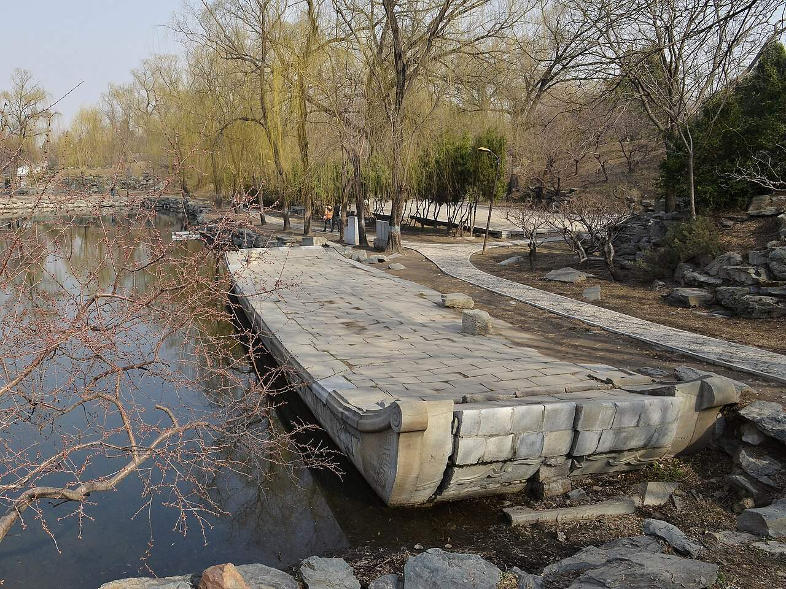
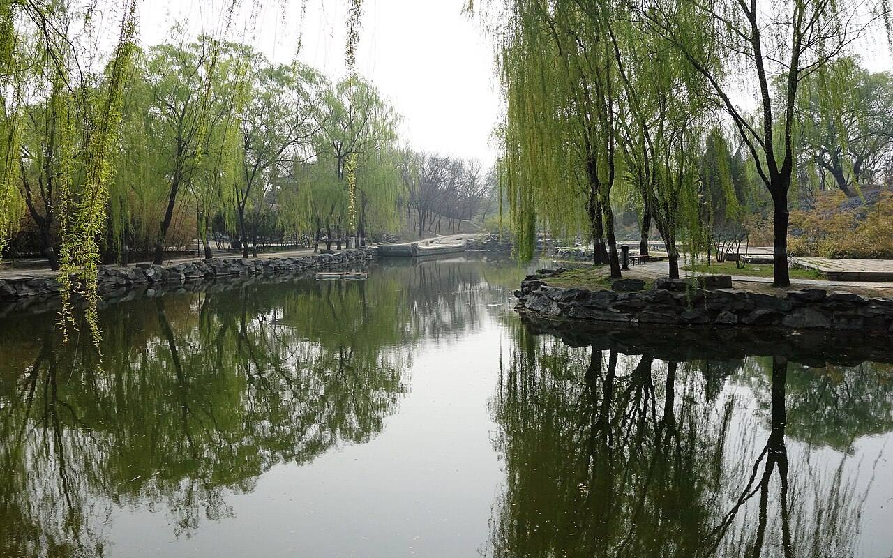
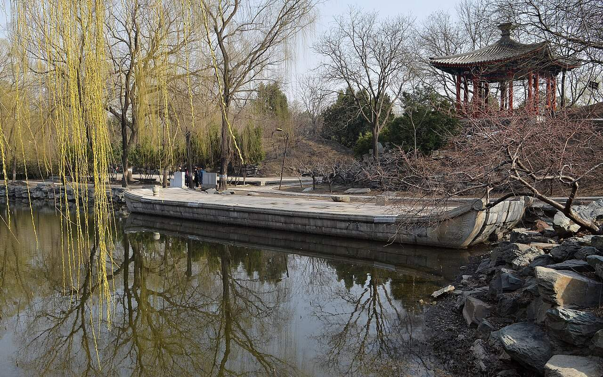
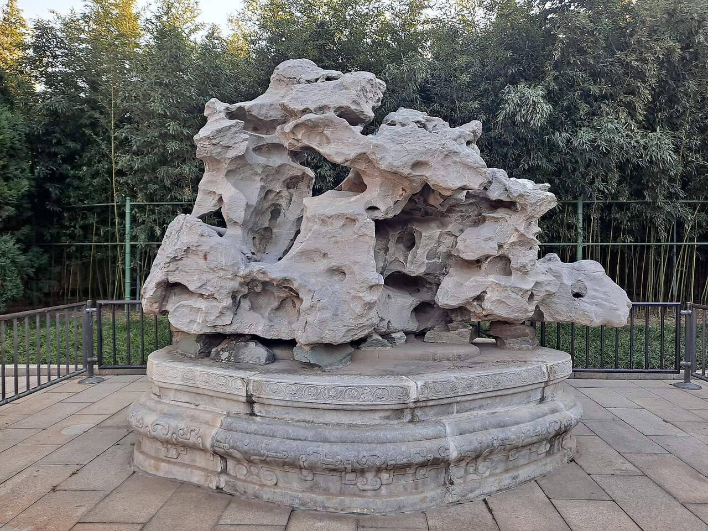

<!-- generated:start (scripts/building_pages.py): do not edit between these markers -->

# YM34: 别有洞天 Bieyou Dongtian

Pieh Yu Tung T'ien (There Is Another Cave of Heaven) · Yuanming Yuan

**3D object:** 22 boxes. Open it: `/reconstruction/3d.html?b=YM34`

## What we know

- **Name:** 别有洞天 Bieyou Dongtian (S05, S02, S08, S41, S51, S01 · confidence B)
- **English:** Pieh Yu Tung T'ien (There Is Another Cave of Heaven) (S05, S02, S08, S41, S51, S01)
- **Garden:** Yuanming Yuan (S05, S02, S08, S41, S51, S01)
- **Type:** scene (S05, S02, S08, S41, S51, S01 · confidence B)
- **Built:** 雍正时期, 初名秀清村 (S51) (S05, S02, S08, S41, S51, S01)
- **Changed:** Main hall rebuilt 3-span roof mid-Qianlong; 1761 west court (S51); differs on plans (S41) (S05, S02, S08, S41, S51, S01)
- **Destroyed:** 1860 (S05, S02, S08, S41, S51, S01)
- **Position:** 40.00599, 116.30139. S01 sure (S01 · confidence B)
- **Note:** Album does not show the 1860 state here (S41). (S05, S02, S08, S41, S51, S01)
- **Plan reader's note:** Label (8050,4220), Malone 34 at (8070,4310). Polygon covers the 秀清村 water gate and the whole south-east corner. (S01) *(research copy, not public)*
- **How it was read:** sure (S01) *(research copy, not public)*
- **Plan pixels:** 8038, 4180 (S01) *(research copy, not public)*

## Our model now

22 boxes stand in this compound, 22 on blocks drawn on the plan, 0 assumed. Its halls are listed below.

## Inside it (22)

- YM34-01 别有洞天殿
- YM34-02 纳翠楼
- YM34-03 水木清华之阁
- YM34-04 时赏斋
- YM34-05 秀清村
- YM34-06 城关 水关
- YM34-07 石舫
- YM34-AE013
- YM34-AE014
- YM34-B0750
- YM34-B0779
- YM34-B0780
- YM34-B0781
- YM34-B0782
- YM34-B0784
- YM34-B0785
- YM34-B0818
- YM34-B0819
- YM34-N01 涵碧亭
- YM34-N02 岩水澄华
- YM34-N03 ?漾楼
- YM34-N04 竹??山斋

## Pictures (9)

- **P0034** (sure): 別有洞天 Bieyou dongtian [Un autre univers] (圓明園四十景, 第34景) (1744 (BnF record: 1744年，清朝乾隆九年)). https://commons.wikimedia.org/wiki/File%3A%E5%9C%93%E6%98%8E%E5%9C%92%E5%9B%9B%E5%8D%81%E6%99%AF._%E7%AC%AC%E4%B8%89%E5%8D%81%E5%9B%9B%E6%99%AF_%28%E4%B8%8B%E5%86%8C%EF%BC%8C%E7%AC%AC%E5%8D%81%E5%9B%9B%E5%B9%85%E5%9B%BE%29%2C_%E5%88%A5%E6%9C%89%E6%B4%9E%E5%A4%A9_-_%28%E6%B8%85%29%E5%94%90%E5%B2%B1%E3%80%81%E6%B2%88%E6%BA%90%E5%90%88%E7%95%AB_%3B_%28%E4%B9%BE%E9%9A%86%E5%90%9F%E8%AF%97%EF%BC%8C%E6%B1%AA%E7%94%B1%E6%95%A6%E4%BB%A3%E4%B9%A6%29Bieyou_dongtian_-_%28Qing%29Tang_Dai%2C_Shen_Yuan_he_hua_-_btv1b550083498.jpg

  

- **P0063** (sure): 中国皇帝的宫殿与庙宇. 第3幅图, 别有洞天 - (清)孙祜、沈源Bieyou dongtian - (Qing)Sun Hu, Shen Yuan (1745 (Commons, from the BnF record)). https://commons.wikimedia.org/wiki/File%3A%E4%B8%AD%E5%9B%BD%E7%9A%87%E5%B8%9D%E7%9A%84%E5%AE%AB%E6%AE%BF%E4%B8%8E%E5%BA%99%E5%AE%87._%E7%AC%AC3%E5%B9%85%E5%9B%BE%2C_%E5%88%AB%E6%9C%89%E6%B4%9E%E5%A4%A9_-_%28%E6%B8%85%29%E5%AD%99%E7%A5%9C%E3%80%81%E6%B2%88%E6%BA%90Bieyou_dongtian_-_%28Qing%29Sun_Hu%2C_Shen_Yuan_-_btv1b10520703n.jpg

  

- **P0107** (sure): 海淀(镇)：中国皇帝的行宫. 第7幅图, 別有洞天Bieyou dongtian (1750-1792 (BnF, cb43831905b; ex coll. Bertin)). https://commons.wikimedia.org/wiki/File%3A%E6%B5%B7%E6%B7%80%28%E9%95%87%29%EF%BC%9A%E4%B8%AD%E5%9B%BD%E7%9A%87%E5%B8%9D%E7%9A%84%E8%A1%8C%E5%AE%AB._%E7%AC%AC7%E5%B9%85%E5%9B%BE%2C_%E5%88%A5%E6%9C%89%E6%B4%9E%E5%A4%A9Bieyou_dongtian_-_btv1b10520645t.jpg

  

- **P0265** (sure): 別有洞天 Bieyou Dongtian (御製圓明園圖詠, 1887 石印本, 下卷 (Commons 卷二), 第34景; printed title in the right margin of the picture) (光緒十三年 1887 (Commons/NLC record; colophon 光緒十三年七月天津石印書屋 in the SSID copy, S98 PDF p.2); design after the woodblock of 1745 by 孫祜 Sun Hu and 沈源 Shen Yuan). https://commons.wikimedia.org/wiki/File%3ANLC403-312001107375-14034_%E7%A6%A6%E5%88%B6%E5%9C%93%E6%98%8E%E5%9C%92%E5%9C%96%E8%A9%A0_%E5%8D%B7%E4%BA%8C.pdf?page=47

  

- **P0541** (sure): 別有洞天 Bieyou Dongtian: 乾隆 Qianlong's preface and poem with the courtiers' commentary, 御製圓明園圖詠 1887 (poem 1744 (乾隆九年); this printing 1887). https://commons.wikimedia.org/wiki/File%3ANLC403-312001107375-14034_%E7%A6%A6%E5%88%B6%E5%9C%93%E6%98%8E%E5%9C%92%E5%9C%96%E8%A9%A0_%E5%8D%B7%E4%BA%8C.pdf?page=48

  

- **P0389** (sure): Bieyou Dongtian Marble Boat 20130323.jpg (2013-03-23 15:32:26 (Commons DateTimeOriginal)). https://commons.wikimedia.org/wiki/File:Bieyou_Dongtian_Marble_Boat_20130323.jpg

  

- **P0390** (sure): Bieyou Dongtian 20130421.JPG (2013-04-21 15:00:12 (Commons DateTimeOriginal)). https://commons.wikimedia.org/wiki/File:Bieyou_Dongtian_20130421.JPG

  

- **P0456** (sure): Bieyou Dongtian 20130323.JPG (2013-03-23 15:39:01 (Commons DateTimeOriginal)). https://commons.wikimedia.org/wiki/File:Bieyou_Dongtian_20130323.JPG

  

- **P0491** (likely): Zhongshan Park, Beijing 13.jpg (2023-11-18 (Commons DateTimeOriginal)). https://commons.wikimedia.org/wiki/File:Zhongshan_Park,_Beijing_13.jpg

  

## Texts and drawings (29)

- **E1969** (poem, sure): 御製别有洞天詩（圓明園四十景詩）. 1744 (乾隆九年) · printed in S05 j82:19a-19b · S40. https://github.com/kanripo/KR2k0036/blob/master/KR2k0036_082.txt
  > 乾隆九年 御製别有洞天詩 苑牆東出水闗曰秀清村長薄疎林映帶莊墅自有塵外致正不必傾岑峻磵阻絶恒蹊罕得津逮也 几席絶塵囂草木清且淑即此凌霞標何須三十六
  Beyond the water gate on the east wall lies 秀清村, with thin woods and farmhouses. It has an air of being outside the world without the need for steep cliffs and blocked paths.
- **E1978** (text, sure): 日下舊聞考 别有洞天. 1780s (乾隆 敕撰) · j82:18b-19a · S05. https://github.com/kanripo/KR2k0036/blob/master/KR2k0036_082.txt
  > 接秀山房之南有敞宇北依山南臨河為别有洞天五楹西為納翠樓西南為水木清華之閣閣西稍北為時賞齋（圓明園册）臣等謹按别有洞天四十景之一額與納翠樓水木清華之閣諸額皆皇上御書
  South of 接秀山房, hill behind and stream before: the five-bay 别有洞天, with 納翠樓, 水木清華之閣 and 時賞齋.
- **E1970** (poem, sure): 延藻樓, 竹宻山齋. 乾隆二十七年 1762 · KR4f0005_187:13a (next to each other) · S201. https://github.com/kanripo/KR4f0005
  > 延藻樓……假山含峭蒨層室納烟雲……竹宻山齋……愛竹縁他君子節搆房疑此渭川濵
  Two consecutive poems of 1762, in a run on garden halls. S381 places both at 别有洞天. They settle the plan labels ?漾楼 and 竹??山斋.
- **E1968** (poem, sure): 别有洞天: 乾隆九年 poem of the Qianlong Emperor. 乾隆九年 (1744), date from the compilation · p.274 item (1), under 别有洞天 · S360. https://www.yuanmingyuanpark.cn/xs/yjbg/202007/P020200730387572832602.pdf#page=274
  > 几席绝尘嚣，草木清且淑。即此凌霞标，何须三十六
  Poem of the Qianlong Emperor at 别有洞天, 1744. Year as given by the compilation.
- **E1989** (poem, sure): 题纳翠楼. 乾隆二十四年 (1759) · v3 p.24, under 别有洞天; source ref 6-692 · S361. https://www.yuanmingyuanpark.cn/xs/yjbg/202008/P020200803382569071850.pdf#page=27
  > 楼名纳翠岂虚言，苑树虽凋松竹存。迩日雪中饶别致，绿琼天雨汞珠繁。
  Poem 题纳翠楼 by the Qianlong Emperor, 1759, filed by the editors under 别有洞天.
- **E1971** (poem, sure): 活画舫: 乾隆二十七年 poem of the Qianlong Emperor. 乾隆二十七年 (1762), date from the compilation · p.275 item (1), under 活画舫 · S360. https://www.yuanmingyuanpark.cn/xs/yjbg/202007/P020200730387572832602.pdf#page=275
  > 堂高廉远屋之常，近水廉卑偶学航。深广恰依欧永叔，沿洄何异米襄阳。春风秋月有真趣，波态烟容无定方。朅展石渠弃几暇，清河仿佛品题张。
  Poem of the Qianlong Emperor at 活画舫, 1762, on the view. Year as given by the compilation.
- **E1991** (poem, sure): 时赏斋作歌. 乾隆三十一年 (1766) · v3 p.29, under 别有洞天; source ref 9-218 · S361. https://www.yuanmingyuanpark.cn/xs/yjbg/202008/P020200803382569071850.pdf#page=32
  > 一年惟四时，时各九十日。一日十二时，昼夜分半疾。丁丁莲漏无停声，积日为月积月年。又成及时行乐有，其语设如其语斯，非所无逸而凛旦。明旸时旸兮雨时雨，始得纾烦忧兮惬怀绪，时赏之意实在兹，讵曰珍禽奇卉罗庭宇。
  Poem 时赏斋作歌 by the Qianlong Emperor, 1766, filed by the editors under 别有洞天.
- **E1992** (poem, sure): 题时赏斋. 乾隆三十二年 (1767) · v3 p.29, under 别有洞天; source ref 9-266 · S361. https://www.yuanmingyuanpark.cn/xs/yjbg/202008/P020200803382569071850.pdf#page=32
  > 庶征有五要惟时，省岁殷勤念在兹。又用咸休协心赏，艰哉夫岂易言之。
  Poem 题时赏斋 by the Qianlong Emperor, 1767, filed by the editors under 别有洞天.
- **E1990** (poem, sure): 水木清华之阁. 乾隆三十三年 (1768) · v3 p.30, under 别有洞天; source ref 9-409 · S361. https://www.yuanmingyuanpark.cn/xs/yjbg/202008/P020200803382569071850.pdf#page=33
  > 阁凭水木号清华，气味由来本一家。阳夏西池真足赏，简文濠濮岂须夸。
  Poem 水木清华之阁 by the Qianlong Emperor, 1768, filed by the editors under 别有洞天.
- **E1972** (poem, sure): 活画舫: 乾隆三十九年 poem of the Qianlong Emperor. 乾隆三十九年 (1774), date from the compilation · p.275 item (2), under 活画舫 · S360. https://www.yuanmingyuanpark.cn/xs/yjbg/202007/P020200730387572832602.pdf#page=275
  > 近水斋称活画舫，舣来冰岸却成孤。欲矜藏坞真舫者，可得平湖浮漾无。
  Poem of the Qianlong Emperor at 活画舫, 1774, on the view. Year as given by the compilation.
- **E1973** (poem, sure): 别有洞天. 嘉庆元年 (1796) · v3 p.38, under 别有洞天; source ref 1-116 · S361. https://www.yuanmingyuanpark.cn/xs/yjbg/202008/P020200803382569071850.pdf#page=41
  > 春日辉暖波，兰桡放遥岸。容与舟徐移，荡桨縠纹乱，溯洄过前溪，隐约有台观。堤柳绿渐披，山桃红始灿。转渚度小桥，境界欣乍换。水静镜开奁，山明云卷幔。仁智乐会心，芳时畅游衎。
  Poem 别有洞天 by the Jiaqing Emperor, 1796, filed by the editors under 别有洞天.
- **E1974** (poem, sure): 别有洞天: 嘉庆元年 poem of the Jiaqing Emperor. 嘉庆元年 (1796), date from the compilation · p.274 item (2), under 别有洞天 · S360. https://www.yuanmingyuanpark.cn/xs/yjbg/202007/P020200730387572832602.pdf#page=274
  > 水村山郭碧溪连，试放兰桡访洞天。石奏泉琴舟可接，岸开花幔径斜穿。波浮藻荇风漪叠，磴挂藤萝日影悬。几暇偶来问清景，所欣雨后意安便。
  Poem of the Jiaqing Emperor at 别有洞天, 1796, on boating and the view. Year as given by the compilation.
- **E1993** (poem, sure): 秀清村即景书怀. 嘉庆元年 (1796) · v3 p.38, under 别有洞天; source ref 1-110 · S361. https://www.yuanmingyuanpark.cn/xs/yjbg/202008/P020200803382569071850.pdf#page=41
  > 春山润而秀，春水澄且清。泽透景物丽，普遍卉木荣。风静尘不起，波影含空明。泛舟坐天上，俯仰多怡情。眺览见仁智，集虚鲜外营。四郊农务起，土润宜新耕。耤田欲将事，终亩偕公卿。勤勤始东作，切切望西成。游观聊寓目，民瘼中心萦。
  Poem 秀清村即景书怀 by the Jiaqing Emperor, 1796, filed by the editors under 别有洞天.
- **E1975** (poem, sure): 别有洞天. 嘉庆二年 (1797) · v3 p.39, under 别有洞天; source ref 1-281 · S361. https://www.yuanmingyuanpark.cn/xs/yjbg/202008/P020200803382569071850.pdf#page=42
  > 漫拟武陵境，缘溪路不遐。一池萦碧浪，三径遍黄花。地僻情欣适，冬初景益嘉。寻幽得胜概，还过竹廊斜。
  Poem 别有洞天 by the Jiaqing Emperor, 1797, filed by the editors under 别有洞天.
- **E1994** (poem, sure): 秀清村. 嘉庆二年 (1797) · v3 p.39, under 别有洞天; source ref 1-227 · S361. https://www.yuanmingyuanpark.cn/xs/yjbg/202008/P020200803382569071850.pdf#page=42
  > 近水楼台境秀清，满庭花木益敷荣。疏帘风静燕来睇，曲沼波新鸥结盟。柳扬长条汀畔舞，兰舒雅馥座前萦。授时最喜甘霖足，趁润郊原恰始耕。
  Poem 秀清村 by the Jiaqing Emperor, 1797, filed by the editors under 别有洞天.
- **E1976** (poem, sure): 活画舫: 嘉庆十六年 poem of the Jiaqing Emperor. 嘉庆十六年 (1811), date from the compilation · p.276 item (5), under 活画舫 · S360. https://www.yuanmingyuanpark.cn/xs/yjbg/202007/P020200730387572832602.pdf#page=276
  > 凿木为舟利涉川，象形石舫体弥坚。柔能载重妙相济，艮止坎流义理宣。不动刚坚如是观，中流砥柱定波澜。君犹舟也民犹水，作楫勉思盘石安。
  Poem of the Jiaqing Emperor at 活画舫, 1811, on the view. Year as given by the compilation.
- **E1977** (poem, sure): 别有洞天: 道光三年 poem of the Daoguang Emperor. 道光三年 (1823), date from the compilation · p.275 item (15), under 别有洞天 · S360. https://www.yuanmingyuanpark.cn/xs/yjbg/202007/P020200730387572832602.pdf#page=275
  > 云消气爽喜秋中，山崦花关一水通。别有洞天含秀古，非时卉木闲青红。轻飔飒爽穿虚阁，彩旭熹微映绮栊。徒倚回栏清兴惬，寒蛩唧唧聒幽丛。
  Poem of the Daoguang Emperor at 别有洞天, 1823, on the view. Year as given by the compilation.
- **E1981** (description, sure): Scene 34, 别有洞天 Bieyou Dongtian. 1934 · pp.93-94 · S02. https://archive.org/details/historyofpekings00malo
  > It led, as through a cave, to "another sky" and to a small lake surrounded by houses called Hsiu Ch'ing Ts'un, or Beautiful Pure Village.
  A fortified water gate over the stream behind the hill at the south-east corner of 福海, leading to a small lake and 秀清村 Xiuqing Cun.
- **E1216** (description, sure): Site status table, about 2011: remains tidied up. c. 2011 · 系列06 repost, status table · S356. https://blog.sina.com.cn/s/blog_c27029650101itzz.html
  A blogger's table of what was then visible. These scenes have building remains that have been cleared and tidied. Dated about 2011, so digs since then are not reflected.
- **E1982** (description, sure): 别有洞天: 竹密山斋, 延藻楼 and the list of plaques. 2018 blog, on the archive · section on the Xianfeng lists · S381. https://blog.sina.com.cn/s/blog_88741e0d0102xbym.html
  延藻楼: five-bay east-west building against the wall north-east of 竹密山斋, poem from 1762; gallery windows altered 1778. 竹密山斋 rebuilt 1791 with its east gallery. Xianfeng-era lists give 36 plaques here, half of them unknown earlier: this scene was much altered.
- **E1983** (description, sure): 岩水澄华. 2018 blog, on the archive · section 岩水澄华 · S381. https://blog.sina.com.cn/s/blog_88741e0d0102xbym.html
  Five-bay hall facing north with a three-bay porch; the area east and west of it was much rebuilt in late Qianlong or early Jiaqing; platform remains can be seen today on the blog's photographs.
- **E1985** (description, sure): “洞天福地”说与圆明园“别有洞天”之景观构造. post n.d. · lswh · S337. http://iqh.ruc.edu.cn/old/qdhjylyjzx/xszl/jzys/066054d32a674bd1a79ab3e01564cca5.htm
  Links 别有洞天 Bieyou Dongtian to Daoist cave-heaven ideas and to Yongzheng's alchemy here. 100 x 170 m, 2,050 m2 of buildings, the figures of 百景图志.
- **E1986** (description, sure): 老北京的记忆(133): 圆明园别有洞天遗址, quoting 《圆明园百景图志》. blog · post 133 · S111. https://blog.sina.com.cn/s/blog_88741e0d0102xbym.html
  Scene by scene history and sizes. 1751 main hall rebuilt as three linked rolls and 纳翠楼 added; about 1761 the west side redone after 保定 莲池书院, naming Qianlong's own note. 水木清华之阁 two storeys, 时赏斋 a raised hall. Second-hand: blog quoting 百景图志.
- **E1979** (description, sure): 圆明园百景史事分景汇编: 别有洞天. 1744-1823 · from p.274, under 别有洞天 · S360. https://www.yuanmingyuanpark.cn/xs/yjbg/202007/P020200730387572832602.pdf#page=274
  别有洞天: 15 dated items, 1744-1823, of which 15 poems (Qianlong, Jiaqing, Daoguang); recurring themes: the view, boating, escaping the heat. First dated 1744, last dated 1823.
- **E1980** (description, sure): 圆明园百景史事分景汇编: 活画舫. 1762-1811 · from p.275, under 别有洞天 · S360. https://www.yuanmingyuanpark.cn/xs/yjbg/202007/P020200730387572832602.pdf#page=275
  活画舫: 5 dated items, 1762-1811, of which 5 poems (Qianlong, Jiaqing); recurring themes: the view. First dated 1762, last dated 1811.
- **E1984** (description, sure): 圆明园五朝御制诗文集注 v3, editors' note on 别有洞天. 2020 edition · v3 p.23 · S361. https://www.yuanmingyuanpark.cn/xs/yjbg/202008/P020200803382569071850.pdf#page=26
  Begun under Yongzheng, a place of Daoist alchemy. Named halls: main hall five bays in three rolls, 纳翠楼, 水木清华之阁, 时赏斋 with the rock 青云片, the stone-boat 活画舫 of seven bays, 眺爽楼, 秀清村门 to 绮春园. Jiaqing added a five-bay 岩水澄华 and others on the south bank.
- **E1987** (drawing, sure): 《国家图书馆藏样式雷图档·圆明园卷初编》: 别有洞天. mostly 道光, 咸丰, 同治 per the publisher · 初编 目录: 别有洞天, pp.462-470 · S13. https://www.nlcpress.com/ProductView.aspx?Id=7642
  The printed facsimile of the National Library of China's Yangshi Lei sheets has a section on this place at pp.462-470 (9 pages, section length worked out from the next heading); sheet titles and numbers are in the volume, ordered from a library.
- **E1988** (drawing, sure, search index only): 别有洞天总平面图. 乾隆末期至嘉庆 · 清华大学建筑学院图书馆 T0063号 · S310. https://www.mhymy.com/dasl/ysltd/7546.html
  Overall plan of Bieyou Dongtian, late Qianlong to Jiaqing, 800x500 mm. No image here; the site may ask a small payment for the full record.
- **E2262** (plan, sure): 圆明园新证, 端木泓: dated additions shown on plan 1704. post n.d. · tables 1 and 2 · S337. http://iqh.ruc.edu.cn/old/qdhjylyjzx/xszl/xstl/1c9094aef4f041148f15883c7c266cb9.htm
  Tables of when things were added, drawn from archives to date the plan's layers: 藻园 1752, 廓然大公 eight views 1754, 春雨轩 1755, 藏密楼 1758, 多稼轩 ten views 1759, 紫碧山房 1760, 安澜园 and 澄练楼 1763, 若帆之阁 1764, 汇万总春之庙 1769, 文源阁 1775, 法源楼 1779; after: 兰亭八柱 1779, 知过堂 1782, 课农轩 1816, 涵月楼 1827. The most useful single dating table found.

**On the plan:** Drawn on the plan of the gardens (S01), labelled 别有洞天. https://artmuseum.princeton.edu/collections/objects/138657

## Open questions

- Q1: Target state
- Q9: Bay counts, plan against text
- Q45: Halls in the texts with no row

<!-- generated:end -->

## Notes

<!-- Yours: regeneration never touches this part. It goes on the public site; what you write below a line holding only %% private %% stays in the research copy. -->
