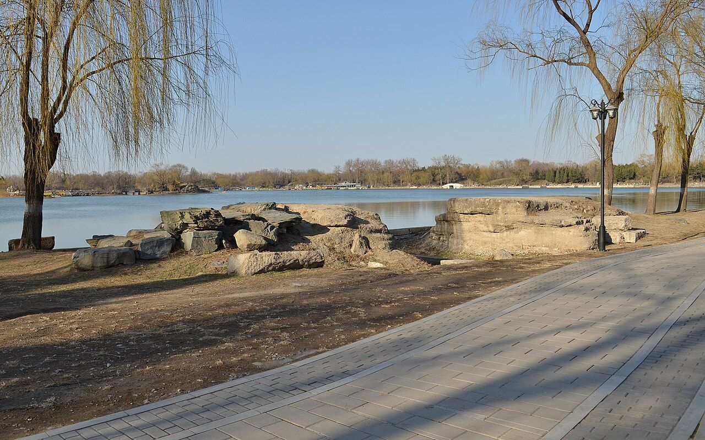

<!-- generated:start (scripts/building_pages.py): do not edit between these markers -->

# YM35-01: 夹镜鸣琴桥亭 Jiajing Mingqin qiaoting

Yuanming Yuan

**3D object:** none yet.

**Part of:** YM35 夹镜鸣琴

## What we know

- **Name:** 夹镜鸣琴桥亭 Jiajing Mingqin qiaoting (S05, S02, S41, S01 · confidence B)
- **Written on the plan:** 夹镜鸣琴 (S01 · confidence B)
- **Garden:** Yuanming Yuan (S05, S02, S41, S01)
- **Type:** bridge (S05, S02, S41, S01 · confidence B)
- **Destroyed:** 1860 (S05, S02, S41, S01)
- **Position:** 40.00563, 116.29822. S01 sure (S01 · confidence B)
- **Note:** Bridge with a pavilion; water falls from the hill behind (S02 p.94). (S05, S02, S41, S01)
- **Plan reader's note:** Pavilion on a bridge; text 虹桥 ... 杰阁. Label is south of it. (S01) *(research copy, not public)*
- **How it was read:** sure (S01) *(research copy, not public)*
- **Plan pixels:** 6715, 4200 (S01) *(research copy, not public)*

## Our model now

No box in the 3D view: the plan shows no building here, or a plot, water, a hill or a name only.

## Pictures (1)

- **P0391** (sure): 夹镜鸣琴遗址 20130324.JPG (2013-03-24 16:40:27 (Commons DateTimeOriginal)). https://commons.wikimedia.org/wiki/File:%E5%A4%B9%E9%95%9C%E9%B8%A3%E7%90%B4%E9%81%97%E5%9D%80_20130324.JPG

  

## Texts and drawings (3)

- **E1998** (text, sure): 日下舊聞考 夹镜鸣琴. 1780s (乾隆 敕撰) · j82:19b-20b · S05. https://github.com/kanripo/KR2k0036/blob/master/KR2k0036_082.txt
  > 别有洞天迤西為夾鏡鳴琴南為聚逺樓東為廣育宫前建坊座後為凝祥殿宫東為南屏晚鐘又東度橋為西山入畫為山容水態夾鏡鳴琴之西為湖山在望為佳山水為洞裏長春（圓圓明園册）臣等謹按夾鏡鳴琴四十景之一額為皇上御書廣育宫奉碧霞元君殿額曰恩光仁照與西山入畫湖山在望佳山水洞裏長春諸額皆世宗御書廣育宫前坊額曰含𢎞光大曰品物咸亨與凝祥殿南屏晩鐘諸額皆皇上御書凝祥殿聫曰茂育恩覃昭聖感資生徳溥配坤元亦御書
  West of 别有洞天: 夾鏡鳴琴, with 聚逺樓, 廣育宫 (to 碧霞元君) and its arch and 凝祥殿, 南屏晚鐘, 西山入畫, 山容水態, 湖山在望, 佳山水 and 洞裏長春.
- **E2006** (text, sure): 日下舊聞考: 夹镜鸣琴桥亭. 1780s (乾隆 敕撰) · j82:20b · S05. https://github.com/kanripo/KR2k0036
  > 架虹橋一道上搆傑閣
- **E1999** (description, sure): Scene 35, 夹镜鸣琴 Jiajing Mingqin. 1934 · p.94 · S02. https://archive.org/details/historyofpekings00malo
  > A deep well can still be found on the top of this hill where the water was drawn by workmen to supply the music of the waterfall.
  A pavilion on a bridge on the south side of 福海, overlooking water both ways, near a waterfall running down from a temple-crowned hill. A deep well on the hilltop, seen by Malone, supplied the fall by hand.

**On the plan:** Drawn on the plan of the gardens (S01), labelled 夹镜鸣琴. https://artmuseum.princeton.edu/collections/objects/138657

## Evidence for the set of buildings

- Evidence for the whole compound 夹镜鸣琴: see YM35
- Reconstructions and comparables for the whole garden, 圆明园 Yuanming Yuan: see GARDEN-YM

## Open questions

None that name it.

<!-- generated:end -->

## Notes

<!-- Yours: regeneration never touches this part. It goes on the public site; what you write below a line holding only %% private %% stays in the research copy. -->
