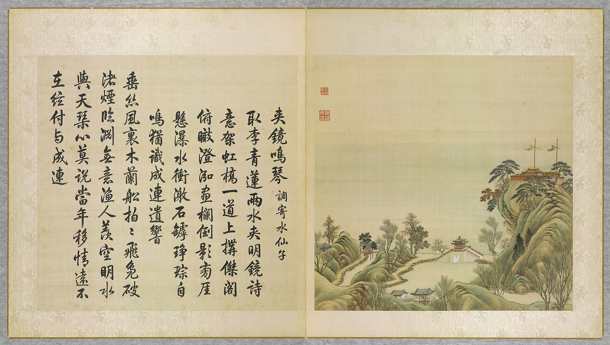

<!-- generated:start (scripts/building_pages.py): do not edit between these markers -->

# YM35-03: 广育宫 Guangyu Gong

Yuanming Yuan

**3D object:** 1 box. Open it: `/reconstruction/3d.html?b=YM35-03`

**Part of:** YM35 夹镜鸣琴

## What we know

- **Name:** 广育宫 Guangyu Gong (S05, S41, S43, S01, S08 · confidence B)
- **Garden:** Yuanming Yuan (S05, S41, S43, S01, S08)
- **Type:** temple (S05, S41, S43, S01, S08 · confidence B)
- **Destroyed:** 1860 (S05, S41, S43, S01, S08)
- **Position:** 40.00560, 116.29917. S01 sure (S01 · confidence B)
- **Bays:** 1x1 on the plan (S05, S41, S43, S01, S08)
- **Size in the inventory:** 16.3 × 4.2 m. S01 plan px / hall scale (S01)
- **Tiles:** yellow glazed (as painted on the leaf) (S05, S41, S43, S01, S08)
- **Note:** 碧霞元君. On a hill 8-9 m (S41). (S05, S41, S43, S01, S08)
- **Plan reader's note:** Label north of the gate A-ym_east-011. Faces the lake, N. After resize. (S01) *(research copy, not public)*
- **How it was read:** sure (S01) *(research copy, not public)*
- **Plan pixels:** 7108, 4274 (S01) *(research copy, not public)*

## Our model now

On the block drawn on the Qing plan S01: position and frontage from the plan, heights and roof from the typology of its hall class, its form drawn by the hall kit. It will be updated as the research goes on.

- **Box:** 16.3 × 4.2 m, main hall
- **Heights:** platform 0.7 m, eave 4.4 m, ridge 6.29 m above the ground
- **Roof:** hip-and-gable 歇山, rolled ridge 卷棚, glazed tile
- **Faces:** 353.3° from north
- **Drawn:** by the hall kit: 5 bays, the middle widest, steps on the back, front, 歇山 hip-and-gable with a rolled ridge 卷棚, glazed tile, a painted beam under the eave. Drawn from the typology of its hall class, not from a picture of this hall (assumed, C).
- **Confidence:** B

## Pictures (1)

- **P0035** (likely): 夾鏡鳴琴 Jiajing mingqin [Jouer de la cithare en serrant le miroir] (圓明園四十景, 第35景) (1744 (BnF record: 1744年，清朝乾隆九年)). https://commons.wikimedia.org/wiki/File%3A%E5%9C%93%E6%98%8E%E5%9C%92%E5%9B%9B%E5%8D%81%E6%99%AF_-_%28%E6%B8%85%29%E5%94%90%E5%B2%B1%E3%80%81%E6%B2%88%E6%BA%90%E5%90%88%E7%95%AB_%3B_%28%E4%B9%BE%E9%9A%86%E5%90%9F%E8%AF%97%EF%BC%8C%E6%B1%AA%E7%94%B1%E6%95%A6%E4%BB%A3%E4%B9%A6%29_-_btv1b55008362z_%28106_of_124%29.jpg

  

## Texts and drawings (4)

- **E1998** (text, sure): 日下舊聞考 夹镜鸣琴. 1780s (乾隆 敕撰) · j82:19b-20b · S05. https://github.com/kanripo/KR2k0036/blob/master/KR2k0036_082.txt
  > 别有洞天迤西為夾鏡鳴琴南為聚逺樓東為廣育宫前建坊座後為凝祥殿宫東為南屏晚鐘又東度橋為西山入畫為山容水態夾鏡鳴琴之西為湖山在望為佳山水為洞裏長春（圓圓明園册）臣等謹按夾鏡鳴琴四十景之一額為皇上御書廣育宫奉碧霞元君殿額曰恩光仁照與西山入畫湖山在望佳山水洞裏長春諸額皆世宗御書廣育宫前坊額曰含𢎞光大曰品物咸亨與凝祥殿南屏晩鐘諸額皆皇上御書凝祥殿聫曰茂育恩覃昭聖感資生徳溥配坤元亦御書
  West of 别有洞天: 夾鏡鳴琴, with 聚逺樓, 廣育宫 (to 碧霞元君) and its arch and 凝祥殿, 南屏晚鐘, 西山入畫, 山容水態, 湖山在望, 佳山水 and 洞裏長春.
- **E1999** (description, likely): Scene 35, 夹镜鸣琴 Jiajing Mingqin. 1934 · p.94 · S02. https://archive.org/details/historyofpekings00malo
  > A deep well can still be found on the top of this hill where the water was drawn by workmen to supply the music of the waterfall.
  A pavilion on a bridge on the south side of 福海, overlooking water both ways, near a waterfall running down from a temple-crowned hill. A deep well on the hilltop, seen by Malone, supplied the fall by hand.
- **E0499** (description, sure): 三类 形制, 山墙 红色 (S47 section 3). 2012, citing archive and Qing texts · pp.121-123 · S47. https://www.dpm.org.cn/Uploads/File/2018/06/15/u5b23730ae0e5a.pdf
  S47 sorts the shrines in three types by form and notes that on the album the gable walls of seven of them are painted red, against grey or white on other buildings: 瑞应宫, 太岁坛, the 杏花春馆 earth shrine, the 北远山村 and 涵虚朗鉴 dragon shrines, 广育宫 and 多宝阁. A colour rule usable for the models.
- **E2002** (description, sure): 广育宫 (S47 section 2.12). 2012, citing archive and Qing texts · p.115, 127; table row 21 · S47. https://www.dpm.org.cn/Uploads/File/2018/06/15/u5b23730ae0e5a.pdf
  On a hill east of 夹镜鸣琴, in pines, facing north in its own court: a pailou, gate hall and the three-bay hip-and-gable main hall 凝祥殿 with side halls. Yellow tile on the album, rare among the shrines. Its goddess 碧霞元君 was prayed to for children; palace women crossed 福海 by boat to it, and a 过皇会 was held nearby on her birthday.

**On the plan:** Drawn on the plan of the gardens (S01), labelled 广育宫, 1x1 cells. https://artmuseum.princeton.edu/collections/objects/138657

## Reconstructions by others (1)

Modern interpretation, not evidence.
- **R0073** (3D model, sure): 《圆明园四十景数字化复原及应用》. 圆明园管理处 with 中央美院, 圆明园管理处; 中央美术学院, 2025. https://news.bjd.com.cn/2026/10/16/11997513.shtml Research-only: link card.

## Evidence for the set of buildings

- Evidence for the whole compound 夹镜鸣琴: see YM35
- Reconstructions and comparables for the whole garden, 圆明园 Yuanming Yuan: see GARDEN-YM
- Standing buildings comparable to a main hall (not this building): see CLASS-main_hall

## Open questions

None that name it.

<!-- generated:end -->

## Notes

<!-- Yours: regeneration never touches this part. It goes on the public site; what you write below a line holding only %% private %% stays in the research copy. -->
