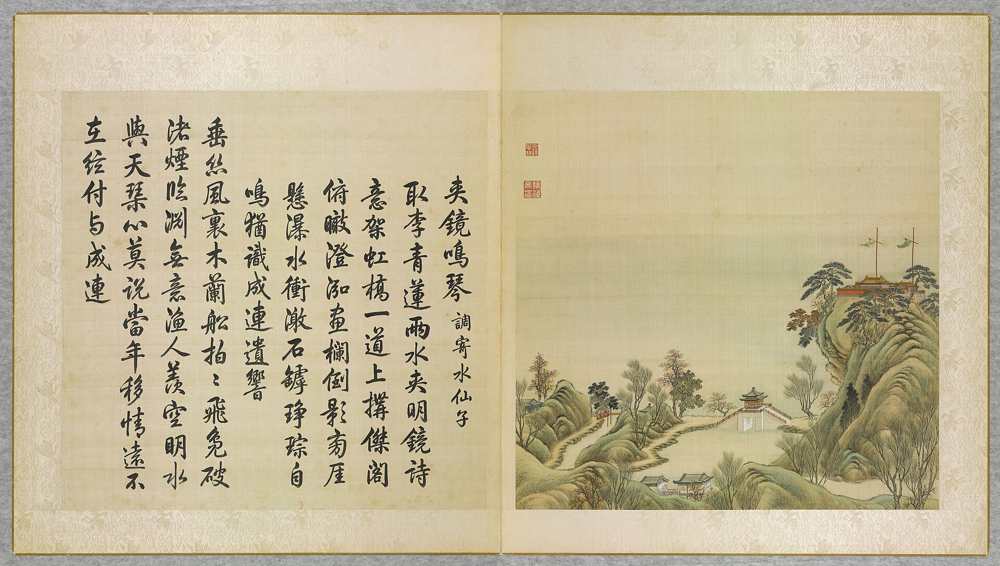
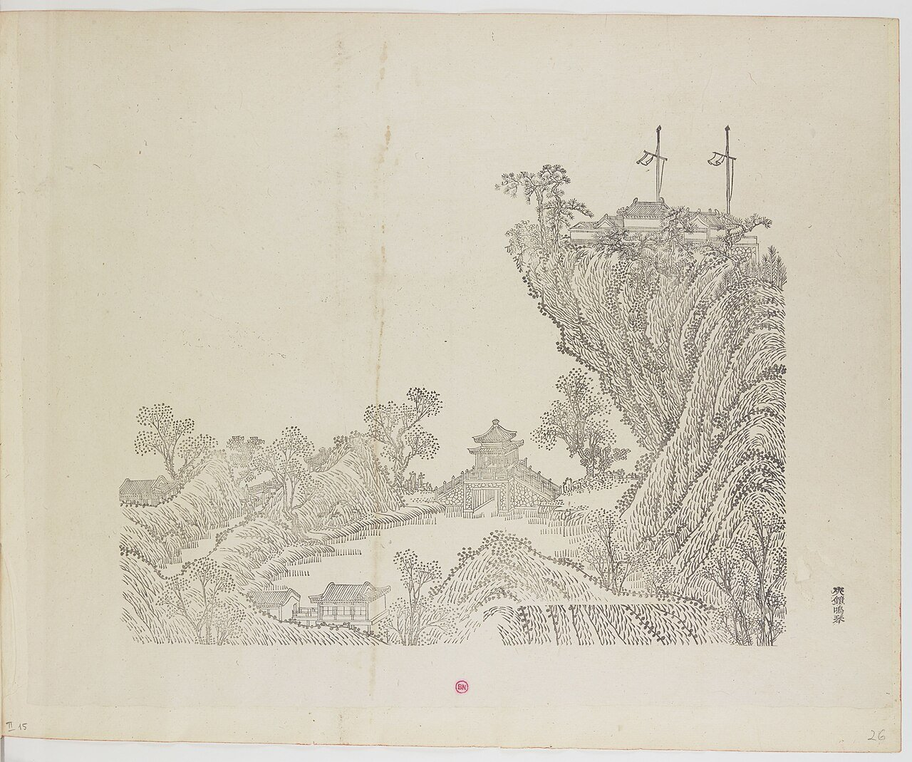
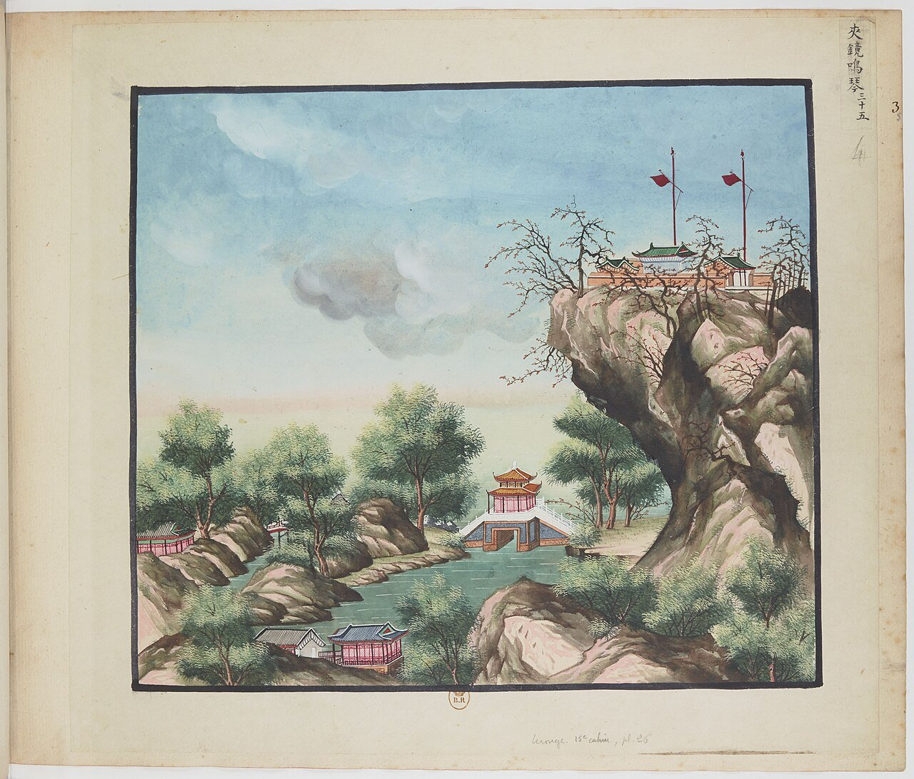
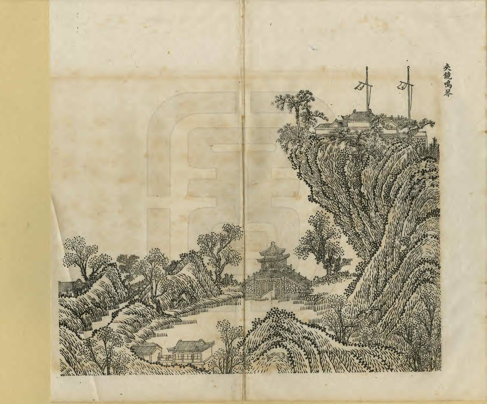
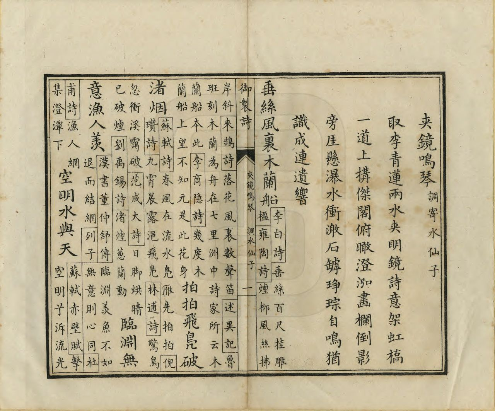
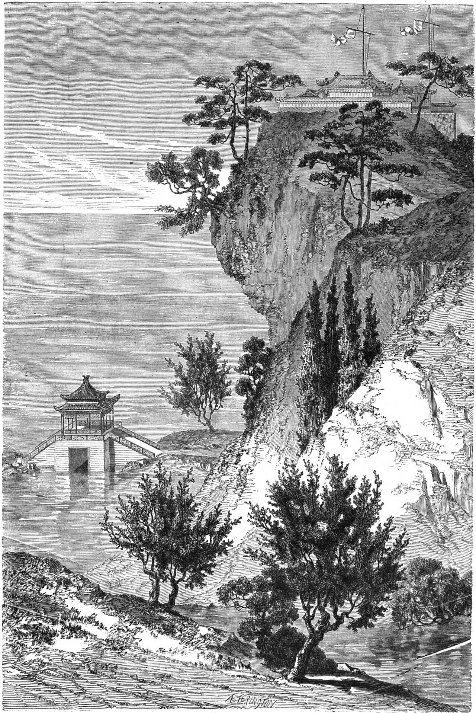
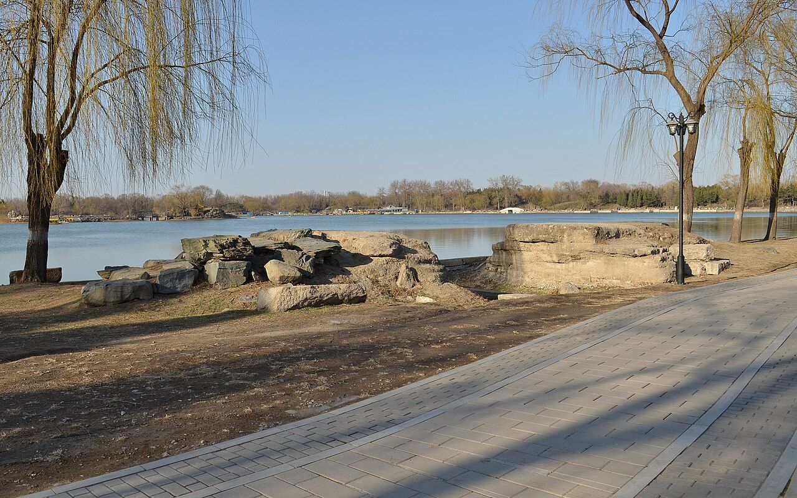

<!-- generated:start (scripts/building_pages.py): do not edit between these markers -->

# YM35: 夹镜鸣琴 Jiajing Mingqin

Chia Ching Ming Ch'in (The Double Mirror and the Sound of the Lute) · Yuanming Yuan

**3D object:** 11 boxes. Open it: `/reconstruction/3d.html?b=YM35`

## What we know

- **Name:** 夹镜鸣琴 Jiajing Mingqin (S05, S02, S08, S43, S01, S361, S310 · confidence A)
- **English:** Chia Ching Ming Ch'in (The Double Mirror and the Sound of the Lute) (S05, S02, S08, S43, S01, S361, S310)
- **Garden:** Yuanming Yuan (S05, S02, S08, S43, S01, S361, S310)
- **Type:** scene (S05, S02, S08, S43, S01, S361, S310 · confidence A)
- **Built:** 雍正朝 (S43); Yongzheng (S05, S02, S08, S43, S01, S361, S310)
- **Changed:** c. 道光十年 (1830): the natural-rock south shore of 福海 replaced by dressed-stone revetment, 463.36 m long, 2.24 m high above the base slab (one 浆板, four courses of large blocks, one cap course); three pavilions in the east rebuilt at the same time (S05, S02, S08, S43, S01, S361, S310)
- **Destroyed:** 1860 (S05, S02, S08, S43, S01, S361, S310)
- **Position:** 40.00563, 116.29821. S01 sure (S01 · confidence B)
- **Plan reader's note:** Label (6710,4290), Malone 35 at (6775,4085). South shore of Fuhai from 湖山在望 to 南屏晚钟. (S01) *(research copy, not public)*
- **How it was read:** sure (S01) *(research copy, not public)*
- **Plan pixels:** 6715, 4200 (S01) *(research copy, not public)*

## Our model now

11 boxes stand in this compound, 10 on blocks drawn on the plan, 1 assumed. Its halls are listed below.

## Inside it (15)

- YM35-01 夹镜鸣琴桥亭
- YM35-02 聚远楼
- YM35-03 广育宫
- YM35-04 广育宫坊
- YM35-05 凝祥殿
- YM35-06 南屏晚钟
- YM35-07 西山入画
- YM35-08 山容水态
- YM35-09 湖山在望
- YM35-10 佳山水
- YM35-11 洞里长春
- YM35-AE011
- YM35-B0759
- YM35-B0761
- YM35-N01 一碧万顷

## Pictures (7)

- **P0035** (sure): 夾鏡鳴琴 Jiajing mingqin [Jouer de la cithare en serrant le miroir] (圓明園四十景, 第35景) (1744 (BnF record: 1744年，清朝乾隆九年)). https://commons.wikimedia.org/wiki/File%3A%E5%9C%93%E6%98%8E%E5%9C%92%E5%9B%9B%E5%8D%81%E6%99%AF_-_%28%E6%B8%85%29%E5%94%90%E5%B2%B1%E3%80%81%E6%B2%88%E6%BA%90%E5%90%88%E7%95%AB_%3B_%28%E4%B9%BE%E9%9A%86%E5%90%9F%E8%AF%97%EF%BC%8C%E6%B1%AA%E7%94%B1%E6%95%A6%E4%BB%A3%E4%B9%A6%29_-_btv1b55008362z_%28106_of_124%29.jpg

  

- **P0086** (sure): 中国皇帝的宫殿与庙宇. 第26幅图, 夾鏡鳴琴 - (清)孙祜、沈源Jiajing mingqin - (Qing)Sun Hu, Shen Yuan (1745 (Commons, from the BnF record)). https://commons.wikimedia.org/wiki/File%3A%E4%B8%AD%E5%9B%BD%E7%9A%87%E5%B8%9D%E7%9A%84%E5%AE%AB%E6%AE%BF%E4%B8%8E%E5%BA%99%E5%AE%87._%E7%AC%AC26%E5%B9%85%E5%9B%BE%2C_%E5%A4%BE%E9%8F%A1%E9%B3%B4%E7%90%B4_-_%28%E6%B8%85%29%E5%AD%99%E7%A5%9C%E3%80%81%E6%B2%88%E6%BA%90Jiajing_mingqin_-_%28Qing%29Sun_Hu%2C_Shen_Yuan_-_btv1b10520710q.jpg

  

- **P0135** (sure): 海淀(镇)：中国皇帝的行宫. 第35幅图, 夾鏡鳴琴Jiajing mingqin (1750-1792 (BnF, cb43831905b; ex coll. Bertin)). https://commons.wikimedia.org/wiki/File%3A%E6%B5%B7%E6%B7%80%28%E9%95%87%29%EF%BC%9A%E4%B8%AD%E5%9B%BD%E7%9A%87%E5%B8%9D%E7%9A%84%E8%A1%8C%E5%AE%AB._%E7%AC%AC35%E5%B9%85%E5%9B%BE%2C_%E5%A4%BE%E9%8F%A1%E9%B3%B4%E7%90%B4Jiajing_mingqin_-_btv1b10520643x.jpg

  

- **P0266** (sure): 夾鏡鳴琴 Jiajing Mingqin (御製圓明園圖詠, 1887 石印本, 下卷 (Commons 卷二), 第35景; printed title in the right margin of the picture) (光緒十三年 1887 (Commons/NLC record; colophon 光緒十三年七月天津石印書屋 in the SSID copy, S98 PDF p.2); design after the woodblock of 1745 by 孫祜 Sun Hu and 沈源 Shen Yuan). https://commons.wikimedia.org/wiki/File%3ANLC403-312001107375-14034_%E7%A6%A6%E5%88%B6%E5%9C%93%E6%98%8E%E5%9C%92%E5%9C%96%E8%A9%A0_%E5%8D%B7%E4%BA%8C.pdf?page=49

  

- **P0542** (sure): 夾鏡鳴琴 Jiajing Mingqin: 乾隆 Qianlong's preface and poem with the courtiers' commentary, 御製圓明園圖詠 1887 (poem 1744 (乾隆九年); this printing 1887). https://commons.wikimedia.org/wiki/File%3ANLC403-312001107375-14034_%E7%A6%A6%E5%88%B6%E5%9C%93%E6%98%8E%E5%9C%92%E5%9C%96%E8%A9%A0_%E5%8D%B7%E4%BA%8C.pdf?page=50

  

- **P0147** (likely): Le Tour du monde 10: The Palace of Meditation, p. 107 (1 July 1864 (Commons)). https://commons.wikimedia.org/wiki/File%3ALe_Tour_du_monde-10-p107.jpg

  

- **P0391** (sure): 夹镜鸣琴遗址 20130324.JPG (2013-03-24 16:40:27 (Commons DateTimeOriginal)). https://commons.wikimedia.org/wiki/File:%E5%A4%B9%E9%95%9C%E9%B8%A3%E7%90%B4%E9%81%97%E5%9D%80_20130324.JPG

  

## Texts and drawings (11)

- **E1997** (poem, sure): 御製夾鏡鳴琴詞（調寄水仙子）（圓明園四十景詩）. 1744 (乾隆九年) · printed in S05 j82:20b-21a · S40. https://github.com/kanripo/KR2k0036/blob/master/KR2k0036_082.txt
  > 乾隆九年 御製夾鏡鳴琴詞（調寄水仙子） 取李青蓮兩水夾明鏡詩意架虹橋一道上搆傑閣俯瞰澄泓畫欄倒影旁厓懸瀑水衝激石罅琤琮自鳴猶識成連遺響 垂絲風裏木蘭船拍拍飛鳬破渚煙臨淵無意漁人羡空明水與天　琴心莫説當年移情逺不在絃付與成連
  After 李白's line on two waters holding a bright mirror: an arched bridge with a tall pavilion looks down on clear water. A cascade from the cliff beside rings on the rock, and he recalls the music of 成連.
- **E1998** (text, sure): 日下舊聞考 夹镜鸣琴. 1780s (乾隆 敕撰) · j82:19b-20b · S05. https://github.com/kanripo/KR2k0036/blob/master/KR2k0036_082.txt
  > 别有洞天迤西為夾鏡鳴琴南為聚逺樓東為廣育宫前建坊座後為凝祥殿宫東為南屏晚鐘又東度橋為西山入畫為山容水態夾鏡鳴琴之西為湖山在望為佳山水為洞裏長春（圓圓明園册）臣等謹按夾鏡鳴琴四十景之一額為皇上御書廣育宫奉碧霞元君殿額曰恩光仁照與西山入畫湖山在望佳山水洞裏長春諸額皆世宗御書廣育宫前坊額曰含𢎞光大曰品物咸亨與凝祥殿南屏晩鐘諸額皆皇上御書凝祥殿聫曰茂育恩覃昭聖感資生徳溥配坤元亦御書
  West of 别有洞天: 夾鏡鳴琴, with 聚逺樓, 廣育宫 (to 碧霞元君) and its arch and 凝祥殿, 南屏晚鐘, 西山入畫, 山容水態, 湖山在望, 佳山水 and 洞裏長春.
- **E2007** (poem, sure): 湖山在望. 嘉庆元年 (1796) · v3 p.57, under 夹镜鸣琴; source ref 1-178 · S361. https://www.yuanmingyuanpark.cn/xs/yjbg/202008/P020200803382569071850.pdf#page=60
  > 草亭虚敞近湖滨，旷览澄潭玉镜陈。山影印川晴旭叠，波光罨画晚风皴。白云几缕萦峰额，红叶一林绘岸漘。福地豫游蒙圣泽，仙寰驻景小阳春。
  Poem 湖山在望 by the Jiaqing Emperor, 1796, filed by the editors under 夹镜鸣琴.
- **E2008** (poem, sure): 湖山在望. 嘉庆二年 (1797) · v3 p.58, under 夹镜鸣琴; source ref 1-238 · S361. https://www.yuanmingyuanpark.cn/xs/yjbg/202008/P020200803382569071850.pdf#page=61
  > 南北界湖山向背，傍汀移棹境全更。目谋心赏奚同异，有触成因幻想生。山色如如原不动，水含叠叠浪花催。何虚何实强分别，过眼烟云是本来。
  Poem 湖山在望 by the Jiaqing Emperor, 1797, filed by the editors under 夹镜鸣琴.
- **E1999** (description, sure): Scene 35, 夹镜鸣琴 Jiajing Mingqin. 1934 · p.94 · S02. https://archive.org/details/historyofpekings00malo
  > A deep well can still be found on the top of this hill where the water was drawn by workmen to supply the music of the waterfall.
  A pavilion on a bridge on the south side of 福海, overlooking water both ways, near a waterfall running down from a temple-crowned hill. A deep well on the hilltop, seen by Malone, supplied the fall by hand.
- **E2000** (description, sure): Site status table, about 2011: scattered remains only. c. 2011 · 系列06 repost, status table · S356. https://blog.sina.com.cn/s/blog_c27029650101itzz.html
  Scenes with only scattered, incomplete building remains in the same table. 方壶胜境 is listed separately as the one with fairly complete remains not yet tidied up. 紫碧山房, 舍卫城 and 如园 have been dug since.
- **E2001** (description, sure): 夹镜鸣琴; 平湖秋月, yaffin 系列11. c. 2011 · scenes 31, 35 · S356. https://blog.sina.com.cn/s/blog_65fec3ab0100svoj.html
  Lead: 夹镜鸣琴, 4,000 m2, south shore of 福海, Yongzheng date, from a Li Bai line on two waters and twin bridges. 平湖秋月, 20,000 m2, north shore, named after the West Lake view, Yongzheng date, three-bay main hall.
- **E2002** (description, sure): 广育宫 (S47 section 2.12). 2012, citing archive and Qing texts · p.115, 127; table row 21 · S47. https://www.dpm.org.cn/Uploads/File/2018/06/15/u5b23730ae0e5a.pdf
  On a hill east of 夹镜鸣琴, in pines, facing north in its own court: a pailou, gate hall and the three-bay hip-and-gable main hall 凝祥殿 with side halls. Yellow tile on the album, rare among the shrines. Its goddess 碧霞元君 was prayed to for children; palace women crossed 福海 by boat to it, and a 过皇会 was held nearby on her birthday.
- **E2003** (description, sure): 圆明园五朝御制诗文集注 v3, editors' note on 夹镜鸣琴. 2020 edition · v3 p.54 · S361. https://www.yuanmingyuanpark.cn/xs/yjbg/202008/P020200803382569071850.pdf#page=57
  A Yongzheng scene on the south shore: a double-eaved square bridge-pavilion, with 聚远楼 across the water, and 广育宫 to the east for the goddess 碧霞元君. Then 南屏晚钟, 西山入画 (rebuilt about 1763 as the five-bay 开鉴堂, later 渊渟镜澈), 湖山在望 and others.
- **E2004** (drawing, sure): 夹镜鸣琴亭平面图 (图名: 十二年二月二十一日改准夹镜鸣琴). 道光十二年 (1832) 二月二十一日 · 国家图书馆善本部 样031-3号 · S310. https://www.mhymy.com/dasl/ysltd/8125.html
  Ink design sheet for altering the Jiajing Mingqin pavilion, dated February 1832. No image here; the site may ask a small payment for the full record.
- **E2005** (drawing, sure): 《国家图书馆藏样式雷图档·圆明园卷初编》: 夹镜鸣琴. mostly 道光, 咸丰, 同治 per the publisher · 初编 目录: 夹镜鸣琴, pp.460-461 · S13. https://www.nlcpress.com/ProductView.aspx?Id=7642
  The printed facsimile of the National Library of China's Yangshi Lei sheets has a section on this place at pp.460-461 (2 pages, section length worked out from the next heading); sheet titles and numbers are in the volume, ordered from a library.

**On the plan:** Drawn on the plan of the gardens (S01), labelled 夹镜鸣琴. https://artmuseum.princeton.edu/collections/objects/138657

## Reconstructions by others (3)

Modern interpretation, not evidence.
- **R0073** (3D model, sure): 《圆明园四十景数字化复原及应用》. 圆明园管理处 with 中央美院, 圆明园管理处; 中央美术学院, 2025. https://news.bjd.com.cn/2026/10/16/11997513.shtml Research-only: link card.
- **R0007** (3D model, likely): 北京旅游网: 108 scenes digitised. 数字圆明园 team. https://www.visitbeijing.com.cn/article/49Nly85Lvzb Research-only: link card.
- **R0310** (paper figure, likely): 《“样式雷”图与圆明园》: survey of about 1700 Yangshi Lei plans, naming scenes changed after 1744. assumed: the author of 《圆明园变迁史探微》. http://iqh.ruc.edu.cn/old/qdhjylyjzx/xszl/ylfj/7c89633b1d0247b7bd91da2ff25c61f8.htm Research-only: link card.

## Surviving comparable buildings, not this building (2)

- **T033** 南屏晚钟 Nanping Wanzhong, 净慈寺 西湖 Hangzhou. Comparable: same court, era or type, confidence C, standing: partly. Name only: a bell by a lake hall Basis: S05 j.82 f.20a-b: hall east of 广育宫, plaque by Qianlong. S416 general. Assigned by the name; no text on this one. https://github.com/kanripo/KR2k0036
  - P0691: Evening Bell Ringing at the Nanping Hill taken by Erwoxuan Photo Studio, 1911. https://commons.wikimedia.org/wiki/File:Evening_Bell_Ringing_at_the_Nanping_Hill_taken_by_Erwoxuan_Photo_Studio,_1911.jpg
- **T034** 水心榭 Shuixin Xie, 避暑山庄 Chengde. Comparable: same court, era or type, confidence C, standing: yes. Pavilion rising from a bridge; sluice form from general knowledge, not read Basis: S05 j.82: 夹镜鸣琴 is a bridge with a pavilion on it. S422 for 水心榭. No text pairs them. https://zh.wikipedia.org/wiki/承德避暑山庄及其周围寺庙
  - P0593: 避暑山庄水心榭 3. https://commons.wikimedia.org/wiki/File:%E9%81%BF%E6%9A%91%E5%B1%B1%E5%BA%84%E6%B0%B4%E5%BF%83%E6%A6%AD_3.jpg
  - P0594: 亜東印画輯 07 048 "水心榭（熱河山莊苑）". https://commons.wikimedia.org/wiki/File:%E4%BA%9C%E6%9D%B1%E5%8D%B0%E7%94%BB%E8%BC%AF_07_048_%22%E6%B0%B4%E5%BF%83%E6%A6%AD%EF%BC%88%E7%86%B1%E6%B2%B3%E5%B1%B1%E8%8E%8A%E8%8B%91%EF%BC%89%22.jpg

## Evidence for the set of buildings

- Reconstructions and comparables for the whole garden, 圆明园 Yuanming Yuan: see GARDEN-YM

## Open questions

- Q140: YM35-01

<!-- generated:end -->

## Notes

<!-- Yours: regeneration never touches this part. It goes on the public site; what you write below a line holding only %% private %% stays in the research copy. -->
