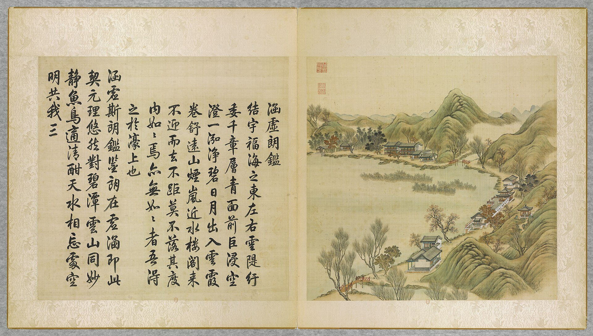
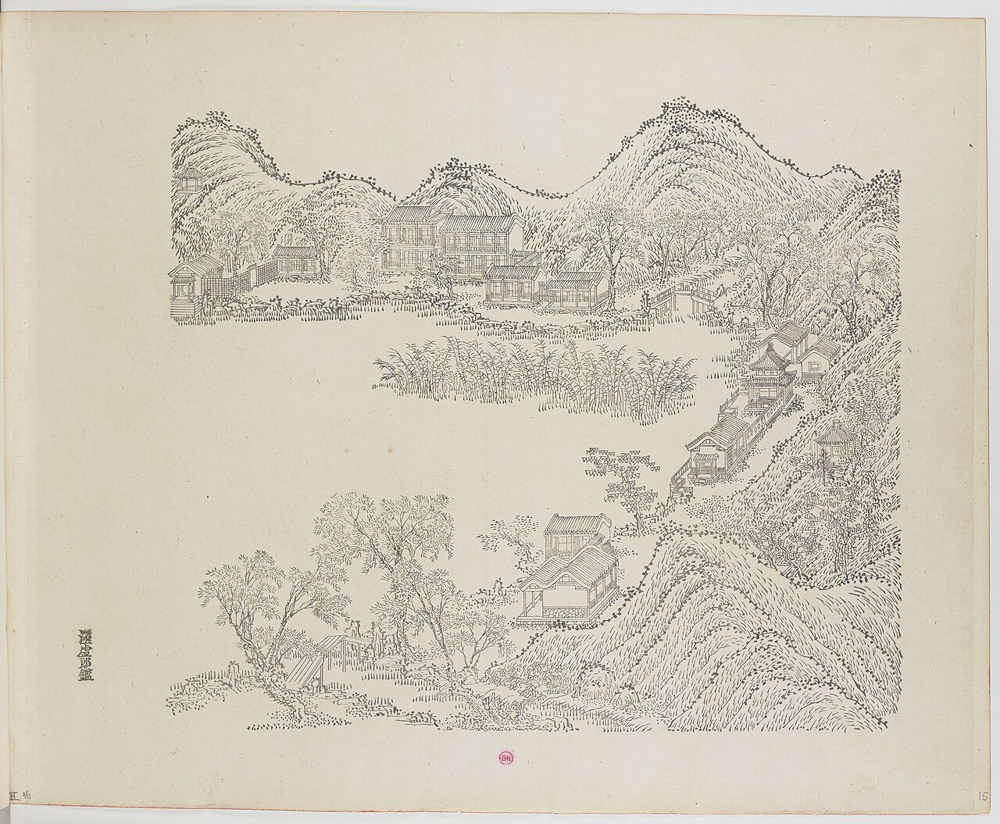
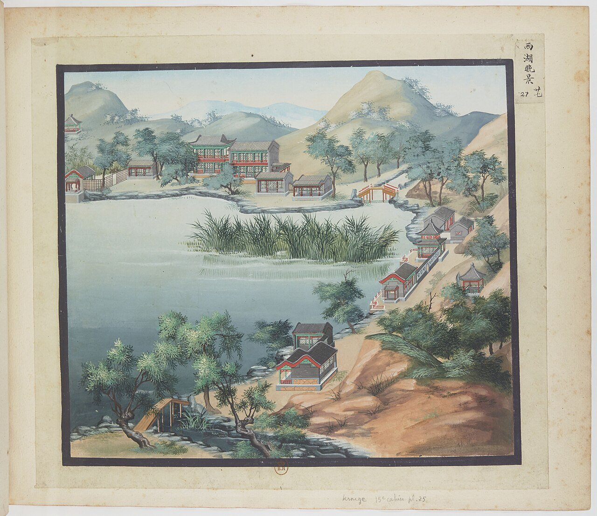
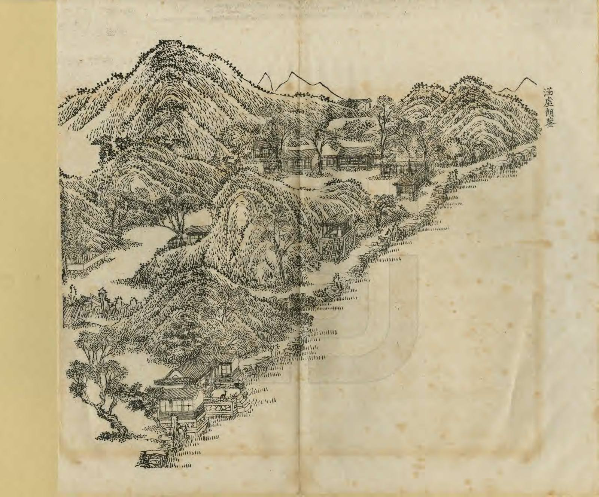
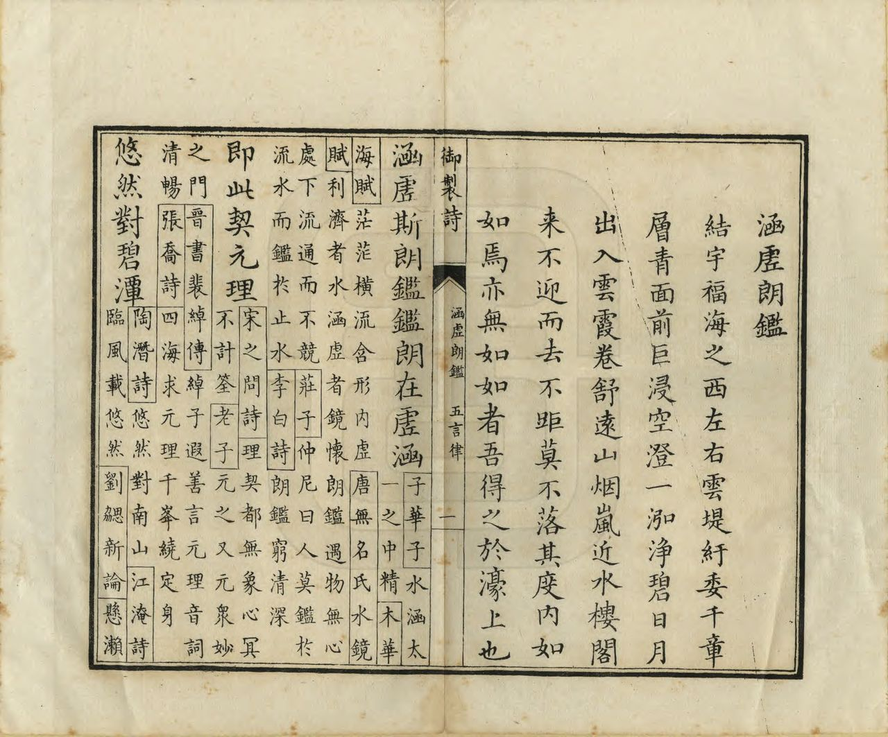
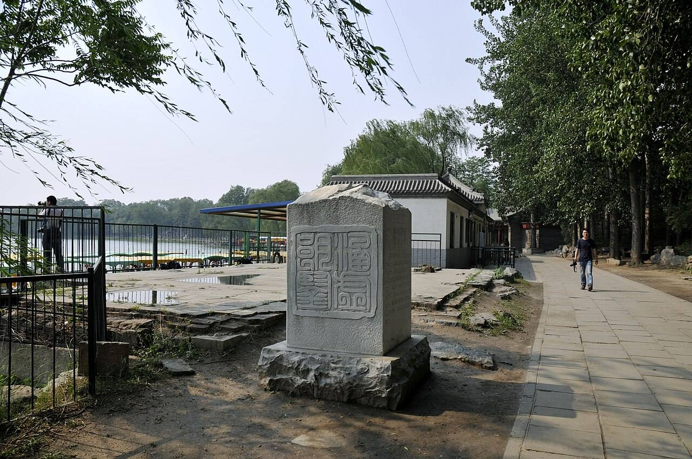
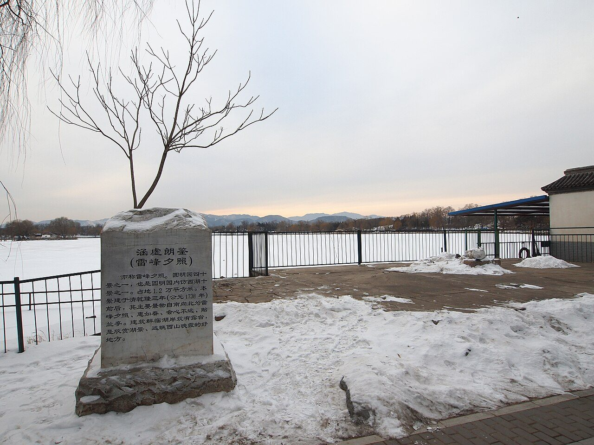

<!-- generated:start (scripts/building_pages.py): do not edit between these markers -->

# YM36: 涵虚朗鉴 Hanxu Langjian

Vast Empty Clear Mirror · Yuanming Yuan

**3D object:** 16 boxes. Open it: `/reconstruction/3d.html?b=YM36`

## What we know

- **Name:** 涵虚朗鉴 Hanxu Langjian (S05, S02, S08, S01, S360, S361 · confidence A)
- **English:** Vast Empty Clear Mirror (S05, S02, S08, S01, S360, S361)
- **Written on the plan:** 涵虚朗鉴 ; 雷峰夕照 (S01 · confidence A)
- **Garden:** Yuanming Yuan (S05, S02, S08, S01, S360, S361)
- **Type:** scene (S05, S02, S08, S01, S360, S361 · confidence A)
- **Built:** by 1762 (first dated item); 1738 (S05, S02, S08, S01, S360, S361)
- **Changed:** 1744 poem 結宇福海之西 [j82:21b-22a]; plaque 舊懸湖西澄虛榭 後移置湖東雷峯夕照軒宇 [j82:21b]. The album view predates this move.; plaque 涵虚朗鉴 formerly at 澄虚榭 (west shore), moved to 雷峰夕照 (east shore); the 1744 leaf already says 福海之東, so the move predates 1744 (S05, S02, S08, S01, S360, S361)
- **Destroyed:** 1860 (S05, S02, S08, S01, S360, S361)
- **Position:** 40.00884, 116.30115. S01 sure (S01 · confidence B)
- **Plan reader's note:** Malone wrote 30 at (7890,1960) off this shore: swapped with 36, trust the labels. 雷峰夕照, 惠如春, 会心不远, 贻兰亭, 值房, 云锦墅 all legible. Polygon extends south to 云锦墅 (text lists it here; S111 under 接秀山房). (S01) *(research copy, not public)*
- **How it was read:** sure (S01) *(research copy, not public)*
- **Plan pixels:** 8204, 2668 (S01) *(research copy, not public)*

## Our model now

16 boxes stand in this compound, 16 on blocks drawn on the plan, 0 assumed. Its halls are listed below.

## Inside it (14)

- YM36-01 雷峰夕照
- YM36-02 惠如春
- YM36-03 寻云榭
- YM36-04 贻兰庭
- YM36-05 会心不远
- YM36-06 临众芳
- YM36-07 云锦墅
- YM36-08 菊秀松蔚
- YM36-09 万景天全
- YM36-AE035
- YM36-AE036
- YM36-B0580
- YM36-N01 值房
- YM36-N02

## Pictures (7)

- **P0036** (sure): 涵虛朗鑑 Hanxu langjian [S'imprégner du vide, réfléchir la clarté] (圓明園四十景, 第36景) (1744 (BnF record: 1744年，清朝乾隆九年)). https://commons.wikimedia.org/wiki/File%3A%E5%9C%93%E6%98%8E%E5%9C%92%E5%9B%9B%E5%8D%81%E6%99%AF._%E7%AC%AC%E4%B8%89%E5%8D%81%E5%85%AD%E6%99%AF_%28%E4%B8%8B%E5%86%8C%EF%BC%8C%E7%AC%AC%E5%8D%81%E5%85%AD%E5%B9%85%E5%9B%BE%29%2C_%E6%B6%B5%E8%99%9B%E6%9C%97%E9%91%91_-_%28%E6%B8%85%29%E5%94%90%E5%B2%B1%E3%80%81%E6%B2%88%E6%BA%90%E5%90%88%E7%95%AB_%3B_%28%E4%B9%BE%E9%9A%86%E5%90%9F%E8%AF%97%EF%BC%8C%E6%B1%AA%E7%94%B1%E6%95%A6%E4%BB%A3%E4%B9%A6%29Hanxu_langjian_-_%28Qing%29Tang_Dai%2C_Shen_Yuan_he_hua_-_btv1b550083513.jpg

  

- **P0075** (sure): 中国皇帝的宫殿与庙宇. 第15幅图, 涵虛郎鑑(涵虛朗鑑) - (清)孙祜、沈源Hanxu langjian - (Qing)Sun Hu, Shen Yuan (1745 (Commons, from the BnF record)). https://commons.wikimedia.org/wiki/File%3A%E4%B8%AD%E5%9B%BD%E7%9A%87%E5%B8%9D%E7%9A%84%E5%AE%AB%E6%AE%BF%E4%B8%8E%E5%BA%99%E5%AE%87._%E7%AC%AC15%E5%B9%85%E5%9B%BE%2C_%E6%B6%B5%E8%99%9B%E9%83%8E%E9%91%91%28%E6%B6%B5%E8%99%9B%E6%9C%97%E9%91%91%29_-_%28%E6%B8%85%29%E5%AD%99%E7%A5%9C%E3%80%81%E6%B2%88%E6%BA%90Hanxu_langjian_-_%28Qing%29Sun_Hu%2C_Shen_Yuan_-_btv1b105207204.jpg

  

- **P0127** (likely): 海淀(镇)：中国皇帝的行宫. 第27幅图, 西湖晚景Xihu wanjing (1750-1792 (BnF, cb43831905b; ex coll. Bertin)). https://commons.wikimedia.org/wiki/File%3A%E6%B5%B7%E6%B7%80%28%E9%95%87%29%EF%BC%9A%E4%B8%AD%E5%9B%BD%E7%9A%87%E5%B8%9D%E7%9A%84%E8%A1%8C%E5%AE%AB._%E7%AC%AC27%E5%B9%85%E5%9B%BE%2C_%E8%A5%BF%E6%B9%96%E6%99%9A%E6%99%AFXihu_wanjing_-_btv1b10520647q.jpg

  

- **P0267** (sure): 涵虛朗鑒 Hanxu Langjian (御製圓明園圖詠, 1887 石印本, 下卷 (Commons 卷二), 第36景; printed title in the right margin of the picture) (光緒十三年 1887 (Commons/NLC record; colophon 光緒十三年七月天津石印書屋 in the SSID copy, S98 PDF p.2); design after the woodblock of 1745 by 孫祜 Sun Hu and 沈源 Shen Yuan). https://commons.wikimedia.org/wiki/File%3ANLC403-312001107375-14034_%E7%A6%A6%E5%88%B6%E5%9C%93%E6%98%8E%E5%9C%92%E5%9C%96%E8%A9%A0_%E5%8D%B7%E4%BA%8C.pdf?page=52

  

- **P0543** (sure): 涵虛朗鑒 Hanxu Langjian: 乾隆 Qianlong's preface and poem with the courtiers' commentary, 御製圓明園圖詠 1887 (poem 1744 (乾隆九年); this printing 1887). https://commons.wikimedia.org/wiki/File%3ANLC403-312001107375-14034_%E7%A6%A6%E5%88%B6%E5%9C%93%E6%98%8E%E5%9C%92%E5%9C%96%E8%A9%A0_%E5%8D%B7%E4%BA%8C.pdf?page=53

  

- **P0392** (sure): 涵虚朗鉴 遗址 - panoramio.jpg (Taken on 27 May 2011 (Commons DateTimeOriginal)). https://commons.wikimedia.org/wiki/File:%E6%B6%B5%E8%99%9A%E6%9C%97%E9%89%B4_%E9%81%97%E5%9D%80_-_panoramio.jpg

  

- **P0643** (sure): 涵虚揽鉴 - Evening Glow on Lake - 2012.12 (Taken on 21 December 2012 (Commons)). https://commons.wikimedia.org/wiki/File:%E6%B6%B5%E8%99%9A%E6%8F%BD%E9%89%B4_-_Evening_Glow_on_Lake_-_2012.12_-_panoramio.jpg

  

## Texts and drawings (21)

- **E2009** (poem, sure): 御製涵虛朗鑑詩（圓明園四十景詩）. 1744 (乾隆九年) · printed in S05 j82:21b-22a · S40. https://github.com/kanripo/KR2k0036/blob/master/KR2k0036_082.txt
  > 乾隆九年 御製涵虛朗鑑詩 結宇福海之西左右雲堤紆委千章層青面前巨浸空澄一泓淨碧日月出入雲霞卷舒逺山烟嵐近水樓閣來不迎而去不距莫不落其度内如如焉亦無如如者吾得之於濠上也 涵虛斯朗鑑朗鑑在虛涵即此契元理悠然對碧潭雲山同妙盡魚鳥適清酣天水相忘處空明共我三
  Placed here on the west of 福海, with cloud-like dykes and thousands of trees on either side and a vast clear sheet of water in front. Sun, moon and clouds come and go unsought, and he sets this beside 莊子's musing above the Hao river.
- **E2015** (text, sure): 日下舊聞考 涵虚朗鉴、福海. 1780s (乾隆 敕撰) · j82:21a-21b · S05. https://github.com/kanripo/KR2k0036/blob/master/KR2k0036_082.txt
  > 涵虛朗鑑在福海東即雷峯夕照正宇其北稍西為惠如春又東北為尋雲榭又北為貽蘭庭為會心不逺其南為臨衆芳為雲錦墅為菊秀松㽔為萬景天全（明圓園册）臣等謹按涵虛朗鑑四十景之一額為皇上御書舊懸湖西澄虛榭後移置湖東雷峯夕照軒宇内惠如春尋雲榭諸額亦御書
  East of 福海: 涵虛朗鑑, the main range of 雷峯夕照, with 惠如春, 尋雲榭, 貽蘭庭, 會心不逺, 臨衆芳, 雲錦墅, 菊秀松㽔 and 萬景天全. The plaque first hung at 澄虛榭 on the west shore and was moved here, which explains why the 1744 preface places the scene on the west.
- **E2010** (poem, sure): 涵虚朗鉴: 乾隆二十七年 poem of the Qianlong Emperor. 乾隆二十七年 (1762), date from the compilation · p.271 item (1), under 涵虚朗鉴 · S360. https://www.yuanmingyuanpark.cn/xs/yjbg/202007/P020200730387572832602.pdf#page=271
  > 天水涵虚处，襟怀朗鉴余。际空常澹澹，照物祇如如。目远随飞鸟，心闲玩戏鱼。碧犹喜云敛，纹不藉风舒。信是得神画，堪通论政书。慿阑适几暇，絜矩每开予。
  Poem of the Qianlong Emperor at 涵虚朗鉴, 1762, on the view. Year as given by the compilation.
- **E2022** (poem, sure): 赋得会心不远. 乾隆二十七年 (1762) · v3 p.60, under 涵虚朗鉴; source ref 8-585 · S361. https://www.yuanmingyuanpark.cn/xs/yjbg/202008/P020200803382569071850.pdf#page=63
  > 琳池围绮榭，镜影澹涵空。曲以云廊达，翳然岩木笼。遥情归静寄，造物是良工。结念休三岛，传神有六通。华林漫相拟，钜野讶堪同。曰我会心处，羲经无妄中。
  Poem 赋得会心不远 by the Qianlong Emperor, 1762, filed by the editors under 涵虚朗鉴.
- **E2021** (poem, sure): 寻云榭漫题. 乾隆五十二年 (1787) · v3 p.61, under 涵虚朗鉴; source ref 16-739 · S361. https://www.yuanmingyuanpark.cn/xs/yjbg/202008/P020200803382569071850.pdf#page=64
  > 散闷步岸傍，遂至寻云榭。寻云有二义，五字言非诈。一为绿林深，入云喻假借。斯则缘畅游，非我所云者。一为望雨际，切盼云生夏。荟蔚跻天中，风随散而罢。寻之总未得，伫立愁以讶。
  Poem 寻云榭漫题 by the Qianlong Emperor, 1787, filed by the editors under 涵虚朗鉴.
- **E2023** (poem, sure): 云锦墅. 嘉庆二年 (1797) · v3 p.7, under 接秀山房; source ref 1-229 · S361. https://www.yuanmingyuanpark.cn/xs/yjbg/202008/P020200803382569071850.pdf#page=10
  > 春华敷锦绣，花墅彩连云。落蕊眼前漾，余香鼻观闻。良时全若绘，大块总成文。试放兰桡去，回溪桃李纷。
  Poem 云锦墅 by the Jiaqing Emperor, 1797, filed by the editors under 接秀山房.
- **E2024** (poem, sure): 云锦墅晴眺. 嘉庆九年 (1804) · v3 p.8, under 接秀山房; source ref 2-403 · S361. https://www.yuanmingyuanpark.cn/xs/yjbg/202008/P020200803382569071850.pdf#page=11
  > 百顷风潭一鉴收，蜃窗倒影印清流。涵溶霞彩朱澜卷，澄澈天光碧浪浮。西岭列屏蘸波洁，北汀连阁映林稠。平湖坐挹心神畅，试写吟笺佳境酬。
  Poem 云锦墅晴眺 by the Jiaqing Emperor, 1804, filed by the editors under 接秀山房.
- **E2011** (poem, sure): 涵虚朗鉴. 嘉庆十三年 (1808) · v3 p.62, under 涵虚朗鉴; source ref 4-30 · S361. https://www.yuanmingyuanpark.cn/xs/yjbg/202008/P020200803382569071850.pdf#page=65
  > 轩鉴碧池光朗映，水天一色遍涵虚。乔松百尺临汀立，细柳千条倚岸舒。风飏疏帘穿小燕，旭晖浅浪跃游鱼。静观生趣欣咸若，䌷绎芸编勉味余。
  Poem 涵虚朗鉴 by the Jiaqing Emperor, 1808, filed by the editors under 涵虚朗鉴.
- **E2012** (poem, sure): 涵虚朗鉴. 嘉庆十三年 (1808) · v3 p.62, under 涵虚朗鉴; source ref 4-41 · S361. https://www.yuanmingyuanpark.cn/xs/yjbg/202008/P020200803382569071850.pdf#page=65
  > 滉漾波光印碧穹，川渟林秀景熙融。心悬朗鉴辉尘世，风送浮云度太空。涵远自微惟克己，集虚得实总由衷。卷阿游览仍求治，敢懈持盈未致中。
  Poem 涵虚朗鉴 by the Jiaqing Emperor, 1808, filed by the editors under 涵虚朗鉴.
- **E2013** (poem, sure): 涵虚朗鉴: 嘉庆十九年 poem of the Jiaqing Emperor. 嘉庆十九年 (1814), date from the compilation · p.271 item (2), under 涵虚朗鉴 · S360. https://www.yuanmingyuanpark.cn/xs/yjbg/202007/P020200730387572832602.pdf#page=271
  > 节度中元颢景清，北窗坐对镜虚明。澄波涵渚一川净，朗鉴悬霄万里晴。柳荫密垂映帘幙，荷香远送满檐楹。拏舟重泛赤栏外，林际微茫崖翠横。
  Poem of the Jiaqing Emperor at 涵虚朗鉴, 1814, on the view. Year as given by the compilation.
- **E2014** (poem, sure): 涵虚朗鉴: 嘉庆二十五年 poem of the Jiaqing Emperor. 嘉庆二十五年 (1820), date from the compilation · p.271 item (5), under 涵虚朗鉴 · S360. https://www.yuanmingyuanpark.cn/xs/yjbg/202007/P020200730387572832602.pdf#page=271
  > 秋令纔临灏景舒，水天一色净涵虚。林光密隐栖枝雀，波影低翻在藻鱼。汀畔浮游浴鸥鹭，槛前灼烁冒芙蕖。心悬朗鉴物咸若，随遇怡和妄念除。
  Poem of the Jiaqing Emperor at 涵虚朗鉴, 1820, on the view. Year as given by the compilation.
- **E1874** (description, sure): Scenes 30, 31, 33, 36, 37: the shores of 福海. 1934 · p.93 · S02. https://archive.org/details/historyofpekings00malo
  > These scenes show scattered houses, pavilions, terraces, and bridges which occupied the narrow strip of shore and the surrounding hills on the north, east, and west of the Happy Sea.
  澡身浴德, 平湖秋月, 接秀山房, 涵虚朗鉴, 廓然大公: scattered houses, pavilions, terraces and bridges on the shore strip and hills north, east and west of 福海. Malone gives no more for these five.
- **E2366** (description, guess): Attiret: shores of 福海, aviaries and fish. 1743 · [pp.17-20] · S157. https://faculty.bard.edu/~louis/gardens/attiretaccount.html
  > It takes up a very large Space; and is all surrounded with a Lattice-work of Brass-wire: in which the Openings are so very fine and small, as to prevent the fish from wandering into the main waters.
  Quays of smooth stone or rock-work, terraces, palaces rising in tiers, groves of several kinds. Network houses half in the water for waterfowl, small menageries, and the largest fish reservoir, closed by brass wire. Which shore is not stated.
- **E2017** (description, sure): 老北京的记忆(125): 涵虚朗鉴 and 接秀山房, quoting 《圆明园百景图志》. 2017 · post 125 · S111. https://blog.sina.com.cn/s/blog_88741e0d0102x6gc.html
  Gives scene sizes and hall by hall measures: 涵虚朗鉴 200 x 60 m, 接秀山房 250 x 50 m. 接秀山房 became 观澜堂 in late Jiaqing. 1855 interior drawing at the NLC. Notes the names of the east-shore scenes were swapped around 1744, and that some modern plans mislabel the halls.
- **E2019** (description, sure): 圆明园福海东岸历史建筑方位考, 圆明园研究 78期. 2024-03-04 · xs/ktsb/202403/t20240304_4643616 · S338. https://www.yuanmingyuanpark.cn/xs/ktsb/202403/t20240304_4643616.html
  Shows that plans disagree on which hall is which along the east shore of 福海: the 1936 Beiping survey, the 1979 He and Zeng plan and the 2010 百景图志 each label differently. Checking Yangshi Lei drawings and texts against the sites, it reads the surviving bases north to south as 贻兰亭, 会心不远, 寻云榭, 惠如春, 雷峰夕照, 临众芳, 云锦墅, 观澜堂. It notes no scientific dig has been done here.
- **E1851** (description, likely): 方壶胜境 南 龙王庙 (S47 section 2.11). 2012, citing archive and Qing texts · p.115; table row 22 · S47. https://www.dpm.org.cn/Uploads/File/2018/06/15/u5b23730ae0e5a.pdf
  South of 蕊珠宫 behind the boat dock, north of 涵虚朗鉴 and close to the five-arch sluice: three bays, hanging gable with ridge and finials, facing south; before 1744 by the album.
- **E2390** (description, likely): 松风阁. 2017 blog, on the Yuanmingyuan archive · section 涵虚朗鉴 · S111. https://blog.sina.com.cn/s/blog_88741e0d0102x6gc.html
  Five-bay building next east of 藏密楼 on the north shore of 福海. It was a stage for the 过皇会 on 碧霞元君's birthday, for example in 1756. No poem names it, and S05 omits it; a survey of 1858 gives its measures.
- **E2016** (description, sure): 圆明园百景史事分景汇编: 涵虚朗鉴. 1762-1820 · from p.271, under 涵虚朗鉴 · S360. https://www.yuanmingyuanpark.cn/xs/yjbg/202007/P020200730387572832602.pdf#page=271
  涵虚朗鉴: 5 dated items, 1762-1820, of which 5 poems (Qianlong, Jiaqing); recurring themes: the view. First dated 1762, last dated 1820.
- **E2018** (description, sure): 圆明园五朝御制诗文集注 v3, editors' note on 涵虚朗鉴. 2020 edition · v3 p.60 · S361. https://www.yuanmingyuanpark.cn/xs/yjbg/202008/P020200803382569071850.pdf#page=63
  Begun 1738 on the north-east shore, a three-bay hall facing west, plaques 雷峰夕照 outside and 涵虚朗鉴 inside. It gives the order of halls along the shore, north and south of that hall: compare the conflict logged by archaeo (S338).
- **E2478** (drawing, sure): 雷峰夕照及惠如春平面图. 道光十二年 (1832) 二月 · 国家图书馆善本部 样031-8号 · S310. https://www.mhymy.com/dasl/ysltd/9807.html
  Rebuilding design (working sheet, 415x405 mm, red and ink) for 雷峰夕照 and 惠如春 in 涵虚朗鉴 on the east shore of 福海; the record gives the scene c. 85 x 250 m and lists repairs of 1778, 1788, 1792-94 and 1832.
- **E2020** (drawing, sure): 《国家图书馆藏样式雷图档·圆明园卷初编》: 涵虚朗鉴. mostly 道光, 咸丰, 同治 per the publisher · 初编 目录: 涵虚朗鉴, pp.442-445 · S13. https://www.nlcpress.com/ProductView.aspx?Id=7642
  The printed facsimile of the National Library of China's Yangshi Lei sheets has a section on this place at pp.442-445 (4 pages, section length worked out from the next heading); sheet titles and numbers are in the volume, ordered from a library.

**On the plan:** Drawn on the plan of the gardens (S01), labelled 涵虚朗鉴 ; 雷峰夕照. https://artmuseum.princeton.edu/collections/objects/138657

## Reconstructions by others (3)

Modern interpretation, not evidence.
- **R0073** (3D model, likely): 《圆明园四十景数字化复原及应用》. 圆明园管理处 with 中央美院, 圆明园管理处; 中央美术学院, 2025. https://news.bjd.com.cn/2026/10/16/11997513.shtml Research-only: link card.
- **R0308** (paper figure, likely): 《圆明园新证》: reading of Palace Museum plan No. 1704, stripped of its later paste-ups to the Qianlong layout of about 1779. . http://iqh.ruc.edu.cn/old/qdhjylyjzx/xszl/xstl/1c9094aef4f041148f15883c7c266cb9.htm Research-only: link card.
- **R0310** (paper figure, likely): 《“样式雷”图与圆明园》: survey of about 1700 Yangshi Lei plans, naming scenes changed after 1744. assumed: the author of 《圆明园变迁史探微》. http://iqh.ruc.edu.cn/old/qdhjylyjzx/xszl/ylfj/7c89633b1d0247b7bd91da2ff25c61f8.htm Research-only: link card.

## Surviving comparable buildings, not this building (1)

- **T035** 雷峰塔 Leifeng Ta, 西湖 杭州 Hangzhou. Comparable: same court, era or type, confidence C, standing: partly. Name only: a west-facing evening view, no pagoda Basis: S05 j.82 f.21a: 涵虚朗鉴 is the main hall of 雷峰夕照. No pagoda here on S01 or in the text: the name is of the view. https://github.com/kanripo/KR2k0036
  - P0630: Leifeng Pagoda 雷峰塔. https://commons.wikimedia.org/wiki/File:Leifeng_Pagoda_%E9%9B%B7%E5%B3%B0%E5%A1%94_-_panoramio.jpg

## Evidence for the set of buildings

- Reconstructions and comparables for the whole garden, 圆明园 Yuanming Yuan: see GARDEN-YM

## Open questions

- Q1: Target state
- Q10: 涵虚朗鉴
- Q41: 藏密楼 YM31-07, 松风阁 YM81
- Q42: East shore of 福海
- Q83: YM54 / 涵虚朗鉴
- Q129: The brief says the album views are roughly from the south
- Q137: YM36
- Q141: Text variants between the album leaves (S08) and the 日下旧闻考 copy (S05, Kanripo WYG)

<!-- generated:end -->

## Notes

<!-- Yours: regeneration never touches this part. It goes on the public site; what you write below a line holding only %% private %% stays in the research copy. -->
