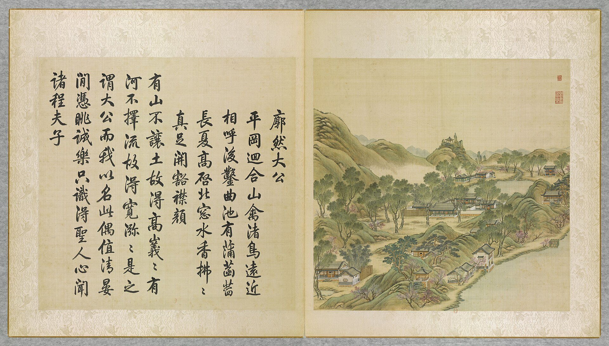

<!-- generated:start (scripts/building_pages.py): do not edit between these markers -->

# YM37-09: 启秀亭 Qixiu Ting

Yuanming Yuan

**3D object:** 1 box. Open it: `/reconstruction/3d.html?b=YM37-09`

**Part of:** YM37 廓然大公

## What we know

- **Name:** 启秀亭 Qixiu Ting (S05, S01 · confidence C)
- **Garden:** Yuanming Yuan (S05, S01)
- **Type:** pavilion (S05, S01 · confidence C)
- **Destroyed:** 1860 (S05, S01)
- **Position:** 40.01081, 116.29353. S01 guess (S01 · confidence C)
- **Size in the inventory:** 5.7 × 7.3 m. S01 plan px / hall scale (S01)
- **Note:** 笠亭 on the hilltop [j82:25a] (S05, S01)
- **Plan reader's note:** 启秀亭: pavilion in a rock ring. (S01) *(research copy, not public)*
- **How it was read:** guess (S01) *(research copy, not public)*
- **Plan pixels:** 5122, 1230 (S01) *(research copy, not public)*

## Our model now

A plain box on the block drawn on the Qing plan S01: position and frontage from the plan, heights and roof from the typology of its hall class. It will be updated as the research goes on.

- **Box:** 5.7 × 7.3 m, pavilion square
- **Heights:** platform 0.48 m, eave 3.68 m, ridge 6.33 m above the ground
- **Roof:** pyramid 攒尖, grey tile
- **Faces:** 173.9° from north
- **Confidence:** C

## Pictures (1)

- **P0037** (guess): 廓然大公 Kuoran dagong [Clarté et intégrité] (圓明園四十景, 第37景) (1744 (BnF record: 1744年，清朝乾隆九年)). https://commons.wikimedia.org/wiki/File%3A%E5%9C%93%E6%98%8E%E5%9C%92%E5%9B%9B%E5%8D%81%E6%99%AF._%E7%AC%AC%E4%B8%89%E5%8D%81%E4%B8%83%E6%99%AF_%28%E4%B8%8B%E5%86%8C%EF%BC%8C%E7%AC%AC%E5%8D%81%E4%B8%83%E5%B9%85%E5%9B%BE%29%2C_%E5%BB%93%E7%84%B6%E5%A4%A7%E5%85%AC_-_%28%E6%B8%85%29%E5%94%90%E5%B2%B1%E3%80%81%E6%B2%88%E6%BA%90%E5%90%88%E7%95%AB_%3B_%28%E4%B9%BE%E9%9A%86%E5%90%9F%E8%AF%97%EF%BC%8C%E6%B1%AA%E7%94%B1%E6%95%A6%E4%BB%A3%E4%B9%A6%29Kuoran_dagong_-_%28Qing%29Tang_Dai%2C_Shen_Yuan_he_hua_-_btv1b55008352j.jpg

  

## Texts and drawings (4)

- **E2028** (poem, sure): 御製廓然大公八景詩（有序）. 1755 (乾隆二十年) · j82:23b-25a · S05. https://github.com/kanripo/KR2k0036/blob/master/KR2k0036_082.txt
  > 乾隆二十年御製廓然大公八景詩（有序）　圓明園四十景皆取四字為題各景之中一軒一峯具有幽致日涉成趣正復不窮題以八景系之七言　前接陌桞後臨平湖軒堂翼然虛明洞徹皇考御書題額時有卿雲䕶之廓然大公扁即在後室一泓涵碧頗有物來順應之趣　深桞偏宜羽客嬉會心恰當讀書時（是處昔又名深栁讀書堂）在隂能和寧吾謂好爵還思與爾縻（右雙鶴齋）　循雙鶴齋而西跨湖為橋圓如半璧暎水則為滿月繚以長廊悠然濠濮間想　拖如玉帶曲如鈎上置行廊又似舟仙術何須倩法善往來常作廣寒游（右規月橋）　性之介立為峭文之藻蔚為蒨太沖詩意良足會心　石秀松𬎼各出羣不同同處挹清芬太沖豈務多竒者五字全拈大塊文（右峭蒨居）　面東為樓杜陵句曰半陂以南純浸山動影窈窕沖融間斯樓有焉因迥為高結搆清層樓因得影山名窻中峯作波中態上下明漪最有情（右影山樓）　竒石㟏岈迴互徑出其中烟雲往來披拂襟袖　緑雲叢翠徑縈紆面面深竒步步殊倩得仇英冩生筆定須為作採芝圖（右披雲徑）　機政之餘拈吟適興每遇佳景不覺綺思濬發　逢源左右足深資適興無非把筆時設使古人癖誠有吟之一字我何辭（右綺吟堂）　曲澗奔泉琤琮作金石聲韻出天然是謂雲山韶濩　迸水摐摐下石磯八音繁會太音稀輞川漫擬王家畫虞陛高懐舜手揮（右韻石淙）　山巔笠亭孤標秀出左顧飛瀑右挹雲林盡得此間勝概　詭石蒼松扶翼然氤氲朝暮幻雲烟林光泉韻無非秀都付山亭秀占全（右啟秀亭）
  Eight poems on 廓然大公's parts, each with a preface giving form and place: 雙鶴齋 once called 深桞讀書堂, 規月橋 as a half-moon covered bridge, 峭蒨居, 影山樓, 披雲徑, 綺吟堂, 韻石淙 and 啟秀亭 on the peak.
- **E2032** (text, sure): 日下舊聞考 廓然大公、福海. 1780s (乾隆 敕撰) · j82:22b-23a · S05. https://github.com/kanripo/KR2k0036/blob/master/KR2k0036_082.txt
  > 福海西北隅平湖秋月之西為廓然大公正宇七楹前為雙鶴齋西北為規月橋東北為綺吟堂又北為採芝徑又北徑巖洞而西為峭蒨居北垣門外有樓為天真可佳峭蒨居西為披雲徑又西亭為啟秀又西稍南為韻石淙西北平臺臨池為芰荷深處垣外為影山樓雙鶴齋西為環秀山房西北為臨湖樓（圓明園册）臣等謹按廓然大公四十景之一額為皇上御書雙鶴齋採芝徑天真可佳芰荷深處影山樓環秀山房臨湖樓諸額皆世宗御書峭蒨居披雲徑諸額皆皇上御書
  West of 平湖秋月: 廓然大公, seven bays, with 雙鶴齋 in front, the 規月橋, 綺吟堂, 採芝徑, 峭蒨居, 天真可佳, 披雲徑, 啟秀, 韻石淙, 芰荷深處, 影山樓, 環秀山房 and 臨湖樓.
- **E2049** (poem, sure): 启秀亭. 乾隆二十六年 (1761) · v3 p.73, under 廓然大公 · S361. https://www.yuanmingyuanpark.cn/xs/yjbg/202008/P020200803382569071850.pdf#page=76
  > 水木澄华竹石清，于于屧步足怡情。如从六艺嫩芳润，先获我心是士衡。
  Poem 启秀亭 by the Qianlong Emperor, 1761, filed by the editors under 廓然大公.
- **E2050** (poem, sure): 启秀亭. 乾隆二十九年 (1764) · v3 p.75, under 廓然大公 · S361. https://www.yuanmingyuanpark.cn/xs/yjbg/202008/P020200803382569071850.pdf#page=78
  > 已觉芳茵衬步青，东风有脚善形形。朝葩夕蘤行看启，解报先声是此亭。
  Poem 启秀亭 by the Qianlong Emperor, 1764, filed by the editors under 廓然大公.

**On the plan:** Drawn on the plan of the gardens (S01) with no label: a building stood here, its name unknown. https://artmuseum.princeton.edu/collections/objects/138657

## Evidence for the set of buildings

- Evidence for the whole compound 廓然大公: see YM37
- Reconstructions and comparables for the whole garden, 圆明园 Yuanming Yuan: see GARDEN-YM
- Standing buildings comparable to a square pavilion (not this building): see CLASS-pavilion_square

## Open questions

None that name it.

<!-- generated:end -->

## Notes

<!-- Yours: regeneration never touches this part. It goes on the public site; what you write below a line holding only %% private %% stays in the research copy. -->
