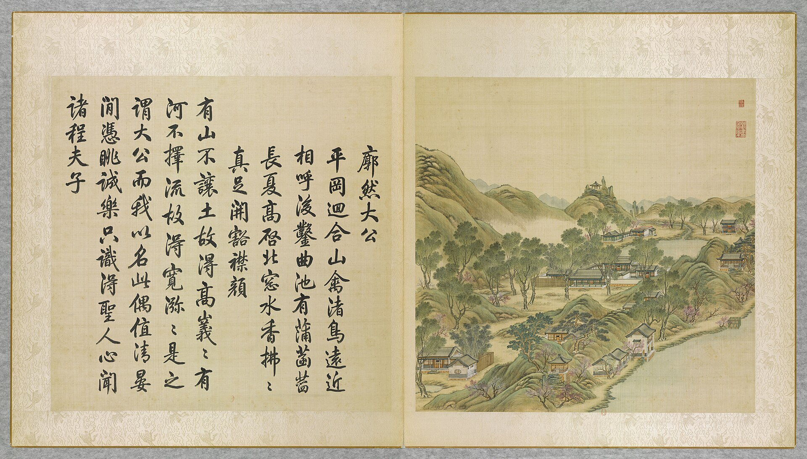
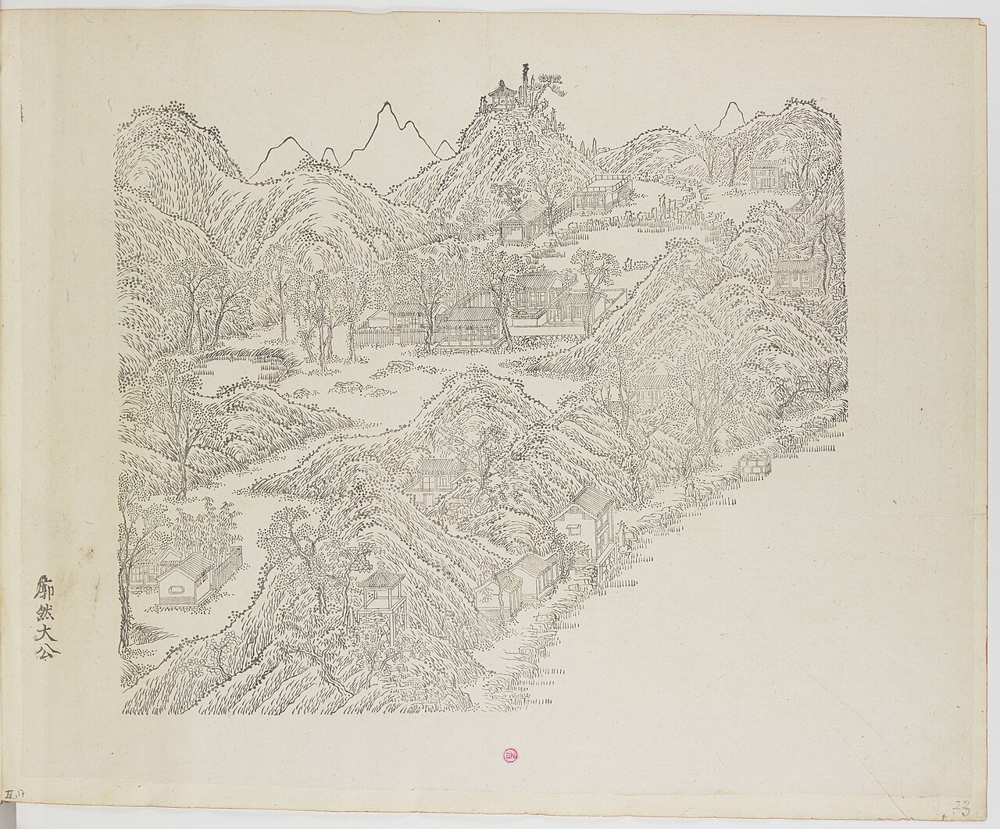
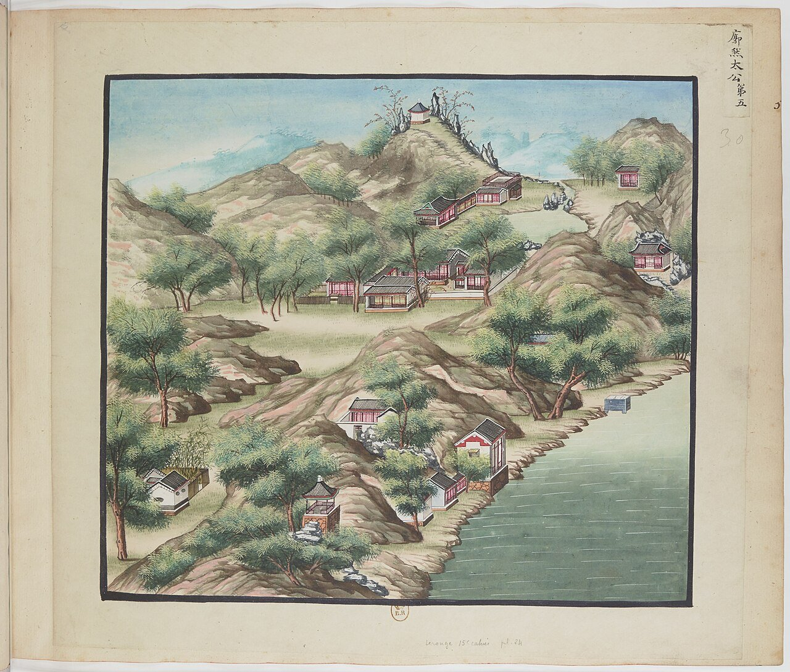
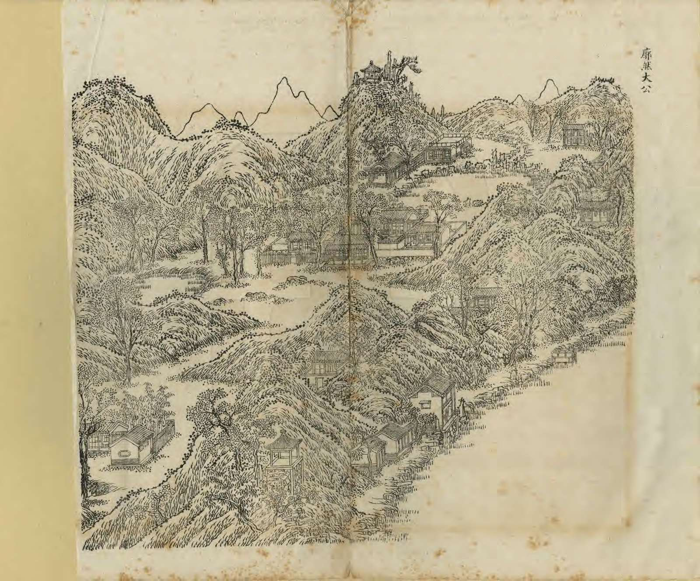
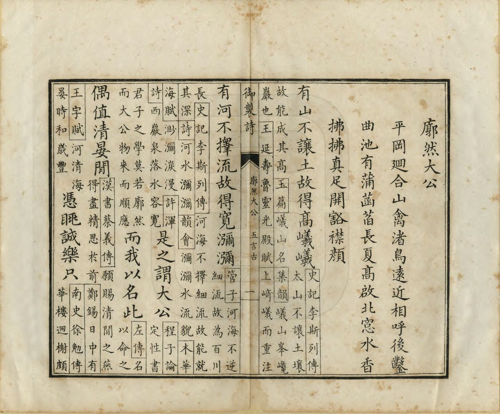
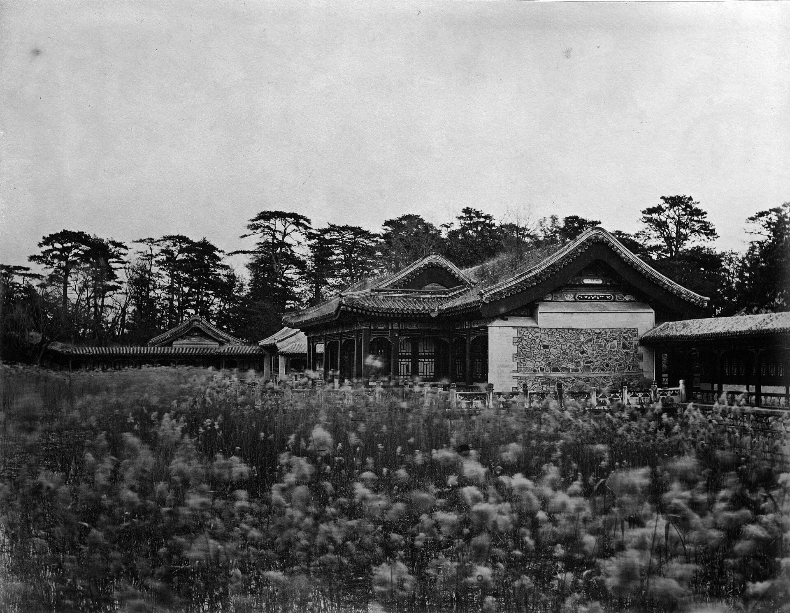
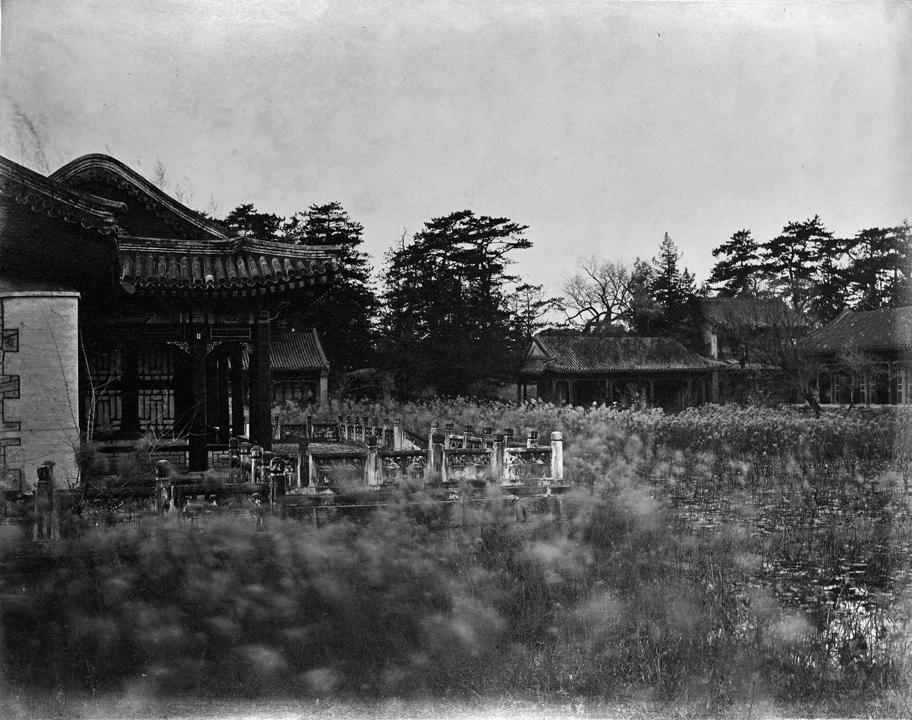
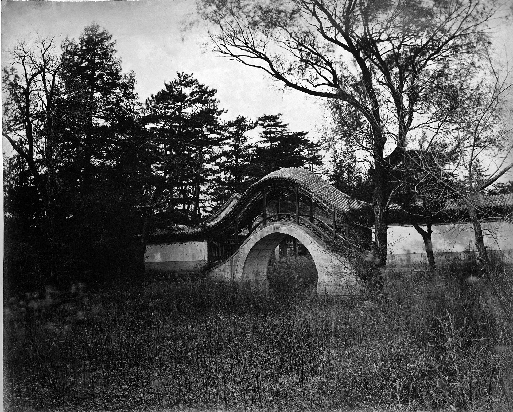

<!-- generated:start (scripts/building_pages.py): do not edit between these markers -->

# YM37: 廓然大公 Kuoran Dagong

The Porch of the Great Gentleman · Yuanming Yuan

**3D object:** 15 boxes. Open it: `/reconstruction/3d.html?b=YM37`

## What we know

- **Name:** 廓然大公 Kuoran Dagong (S05, S02, S08, S06, S01, S361 · confidence A)
- **English:** The Porch of the Great Gentleman (S05, S02, S08, S06, S01, S361)
- **Garden:** Yuanming Yuan (S05, S02, S08, S06, S01, S361)
- **Type:** scene (S05, S02, S08, S06, S01, S361 · confidence A)
- **Changed:** by 1755: 八景 named (雙鶴齋 once 深栁讀書堂) (S05, S02, S08, S06, S01, S361)
- **Destroyed:** 1860; on the 1873 survival list (S06); survived 1860; lost around 1900 (S05, S02, S08, S06, S01, S361)
- **Position:** 40.01010, 116.29411. S01 sure (S01 · confidence B)
- **Note:** after1860: survived 1860, lost around 1900 (editors of S361) (S361, editors' note (E2035)). (S05, S02, S08, S06, S01, S361)
- **Plan reader's note:** Label (5340,1710) in the court, Malone 37 at (5430,1715). Hill and lake group, 双鹤斋 in front. (S01) *(research copy, not public)*
- **How it was read:** sure (S01) *(research copy, not public)*
- **Plan pixels:** 5340, 1632 (S01) *(research copy, not public)*

## Our model now

15 boxes stand in this compound, 15 on blocks drawn on the plan, 0 assumed. Its halls are listed below.

## Inside it (19)

- YM37-01 廓然大公正宇
- YM37-02 双鹤斋
- YM37-03 规月桥
- YM37-04 绮吟堂
- YM37-05 采芝径
- YM37-06 峭蒨居
- YM37-07 天真可佳楼
- YM37-08 披云径
- YM37-09 启秀亭
- YM37-10 韵石淙
- YM37-11 芰荷深处
- YM37-12 影山楼
- YM37-13 环秀山房
- YM37-14 临湖楼
- YM37-B0220
- YM37-B0222
- YM37-B0325
- YM37-B0326
- YM37-B0341

## Pictures (9)

- **P0037** (sure): 廓然大公 Kuoran dagong [Clarté et intégrité] (圓明園四十景, 第37景) (1744 (BnF record: 1744年，清朝乾隆九年)). https://commons.wikimedia.org/wiki/File%3A%E5%9C%93%E6%98%8E%E5%9C%92%E5%9B%9B%E5%8D%81%E6%99%AF._%E7%AC%AC%E4%B8%89%E5%8D%81%E4%B8%83%E6%99%AF_%28%E4%B8%8B%E5%86%8C%EF%BC%8C%E7%AC%AC%E5%8D%81%E4%B8%83%E5%B9%85%E5%9B%BE%29%2C_%E5%BB%93%E7%84%B6%E5%A4%A7%E5%85%AC_-_%28%E6%B8%85%29%E5%94%90%E5%B2%B1%E3%80%81%E6%B2%88%E6%BA%90%E5%90%88%E7%95%AB_%3B_%28%E4%B9%BE%E9%9A%86%E5%90%9F%E8%AF%97%EF%BC%8C%E6%B1%AA%E7%94%B1%E6%95%A6%E4%BB%A3%E4%B9%A6%29Kuoran_dagong_-_%28Qing%29Tang_Dai%2C_Shen_Yuan_he_hua_-_btv1b55008352j.jpg

  

- **P0083** (sure): 中国皇帝的宫殿与庙宇. 第23幅图, 廓然大公 - (清)孙祜、沈源Kuoran dagong - (Qing)Sun Hu, Shen Yuan (1745 (Commons, from the BnF record)). https://commons.wikimedia.org/wiki/File%3A%E4%B8%AD%E5%9B%BD%E7%9A%87%E5%B8%9D%E7%9A%84%E5%AE%AB%E6%AE%BF%E4%B8%8E%E5%BA%99%E5%AE%87._%E7%AC%AC23%E5%B9%85%E5%9B%BE%2C_%E5%BB%93%E7%84%B6%E5%A4%A7%E5%85%AC_-_%28%E6%B8%85%29%E5%AD%99%E7%A5%9C%E3%80%81%E6%B2%88%E6%BA%90Kuoran_dagong_-_%28Qing%29Sun_Hu%2C_Shen_Yuan_-_btv1b10520719r.jpg

  

- **P0105** (sure): 海淀(镇)：中国皇帝的行宫. 第5幅图, 廓然大公Kuoran dagong (1750-1792 (BnF, cb43831905b; ex coll. Bertin)). https://commons.wikimedia.org/wiki/File%3A%E6%B5%B7%E6%B7%80%28%E9%95%87%29%EF%BC%9A%E4%B8%AD%E5%9B%BD%E7%9A%87%E5%B8%9D%E7%9A%84%E8%A1%8C%E5%AE%AB._%E7%AC%AC5%E5%B9%85%E5%9B%BE%2C_%E5%BB%93%E7%84%B6%E5%A4%A7%E5%85%ACKuoran_dagong_-_btv1b10520649m.jpg

  

- **P0268** (sure): 廓然大公 Kuoran Dagong (御製圓明園圖詠, 1887 石印本, 下卷 (Commons 卷二), 第37景; printed title in the right margin of the picture) (光緒十三年 1887 (Commons/NLC record; colophon 光緒十三年七月天津石印書屋 in the SSID copy, S98 PDF p.2); design after the woodblock of 1745 by 孫祜 Sun Hu and 沈源 Shen Yuan). https://commons.wikimedia.org/wiki/File%3ANLC403-312001107375-14034_%E7%A6%A6%E5%88%B6%E5%9C%93%E6%98%8E%E5%9C%92%E5%9C%96%E8%A9%A0_%E5%8D%B7%E4%BA%8C.pdf?page=55

  

- **P0544** (sure): 廓然大公 Kuoran Dagong: 乾隆 Qianlong's preface and poem with the courtiers' commentary, 御製圓明園圖詠 1887 (poem 1744 (乾隆九年); this printing 1887). https://commons.wikimedia.org/wiki/File%3ANLC403-312001107375-14034_%E7%A6%A6%E5%88%B6%E5%9C%93%E6%98%8E%E5%9C%92%E5%9C%96%E8%A9%A0_%E5%8D%B7%E4%BA%8C.pdf?page=56

  

- **P0162** (likely): 圓明園之宮殿皇上乘凉到此前時未破龍舟遊玩 (print caption) (circa 1879 (Commons)). https://commons.wikimedia.org/wiki/File%3A%E5%9C%93%E6%98%8E%E5%9C%92%E4%B9%8B%E5%AE%AE%E6%AE%BF%E7%9A%87%E4%B8%8A%E4%B9%98%E5%87%89%E5%88%B0%E6%AD%A4%E5%89%8D%E6%99%82%E6%9C%AA%E7%A0%B4%E9%BE%8D%E8%88%9F%E9%81%8A%E7%8E%A9.jpg

  

- **P0163** (likely): 圓明園之殿宇皇上到此乘凉 (print caption) (circa 1879 (Commons)). https://commons.wikimedia.org/wiki/File%3A%E5%9C%93%E6%98%8E%E5%9C%92%E4%B9%8B%E6%AE%BF%E5%AE%87%E7%9A%87%E4%B8%8A%E5%88%B0%E6%AD%A4%E4%B9%98%E5%87%89.jpg

  

- **P0490** (likely): Guiyue Bridge in the Yuanmingyuan.jpg (). https://commons.wikimedia.org/wiki/File:Guiyue_Bridge_in_the_Yuanmingyuan.jpg Research-only: link card.
- **P0164** (guess): 圓明園之龍月橋所有龍舟由橋穿過雅致之極 (print caption) (circa 1879 (Commons)). https://commons.wikimedia.org/wiki/File%3A%E5%9C%93%E6%98%8E%E5%9C%92%E4%B9%8B%E9%BE%8D%E6%9C%88%E6%A9%8B%E6%89%80%E6%9C%89%E9%BE%8D%E8%88%9F%E7%94%B1%E6%A9%8B%E7%A9%BF%E9%81%8E%E9%9B%85%E8%87%B4%E4%B9%8B%E6%A5%B5.jpg

  

## Texts and drawings (39)

- **E2025** (poem, sure): 御製廓然大公詩（圓明園四十景詩）. 1744 (乾隆九年) · printed in S05 j82:23a-23b · S40. https://github.com/kanripo/KR2k0036/blob/master/KR2k0036_082.txt
  > 乾隆九年 御製廓然大公詩 平岡迴合山禽渚鳥逺近相呼後鑿曲池有蒲菡蓞長夏高啓北窻水香拂拂真足開豁襟顔 有山不讓土故得高㠖㠖有河不擇流故得寛瀰瀰是之謂大公而我以名此偶值清晏間慿眺誠樂只識得聖人心聞諸程夫子
  Low hills enclose it and birds call from far and near. A winding pool of reeds and lotus is dug behind; in high summer the north window opened on the scent of the water.
- **E2028** (poem, sure): 御製廓然大公八景詩（有序）. 1755 (乾隆二十年) · j82:23b-25a · S05. https://github.com/kanripo/KR2k0036/blob/master/KR2k0036_082.txt
  > 乾隆二十年御製廓然大公八景詩（有序）　圓明園四十景皆取四字為題各景之中一軒一峯具有幽致日涉成趣正復不窮題以八景系之七言　前接陌桞後臨平湖軒堂翼然虛明洞徹皇考御書題額時有卿雲䕶之廓然大公扁即在後室一泓涵碧頗有物來順應之趣　深桞偏宜羽客嬉會心恰當讀書時（是處昔又名深栁讀書堂）在隂能和寧吾謂好爵還思與爾縻（右雙鶴齋）　循雙鶴齋而西跨湖為橋圓如半璧暎水則為滿月繚以長廊悠然濠濮間想　拖如玉帶曲如鈎上置行廊又似舟仙術何須倩法善往來常作廣寒游（右規月橋）　性之介立為峭文之藻蔚為蒨太沖詩意良足會心　石秀松𬎼各出羣不同同處挹清芬太沖豈務多竒者五字全拈大塊文（右峭蒨居）　面東為樓杜陵句曰半陂以南純浸山動影窈窕沖融間斯樓有焉因迥為高結搆清層樓因得影山名窻中峯作波中態上下明漪最有情（右影山樓）　竒石㟏岈迴互徑出其中烟雲往來披拂襟袖　緑雲叢翠徑縈紆面面深竒步步殊倩得仇英冩生筆定須為作採芝圖（右披雲徑）　機政之餘拈吟適興每遇佳景不覺綺思濬發　逢源左右足深資適興無非把筆時設使古人癖誠有吟之一字我何辭（右綺吟堂）　曲澗奔泉琤琮作金石聲韻出天然是謂雲山韶濩　迸水摐摐下石磯八音繁會太音稀輞川漫擬王家畫虞陛高懐舜手揮（右韻石淙）　山巔笠亭孤標秀出左顧飛瀑右挹雲林盡得此間勝概　詭石蒼松扶翼然氤氲朝暮幻雲烟林光泉韻無非秀都付山亭秀占全（右啟秀亭）
  Eight poems on 廓然大公's parts, each with a preface giving form and place: 雙鶴齋 once called 深桞讀書堂, 規月橋 as a half-moon covered bridge, 峭蒨居, 影山樓, 披雲徑, 綺吟堂, 韻石淙 and 啟秀亭 on the peak.
- **E2032** (text, sure): 日下舊聞考 廓然大公、福海. 1780s (乾隆 敕撰) · j82:22b-23a · S05. https://github.com/kanripo/KR2k0036/blob/master/KR2k0036_082.txt
  > 福海西北隅平湖秋月之西為廓然大公正宇七楹前為雙鶴齋西北為規月橋東北為綺吟堂又北為採芝徑又北徑巖洞而西為峭蒨居北垣門外有樓為天真可佳峭蒨居西為披雲徑又西亭為啟秀又西稍南為韻石淙西北平臺臨池為芰荷深處垣外為影山樓雙鶴齋西為環秀山房西北為臨湖樓（圓明園册）臣等謹按廓然大公四十景之一額為皇上御書雙鶴齋採芝徑天真可佳芰荷深處影山樓環秀山房臨湖樓諸額皆世宗御書峭蒨居披雲徑諸額皆皇上御書
  West of 平湖秋月: 廓然大公, seven bays, with 雙鶴齋 in front, the 規月橋, 綺吟堂, 採芝徑, 峭蒨居, 天真可佳, 披雲徑, 啟秀, 韻石淙, 芰荷深處, 影山樓, 環秀山房 and 臨湖樓.
- **E2026** (poem, sure): 廓然大公: 乾隆二十年 poem of the Qianlong Emperor. 乾隆二十年 (1755), date from the compilation · p.257 item (3), under 廓然大公 · S360. https://www.yuanmingyuanpark.cn/xs/yjbg/202007/P020200730387572832602.pdf#page=257
  > 一泓涵碧，颇有物来。顺应之趣，深柳偏宜。羽客嬉会心，恰当读书时。 （是处昔又名深柳读书堂）在阴能和宁吾谓，好爵还思与尔縻。
  Poem of the Qianlong Emperor at 廓然大公, 1755, on reading. Year as given by the compilation.
- **E2027** (poem, sure): 廓然大公八景 有序. 乾隆二十年 (1755) · v3 p.68, under 廓然大公; source ref 5-336 · S361. https://www.yuanmingyuanpark.cn/xs/yjbg/202008/P020200803382569071850.pdf#page=71
  > 圆明园四十景，皆取四字为题。各景之中，一轩一峰，具有幽致。日涉成趣，正复不穷。题以八景，系之七言。
  Poem 廓然大公八景 有序 by the Qianlong Emperor, 1755, filed by the editors under 廓然大公.
- **E2039** (poem, sure): 题双鹤斋. 乾隆二十年 (1755) · v3 p.70, under 廓然大公; source ref 5-366 · S361. https://www.yuanmingyuanpark.cn/xs/yjbg/202008/P020200803382569071850.pdf#page=73
  > 翯翯松阴复竹边，双来疑是下青田。参军赋句无须读，弄影奔机意总仙。
  Poem 题双鹤斋 by the Qianlong Emperor, 1755, filed by the editors under 廓然大公.
- **E2045** (poem, sure): 峭蒨居. 乾隆二十年 (1755) · v3 p.69, under 廓然大公 · S361. https://www.yuanmingyuanpark.cn/xs/yjbg/202008/P020200803382569071850.pdf#page=72
  > 性之介，立为峭。文之藻，蔚为蒨。太冲诗意，良足会心。石秀松蕤各出群，不同同处挹清芬。太冲岂务多奇者，五字全拈大块文。
  Poem 峭蒨居 by the Qianlong Emperor, 1755, filed by the editors under 廓然大公.
- **E2046** (poem, sure): 峭蒨居. 乾隆二十四年 (1759) · v3 p.71, under 廓然大公; source ref 6-705 · S361. https://www.yuanmingyuanpark.cn/xs/yjbg/202008/P020200803382569071850.pdf#page=74
  > 雨后晴和碧藓滋，破颜桃朵笑嶔崎。今年二月停行跸，欲阅园庭春所宜。
  Poem 峭蒨居 by the Qianlong Emperor, 1759, filed by the editors under 廓然大公.
- **E2053** (poem, sure): 影山楼. 乾隆二十四年 (1759) · v3 p.72, under 廓然大公; source ref 6-712 · S361. https://www.yuanmingyuanpark.cn/xs/yjbg/202008/P020200803382569071850.pdf#page=75
  > 潇洒山楼号影山，毎来消得片时闲。难拈七字征名象，为在虚无缥缈间。
  Poem 影山楼 by the Qianlong Emperor, 1759, filed by the editors under 廓然大公.
- **E2040** (poem, sure): 双鹤斋. 乾隆二十六年 (1761) · v3 p.72, under 廓然大公 · S361. https://www.yuanmingyuanpark.cn/xs/yjbg/202008/P020200803382569071850.pdf#page=75
  > 讵是寻常恋稻粱，仙禽雅合驻仙乡。形容不拟轻为赋，明远佳辞已擅场。
  Poem 双鹤斋 by the Qianlong Emperor, 1761, filed by the editors under 廓然大公.
- **E2041** (poem, sure): 规月桥. 乾隆二十六年 (1761) · v3 p.72, under 廓然大公 · S361. https://www.yuanmingyuanpark.cn/xs/yjbg/202008/P020200803382569071850.pdf#page=75
  > 枕岸看如上下弦，影波原见一轮圆。是为规月是真月，照彻三千与大千。
  Poem 规月桥 by the Qianlong Emperor, 1761, filed by the editors under 廓然大公.
- **E2043** (poem, sure): 绮吟堂. 乾隆二十六年 (1761) · v3 p.73, under 廓然大公 · S361. https://www.yuanmingyuanpark.cn/xs/yjbg/202008/P020200803382569071850.pdf#page=76
  > 美景良辰奚遣兴，铺笺点笔每敲吟。是予结习非予善，要亦不因此放心。
  Poem 绮吟堂 by the Qianlong Emperor, 1761, filed by the editors under 廓然大公.
- **E2049** (poem, sure): 启秀亭. 乾隆二十六年 (1761) · v3 p.73, under 廓然大公 · S361. https://www.yuanmingyuanpark.cn/xs/yjbg/202008/P020200803382569071850.pdf#page=76
  > 水木澄华竹石清，于于屧步足怡情。如从六艺嫩芳润，先获我心是士衡。
  Poem 启秀亭 by the Qianlong Emperor, 1761, filed by the editors under 廓然大公.
- **E2051** (poem, sure): 韵石淙. 乾隆二十六年 (1761) · v3 p.73, under 廓然大公 · S361. https://www.yuanmingyuanpark.cn/xs/yjbg/202008/P020200803382569071850.pdf#page=76
  > 石将水本寂然物，韵出无端两相遭。一切有为法如是，心源定处不生涛。
  Poem 韵石淙 by the Qianlong Emperor, 1761, filed by the editors under 廓然大公.
- **E2054** (poem, sure): 影山楼. 乾隆二十六年 (1761) · v3 p.73, under 廓然大公 · S361. https://www.yuanmingyuanpark.cn/xs/yjbg/202008/P020200803382569071850.pdf#page=76
  > 楼俯清波波影山，文窗棐几称高闲。是忧勤匪高闲者，只觉赧然于此间。
  Poem 影山楼 by the Qianlong Emperor, 1761, filed by the editors under 廓然大公.
- **E2042** (poem, sure): 规月桥. 乾隆二十九年 (1764) · v3 p.74, under 廓然大公 · S361. https://www.yuanmingyuanpark.cn/xs/yjbg/202008/P020200803382569071850.pdf#page=77
  > 规成圆圆莫如月，月自先天规后天。试看卧波分上下，却因半故体常全。
  Poem 规月桥 by the Qianlong Emperor, 1764, filed by the editors under 廓然大公.
- **E2044** (poem, sure): 绮吟堂. 乾隆二十九年 (1764) · v3 p.74, under 廓然大公 · S361. https://www.yuanmingyuanpark.cn/xs/yjbg/202008/P020200803382569071850.pdf#page=77
  > 成吟寓目只斯须，工拙何烦更计乎。五字设当髭捻断，卢家笑欲作髡徒。
  Poem 绮吟堂 by the Qianlong Emperor, 1764, filed by the editors under 廓然大公.
- **E2050** (poem, sure): 启秀亭. 乾隆二十九年 (1764) · v3 p.75, under 廓然大公 · S361. https://www.yuanmingyuanpark.cn/xs/yjbg/202008/P020200803382569071850.pdf#page=78
  > 已觉芳茵衬步青，东风有脚善形形。朝葩夕蘤行看启，解报先声是此亭。
  Poem 启秀亭 by the Qianlong Emperor, 1764, filed by the editors under 廓然大公.
- **E2052** (poem, sure): 韵石淙. 乾隆二十九年 (1764) · v3 p.75, under 廓然大公 · S361. https://www.yuanmingyuanpark.cn/xs/yjbg/202008/P020200803382569071850.pdf#page=78
  > 流泉石上似琴调，讵是寻常爨尾烧。莫讶宫声非漏越，五弦当日叶箫韶。
  Poem 韵石淙 by the Qianlong Emperor, 1764, filed by the editors under 廓然大公.
- **E2047** (poem, sure): 披云径. 乾隆三十四年 (1769) · v3 p.76, under 廓然大公 · S361. https://www.yuanmingyuanpark.cn/xs/yjbg/202008/P020200803382569071850.pdf#page=79
  > 一片如从龙井移，滃然时向锐尖披。湿衣不识缘底事，徐悟伯高曾有诗。
  Poem 披云径 by the Qianlong Emperor, 1769, filed by the editors under 廓然大公.
- **E2029** (poem, sure): 廓然大公: 乾隆三十九年 poem of the Qianlong Emperor. 乾隆三十九年 (1774), date from the compilation · p.258 item (11), under 廓然大公 · S360. https://www.yuanmingyuanpark.cn/xs/yjbg/202007/P020200730387572832602.pdf#page=258
  > 古柳笼堂合抱围，（是处昔又名深柳读书堂）胎仙驻此欲忘飞。昔诚是矣今何敢，对立居然二老归。
  Poem of the Qianlong Emperor at 廓然大公, 1774, on reading. Year as given by the compilation.
- **E2048** (poem, sure): 披云径. 乾隆四十一年 (1776) · v3 p.79, under 廓然大公 · S361. https://www.yuanmingyuanpark.cn/xs/yjbg/202008/P020200803382569071850.pdf#page=82
  > 磵户云封亦可欣，往来循径必披云。然因人与安名耳，云者那知聚及分。
  Poem 披云径 by the Qianlong Emperor, 1776, filed by the editors under 廓然大公.
- **E2030** (poem, sure): 廓然大公. 乾隆五十九年 (1794) · v3 p.82, under 廓然大公 · S361. https://www.yuanmingyuanpark.cn/xs/yjbg/202008/P020200803382569071850.pdf#page=85
  > 五架书斋虚且朗，不教花树植前墀。廓然明示大公意，我亦物来顺应之。
  Poem 廓然大公 by the Qianlong Emperor, 1794, filed by the editors under 廓然大公.
- **E2031** (poem, sure): 廓然大公: 道光八年 poem of the Daoguang Emperor. 道光八年 (1828), date from the compilation · p.258 item (16), under 廓然大公 · S360. https://www.yuanmingyuanpark.cn/xs/yjbg/202007/P020200730387572832602.pdf#page=258
  > 前朝巳优渥，昨夜复沾濡。仰见天心顺，临轩讯逆俘。欧刀伸国法，摘祭快人心。除逆安边圉，都由昊眷深。
  Poem of the Daoguang Emperor at 廓然大公, 1828. Year as given by the compilation.
- **E2055** (poem, sure): 环秀山房对月（347）. year not parsed · v3 p.67, under 廓然大公 · S361. https://www.yuanmingyuanpark.cn/xs/yjbg/202008/P020200803382569071850.pdf#page=70
  > 暑退林泉爽，新秋景物佳。蛩吟依藓砌，鹤迹印溪沙。搁笔评山色，擎杯对月华。坐深群籁寂，竹树影横斜。
  Poem 环秀山房对月（347） by the  Emperor, filed by the editors under 廓然大公.
- **E1874** (description, sure): Scenes 30, 31, 33, 36, 37: the shores of 福海. 1934 · p.93 · S02. https://archive.org/details/historyofpekings00malo
  > These scenes show scattered houses, pavilions, terraces, and bridges which occupied the narrow strip of shore and the surrounding hills on the north, east, and west of the Happy Sea.
  澡身浴德, 平湖秋月, 接秀山房, 涵虚朗鉴, 廓然大公: scattered houses, pavilions, terraces and bridges on the shore strip and hills north, east and west of 福海. Malone gives no more for these five.
- **E2366** (description, guess): Attiret: shores of 福海, aviaries and fish. 1743 · [pp.17-20] · S157. https://faculty.bard.edu/~louis/gardens/attiretaccount.html
  > It takes up a very large Space; and is all surrounded with a Lattice-work of Brass-wire: in which the Openings are so very fine and small, as to prevent the fish from wandering into the main waters.
  Quays of smooth stone or rock-work, terraces, palaces rising in tiers, groves of several kinds. Network houses half in the water for waterfowl, small menageries, and the largest fish reservoir, closed by brass wire. Which shore is not stated.
- **E1011** (description, sure): Site status table, about 2011: nothing visible, or built over. c. 2011 · 系列06 repost, status table · S356. https://blog.sina.com.cn/s/blog_c27029650101itzz.html
  Same table. In it the first group shows no visible remains; 得全阁, 流香渚, 凤麟洲, 涵秋馆, 蔚藻堂, 中和堂, 敷春堂 and 心镜轩 have service buildings on them, and 含晖楼, 澄心堂, 延寿寺, 清夏堂 and 喜雨山房 are occupied by other institutions. 澹泊宁静 and several others have been dug since, so this is out of date for them.
- **E2034** (description, sure): 双鹤斋 吕祖亭 (采芝径) (S47 section 2.13). 2012, citing archive and Qing texts · pp.115-116, 123; table row 23 · S47. https://www.dpm.org.cn/Uploads/File/2018/06/15/u5b23730ae0e5a.pdf
  A square one-bay pavilion with surrounding gallery, 6.72 m overall, on a high platform, facing west, named 采芝径, built by early Yongzheng as a mere view. Xianfeng ordered altars for 吕祖 and two companions in February 1858, and it was called 吕祖亭 from then. A Yangshi Lei elevation of its shrine survives. It still received offerings in 1861.
- **E2033** (description, sure): 圆明园百景史事分景汇编: 廓然大公. 1755-1828 · from p.257, under 廓然大公 · S360. https://www.yuanmingyuanpark.cn/xs/yjbg/202007/P020200730387572832602.pdf#page=257
  廓然大公: 17 dated items, 1755-1828, of which 16 poems and 1 court records (Qianlong, Jiaqing, Daoguang); recurring themes: reading, the view, escaping the heat. First dated 1755, last dated 1828.
- **E2035** (description, sure): 圆明园五朝御制诗文集注 v3, editors' note on 廓然大公. 2020 edition · v3 p.67 · S361. https://www.yuanmingyuanpark.cn/xs/yjbg/202008/P020200803382569071850.pdf#page=70
  Begun under Yongzheng, later a favourite residence: a seven-bay hall with a five-bay annex 双鹤斋. 规月桥, 绮吟堂, 采芝径, 峭蒨居, 影山楼, 环秀山房 follow. Qianlong's rebuild copied 寄畅园, and the rockwork copied his Panshan villa. It survived 1860 and was lost around 1900, say the editors.
- **E1745** (description, sure, search index only): 鱼跃鸢飞; 西峰秀色; 鸿慈永祜; 日天琳宇; 汇芳书院; 蓬岛瑶台; 廓然大公 (search-index text). n.d. · mhymy jqjs, tag and ysltd pages · S340. https://www.mhymy.com/ymss/jqjs/ymy
  Short notes: 鱼跃鸢飞 inside 大北门, Yongzheng, about 2,500 m2; 西峰秀色 on an islet north of 舍卫城, 1728, open only west toward the hills; 安佑宫 1740-43, its marble columns now at Peking University and the National Library; 日天琳宇 the 佛楼, early Yongzheng; 汇芳书院 1742; 廓然大公 320 x 160 m, lost in 1900.
- **E2036** (drawing, sure): 廓然大公总平面图. 咸丰十年 (1860) 以前 · 故宫博物院图书馆 样1702号 · S310. https://www.mhymy.com/dasl/ysltd/8362.html
  Overall plan of Kuoran Dagong, also called Shuanghe Zhai, on the west shore of Fuhai; the record dates it only as before 1860. No image here; the site may ask a small payment for the full record.
- **E2470** (drawing, sure): 样式雷烫样 of the Tongzhi repair of Yuanming Yuan (list by site). 同治 (1873-74) for most, per the report · Lei family models, now chiefly 故宫博物院; the report does not give numbers · S920. https://www.thepaper.cn/newsDetail_forward_2201516
  The Lei family card models cover Yuanming Yuan, Wanchun Yuan, the Summer Palace and others; most of the Yuanming Yuan ones were made for Tongzhi's repair: the whole central (九洲清晏) axis, 泉石自娱, 同乐堂, 上下天光, 思顺堂, 天地一家春; in the north 恒春堂, 课农轩, 廓然大公; in the south 勤政殿; in the west 万方安和. Period objects of 1873-74, not of 1860: they show the Tongzhi design, which kept many old names but changed forms.
- **E2037** (drawing, sure): 《国家图书馆藏样式雷图档·圆明园卷初编》: 廓然大公. mostly 道光, 咸丰, 同治 per the publisher · 初编 目录: 廓然大公, pp.330-353 · S13. https://www.nlcpress.com/ProductView.aspx?Id=7642
  The printed facsimile of the National Library of China's Yangshi Lei sheets has a section on this place at pp.330-353 (24 pages, section length worked out from the next heading); sheet titles and numbers are in the volume, ordered from a library.
- **E2038** (drawing, sure): 圆明园廓然大公 烫样. 故宫博物院 · S327. https://www.ihchina.cn/news_other_details/17719.html
  Paper model of Kuoran Dagong shown at the National Library in 2007 as held by the Palace Museum; the report gives no date.
- **E2490** (drawing, sure): 廓然大公烫样及细部 (photo set of the card model, P1-P8). model undated on the page; Lei family 廓然大公 models are listed among the Tongzhi ones (S920) · mhymy dasl/ysltd/918; model in the 故宫博物院 (E2038) · S310. https://www.mhymy.com/dasl/ysltd/918.html
  Eight photographs of the 廓然大公 card model and its details, with no text. Images not saved (research-only). If the model is of 1873-74 it shows the Tongzhi design, not 1860.
- **E2262** (plan, sure): 圆明园新证, 端木泓: dated additions shown on plan 1704. post n.d. · tables 1 and 2 · S337. http://iqh.ruc.edu.cn/old/qdhjylyjzx/xszl/xstl/1c9094aef4f041148f15883c7c266cb9.htm
  Tables of when things were added, drawn from archives to date the plan's layers: 藻园 1752, 廓然大公 eight views 1754, 春雨轩 1755, 藏密楼 1758, 多稼轩 ten views 1759, 紫碧山房 1760, 安澜园 and 澄练楼 1763, 若帆之阁 1764, 汇万总春之庙 1769, 文源阁 1775, 法源楼 1779; after: 兰亭八柱 1779, 知过堂 1782, 课农轩 1816, 涵月楼 1827. The most useful single dating table found.
- **E1086** (plan, sure, search index only): Yangshi Lei plan cards on 梦回圆明园: 勤政殿平面图, 西峰秀色总平面图, 安佑宫室内布置图, 映清斋平面图, 绮春园宫门区平面图, 敷春堂殿平面图, 敷春堂东南所平面图, 涵秋馆地盘图, 四宜书屋(绮春园)平面图, 河道泊岸总平面图, 长春园样式雷河道图, 西洋楼水法图, 御制廓然大公八景诗图. Qing · dasl/ysltd: 11009, 11099, 7659, 9716, 7496, 12232, 9879, 7704, 13985, 9509, 6902, 7643; dasl 11675 · S340. https://www.mhymy.com/dasl/ysltd/11009.html
  Titles seen in the index, drawings not opened. Pattern: https://www.mhymy.com/dasl/ysltd/<id>.html.

**On the plan:** Drawn on the plan of the gardens (S01), labelled 廓然大公. https://artmuseum.princeton.edu/collections/objects/138657

## Reconstructions by others (1)

Modern interpretation, not evidence.
- **R0292** (physical model, likely, search index only): 烫样, 廓然大公. 样式房 Yangshi Lei, 故宫博物院 Palace Museum. https://www.ihchina.cn/news_other_details/17719.html Research-only: link card.

## Surviving comparable buildings, not this building (3)

- **T036** 云林石室 (静寄山庄) Yunlin Stone Chamber, Jingji villa, 盘山 Panshan, 蓟县. Ours was copied from it, confidence B, standing: no. Nothing for form today Basis: S361 v3 p.67; S419: the rockwork of 廓然大公 copies the rocks of 云林石室 at the Panshan villa. S05 j.83 f.16b, own note: 盘山静寄山庄 has a 云林石室. https://www.visitbeijing.com.cn/article/47Qq6AgegcR
- **T037** 寄畅园 Jichang Yuan, 惠山 无锡 Wuxi. Ours was copied from it, confidence B, standing: yes. Long pond, gallery, rocks; plan idea Basis: S361 v3 p.67, editors' note (E2035): Qianlong's rebuild of 廓然大公 copied 寄畅园, the rocks copying his Panshan villa. S419: rebuild from 乾隆十九年 (1754); Jiaqing's poem says the building long since imitated Huishan. S05 j.84 f.17a covers the same garden as model for 惠山园 only. https://www.yuanmingyuanpark.cn/xs/yjbg/202008/P020200803382569071850.pdf#page=70
  - P0626: Slepping-on-cloud Hall, Jichang Garden. https://commons.wikimedia.org/wiki/File:Slepping-on-cloud_Hall,_Jichang_Garden.jpg
  - P0627: 寄畅园. https://commons.wikimedia.org/wiki/File:%E5%AF%84%E7%95%85%E5%9B%AD.jpg
- **T038** 谐趣园 (原 惠山园) Xiequ Yuan, first Huishan Yuan, 颐和园 Summer Palace. Sister: built together, same design, confidence A, standing: rebuilt 1886. Pond and galleries of the same model on northern ground; the closest standing court version Basis: S05 j.84 f.16b: 惠山园 「规制仿寄暢园」; f.17a: he took a picture home in 1751 and built it at the east foot of Wanshou Shan. Same model as ours per S361. https://github.com/kanripo/KR2k0036
  - P0628: 颐和园谐趣园 - panoramio (1). https://commons.wikimedia.org/wiki/File:%E9%A2%90%E5%92%8C%E5%9B%AD%E8%B0%90%E8%B6%A3%E5%9B%AD_-_panoramio_(1).jpg

## Evidence for the set of buildings

- Reconstructions and comparables for the whole garden, 圆明园 Yuanming Yuan: see GARDEN-YM

## Open questions

- Q9: Bay counts, plan against text
- Q47: How much burned, and when
- Q104: 烫样 dates
- Q129: The brief says the album views are roughly from the south

<!-- generated:end -->

## Notes

<!-- Yours: regeneration never touches this part. It goes on the public site; what you write below a line holding only %% private %% stays in the research copy. -->
