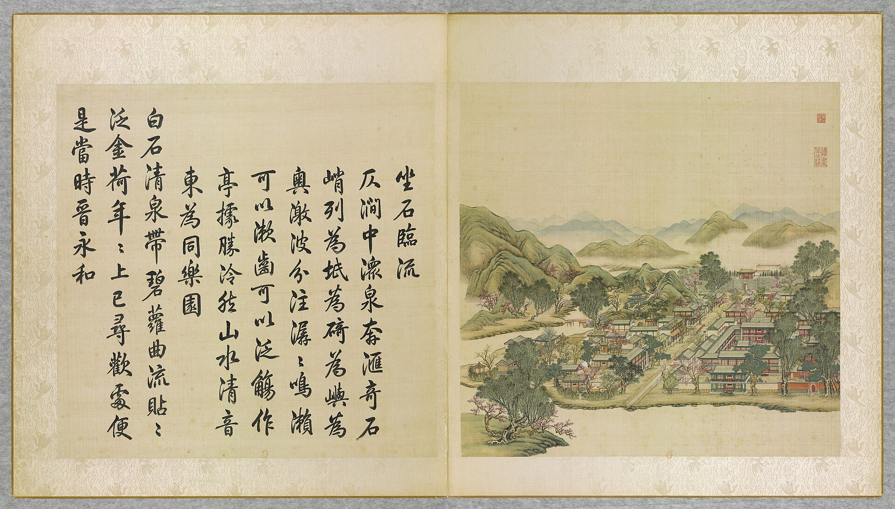

<!-- generated:start (scripts/building_pages.py): do not edit between these markers -->

# YM38-01: 坐石临流亭 Zuoshi Linliu Ting

Yuanming Yuan

**3D object:** 1 box. Open it: `/reconstruction/3d.html?b=YM38-01`

**Part of:** YM38 坐石临流

## What we know

- **Name:** 坐石临流亭 Zuoshi Linliu Ting (S05, S06, S01 · confidence B)
- **Written on the plan:** 土石临流 (S01 · confidence B)
- **Garden:** Yuanming Yuan (S05, S06, S01)
- **Type:** pavilion (S05, S06, S01 · confidence B)
- **Destroyed:** 1860 (S05, S06, S01)
- **Position:** 40.00824, 116.29222. S01 sure (S01 · confidence B)
- **Bays:** 3 in the texts (S05, S06, S01)
- **Size in the inventory:** 4.8 × 6.0 m. S01 plan px / hall scale (S01)
- **Note:** Poem: 作亭據勝處 [j82:26a]. S06: 兰亭八柱 stones (moved 1915 to 中山公园). orientation: W (S05, j82:25b). (S05, S06, S01)
- **Plan reader's note:** T-plan hall. Label to the SE. rect=35,22,0 (S01) *(research copy, not public)*
- **How it was read:** sure (S01) *(research copy, not public)*
- **Plan pixels:** 4405, 2415 (S01) *(research copy, not public)*

## Our model now

A plain box on the block drawn on the Qing plan S01: position and frontage from the plan, heights and roof from the typology of its hall class. It will be updated as the research goes on.

- **Box:** 4.8 × 6 m, pavilion square
- **Heights:** platform 0.48 m, eave 3.68 m, ridge 5.91 m above the ground
- **Roof:** pyramid 攒尖, grey tile
- **Faces:** 258.1° from north
- **Confidence:** B

## Pictures (1)

- **P0038** (likely): 坐石臨流 Zuoshi linliu [D'une pierre effleurant l'eau, regarder s'écouler l'onde] (圓明園四十景, 第38景) (1744 (BnF record: 1744年，清朝乾隆九年)). https://commons.wikimedia.org/wiki/File%3A%E5%9C%93%E6%98%8E%E5%9C%92%E5%9B%9B%E5%8D%81%E6%99%AF._%E7%AC%AC%E4%B8%89%E5%8D%81%E5%85%AB%E6%99%AF_%28%E4%B8%8B%E5%86%8C%EF%BC%8C%E7%AC%AC%E5%8D%81%E5%85%AB%E5%B9%85%E5%9B%BE%29%2C_%E5%9D%90%E7%9F%B3%E8%87%A8%E6%B5%81_-_%28%E6%B8%85%29%E5%94%90%E5%B2%B1%E3%80%81%E6%B2%88%E6%BA%90%E5%90%88%E7%95%AB_%3B_%28%E4%B9%BE%E9%9A%86%E5%90%9F%E8%AF%97%EF%BC%8C%E6%B1%AA%E7%94%B1%E6%95%A6%E4%BB%A3%E4%B9%A6%29Zuoshi_linliu_-_%28Qing%29Tang_Dai%2C_Shen_Yuan_he_hua%2C_-_btv1b550083530.jpg

  

## Texts and drawings (2)

- **E2064** (text, sure): 日下舊聞考 坐石临流. 1780s (乾隆 敕撰) · j82:25b · S05. https://github.com/kanripo/KR2k0036/blob/master/KR2k0036_082.txt
  > 坐石臨流在水木明瑟東南澹泊寧靜之東溪水周環軒宇三楹西嚮（圓明園册）臣等謹按坐石臨流四十景之一額為皇上御書
  South-east of 水木明瑟, east of 澹泊寧静, ringed by stream: three bays facing west. The note says only that the plaque is Qianlong's.
- **E2067** (description, sure): Scene 38, 坐石临流 Zuoshi Linliu, and 舍卫城 Shewei Cheng. 1934 · p.94 · S02. https://archive.org/details/historyofpekings00malo
  > Not far west of the Happy Sea a granite road between two rows of buildings, which included a theater and which looked like a business street in a city, crossed a bridge over a canal, and led up to a gate in a fortified wall like the entrance of a city.
  Granite road with shops and a theatre, a bridge, then the gate of 舍卫城 (Sravasti) in a walled enclosure with a pailou before it, red-walled temples inside, a similar gate on the north. The small pavilion over a rocky stream gave the scene its name. N.45: yellow glazed tile pieces found by Malone, inscribed She Wei Ch'eng and "made in the 15th year"; probably the 佛城 being built in 1740. The fair of the court was held on this street.

**On the plan:** Drawn on the plan of the gardens (S01), labelled 土石临流. https://artmuseum.princeton.edu/collections/objects/138657

## Evidence for the set of buildings

- Evidence for the whole compound 坐石临流: see YM38
- Reconstructions and comparables for the whole garden, 圆明园 Yuanming Yuan: see GARDEN-YM
- Standing buildings comparable to a square pavilion (not this building): see CLASS-pavilion_square

## Open questions

- Q91: YM38-01

<!-- generated:end -->

## Notes

<!-- Yours: regeneration never touches this part. It goes on the public site; what you write below a line holding only %% private %% stays in the research copy. -->
