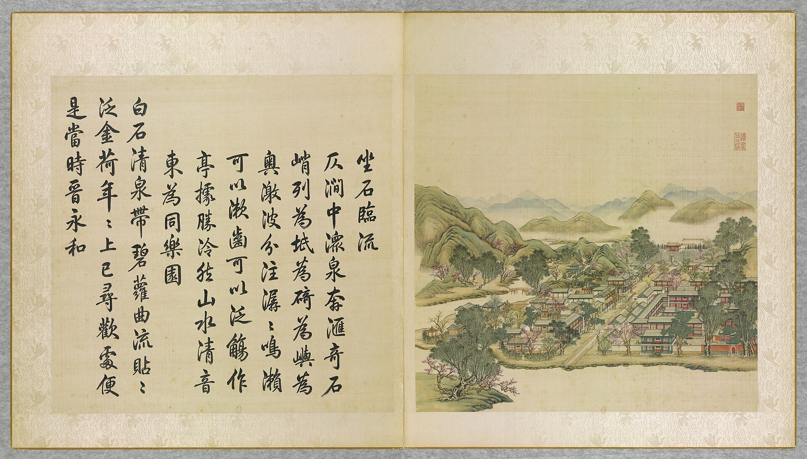
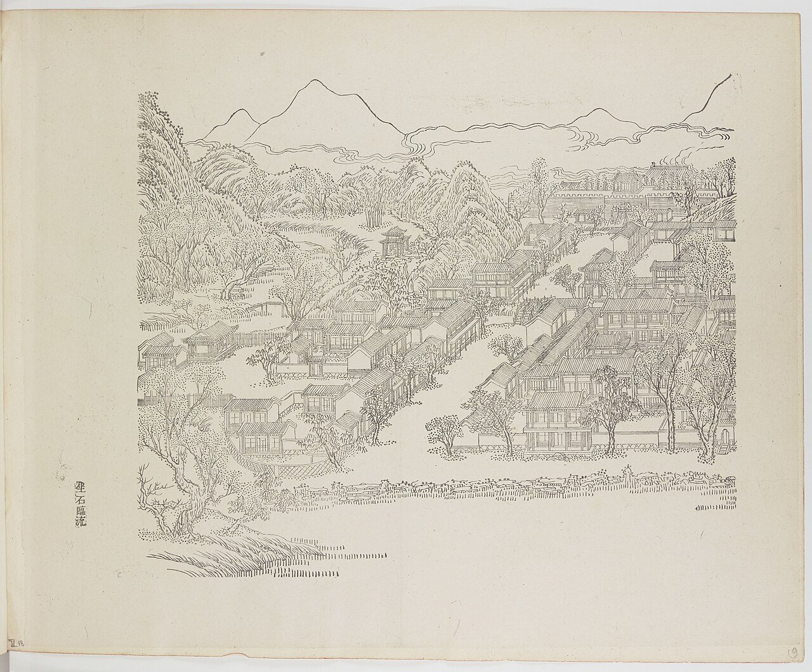
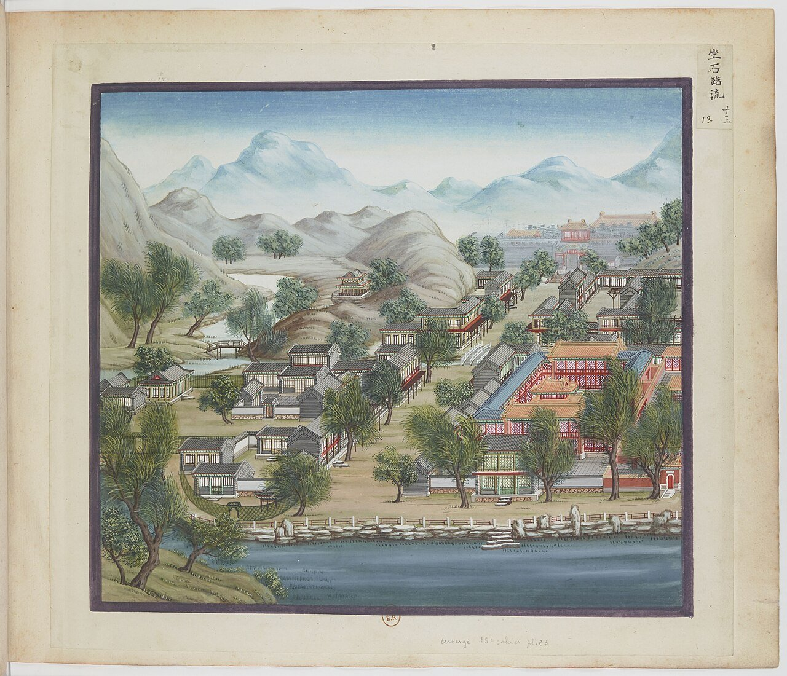
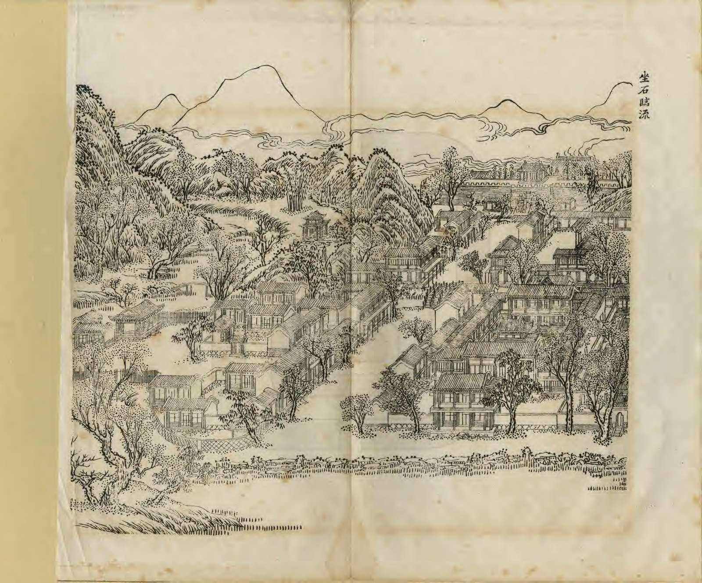
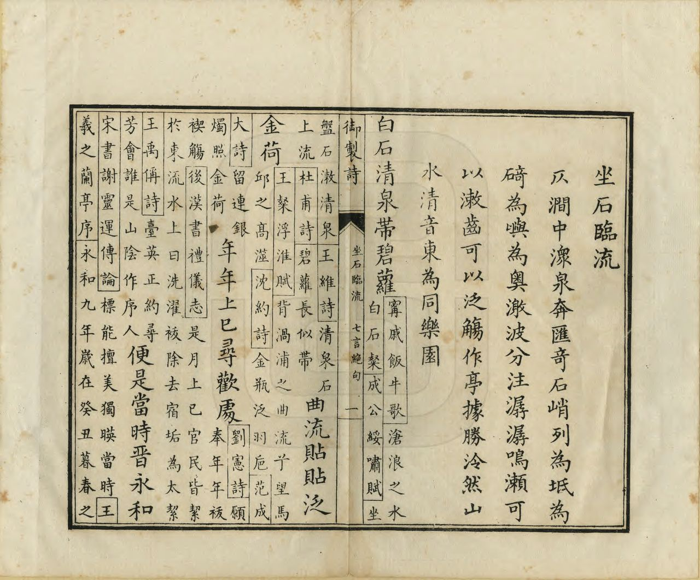
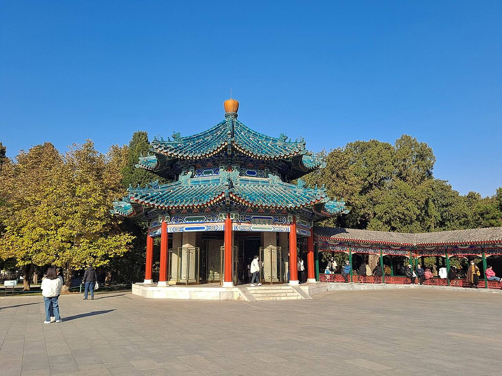
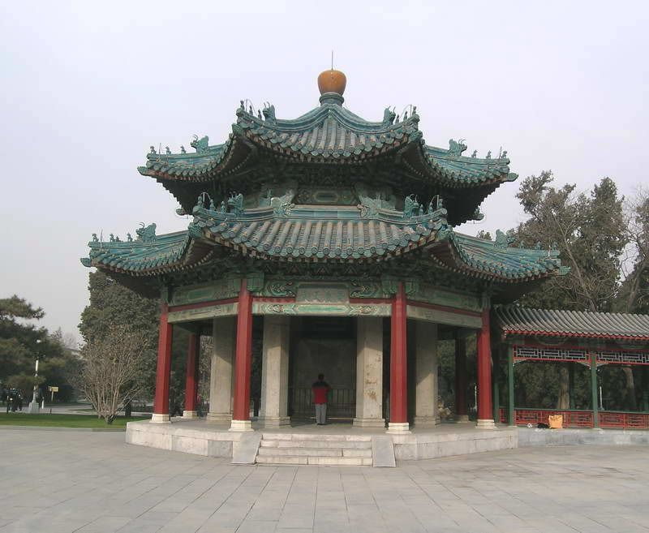

<!-- generated:start (scripts/building_pages.py): do not edit between these markers -->

# YM38: 坐石临流 Zuoshi Linliu

The Granite Road South of She Wei Ch'eng (the Stone Resting in the Running Water) · Yuanming Yuan

**3D object:** 7 boxes. Open it: `/reconstruction/3d.html?b=YM38`

## What we know

- **Name:** 坐石临流 Zuoshi Linliu (S05, S02, S08, S41, S01, S361, S310 · confidence A)
- **English:** The Granite Road South of She Wei Ch'eng (the Stone Resting in the Running Water) (S05, S02, S08, S41, S01, S361, S310)
- **Written on the plan:** 土石临流 (S01 · confidence A)
- **Garden:** Yuanming Yuan (S05, S02, S08, S41, S01, S361, S310)
- **Type:** scene (S05, S02, S08, S41, S01, S361, S310 · confidence A)
- **Changed:** Lanting pavilion with stone pillars and a carved stone screen standing by 1796; mid-Qianlong: 坐石临流 rebuilt as an eight-sided double-eaved pavilion 八方重檐亭, with a six-sided thatched pavilion, a square bamboo-style pavilion, a two-bay thatched house and a stone throne-bed and screen (S05, S02, S08, S41, S01, S361, S310)
- **Destroyed:** 1860 (S05, S02, S08, S41, S01, S361, S310)
- **Position:** 40.00833, 116.29183. S01 sure (S01 · confidence B)
- **Note:** Album leaf also shows 同乐园 (YM44) and 舍卫城 (YM45) (S41; S02 p.94). Hall list is only this pavilion; the rest are YM44, YM45. (S05, S02, S08, S41, S01, S361, S310)
- **Plan reader's note:** Label at (4288,2400). Polygon stops at the scroll gap x~4305; more drawing continues east of the gap (not read). (S01) *(research copy, not public)*
- **How it was read:** sure (S01) *(research copy, not public)*
- **Plan pixels:** 4245, 2345 (S01) *(research copy, not public)*

## Our model now

7 boxes stand in this compound, 7 on blocks drawn on the plan, 0 assumed. Its halls are listed below.

## Inside it (7)

- YM38-01 坐石临流亭
- YM38-B0396
- YM38-B0412
- YM38-B0435
- YM38-B0436
- YM38-B0437
- YM38-B0445

## Pictures (9)

- **P0038** (sure): 坐石臨流 Zuoshi linliu [D'une pierre effleurant l'eau, regarder s'écouler l'onde] (圓明園四十景, 第38景) (1744 (BnF record: 1744年，清朝乾隆九年)). https://commons.wikimedia.org/wiki/File%3A%E5%9C%93%E6%98%8E%E5%9C%92%E5%9B%9B%E5%8D%81%E6%99%AF._%E7%AC%AC%E4%B8%89%E5%8D%81%E5%85%AB%E6%99%AF_%28%E4%B8%8B%E5%86%8C%EF%BC%8C%E7%AC%AC%E5%8D%81%E5%85%AB%E5%B9%85%E5%9B%BE%29%2C_%E5%9D%90%E7%9F%B3%E8%87%A8%E6%B5%81_-_%28%E6%B8%85%29%E5%94%90%E5%B2%B1%E3%80%81%E6%B2%88%E6%BA%90%E5%90%88%E7%95%AB_%3B_%28%E4%B9%BE%E9%9A%86%E5%90%9F%E8%AF%97%EF%BC%8C%E6%B1%AA%E7%94%B1%E6%95%A6%E4%BB%A3%E4%B9%A6%29Zuoshi_linliu_-_%28Qing%29Tang_Dai%2C_Shen_Yuan_he_hua%2C_-_btv1b550083530.jpg

  

- **P0079** (sure): 中国皇帝的宫殿与庙宇. 第19幅图, 坐石臨流 - (清)孙祜、沈源Zuoshi linliu - (Qing)Sun Hu, Shen Yuan (1745 (Commons, from the BnF record)). https://commons.wikimedia.org/wiki/File%3A%E4%B8%AD%E5%9B%BD%E7%9A%87%E5%B8%9D%E7%9A%84%E5%AE%AB%E6%AE%BF%E4%B8%8E%E5%BA%99%E5%AE%87._%E7%AC%AC19%E5%B9%85%E5%9B%BE%2C_%E5%9D%90%E7%9F%B3%E8%87%A8%E6%B5%81_-_%28%E6%B8%85%29%E5%AD%99%E7%A5%9C%E3%80%81%E6%B2%88%E6%BA%90Zuoshi_linliu_-_%28Qing%29Sun_Hu%2C_Shen_Yuan_-_btv1b10520721k.jpg

  

- **P0113** (sure): 海淀(镇)：中国皇帝的行宫. 第13幅图, 坐石臨流Zuoshi linliu (1750-1792 (BnF, cb43831905b; ex coll. Bertin)). https://commons.wikimedia.org/wiki/File%3A%E6%B5%B7%E6%B7%80%28%E9%95%87%29%EF%BC%9A%E4%B8%AD%E5%9B%BD%E7%9A%87%E5%B8%9D%E7%9A%84%E8%A1%8C%E5%AE%AB._%E7%AC%AC13%E5%B9%85%E5%9B%BE%2C_%E5%9D%90%E7%9F%B3%E8%87%A8%E6%B5%81Zuoshi_linliu_-_btv1b10520651f.jpg

  

- **P0269** (sure): 坐石臨流 Zuoshi Linliu (御製圓明園圖詠, 1887 石印本, 下卷 (Commons 卷二), 第38景; printed title in the right margin of the picture) (光緒十三年 1887 (Commons/NLC record; colophon 光緒十三年七月天津石印書屋 in the SSID copy, S98 PDF p.2); design after the woodblock of 1745 by 孫祜 Sun Hu and 沈源 Shen Yuan). https://commons.wikimedia.org/wiki/File%3ANLC403-312001107375-14034_%E7%A6%A6%E5%88%B6%E5%9C%93%E6%98%8E%E5%9C%92%E5%9C%96%E8%A9%A0_%E5%8D%B7%E4%BA%8C.pdf?page=58

  

- **P0545** (sure): 坐石臨流 Zuoshi Linliu: 乾隆 Qianlong's preface and poem with the courtiers' commentary, 御製圓明園圖詠 1887 (poem 1744 (乾隆九年); this printing 1887). https://commons.wikimedia.org/wiki/File%3ANLC403-312001107375-14034_%E7%A6%A6%E5%88%B6%E5%9C%93%E6%98%8E%E5%9C%92%E5%9C%96%E8%A9%A0_%E5%8D%B7%E4%BA%8C.pdf?page=59

  

- **P0797** (likely): Bj zsgy07.JPG (not stated (Commons file page)). https://commons.wikimedia.org/wiki/File:Bj_zsgy07.JPG
- **P0492** (likely): Lanting Tablet Pavilion 1.jpg (2023-11-18 (Commons DateTimeOriginal)). https://commons.wikimedia.org/wiki/File:Lanting_Tablet_Pavilion_1.jpg

  

- **P0493** (likely): Lanting Eight-column Pavilion, Zhongshan Park.jpg (Nov.27th, 2005 (Commons DateTimeOriginal)). https://commons.wikimedia.org/wiki/File:Lanting_Eight-column_Pavilion,_Zhongshan_Park.jpg

  

- **P0798** (likely): Dongcheng, Beijing, China - panoramio (65).jpg (Taken on 17 June 2013 (Commons file page)). https://commons.wikimedia.org/wiki/File:Dongcheng,_Beijing,_China_-_panoramio_(65).jpg

## Texts and drawings (23)

- **E2056** (poem, sure): 御製坐石臨流詩（圓明園四十景詩）. 1744 (乾隆九年) · printed in S05 j82:26a · S40. https://github.com/kanripo/KR2k0036/blob/master/KR2k0036_082.txt
  > 乾隆九年 御製坐石臨流詩 仄澗中潨泉奔滙竒石峭列為坻為碕為嶼為奥激波分注潺潺鳴籟可以潄齒可以泛觴作亭據勝處泠然山水清音東為同樂園 白石清泉帶碧蘿曲流貼貼泛金荷年年上已尋歡處便是當時晉永和
  Waters race together in a narrow gully, past sharp rocks. The stream's divided flow sings, good for rinsing the mouth or floating wine cups. A pavilion stands at the best spot, with 同樂園 to the east.
- **E2064** (text, sure): 日下舊聞考 坐石临流. 1780s (乾隆 敕撰) · j82:25b · S05. https://github.com/kanripo/KR2k0036/blob/master/KR2k0036_082.txt
  > 坐石臨流在水木明瑟東南澹泊寧靜之東溪水周環軒宇三楹西嚮（圓明園册）臣等謹按坐石臨流四十景之一額為皇上御書
  South-east of 水木明瑟, east of 澹泊寧静, ringed by stream: three bays facing west. The note says only that the plaque is Qianlong's.
- **E2057** (poem, sure): 养和室: 乾隆三十二年 poem of the Qianlong Emperor. 乾隆三十二年 (1767), date from the compilation · p.222 item (1), under 养和室 · S360. https://www.yuanmingyuanpark.cn/xs/yjbg/202007/P020200730387572832602.pdf#page=222
  > 啬神非吾希，种秫非吾怡。发而皆中节，闻之吾子思。是必有所养，其和匪矜持。不为内欲扰，不为外物移。 如元首万善，如春冠四时。冲融去安排，位育庶可几。
  Poem of the Qianlong Emperor at 养和室, 1767. Year as given by the compilation.
- **E2058** (poem, sure): 抱朴草堂: 乾隆三十二年 poem of the Qianlong Emperor. 乾隆三十二年 (1767), date from the compilation · p.221 item (1), under 抱朴草堂 · S360. https://www.yuanmingyuanpark.cn/xs/yjbg/202007/P020200730387572832602.pdf#page=221
  > 轩楹近觉厌华庨，洁治书堂覆草茅。欲拟幽人犹未得，敢言古帝恐成淆。闲披芸简窗前朗，静聴松风户外敲。津逮漫言由李葛，仙家与我却无交。”抱朴草堂是乾隆皇帝依照承德狮子园草房改建而成。乾隆在诗中有云：“抱朴草堂之构以皇考热河狮子园有草房，因仿 效为之，用昭示俭深意
  Poem of the Qianlong Emperor at 抱朴草堂, 1767. Year as given by the compilation.
- **E2059** (poem, sure): 抱朴草堂: 乾隆三十二年 poem of the Qianlong Emperor. 乾隆三十二年 (1767), date from the compilation · p.222 item (2), under 抱朴草堂 · S360. https://www.yuanmingyuanpark.cn/xs/yjbg/202007/P020200730387572832602.pdf#page=222
  > 洁治数间屋，匪华以朴胜。曲篱堂后围，横溪阶下映。插架富芸编，汲古颐神性。清暇偶憩坐，窗明几亦净。惜阴意有永，体物心无竞。绮镫方在楹，微觉弗相称。
  Poem of the Qianlong Emperor at 抱朴草堂, 1767, on reading. Year as given by the compilation.
- **E2060** (poem, sure): 养和室: 乾隆三十五年 poem of the Qianlong Emperor. 乾隆三十五年 (1770), date from the compilation · p.223 item (2), under 养和室 · S360. https://www.yuanmingyuanpark.cn/xs/yjbg/202007/P020200730387572832602.pdf#page=223
  > 交养由来内外通，春和一室趣无穷。便如九十韶光富，也在冲容酝酿中。
  Poem of the Qianlong Emperor at 养和室, 1770, on the view. Year as given by the compilation.
- **E2061** (poem, sure): 养和室: 乾隆五十四年 poem of the Qianlong Emperor. 乾隆五十四年 (1789), date from the compilation · p.223 item (4), under 养和室 · S360. https://www.yuanmingyuanpark.cn/xs/yjbg/202007/P020200730387572832602.pdf#page=223
  > 一室冲融号养和，窗前春物未婆娑。诸凡未发先为蓄，吾亦于斯所得多。
  Poem of the Qianlong Emperor at 养和室, 1789. Year as given by the compilation.
- **E2062** (poem, sure): 坐石临流. 嘉庆元年 (1796) · v3 p.97, under 坐石临流; source ref 1-123 · S361. https://www.yuanmingyuanpark.cn/xs/yjbg/202008/P020200803382569071850.pdf#page=100
  > 修禊清游晋永和，仿成亭子俯平坡。山屏镂刻图全展，石柱周环帖遍罗。曲水纡回通别渚，茂林幽邃荫崇阿。岂同觞咏怀今昔，几暇肩舆偶一过。
  Poem 坐石临流 by the Jiaqing Emperor, 1796, filed by the editors under 坐石临流.
- **E2063** (poem, sure): 抱朴草堂: 嘉庆十一年 poem of the Jiaqing Emperor. 嘉庆十一年 (1806), date from the compilation · p.222 item (10), under 抱朴草堂 · S360. https://www.yuanmingyuanpark.cn/xs/yjbg/202007/P020200730387572832602.pdf#page=222
  > 心非黄屋念茅茨，数架草堂碧水湄。欲使民风返淳朴，雕梁画栋又奚为。纸窗藤榻欣清雅，静觉田家风味宜。渚畔停桡偶临憩，半瓯芳茗一章诗。
  Poem of the Jiaqing Emperor at 抱朴草堂, 1806, on the view. Year as given by the compilation.
- **E2067** (description, sure): Scene 38, 坐石临流 Zuoshi Linliu, and 舍卫城 Shewei Cheng. 1934 · p.94 · S02. https://archive.org/details/historyofpekings00malo
  > Not far west of the Happy Sea a granite road between two rows of buildings, which included a theater and which looked like a business street in a city, crossed a bridge over a canal, and led up to a gate in a fortified wall like the entrance of a city.
  Granite road with shops and a theatre, a bridge, then the gate of 舍卫城 (Sravasti) in a walled enclosure with a pailou before it, red-walled temples inside, a similar gate on the north. The small pavilion over a rocky stream gave the scene its name. N.45: yellow glazed tile pieces found by Malone, inscribed She Wei Ch'eng and "made in the 15th year"; probably the 佛城 being built in 1740. The fair of the court was held on this street.
- **E1011** (description, sure): Site status table, about 2011: nothing visible, or built over. c. 2011 · 系列06 repost, status table · S356. https://blog.sina.com.cn/s/blog_c27029650101itzz.html
  Same table. In it the first group shows no visible remains; 得全阁, 流香渚, 凤麟洲, 涵秋馆, 蔚藻堂, 中和堂, 敷春堂 and 心镜轩 have service buildings on them, and 含晖楼, 澄心堂, 延寿寺, 清夏堂 and 喜雨山房 are occupied by other institutions. 澹泊宁静 and several others have been dug since, so this is out of date for them.
- **E2157** (description, sure): 圆明园同乐园的功能及其文化内涵. post n.d. · lswh · S337. http://iqh.ruc.edu.cn/old/qdhjylyjzx/xszl/ylfj/602fc6cd19de47f8b9fb9d1a693ade5e.htm
  同乐园 Tongle Yuan, part of 坐石临流, was the court's main entertainment quarter, begun early Yongzheng: stage 清音阁, main hall, temple 永日堂 and the shop street. Emperor below and empresses above in the viewing hall; princes and envoys in east and west wings of 14 bays each. Nine upper buildings of 64 bays. Street T-shaped, 120 x 100 m.
- **E1276** (description, likely): 圆明园景点建筑命名对古代文学遗产的继承与发展. post n.d. · lswh · S337. http://iqh.ruc.edu.cn/old/qdhjylyjzx/xszl/jzys/dede1cad62ea454f85d22aca8ad15328.htm
  How scene and hall names come from literature: 上下天光 from 范仲淹, 杏花春馆 from 杜牧, 武陵春色 from 陶渊明, 坐石临流 from 兰亭, and 丰乐轩 and 顺木天 from 柳宗元. It also quotes the 陶渊明 line 平畴交远风. It places 丰乐轩, three bays facing north, in the 紫碧山房 scene.
- **E2070** (description, likely): 清宮詞 note. Republic period · line 548 of the corpus file · S215. https://github.com/garychowcmu/daizhigev20/blob/master/诗藏/词集/清宫词.txt
  Note: the old 蘭亭 of the garden (taken to be the pavilion of 坐石臨流; the note does not name the scene) had a stone with a picture and imperial poem, and eight pillars with famous copies. After the ruin the stone went to the Central Park and the pillars were found at 頤和園.
- **E2065** (description, sure): 圆明园百景史事分景汇编: 养和室. 1767-1789 · from p.222, under 坐石临流 · S360. https://www.yuanmingyuanpark.cn/xs/yjbg/202007/P020200730387572832602.pdf#page=222
  养和室: 4 dated items, 1767-1789, of which 4 poems (Qianlong); recurring themes: the view. First dated 1767, last dated 1789.
- **E2066** (description, sure): 圆明园百景史事分景汇编: 抱朴草堂. 1767-1806 · from p.221, under 坐石临流 · S360. https://www.yuanmingyuanpark.cn/xs/yjbg/202007/P020200730387572832602.pdf#page=221
  抱朴草堂: 10 dated items, 1767-1806, of which 10 poems (Qianlong, Jiaqing); recurring themes: reading, the view. First dated 1767, last dated 1806.
- **E2068** (description, sure): 圆明园五朝御制诗文集注 v3, editors' note on 坐石临流. 2020 edition · v3 p.88 · S361. https://www.yuanmingyuanpark.cn/xs/yjbg/202008/P020200803382569071850.pdf#page=91
  An overview of a four-part district with the shop street in the middle. 坐石临流 is the cup-floating pavilion; 抱朴草堂 a six-bay reverse hall. It gives 舍卫城 hall by hall (多宝阁, 寿国寿民, 仁慈殿, 普福宫, 最胜阁), and 同乐园: a theatre with towers of five bays, three-bay link, the emperor below and dowager above, facing the three-storey stage 清音阁.
- **E2069** (description, sure, search index only): 坐石临流 scene card. n.d. · mhymy jqjs 11647 · S340. https://www.mhymy.com/ymss/jqjs/11647.html
  North-east of 后湖; copies the 兰亭 of Shaoxing, with its winding-stream gathering of 王羲之.
- **E2071** (drawing, sure): 《国家图书馆藏样式雷图档·圆明园卷初编》: 坐石临流. mostly 道光, 咸丰, 同治 per the publisher · 初编 目录: 坐石临流, pp.229-262 · S13. https://www.nlcpress.com/ProductView.aspx?Id=7642
  The printed facsimile of the National Library of China's Yangshi Lei sheets has a section on this place at pp.229-262 (34 pages, section length worked out from the next heading); sheet titles and numbers are in the volume, ordered from a library.
- **E2158** (drawing, likely): 同乐园 烫样. 中国国家博物馆 · S328. https://www.mhymy.com/xwzx/ssrd/13512.html
  Paper model of the Tongle Yuan group under conservation at the National Museum, reported as the clearest surviving record of it, labelled with directions and sizes; made for Tongzhi's project per the report.
- **E2072** (drawing, sure, search index only): 同乐园平面图. S310. https://www.mhymy.com/dasl/ysltd/7295.html
  Plan of the great theatre garden, part of Zuoshi Linliu, facing Shewei Cheng to the north; shelf number and date not seen in the extract. No image here; the site may ask a small payment for the full record.
- **E0550** (plan, sure): 圆明园新证—乾隆朝圆明园全图的发现与研究 (端木泓). post n.d. · 故宫博物院图书馆 no.1704 · S337. http://iqh.ruc.edu.cn/old/qdhjylyjzx/xszl/xstl/1c9094aef4f041148f15883c7c266cb9.htm
  Argues Palace Museum Library plan no.1704, paper, about 17.6 x 13.1 m, is the earliest complete plan of the Qianlong garden. About a hundred pasted corrections sit over the base layer, recording changes from Qianlong 44 (1779) to Daoguang 11 (1831, 慎德堂). 坐石临流 is one scene shown both ways.
- **E2262** (plan, sure): 圆明园新证, 端木泓: dated additions shown on plan 1704. post n.d. · tables 1 and 2 · S337. http://iqh.ruc.edu.cn/old/qdhjylyjzx/xszl/xstl/1c9094aef4f041148f15883c7c266cb9.htm
  Tables of when things were added, drawn from archives to date the plan's layers: 藻园 1752, 廓然大公 eight views 1754, 春雨轩 1755, 藏密楼 1758, 多稼轩 ten views 1759, 紫碧山房 1760, 安澜园 and 澄练楼 1763, 若帆之阁 1764, 汇万总春之庙 1769, 文源阁 1775, 法源楼 1779; after: 兰亭八柱 1779, 知过堂 1782, 课农轩 1816, 涵月楼 1827. The most useful single dating table found.

**On the plan:** Drawn on the plan of the gardens (S01), labelled 土石临流. https://artmuseum.princeton.edu/collections/objects/138657

## Reconstructions by others (1)

Modern interpretation, not evidence.
- **R0301** (AR/VR, likely): 时光巴士, hydrogen XR bus with transparent screens. Jeff Smith and Steve Petersen, Chrono Craft, 圆明园管理处, 2024. https://arinsider.co/?p=25138 Research-only: link card.

## Surviving comparable buildings, not this building (4)

- **T039** 兰亭 Lan Ting (Orchid Pavilion), 绍兴 Shaoxing. Comparable: same court, era or type, confidence A, standing: yes. A literary reference; 流觞 water. Compare the 流觞亭 setting Basis: S05 j.82 f.26a poem of 乾隆九年: stone stream 「可以泛觞」, 「年年上巳寻欢处，便是当时晋永和」: refers to the gathering of 353. https://github.com/kanripo/KR2k0036
  - P0581: Lanting, 2021-04-17 03. https://commons.wikimedia.org/wiki/File:Lanting,_2021-04-17_03.jpg
  - P0582: Lanting, 2021-04-17 05. https://commons.wikimedia.org/wiki/File:Lanting,_2021-04-17_05.jpg
  - P0664: 兰亭碑亭. https://commons.wikimedia.org/wiki/File:%E5%85%B0%E4%BA%AD%E7%A2%91%E4%BA%AD.jpg
- **T040** 兰亭八柱 (八柱碑亭) Eight Pillars of the Orchid Pavilion, with stele pavilion, 中山公园 Zhongshan Park, Beijing. Comparable: same court, era or type, confidence B, standing: yes. Real form: octagonal pavilion on eight stone pillars with carved copies of Lanting calligraphy Basis: Not a copy. S409: the 兰亭 stele and its eight pillars reached 中央公园 in two stages, before 1917 and after 1941 (the article also names a 1925 purchase of 圆明园 stones). S408: a stone pavilion on eight pillars carrying Lanting copies. These are surviving parts of ours; no schema value says that, so `comparable`. https://www.chinanews.com/zhuanzhu/2000-10-23/257.html
- **T041** 流水音 (淑清院流杯亭) Liushui Yin, 中南海 西苑 Zhongnanhai, Beijing. Comparable: same court, era or type, confidence B, standing: yes. Name shared with a hall at YM31; cup pavilion Basis: 郝黎, 清代西苑淑清院流杯亭考 (S410): Qianlong rebuilt and named this cup-floating pavilion; same 曲水流觞 tradition. Note our YM31 平湖秋月 also has a 流水音 (S05 j.82 f.15b). https://www.jgcm.ac.cn/jah/article/doi/10.12329/20969368.2025.02006
- **T042** 禊赏亭 Xishang Ting (Pavilion of the Spring Purification), 宁寿宫花园 Qianlong Garden, Forbidden City. Comparable: same court, era or type, confidence B, standing: yes. Standing Qianlong 流杯 pavilion; roof, plan, channel Basis: Search summary (gmw 2026): 凸-plan pavilion with a carved white marble cup-channel 27 m long, bamboo patterned, evoking Lanting. Same emperor, same Lanting theme as ours; no source says one copied the other. https://m.gmw.cn/2026-10/06/content_1304572408.htm

## Evidence for the set of buildings

- Reconstructions and comparables for the whole garden, 圆明园 Yuanming Yuan: see GARDEN-YM

## Open questions

- Q91: YM38-01
- Q99: Wolseley (S240), M'Ghee (S242), Loch (S244)
- Q119: Digs
- Q125: Geotagged Commons coverage is thin
- Q192: Land necks the plan draws lie under the traced water
- Q193: Bridges: three at 出入贤良门, and bridges the readers saw that the layer lacks

<!-- generated:end -->

## Notes

<!-- Yours: regeneration never touches this part. It goes on the public site; what you write below a line holding only %% private %% stays in the research copy. -->
