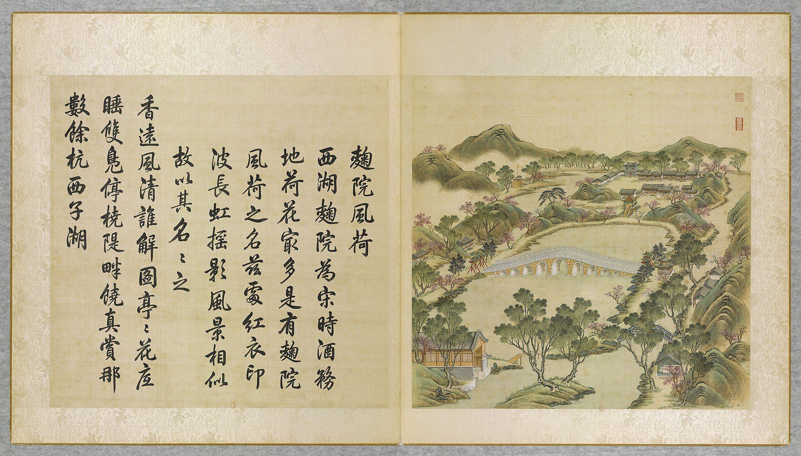

<!-- generated:start (scripts/building_pages.py): do not edit between these markers -->

# YM39-03: 九孔桥 Jiukong Qiao

Yuanming Yuan

**3D object:** none yet.

**Part of:** YM39 曲院风荷

## What we know

- **Name:** 九孔桥 Jiukong Qiao (S05, S02, S01 · confidence B)
- **Garden:** Yuanming Yuan (S05, S02, S01)
- **Type:** bridge (S05, S02, S01 · confidence B)
- **Destroyed:** 1860 (S05, S02, S01)
- **Position:** 40.00483, 116.29368. S01 likely (S01 · confidence B)
- **Note:** 9 arches (S02 p.96). (S05, S02, S01)
- **Plan reader's note:** 九孔桥: plain causeway-like bar between the ovals, no arches drawn. rect=320,45,0 (S01) *(research copy, not public)*
- **How it was read:** likely (S01) *(research copy, not public)*
- **Plan pixels:** 4765, 4180 (S01) *(research copy, not public)*

## Our model now

No box in the 3D view: the plan shows no building here, or a plot, water, a hill or a name only.

## Pictures (1)

- **P0039** (likely): 麴院風荷 Quyuan fenghe [Senteurs de lotus à travers la cour des Ferments] (圓明園四十景, 第39景) (1744 (BnF record: 1744年，清朝乾隆九年)). https://commons.wikimedia.org/wiki/File%3A%E5%9C%93%E6%98%8E%E5%9C%92%E5%9B%9B%E5%8D%81%E6%99%AF._%E7%AC%AC%E4%B8%89%E5%8D%81%E4%B9%9D%E6%99%AF_%28%E4%B8%8B%E5%86%8C%EF%BC%8C%E7%AC%AC%E5%8D%81%E4%B9%9D%E5%B9%85%E5%9B%BE%29%2C_%E9%BA%B4%E9%99%A2%E9%A2%A8%E8%8D%B7_-_%28%E6%B8%85%29%E5%94%90%E5%B2%B1%E3%80%81%E6%B2%88%E6%BA%90%E5%90%88%E7%95%AB_%3B_%28%E4%B9%BE%E9%9A%86%E5%90%9F%E8%AF%97%EF%BC%8C%E6%B1%AA%E7%94%B1%E6%95%A6%E4%BB%A3%E4%B9%A6%29Quyuan_fenghe_-_%28Qing%29Tang_Dai%2C_Shen_Yuan_he_hua_-_btv1b55008354f.jpg

  

## Texts and drawings (2)

- **E2078** (text, sure): 日下舊聞考 曲院风荷. 1780s (乾隆 敕撰) · j82:27a-27b · S05. https://github.com/kanripo/KR2k0036/blob/master/KR2k0036_082.txt
  > 麴院風荷之南跨池東西橋九空坊楔二西為金鼇東為玉蝀金鼇西南河外室為四圍佳麗玉蝀東有亭為飲練長虹又東南度橋折而北設城闗為寧和鎮其東南為東樓門（圓明園册）臣等謹按飲練長虹寧和鎮諸額皆御書
  South of 麴院風荷, a nine-opening bridge across the pool with archways 金鼇 to the west and 玉蝀 to the east; 四圍佳麗 and the 飲練長虹 pavilion nearby; further south-east the walled mock town 寧和鎮 and the 東樓門.
- **E2080** (description, sure): Scene 39, 曲院风荷 Quyuan Fenghe. 1934 · pp.94-96 · S02. https://archive.org/details/historyofpekings00malo
  > The building at the Yuan Ming Yuan which bore this name faced south on a pretty lotus pond crossed by a great curved bridge supported by nine arches and leading nowhere in particular.
  Hall facing south on a lotus pond with a nine-arch curved bridge.

**On the plan:** Drawn on the plan of the gardens (S01) with no label: a building stood here, its name unknown. https://artmuseum.princeton.edu/collections/objects/138657

## Evidence for the set of buildings

- Evidence for the whole compound 曲院风荷: see YM39
- Reconstructions and comparables for the whole garden, 圆明园 Yuanming Yuan: see GARDEN-YM

## Open questions

None that name it.

<!-- generated:end -->

## Notes

<!-- Yours: regeneration never touches this part. It goes on the public site; what you write below a line holding only %% private %% stays in the research copy. -->
