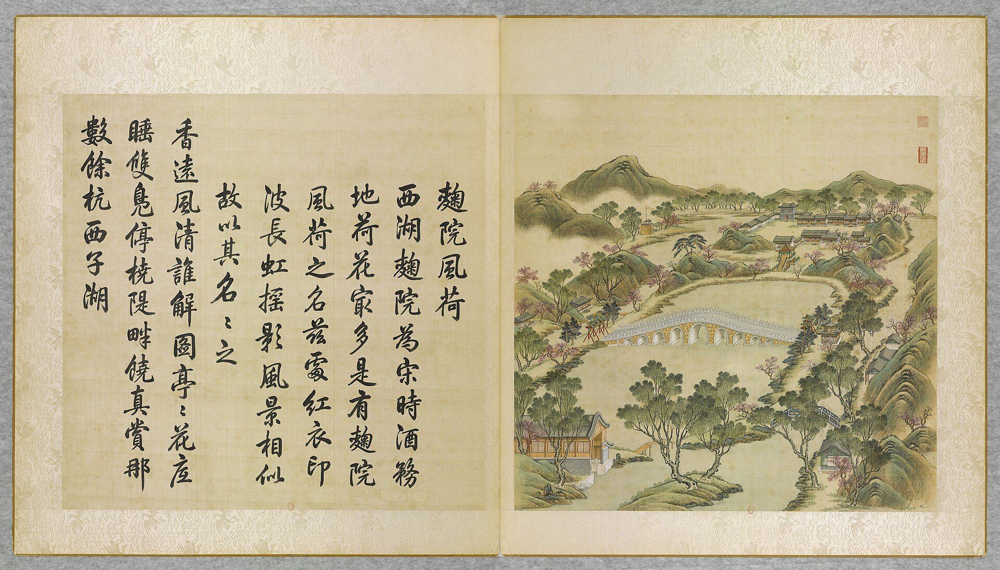

<!-- generated:start (scripts/building_pages.py): do not edit between these markers -->

# YM39-07: 饮练长虹亭 Yinlian Changhong Ting

Yuanming Yuan

**3D object:** 1 box. Open it: `/reconstruction/3d.html?b=YM39-07`

**Part of:** YM39 曲院风荷

## What we know

- **Name:** 饮练长虹亭 Yinlian Changhong Ting (S05, S01 · confidence B)
- **Written on the plan:** 饮练长虹 (S01 · confidence B)
- **Garden:** Yuanming Yuan (S05, S01)
- **Type:** pavilion (S05, S01 · confidence B)
- **Destroyed:** 1860 (S05, S01)
- **Position:** 40.00496, 116.29424. S01 sure (S01 · confidence B)
- **Bays:** 1x1 on the plan (S05, S01)
- **Size in the inventory:** 6.7 × 6.6 m. S01 plan px / hall scale (S01)
- **Plan reader's note:** Label just east. (S01) *(research copy, not public)*
- **How it was read:** sure (S01) *(research copy, not public)*
- **Plan pixels:** 4992, 4185 (S01) *(research copy, not public)*

## Our model now

On the block drawn on the Qing plan S01: position and frontage from the plan, heights and roof from the typology of its hall class, its form drawn by the hall kit. It will be updated as the research goes on.

- **Box:** 6.7 × 6.6 m, pavilion square
- **Heights:** platform 0.48 m, eave 3.68 m, ridge 6.75 m above the ground
- **Roof:** pyramid 攒尖, double eaves 重檐, grey tile
- **Faces:** 71.6° from north
- **Drawn:** by the hall kit: 1 bay, steps on the back, front, 攒尖 pyramid, double eaves 重檐, grey tile, a painted beam under the eave. From its own figures and readings where the dossier gives them (roof read: halls.csv S08 A; tiles read: halls.csv S08 A), the rest from the typology of its hall class.
- **Confidence:** B

## Pictures (1)

- **P0039** (likely): 麴院風荷 Quyuan fenghe [Senteurs de lotus à travers la cour des Ferments] (圓明園四十景, 第39景) (1744 (BnF record: 1744年，清朝乾隆九年)). https://commons.wikimedia.org/wiki/File%3A%E5%9C%93%E6%98%8E%E5%9C%92%E5%9B%9B%E5%8D%81%E6%99%AF._%E7%AC%AC%E4%B8%89%E5%8D%81%E4%B9%9D%E6%99%AF_%28%E4%B8%8B%E5%86%8C%EF%BC%8C%E7%AC%AC%E5%8D%81%E4%B9%9D%E5%B9%85%E5%9B%BE%29%2C_%E9%BA%B4%E9%99%A2%E9%A2%A8%E8%8D%B7_-_%28%E6%B8%85%29%E5%94%90%E5%B2%B1%E3%80%81%E6%B2%88%E6%BA%90%E5%90%88%E7%95%AB_%3B_%28%E4%B9%BE%E9%9A%86%E5%90%9F%E8%AF%97%EF%BC%8C%E6%B1%AA%E7%94%B1%E6%95%A6%E4%BB%A3%E4%B9%A6%29Quyuan_fenghe_-_%28Qing%29Tang_Dai%2C_Shen_Yuan_he_hua_-_btv1b55008354f.jpg

  

## Texts and drawings (1)

- **E2078** (text, sure): 日下舊聞考 曲院风荷. 1780s (乾隆 敕撰) · j82:27a-27b · S05. https://github.com/kanripo/KR2k0036/blob/master/KR2k0036_082.txt
  > 麴院風荷之南跨池東西橋九空坊楔二西為金鼇東為玉蝀金鼇西南河外室為四圍佳麗玉蝀東有亭為飲練長虹又東南度橋折而北設城闗為寧和鎮其東南為東樓門（圓明園册）臣等謹按飲練長虹寧和鎮諸額皆御書
  South of 麴院風荷, a nine-opening bridge across the pool with archways 金鼇 to the west and 玉蝀 to the east; 四圍佳麗 and the 飲練長虹 pavilion nearby; further south-east the walled mock town 寧和鎮 and the 東樓門.

**On the plan:** Drawn on the plan of the gardens (S01), labelled 饮练长虹, 1x1 cells. https://artmuseum.princeton.edu/collections/objects/138657

## Evidence for the set of buildings

- Evidence for the whole compound 曲院风荷: see YM39
- Reconstructions and comparables for the whole garden, 圆明园 Yuanming Yuan: see GARDEN-YM
- Standing buildings comparable to a square pavilion (not this building): see CLASS-pavilion_square

## Open questions

None that name it.

<!-- generated:end -->

## Notes

<!-- Yours: regeneration never touches this part. It goes on the public site; what you write below a line holding only %% private %% stays in the research copy. -->
