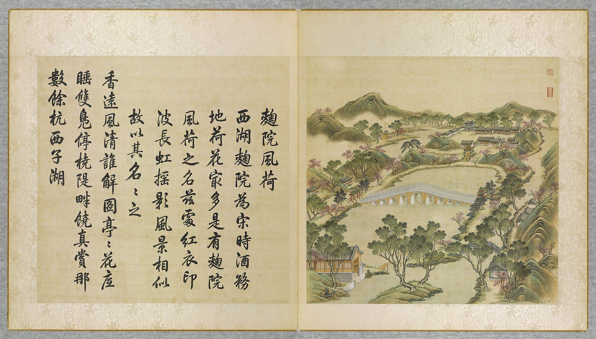

<!-- generated:start (scripts/building_pages.py): do not edit between these markers -->

# YM39-08: 宁和镇 Ninghe Zhen

Yuanming Yuan

**3D object:** 5 boxes. Open it: `/reconstruction/3d.html?b=YM39-08`

**Part of:** YM39 曲院风荷

## What we know

- **Name:** 宁和镇 Ninghe Zhen (S05, S01 · confidence B)
- **Written on the plan:** 春和镇 (S01 · confidence B)
- **Garden:** Yuanming Yuan (S05, S01)
- **Type:** gate (S05, S01 · confidence B)
- **Destroyed:** 1860 (S05, S01)
- **Position:** 40.00463, 116.29486. S01 likely (S01 · confidence B)
- **Bays:** 2x1 on the plan (S05, S01)
- **Size in the inventory:** 7.9 × 5.4 m. S01 plan px / hall scale (S01)
- **Plan reader's note:** Plan 春和镇, text 宁和镇. Text 设城关: row B0775, B0776, an X-marked square at (5275,4426), B0777 on the road; blank strip B0816 may be the gate passage. (S01) *(research copy, not public)*
- **How it was read:** likely (S01) *(research copy, not public)*
- **Plan pixels:** 5224, 4425 (S01) *(research copy, not public)*

## Our model now

A plain box on the block drawn on the Qing plan S01: position and frontage from the plan, heights and roof from the typology of its hall class. It will be updated as the research goes on.

- **1 ×:** gate hall: 6.91 × 5.4 m, eave 4.47 m, ridge 6.4 m
- **1 ×:** gate hall: 6.07 × 5.32 m, eave 4.47 m, ridge 6.38 m
- **1 ×:** gate hall: 9.1 × 6.3 m, eave 4.47 m, ridge 6.72 m
- **1 ×:** gate hall: 8.1 × 5.4 m, eave 4.47 m, ridge 6.4 m
- **1 ×:** gate hall: 6.9 × 6 m, eave 4.47 m, ridge 6.61 m
- **Confidence:** B

## Pictures (1)

- **P0039** (likely): 麴院風荷 Quyuan fenghe [Senteurs de lotus à travers la cour des Ferments] (圓明園四十景, 第39景) (1744 (BnF record: 1744年，清朝乾隆九年)). https://commons.wikimedia.org/wiki/File%3A%E5%9C%93%E6%98%8E%E5%9C%92%E5%9B%9B%E5%8D%81%E6%99%AF._%E7%AC%AC%E4%B8%89%E5%8D%81%E4%B9%9D%E6%99%AF_%28%E4%B8%8B%E5%86%8C%EF%BC%8C%E7%AC%AC%E5%8D%81%E4%B9%9D%E5%B9%85%E5%9B%BE%29%2C_%E9%BA%B4%E9%99%A2%E9%A2%A8%E8%8D%B7_-_%28%E6%B8%85%29%E5%94%90%E5%B2%B1%E3%80%81%E6%B2%88%E6%BA%90%E5%90%88%E7%95%AB_%3B_%28%E4%B9%BE%E9%9A%86%E5%90%9F%E8%AF%97%EF%BC%8C%E6%B1%AA%E7%94%B1%E6%95%A6%E4%BB%A3%E4%B9%A6%29Quyuan_fenghe_-_%28Qing%29Tang_Dai%2C_Shen_Yuan_he_hua_-_btv1b55008354f.jpg

  

## Texts and drawings (3)

- **E2078** (text, sure): 日下舊聞考 曲院风荷. 1780s (乾隆 敕撰) · j82:27a-27b · S05. https://github.com/kanripo/KR2k0036/blob/master/KR2k0036_082.txt
  > 麴院風荷之南跨池東西橋九空坊楔二西為金鼇東為玉蝀金鼇西南河外室為四圍佳麗玉蝀東有亭為飲練長虹又東南度橋折而北設城闗為寧和鎮其東南為東樓門（圓明園册）臣等謹按飲練長虹寧和鎮諸額皆御書
  South of 麴院風荷, a nine-opening bridge across the pool with archways 金鼇 to the west and 玉蝀 to the east; 四圍佳麗 and the 飲練長虹 pavilion nearby; further south-east the walled mock town 寧和鎮 and the 東樓門.
- **E2393** (text, likely): 《日下舊聞考》 on 寧和鎮, the plan's 春和镇. 乾隆, 1780s · j82:27b · S05. https://www.kanripo.org/text/KR2k0036/082
  > 飲練長虹又東南度橋折而北設城闗為寧和鎮其東南為東樓門
  Rixia gives 寧和鎮, a gate fort. S01 reads 春和镇: the S361 editors (E2081, v3 p.112) say it was renamed 春和镇 early in Daoguang's reign to avoid a name taboo, so S01 shows the later name.
- **E0548** (plan, sure): 三幅样式雷圆明园河道全图辨析. 2024-06-18 post · NLC 043-001, -002, -003 · S337. http://iqh.ruc.edu.cn/old/qdhjylyjzx/xszl/jzys/59b83e20f7ab4840b746a6208a550939.htm
  Dates three NLC Yangshi Lei water-course plans (about 1:2000) by the changes they show. It lists dated works: 1803 channel from 宁和镇 to 秀清村; 1810 镜远洲 at 平湖秋月; 1811 恒春堂; after 1828 清晖阁 replaced by 湛静斋; 1831 慎德堂; 1836 九州清晏殿 reduced to five bays with 同道堂 added west; 1846 洞天深处 four courts to two.

**On the plan:** Drawn on the plan of the gardens (S01), labelled 春和镇, 2x1 cells. https://artmuseum.princeton.edu/collections/objects/138657

## Evidence for the set of buildings

- Evidence for the whole compound 曲院风荷: see YM39
- Reconstructions and comparables for the whole garden, 圆明园 Yuanming Yuan: see GARDEN-YM
- Standing buildings comparable to a gate hall (not this building): see CLASS-gate_hall

## Open questions

None that name it.

<!-- generated:end -->

## Notes

<!-- Yours: regeneration never touches this part. It goes on the public site; what you write below a line holding only %% private %% stays in the research copy. -->
