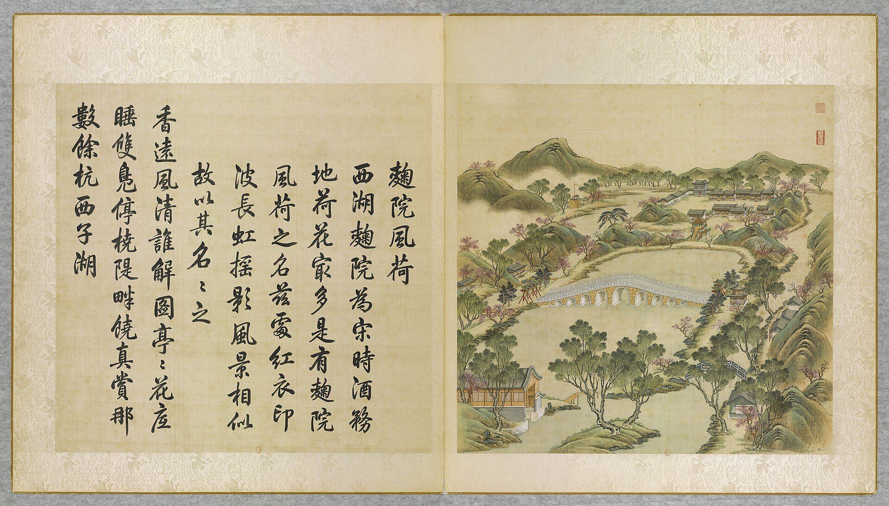
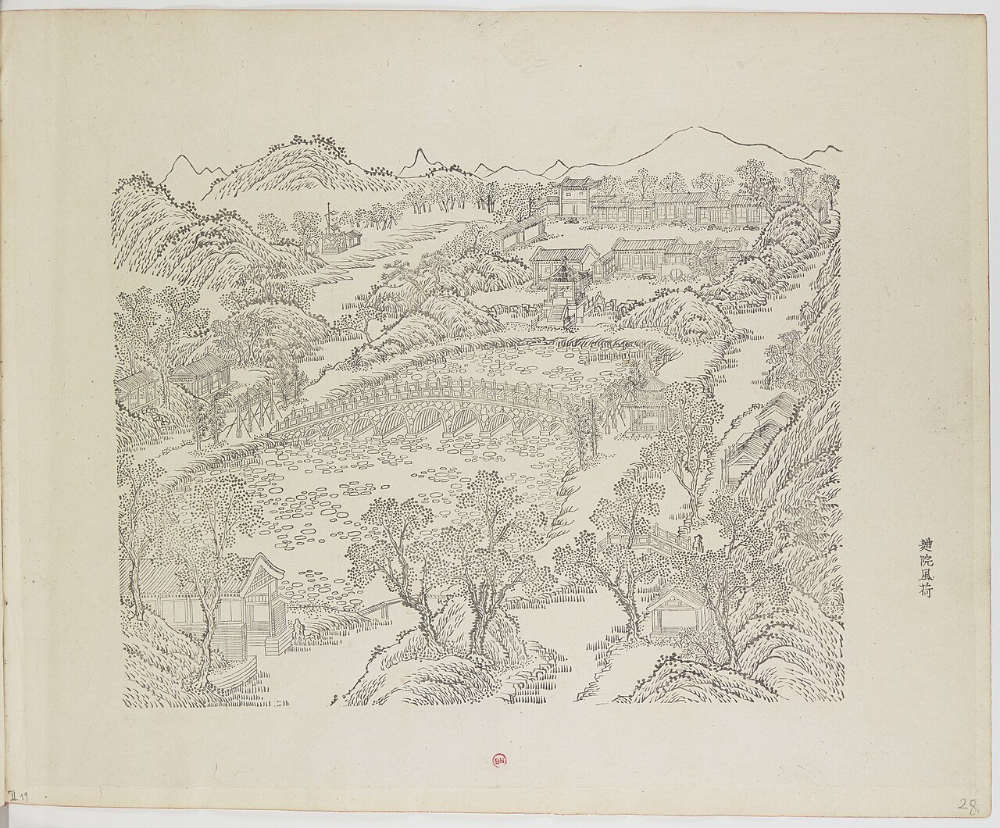
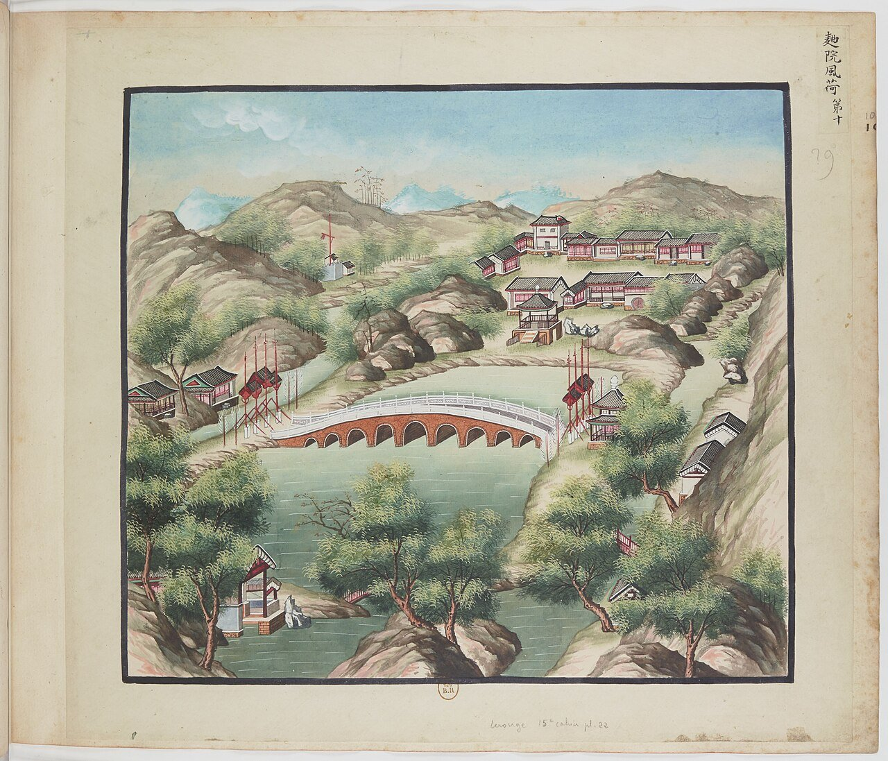
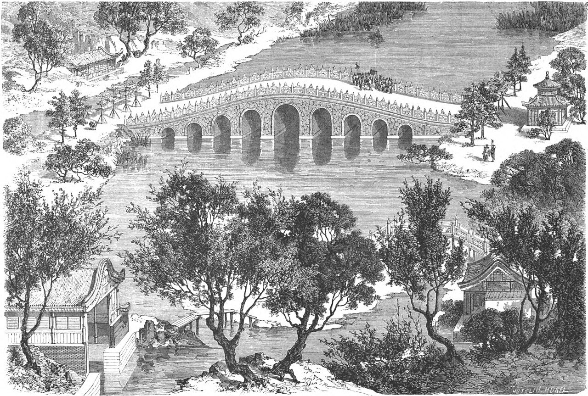
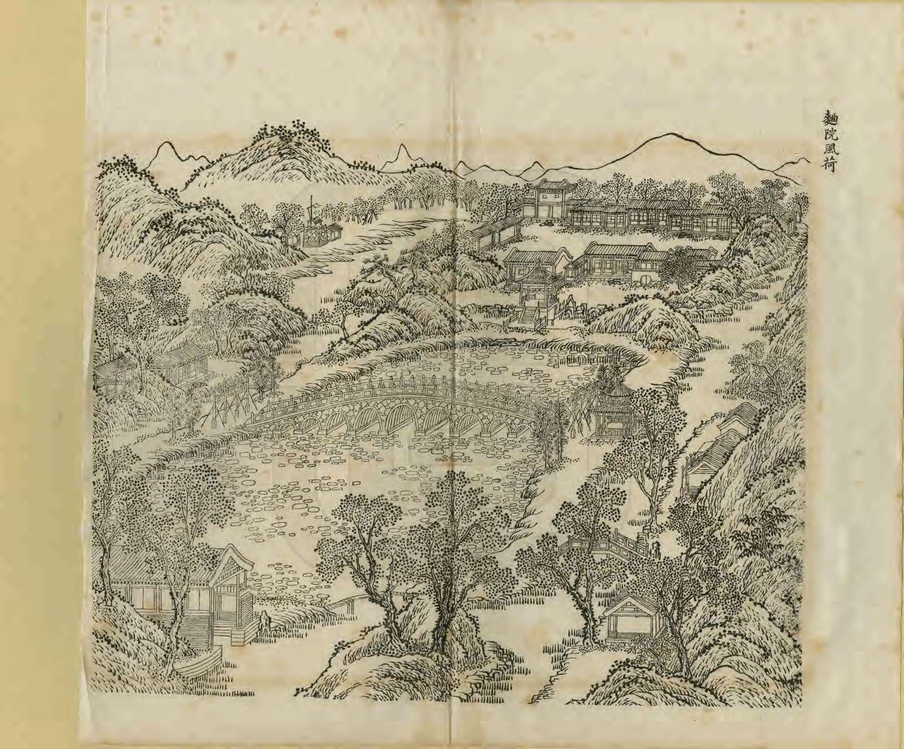
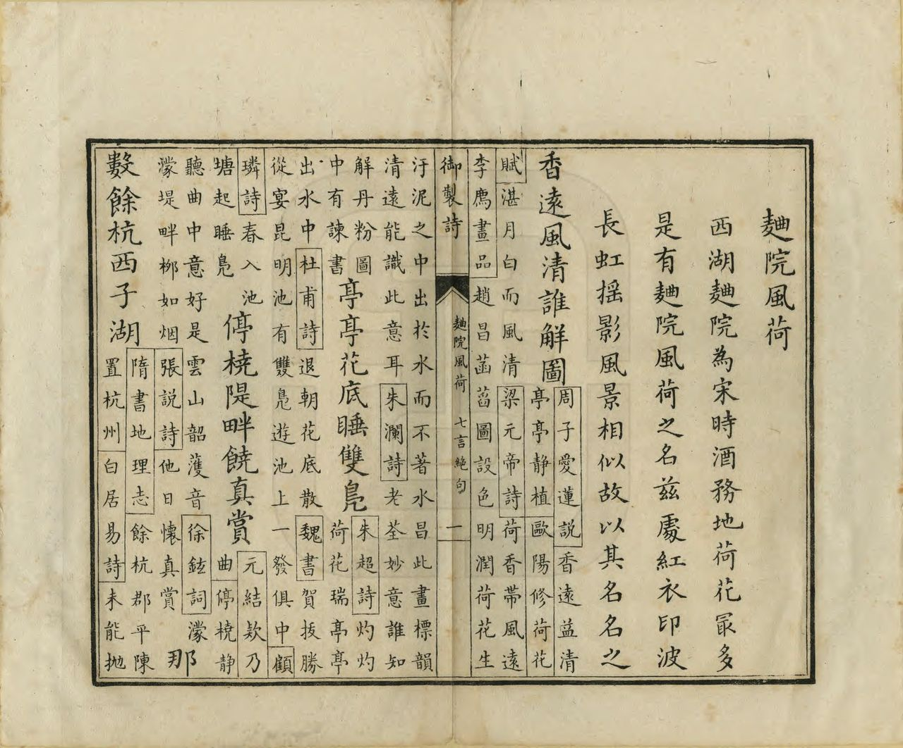
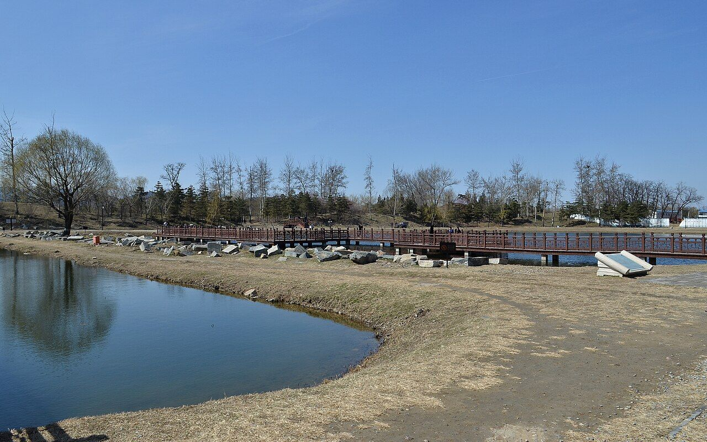

<!-- generated:start (scripts/building_pages.py): do not edit between these markers -->

# YM39: 曲院风荷 Quyuan Fenghe

Ch'u Yuan Feng Ho (Yeast Courtyard, Wind, and Lotus) · Yuanming Yuan

**3D object:** 21 boxes. Open it: `/reconstruction/3d.html?b=YM39`

## What we know

- **Name:** 曲院风荷 Quyuan Fenghe (S05, S02, S08, S41, S43, S01, S360 · confidence B)
- **English:** Ch'u Yuan Feng Ho (Yeast Courtyard, Wind, and Lotus) (S05, S02, S08, S41, S43, S01, S360)
- **Written on the plan:** 麴院风荷 (S01 · confidence B)
- **Garden:** Yuanming Yuan (S05, S02, S08, S41, S43, S01, S360)
- **Type:** scene (S05, S02, S08, S41, S43, S01, S360 · confidence B)
- **Built:** by 1744 (first dated item) (S05, S02, S08, S41, S43, S01, S360)
- **Changed:** Differs on later plans (S41); housed 南府 eunuchs in Qianlong-Jiaqing (S43) (S05, S02, S08, S41, S43, S01, S360)
- **Destroyed:** 1860 (S05, S02, S08, S41, S43, S01, S360)
- **Position:** 40.00642, 116.29339. S01 sure (S01 · confidence B)
- **Note:** Rixia writes 麴院風荷. Album does not show the 1860 state here (S41). (S05, S02, S08, S41, S43, S01, S360)
- **Plan reader's note:** Label (4770,3460), Malone 39 on both ovals. 春和镇 (the text 宁和镇) is its own row: NEW-ym_east-11. (S01) *(research copy, not public)*
- **How it was read:** sure (S01) *(research copy, not public)*
- **Plan pixels:** 4770, 3369 (S01) *(research copy, not public)*

## Our model now

21 boxes stand in this compound, 21 on blocks drawn on the plan, 0 assumed. Its halls are listed below.

## Inside it (18)

- YM39-01 麴院风荷殿
- YM39-02 洛迦胜境
- YM39-03 九孔桥
- YM39-04 金鳌坊
- YM39-05 玉蝀坊
- YM39-06 四围佳丽
- YM39-07 饮练长虹亭
- YM39-08 宁和镇
- YM39-B0571
- YM39-B0572
- YM39-B0573
- YM39-B0574
- YM39-B0600
- YM39-B0601
- YM39-B0602
- YM39-B0603
- YM39-B0604
- YM39-B0628

## Pictures (8)

- **P0039** (sure): 麴院風荷 Quyuan fenghe [Senteurs de lotus à travers la cour des Ferments] (圓明園四十景, 第39景) (1744 (BnF record: 1744年，清朝乾隆九年)). https://commons.wikimedia.org/wiki/File%3A%E5%9C%93%E6%98%8E%E5%9C%92%E5%9B%9B%E5%8D%81%E6%99%AF._%E7%AC%AC%E4%B8%89%E5%8D%81%E4%B9%9D%E6%99%AF_%28%E4%B8%8B%E5%86%8C%EF%BC%8C%E7%AC%AC%E5%8D%81%E4%B9%9D%E5%B9%85%E5%9B%BE%29%2C_%E9%BA%B4%E9%99%A2%E9%A2%A8%E8%8D%B7_-_%28%E6%B8%85%29%E5%94%90%E5%B2%B1%E3%80%81%E6%B2%88%E6%BA%90%E5%90%88%E7%95%AB_%3B_%28%E4%B9%BE%E9%9A%86%E5%90%9F%E8%AF%97%EF%BC%8C%E6%B1%AA%E7%94%B1%E6%95%A6%E4%BB%A3%E4%B9%A6%29Quyuan_fenghe_-_%28Qing%29Tang_Dai%2C_Shen_Yuan_he_hua_-_btv1b55008354f.jpg

  

- **P0088** (sure): 中国皇帝的宫殿与庙宇. 第28幅图, 麴院風荷 - (清)孙祜、沈源Quyuan fenghe - (Qing)Sun Hu, Shen Yuan (1745 (Commons, from the BnF record)). https://commons.wikimedia.org/wiki/File%3A%E4%B8%AD%E5%9B%BD%E7%9A%87%E5%B8%9D%E7%9A%84%E5%AE%AB%E6%AE%BF%E4%B8%8E%E5%BA%99%E5%AE%87._%E7%AC%AC28%E5%B9%85%E5%9B%BE%2C_%E9%BA%B4%E9%99%A2%E9%A2%A8%E8%8D%B7_-_%28%E6%B8%85%29%E5%AD%99%E7%A5%9C%E3%80%81%E6%B2%88%E6%BA%90Quyuan_fenghe_-_%28Qing%29Sun_Hu%2C_Shen_Yuan_-_btv1b105207115.jpg

  

- **P0110** (sure): 海淀(镇)：中国皇帝的行宫. 第10幅图, 麴院風荷Quyuan fenghe (1750-1792 (BnF, cb43831905b; ex coll. Bertin)). https://commons.wikimedia.org/wiki/File%3A%E6%B5%B7%E6%B7%80%28%E9%95%87%29%EF%BC%9A%E4%B8%AD%E5%9B%BD%E7%9A%87%E5%B8%9D%E7%9A%84%E8%A1%8C%E5%AE%AB._%E7%AC%AC10%E5%B9%85%E5%9B%BE%2C_%E9%BA%B4%E9%99%A2%E9%A2%A8%E8%8D%B7Quyuan_fenghe_-_btv1b10520652w.jpg

  

- **P0148** (sure): Le Tour du monde 10: Khiô-Youen-foung-hô, or the Court of Refreshments, p. 109 (1 July 1864 (Commons)). https://commons.wikimedia.org/wiki/File%3ALe_Tour_du_monde-10-p109.jpg

  

- **P0270** (sure): 麯院風荷 Quyuan Fenghe (御製圓明園圖詠, 1887 石印本, 下卷 (Commons 卷二), 第39景; printed title in the right margin of the picture) (光緒十三年 1887 (Commons/NLC record; colophon 光緒十三年七月天津石印書屋 in the SSID copy, S98 PDF p.2); design after the woodblock of 1745 by 孫祜 Sun Hu and 沈源 Shen Yuan). https://commons.wikimedia.org/wiki/File%3ANLC403-312001107375-14034_%E7%A6%A6%E5%88%B6%E5%9C%93%E6%98%8E%E5%9C%92%E5%9C%96%E8%A9%A0_%E5%8D%B7%E4%BA%8C.pdf?page=61

  

- **P0546** (sure): 麯院風荷 Quyuan Fenghe: 乾隆 Qianlong's preface and poem with the courtiers' commentary, 御製圓明園圖詠 1887 (poem 1744 (乾隆九年); this printing 1887). https://commons.wikimedia.org/wiki/File%3ANLC403-312001107375-14034_%E7%A6%A6%E5%88%B6%E5%9C%93%E6%98%8E%E5%9C%92%E5%9C%96%E8%A9%A0_%E5%8D%B7%E4%BA%8C.pdf?page=62

  

- **P0207** (sure): Sirén, Enligt text under Pl. 186 Kinas trädgårdar Vol. I: Yuanmingyuan. Quyuan Fenghe, Vindkneioen ”Vind och Lotus”, så uppkallad efter en under Song-perioden berömd vinstuga vid Västra Sjön (undated by holder; Sirén's second trip 1921-23 for this group). http://kulturarvsdata.se/SMVK-OM/Bildarkiv/198818 Research-only: link card.
- **P0498** (sure): 曲院风荷 20130324.jpg (2013-03-24 13:37:12 (Commons DateTimeOriginal)). https://commons.wikimedia.org/wiki/File:%E6%9B%B2%E9%99%A2%E9%A3%8E%E8%8D%B7_20130324.jpg

  

## Texts and drawings (13)

- **E2073** (poem, sure): 御製麴院風荷詩（圓明園四十景詩）. 1744 (乾隆九年) · printed in S05 j82:26b-27a · S40. https://github.com/kanripo/KR2k0036/blob/master/KR2k0036_082.txt
  > 乾隆九年 御製麴院風荷詩 西湖麴院為宋時酒務地荷花最多是有麴院風荷之名兹處紅衣印波長虹摇影風景相似故以其名名之 香逺風清誰解圖亭亭花底睡雙鳬停橈隄畔饒真賞那數餘杭西子湖
  The name comes from the place on 西湖 West Lake that was a Song state brewery, thick with lotus. This place, with red lotus and a long bridge's reflection, looks the same and takes the name.
- **E2077** (text, sure): 日下舊聞考 曲院风荷. 1780s (乾隆 敕撰) · j82:26b · S05. https://github.com/kanripo/KR2k0036/blob/master/KR2k0036_082.txt
  > 坐石臨流東南當碧桐書院正東為麴院風荷五楹南嚮其西佛樓為洛迦勝境（圓明園册）臣等謹按麴院風荷四十景之一額為皇上御書洛迦勝境額亦御書
  East of 碧桐書院: 麴院風荷, five bays facing south, with the Buddha tower 洛迦勝境 to its west.
- **E2078** (text, sure): 日下舊聞考 曲院风荷. 1780s (乾隆 敕撰) · j82:27a-27b · S05. https://github.com/kanripo/KR2k0036/blob/master/KR2k0036_082.txt
  > 麴院風荷之南跨池東西橋九空坊楔二西為金鼇東為玉蝀金鼇西南河外室為四圍佳麗玉蝀東有亭為飲練長虹又東南度橋折而北設城闗為寧和鎮其東南為東樓門（圓明園册）臣等謹按飲練長虹寧和鎮諸額皆御書
  South of 麴院風荷, a nine-opening bridge across the pool with archways 金鼇 to the west and 玉蝀 to the east; 四圍佳麗 and the 飲練長虹 pavilion nearby; further south-east the walled mock town 寧和鎮 and the 東樓門.
- **E2074** (poem, sure): 曲院风荷: 乾隆九年 poem of the Qianlong Emperor. 乾隆九年 (1744), date from the compilation · p.256 item (1), under 曲院风荷 · S360. https://www.yuanmingyuanpark.cn/xs/yjbg/202007/P020200730387572832602.pdf#page=256
  > 香远风清谁解图，亭亭花底睡双凫。停桡堤畔饶真赏，那数余杭西子湖。
  Poem of the Qianlong Emperor at 曲院风荷, 1744. Year as given by the compilation.
- **E2075** (poem, sure): 曲院风荷: 嘉庆元年 poem of the Jiaqing Emperor. 嘉庆元年 (1796), date from the compilation · p.257 item (2), under 曲院风荷 · S360. https://www.yuanmingyuanpark.cn/xs/yjbg/202007/P020200730387572832602.pdf#page=257
  > 显迹传东土，如来平等观。西方常住锡，南海永安澜。法律三车演，庄严七宝攒。长称圣人寿，普被福田宽。
  Poem of the Jiaqing Emperor at 曲院风荷, 1796, on the view. Year as given by the compilation.
- **E2076** (poem, sure): 曲院风荷: 嘉庆七年 poem of the Jiaqing Emperor. 嘉庆七年 (1802), date from the compilation · p.257 item (4), under 曲院风荷 · S360. https://www.yuanmingyuanpark.cn/xs/yjbg/202007/P020200730387572832602.pdf#page=257
  > 海南卓锡畅宗风，应感随声示现同。人我尽包四生转，慈悲原在一心通。六时钟磬真仍幻，三月莺花色即空。若向个中寻住脚，痴人说梦总愚蒙。
  Poem of the Jiaqing Emperor at 曲院风荷, 1802, on the view. Year as given by the compilation.
- **E2080** (description, sure): Scene 39, 曲院风荷 Quyuan Fenghe. 1934 · pp.94-96 · S02. https://archive.org/details/historyofpekings00malo
  > The building at the Yuan Ming Yuan which bore this name faced south on a pretty lotus pond crossed by a great curved bridge supported by nine arches and leading nowhere in particular.
  Hall facing south on a lotus pond with a nine-arch curved bridge.
- **E1011** (description, sure): Site status table, about 2011: nothing visible, or built over. c. 2011 · 系列06 repost, status table · S356. https://blog.sina.com.cn/s/blog_c27029650101itzz.html
  Same table. In it the first group shows no visible remains; 得全阁, 流香渚, 凤麟洲, 涵秋馆, 蔚藻堂, 中和堂, 敷春堂 and 心镜轩 have service buildings on them, and 含晖楼, 澄心堂, 延寿寺, 清夏堂 and 喜雨山房 are occupied by other institutions. 澹泊宁静 and several others have been dug since, so this is out of date for them.
- **E2079** (description, sure): 圆明园百景史事分景汇编: 曲院风荷. 1744-1802 · from p.256, under 曲院风荷 · S360. https://www.yuanmingyuanpark.cn/xs/yjbg/202007/P020200730387572832602.pdf#page=256
  曲院风荷: 4 dated items, 1744-1802, of which 4 poems (Qianlong, Jiaqing); recurring themes: the view. First dated 1744, last dated 1802.
- **E2081** (description, sure): 圆明园五朝御制诗文集注 v3, editors' note on 曲院风荷. 2020 edition · v3 p.112 · S361. https://www.yuanmingyuanpark.cn/xs/yjbg/202008/P020200803382569071850.pdf#page=115
  Modelled on the West Lake scene. Five-bay hall, Buddhist tower 洛伽胜境, a nine-arch bridge with archways 金鳌 and 玉蝀, 四围佳丽, 饮练长虹, then 宁和镇, renamed 春和镇 early in Daoguang's reign to avoid a name taboo. West of it the village 村庄房.
- **E2082** (drawing, sure): 《国家图书馆藏样式雷图档·圆明园卷初编》: 曲院风荷. mostly 道光, 咸丰, 同治 per the publisher · 初编 目录: 曲院风荷, p.228 · S13. https://www.nlcpress.com/ProductView.aspx?Id=7642
  The printed facsimile of the National Library of China's Yangshi Lei sheets has a section on this place at p.228 (1 pages, section length worked out from the next heading); sheet titles and numbers are in the volume, ordered from a library.
- **E2083** (drawing, sure): 曲院风荷样式雷图. S310. https://www.mhymy.com/dasl/ysltd/2455.html
  Older record of a drawing of Quyuan Fenghe; the archived copy has a scene description only, no shelf number or date. No image here; the site may ask a small payment for the full record.
- **E2084** (archaeology, sure): 圆明园曲苑风荷保护工程考古勘探报告. 2007-06-02 to 07-25 · mhymy 11419, free part · S155. https://www.mhymy.com/dasl/11419.html
  Survey of a concave strip of about 13,500 m2 at 曲院风荷 Quyuan Fenghe, about 355 m north-south and 11-17 m wide, southwest of 福海. The printed figures do not multiply out to that area, so the area is doubtful. Results paywalled.

**On the plan:** Drawn on the plan of the gardens (S01), labelled 麴院风荷. https://artmuseum.princeton.edu/collections/objects/138657

## Reconstructions by others (1)

Modern interpretation, not evidence.
- **R0073** (3D model, likely): 《圆明园四十景数字化复原及应用》. 圆明园管理处 with 中央美院, 圆明园管理处; 中央美术学院, 2025. https://news.bjd.com.cn/2026/10/16/11997513.shtml Research-only: link card.

## Surviving comparable buildings, not this building (2)

- **T044** 苏堤 Su Causeway, West Lake, 西湖 杭州 Hangzhou. Ours was copied from it, confidence B, standing: yes. Bank and nine-arched bridge as a long rainbow Basis: S417: 曲院风荷 pool, 400 x 150 m, is an epitome of West Lake and its west bank imitates the Su Causeway; largest of the garden's ten. S05 j.82 f.26b-27a says only that the scenery is alike (see other row). https://www.visitbeijing.com.cn/article/47QroOXaID5
  - P0655: Su Causeway, West Lake. https://commons.wikimedia.org/wiki/File:Su_Causeway,_West_Lake.jpg
  - P0656: Su Causeway near West Lake, looking towards north 20120529 1. https://commons.wikimedia.org/wiki/File:Su_Causeway_near_West_Lake,_looking_towards_north_20120529_1.jpg
- **T043** 曲院风荷 Quyuan Fenghe (Winery Courtyard, Lotus in the Breeze), 西湖 West Lake, 杭州. Comparable: same court, era or type, confidence A, standing: yes. Scenery: lotus and bridge. Not a building copy Basis: S05 j.82 f.26b-27a, 乾隆九年 poem: 西湖 麴院 was a Song winery full of lotus; 「此处…风景相似故以其名名之」: named for like scenery. https://github.com/kanripo/KR2k0036
  - P0603: 西湖十景-曲院风荷. https://commons.wikimedia.org/wiki/File:%E8%A5%BF%E6%B9%96%E5%8D%81%E6%99%AF-%E6%9B%B2%E9%99%A2%E9%A3%8E%E8%8D%B7.jpg
  - P0604: Lotus in the Breeze at the Winding Courtyard 0. https://commons.wikimedia.org/wiki/File:Lotus_in_the_Breeze_at_the_Winding_Courtyard_0.jpg

## Evidence for the set of buildings

- Reconstructions and comparables for the whole garden, 圆明园 Yuanming Yuan: see GARDEN-YM

## Open questions

- Q1: Target state
- Q20: Name variants
- Q99: Wolseley (S240), M'Ghee (S242), Loch (S244)
- Q125: Geotagged Commons coverage is thin
- Q128: The gouaches of 1750-92 (S77, P0101-P0140) recolour systematically

<!-- generated:end -->

## Notes

<!-- Yours: regeneration never touches this part. It goes on the public site; what you write below a line holding only %% private %% stays in the research copy. -->
