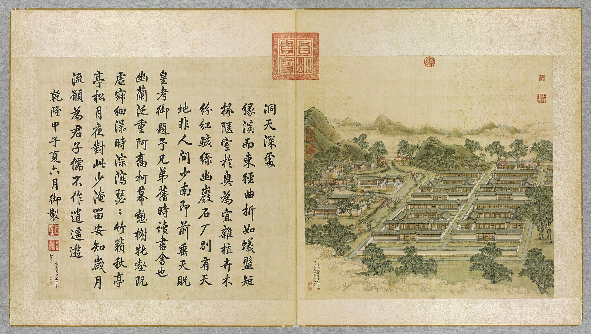
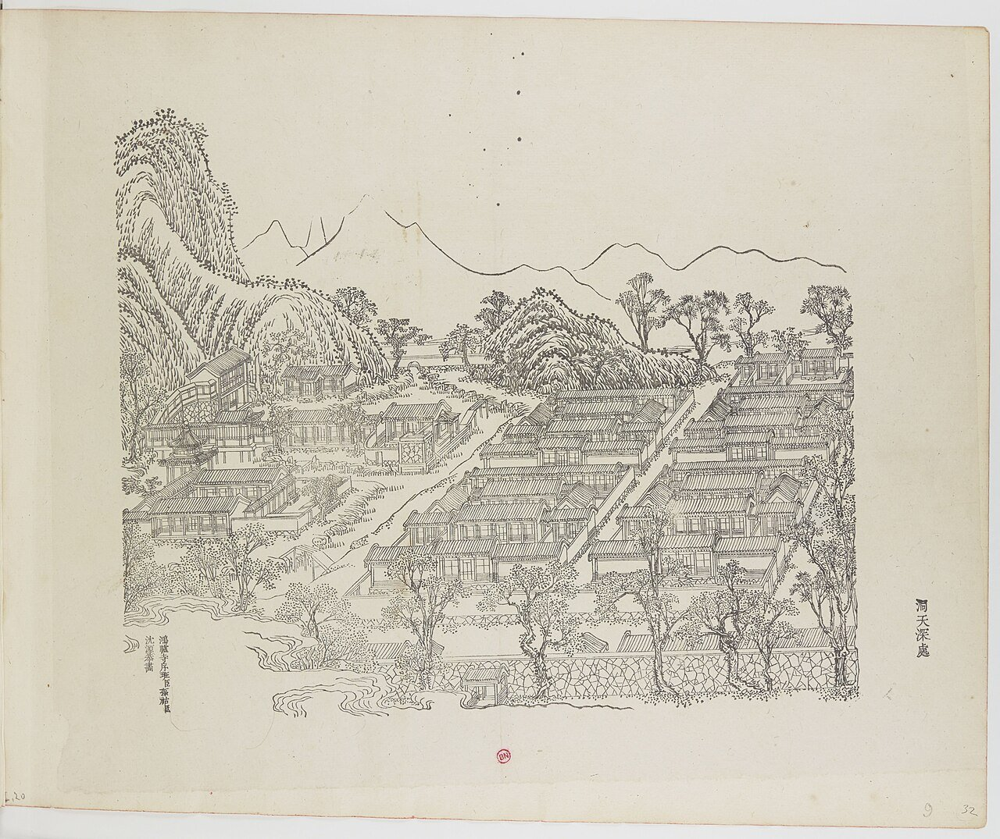
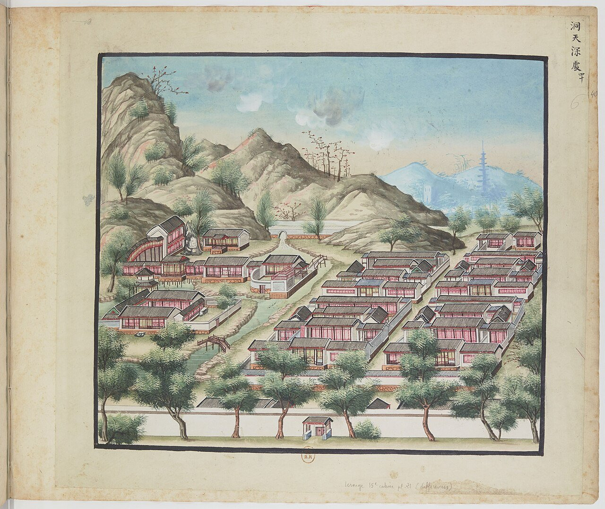
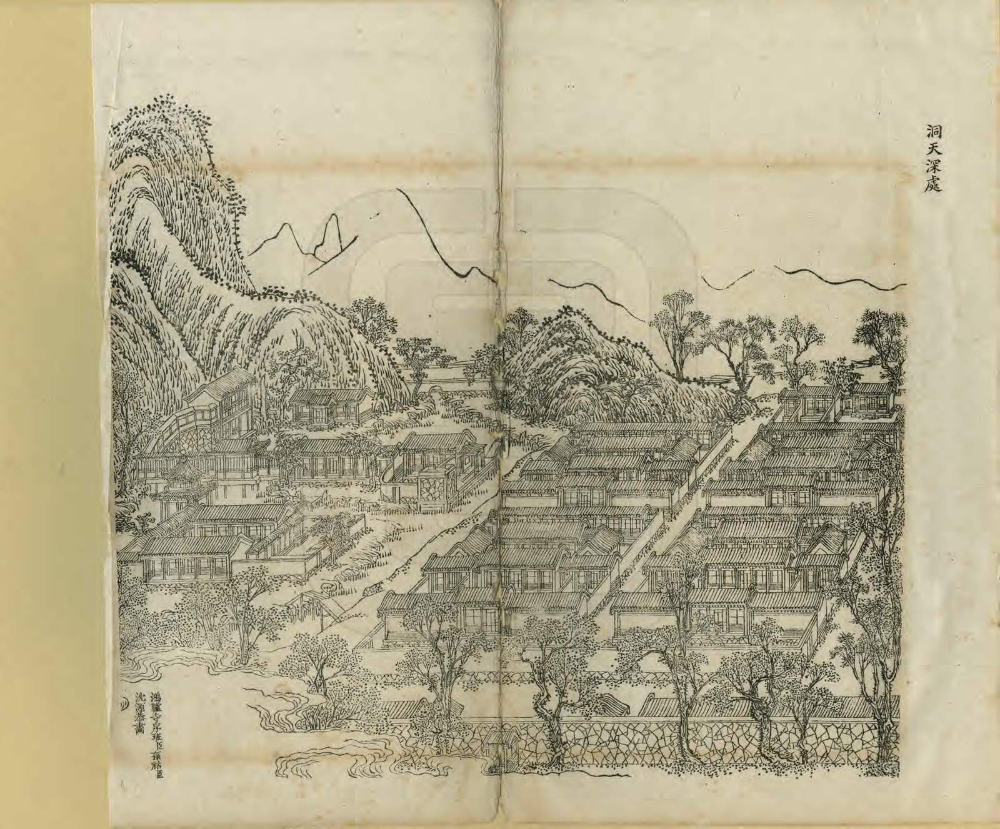
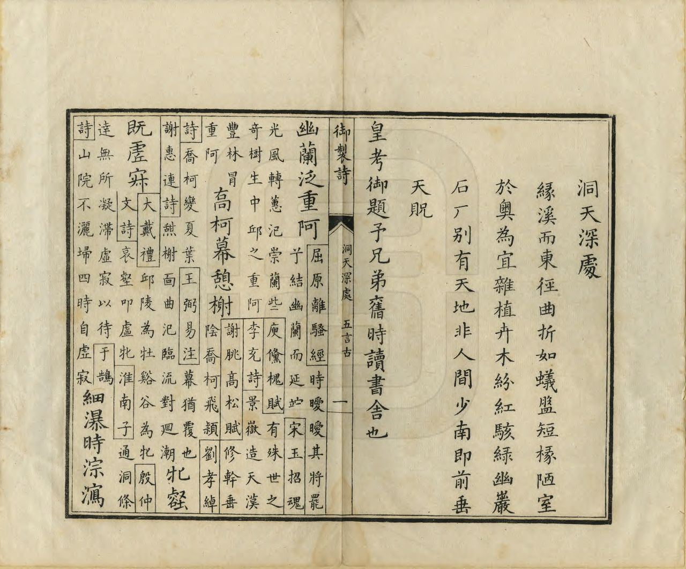

<!-- generated:start (scripts/building_pages.py): do not edit between these markers -->

# YM40: 洞天深处 Dongtian Shenchu

The Palace School, the Princes' Residences, and Studios (the Depth of the Vault of Heaven) · Yuanming Yuan

**3D object:** 74 boxes. Open it: `/reconstruction/3d.html?b=YM40`

## What we know

- **Name:** 洞天深处 Dongtian Shenchu (S05, S02, S08, S41, S01, S337 · confidence B)
- **English:** The Palace School, the Princes' Residences, and Studios (the Depth of the Vault of Heaven) (S05, S02, S08, S41, S01, S337)
- **Garden:** Yuanming Yuan (S05, S02, S08, S41, S01, S337)
- **Type:** scene (S05, S02, S08, S41, S01, S337 · confidence B)
- **Changed:** Four courts rebuilt as two groups (S41); 如意馆 new layout pasted on plan (S02 p.96 n.); 1846: east and west four courts reduced to two (S05, S02, S08, S41, S01, S337)
- **Destroyed:** 1860 (S05, S02, S08, S41, S01, S337)
- **Position:** 40.00248, 116.29431. S01 sure (S01 · confidence B)
- **Note:** Album does not show the 1860 state here (S41). (S05, S02, S08, S41, S01, S337)
- **Plan reader's note:** Malone 40 at (4920,5695). Labels 后天不老, 前垂天贶, 乐道堂, 东所, 福元门. B0991 at the west edge is included on position only. (S01) *(research copy, not public)*
- **How it was read:** sure (S01) *(research copy, not public)*
- **Plan pixels:** 4900, 5400 (S01) *(research copy, not public)*

## Our model now

74 boxes stand in this compound, 74 on blocks drawn on the plan, 0 assumed. Its halls are listed below.

## Inside it (63)

- YM40-01 四所
- YM40-02 福园门
- YM40-03 前垂天贶
- YM40-04 中天景物
- YM40-05 斯文在兹
- YM40-06 后天不老
- YM40-07 如意馆
- YM40-B0972
- YM40-B0991
- YM40-B0992
- YM40-B0993
- YM40-B0994
- YM40-B0995
- YM40-B0996
- YM40-B0997
- YM40-B1026
- YM40-B1027
- YM40-B1029
- YM40-B1030
- YM40-B1031
- YM40-B1032
- YM40-B1034
- YM40-B1065
- YM40-B1066
- YM40-B1068
- YM40-B1069
- YM40-B1071
- YM40-B1090
- YM40-B1094
- YM40-B1095
- YM40-B1097
- YM40-B1098
- YM40-B1099
- YM40-B1100
- YM40-B1101
- YM40-B1102
- YM40-B1116
- YM40-B1117
- YM40-B1118
- YM40-B1119
- YM40-B1120
- YM40-B1121
- YM40-B1122
- YM40-B1123
- YM40-B1124
- YM40-B1125
- YM40-B1126
- YM40-B1127
- YM40-B1128
- YM40-B1129
- YM40-B1130
- YM40-B1131
- YM40-B1132
- YM40-B1133
- YM40-B1134
- YM40-B1157
- YM40-B1158
- YM40-B1159
- YM40-B1160
- YM40-B1161
- YM40-B1162
- YM40-N01 乐道堂
- YM40-N02 东所

## Pictures (5)

- **P0040** (sure): 洞天深處 Dongtian shenchu [Au profond de la grotte-ciel] (圓明園四十景, 第40景) (1744 (BnF record: 1744年，清朝乾隆九年)). https://commons.wikimedia.org/wiki/File%3A%E5%9C%93%E6%98%8E%E5%9C%92%E5%9B%9B%E5%8D%81%E6%99%AF_-_%28%E6%B8%85%29%E5%94%90%E5%B2%B1%E3%80%81%E6%B2%88%E6%BA%90%E5%90%88%E7%95%AB_%3B_%28%E4%B9%BE%E9%9A%86%E5%90%9F%E8%AF%97%EF%BC%8C%E6%B1%AA%E7%94%B1%E6%95%A6%E4%BB%A3%E4%B9%A6%29_-_btv1b55008362z_%28121_of_124%29.jpg

  

- **P0069** (sure): 中国皇帝的宫殿与庙宇. 第9幅图, 洞天深處 - (清)孙祜、沈源(鴻臚寺序班)Dongtian shenchu - (Qing)Sun Hu, Shen Yuan (1745 (Commons, from the BnF record)). https://commons.wikimedia.org/wiki/File%3A%E4%B8%AD%E5%9B%BD%E7%9A%87%E5%B8%9D%E7%9A%84%E5%AE%AB%E6%AE%BF%E4%B8%8E%E5%BA%99%E5%AE%87._%E7%AC%AC9%E5%B9%85%E5%9B%BE%2C_%E6%B4%9E%E5%A4%A9%E6%B7%B1%E8%99%95_-_%28%E6%B8%85%29%E5%AD%99%E7%A5%9C%E3%80%81%E6%B2%88%E6%BA%90%28%E9%B4%BB%E8%87%9A%E5%AF%BA%E5%BA%8F%E7%8F%AD%29Dongtian_shenchu_-_%28Qing%29Sun_Hu%2C_Shen_Yuan_-_btv1b10520709b.jpg

  

- **P0140** (sure): 海淀(镇)：中国皇帝的行宫. 第40幅图, 洞天深處Dongtian shenchu (1750-1792 (BnF, cb43831905b; ex coll. Bertin)). https://commons.wikimedia.org/wiki/File%3A%E6%B5%B7%E6%B7%80%28%E9%95%87%29%EF%BC%9A%E4%B8%AD%E5%9B%BD%E7%9A%87%E5%B8%9D%E7%9A%84%E8%A1%8C%E5%AE%AB._%E7%AC%AC40%E5%B9%85%E5%9B%BE%2C_%E6%B4%9E%E5%A4%A9%E6%B7%B1%E8%99%95Dongtian_shenchu_-_btv1b105206591.jpg

  

- **P0271** (sure): 洞天深處 Dongtian Shenchu (御製圓明園圖詠, 1887 石印本, 下卷 (Commons 卷二), 第40景; printed title in the right margin of the picture) (光緒十三年 1887 (Commons/NLC record; colophon 光緒十三年七月天津石印書屋 in the SSID copy, S98 PDF p.2); design after the woodblock of 1745 by 孫祜 Sun Hu and 沈源 Shen Yuan). https://commons.wikimedia.org/wiki/File%3ANLC403-312001107375-14034_%E7%A6%A6%E5%88%B6%E5%9C%93%E6%98%8E%E5%9C%92%E5%9C%96%E8%A9%A0_%E5%8D%B7%E4%BA%8C.pdf?page=64

  

- **P0547** (sure): 洞天深處 Dongtian Shenchu: 乾隆 Qianlong's preface and poem with the courtiers' commentary, 御製圓明園圖詠 1887 (poem 1744 (乾隆九年); this printing 1887). https://commons.wikimedia.org/wiki/File%3ANLC403-312001107375-14034_%E7%A6%A6%E5%88%B6%E5%9C%93%E6%98%8E%E5%9C%92%E5%9C%96%E8%A9%A0_%E5%8D%B7%E4%BA%8C.pdf?page=65

  

## Texts and drawings (22)

- **E2085** (poem, sure): 御製洞天深處詩（圓明園四十景詩）. 1744 (乾隆九年) · printed in S05 j82:29a-29b · S40. https://github.com/kanripo/KR2k0036/blob/master/KR2k0036_082.txt
  > 乾隆九年 御製洞天深處詩 縁溪而東徑曲折如蟻盤短椽陿室於奥為宜雜植卉木紛紅駭緑幽巖石厂别有天地非人間少南即前垂天貺皇考御題予兄弟舊時讀書舎也 幽蘭泛重阿喬柯幕憩榭牝壑既虛寂細瀑時淙㵼瑟瑟竹籟秋亭亭松月夜對此少淹留安知嵗月流願為君子儒不作逍遥遊
  East along the stream by a path as twisting as an ant's track: small rooms in a secluded spot, with mixed plants and caves. A little south is 前垂天貺 with his father's plaque, the school where he and his brothers read as boys.
- **E0382** (text, sure): 福園門 in front of 洞天深处. 1780s · j82:28b · S05. https://github.com/kanripo/KR2k0036/blob/master/KR2k0036_082.txt
  > 洞天深處在如意館西稍南前宇乃諸皇子所居為四所東西二街南北一街前為福園門
  S01 writes 福元门. The texts write 福园门. The form 福元 is itself on a Yangshi Lei plan: S337 (三幅样式雷) reports 福元四所 on sheet 043-002 for the same place.
- **E2087** (text, sure): 日下舊聞考 洞天深处. 1780s (乾隆 敕撰) · j82:28b-29a · S05. https://github.com/kanripo/KR2k0036/blob/master/KR2k0036_082.txt
  > 洞天深處在如意館西稍南前宇乃諸皇子所居為四所東西二街南北一街前為福園門四所之西為諸皇子肄業之所前有前垂天貺中為中天景物東宇為斯文在兹後為後天不老（圓明園册）臣等謹按洞天深處四十景之一額為皇上御書前垂天貺中天景物後天不老及如意館諸額皆世宗御書斯文在兹額恭懸至聖先師神龕上聫曰道統集成歸至徳聖功養正仰微言皆御書
  West and a little south of 如意館, near the 福園門: four courts where the imperial princes lived, with streets between; west of them the princes' school with 前垂天貺, 中天景物, 斯文在兹 (shrine to Confucius) and 後天不老.
- **E0433** (text, sure): 徐樹鈞 圓明園詞序. 1871 (同治十年立秋), recording a visit of 四月十日 · preface, whole · S203. https://www.douban.com/group/topic/46378693/
  > 圆明园在京城西，出平则门三十里，畅春园北里许，世宗皇帝藩邸赐园也。圣祖常游豫西郊，次于丹棱沜，乐其川原，因明武清侯李伟清华园旧址，筑畅春园，藩邸赐园，故在其旁。雍正三年，乃大宫殿朝署之规以避暑听政，前临西山，环以西湖。湖水发源玉泉山，曰瓮山，度宫墙东流入清河，《水经注》所谓“蓟县西湖，绿水澄澹，燕之旧池”者也。东流为洗马沟，东南合高梁之水，故鱼稻饶衍，陂泉交绮。高宗皇帝嗣位，海宇殷阗，八方无事，每岁缔构，专饰园居。大驾南巡，流览湖山风景之胜，图画以归，若海宁安澜园、江宁瞻园、钱塘小有天园、吴县狮子林，皆仿其制，增制园中。列景四十，以四字题匾者为一胜区，一区之内，斋馆无数。复东拓长春，西辟清漪，离宫别馆，月榭风亭，属之西山，所费不计亿万。园地多明权珰别业，或传崇祯末，诸奄皆以珍宝窟宅于兹，乾隆间浚池，发金银数百万，时国运方兴，地不爱宝，上心悦豫，殚精构造，曲尽游观之妙，元明以来，未之闻也。每岁夏幸园中，冬初还宫，内廷大臣，赐第相望，文武侍从，并直园林，入直奏对，昕夕往来，络绎道路，历雍乾嘉道，百余年于兹矣。文宗初，粤寇踞金陵，盗贼蜂起，上初即位，求直言，得胜保、曾国藩、袁甲三三臣，既以塞 、程、徐、陆，先朝重望，相继倾覆，始擢用前言事者，各畀重任，三臣支柱，贼不犯畿。然迭胜迭败，东南数省，蹂躏无完土，上悯苍生之颠沛，慨左右之无人。九年冬，郊宿于斋宫，夜分痛哭，侍臣凄恻。大考翰詹，以宣室前席发题，忧心焦思，伤于祸乱，然后稍自抑解，寄于文酒。以宫中行止有节，尤喜园居，冬至入宫，初正即出。时园中传有四春之宠，皆汉女，分居亭馆，所谓杏花春、武陵春、牡丹春、海棠春者也。然上明于料兵，委权阃外，超次用人，海内称哲。而部寺诸臣，无所磨励，颇袭旧敝。晚得肃顺，敢言自任，故委以谋议。先是道光二十年，英吉利夷船，至广东香港，求通商不得，又以烧烟起衅，执政议和，予海关税银千八百万。英夷请立约，广督耆英，与期十年。届期而徐广缙督两广，夷使至广州，拒不许入，以受封爵，夷酋恨焉，志入广州。咸丰元 [ 九 ] 年，英吉利、法兰西、美利坚各国，乘粤寇鸱张，中国多故，复以轮舶直入大沽台。王僧格林沁，托团练之名，焚其二船，尽击走之。夷人知大皇帝无意于战，特臣民之私愤，乃潜至海岸，买马数千，募群盗为军，半年而成，再犯天津，称西洋马队，闻者恐栗，夷马步登岸，我未陈而敌骑长驱矣。十年六 [ 八 ] 月十六日，上方园居，闻夷骑至通州，仓卒率后嫔幸热河，道路初无供帐，途出密云，御食豆乳麦粥而已。十七日，英夷帅叩东便门，或有闭城者，闻炮而开，王公请和，和议将定。十九日，夷人至圆明园宫门，管园大臣文丰当门说止之，夷兵已去。文都统知奸民将起，环问守卫禁兵，无一在者，乃自索马还内，投福海死。奸人乘时纵火，入宫劫掠，夷人从之，各园皆火发，三昼夜不熄，非独我无官府诘问，夷帅亦不能知也。初英夷使臣巴夏里，已拘刑部，和议成，以礼释囚。于是巴夏里与英帅，各陈兵仗至礼部，订约五十七条，予以海关税银三千六百万，而夷人抵偿圆明园银二十万。王公奏言，未敢斥夷，文丰与主事惠丰，同死于园，不称殉节，但言遭兵燹而已。十一年七月，文宗晏驾热河，今上即位，奉两宫皇太后还京，垂帘十载，巨寇削平。而夷人通商江海，往来贸易，设通商王大臣，以接夷使。然常言：“某省士民毁天主教堂，某省不行其教，某省民教构衅。”日以难我，应之不暇，盖岌岌乎华夷杂处，又忽忽十有一年。园居荒墟，鞠为茂草，西山大寺，夷妇深居，予旅京师，恻然不敢过也。同治十年春，同年王壬父重至辇下，追话旧游，张子雨珊亦以计偕来，约访故宫，因驻守参将廖承恩许为道主。四月十日，命仆马同过绣漪桥，寻清漪园遗迹，颓垣断瓦，零乱榛芜，宫树苍苍，水鸣呜咽。由辇路登廓如亭，南望万寿山，但见牧童樵子，往来林莽间。暮从昆明湖归，桥上铜犀卧荆棘中，犀背御铭，琅然可诵。明日访守园者，得董监，自言：“年七十有余，自道光初入寺园中，今秩五品，居福园门旁。”导予等从瓦砾中，循出入贤良门而北，指勤政、光明、寿山、太和四殿遗址，前湖圆明寝殿五楹，后为奉三无私殿、九州清晏殿各七楹，坏壁犹立，拾级可寻。董监言：“东为天地一家春，后居也，西为乐安和，诸妃嫔贵人居也，洞天深处，皇子居也。清辉殿为文宗重建，与五福堂、镂月开云台、朗吟阁皆不可复识。”镂月开云者，即所谓牡丹春者也。世宗为皇子时，迎圣祖至赐园，而高宗年十二，以皇孙召侍左右，三天子福寿冠前古，集于一堂，高宗后制诗，尝夸乐之。经其废基，裴回惄焉。东渡湖，为苏堤、长春仙馆、藻园，又北为月地云居、舍卫城、日天琳宇、水木明瑟、濂溪乐处，仅约略指视所在。东北至香雪廊，阶前茅荻萧萧，废池可辩，有老监奉茶自石畔出，讶客所从来，颇似桃源人逢渔郎也。渡桥循福海西行，为平湖秋月，水光溶溶，一泻千顷。望蓬岛瑶台，岛上殿宇，犹存数楹，惜无方舟不达。其下流水潺湲，激石成响，董监示予：“此管园大臣文公死所也。”西北至双鹤斋，又西过规月桥，登绮吟堂，经采芝径，折而东，仍出双鹤斋。园中残毁几遍，独存此为劫灰之余，乱草侵阶，窗棂宛在，尤动人禾黍悲耳。双鹤斋西，为溪月松风，翠柏苍藤，沿流覆道，斜日在林，有老宫人驱羊豕下来。东过碧桐书院，地跨池上，东为金鳌，西为玉蝀，坊楔犹存。又东去，皆败坏难寻，遂不复往。莫色沈沈，栖乌乱飞，揖董监，出福园门，还于廖宅。廖，沣州人，字枫亭，少从塞尚阿、僧格林沁军，亦能言行间事，感予来游，颇尽宾主之欢。既夕言归，则礼部放榜日也。雨珊既落第南去，予与壬父每相过从，念言园游，辄惘惘不自得。壬父又曰：“园之盛时，纯皇勒记，必殷殷踵事之戒，然仁宗始罢南幸，宣宗尤忧国贫，秋狝之礼，辍而不举。惟夫张弛之道宜及，嘉道时，补纯皇倦勤之功，而内外大臣，惟务慎节，监司宽厚，牧令昏庸，讳盗容奸，以为安静。八卦妖徒，连兵十载，无生天主，教目滋繁，由游民轻法，刑废不用故也。江淮行宫，既皆斥卖，国之所患，岂在乏财。”又曰：“燕地经安史戎马之迹，爰及辽金，近沙漠之风矣。明太宗以燕王旧居，不务改宅，仍而至今，地利竭矣。又园居单外，非所以驻万乘，废而不居，盖亦时宜。” 予曰：“然，前年御史德泰，请按户亩鳞次捐输，复修园宫。大臣以侈端将启，请旨切责，谪戍未行，愤悔自死。自此莫敢言园居者。而比年备办大婚，费已千万，结彩宫门，至十余万，公奏朝廷动用钱粮，婚以成礼，岂在华饰，若前明户部司官得以谏争，予且建言矣。又予闻慈安太后在文宗时，有脱簪之谏，《关雎》《车舝》之贤，中兴之由也。又园宫未焚前一岁，妖言传上坐寝殿，见白须老翁，自称园神，请辞而去，上梦中加神二品阶，明日，至祠谕祀之，未一期而园毁，岂能定欤？子能诗者，达于政事，曷以风人之意，备《繁霜》《云汉》之采？”于是壬父为《圆明园词》一篇。而周学士（即大学士周祖培）、潘侍郎见之，并叹其伤心感人，笔墨通于情性。予以此诗可传后来，虑夫代远年逝，传闻失实，词中所述，罔有征者，乃为文以序之。同治十年立秋日，长沙徐树钧撰。
  A walk through the ruins eleven years after the destruction, guided by an old eunuch who had served since the 1820s. It says which sites could still be read, and that 雙鶴齋 with its surroundings alone stood, as did some rooms on 蓬島瑶臺 and the 金鼇 and 玉蝀 arches. Its account of 1860 credits the first fires to local robbers, which differs from the British and French record in S02.
- **E0384** (text, sure): 宣宗實錄: 福园门 guarded, 1830. 道光十年十月 · 道光十年十月乙巳 (corpus copy) · S208. https://github.com/garychowcmu/daizhigev20/blob/master/史藏/别史/清实录道光朝实录.txt
  > 大阿哥因病未痊。住圆明园。……仪亲王于十八日前往看视。径入福园门、至阿哥所内。当时值班官兵及太监等拦阻不听
  Daoguang reprimands 仪亲王 for walking in past the guards to the sick eldest son: this gate led straight to the princes' courts.
- **E2086** (poem, sure): 洞天深处. 乾隆九年 (1744) · v3 p.115, under 洞天深处; source ref 2-690 · S361. https://www.yuanmingyuanpark.cn/xs/yjbg/202008/P020200803382569071850.pdf#page=118
  > 缘溪而东，径曲折如蚁盘。短椽陿室，于奥为宜。杂植卉木，纷红骇绿，幽岩石厂，别有天地非人间。少南即前垂天贶，皇考御题，予兄弟旧时读书舍也。幽兰泛重阿，乔柯幕憩榭。牝壑既虚寂，细瀑时淙泻。瑟瑟竹籁秋，亭亭松月夜。对此少淹留，安知岁月流。愿为君子儒，不作逍遥游。
  Poem 洞天深处 by the Qianlong Emperor, 1744, filed by the editors under 洞天深处.
- **E2096** (poem, sure): 二月廿四日出福园门启程（94）. 乾隆五十三年 (1788) · v4 p.383, under 春熙院 · S361. https://www.yuanmingyuanpark.cn/xs/yjbg/202008/P020200803382796786124.pdf#page=386
  > 卖餳天气近清明，路指渔阳纪首程。春露关心随雁序，时风拂面听莺鸣
  Poem 二月廿四日出福园门启程（94） by the Qianlong Emperor, 1788, filed by the editors under 春熙院.
- **E2097** (poem, sure): 偕三弟自福园门启程作（125）. 乾隆五十三年 (1788) · v4 p.401, under 春熙院 · S361. https://www.yuanmingyuanpark.cn/xs/yjbg/202008/P020200803382796786124.pdf#page=404
  > 西风下平皋，飒爽欣秋仲。并辔历长途，蹀躞青骢控。年来上塞过，笑语常相共。山川入画图，赏心由此众。禾稼有丰盈，闾阎无聚讼。一带列青峦，游目时时纵。霮䨴束山腰，云浓如结冻。行行秋景清，好倩新诗送。
  Poem 偕三弟自福园门启程作（125） by the Qianlong Emperor, 1788, filed by the editors under 春熙院.
- **E2098** (poem, sure): 恭和御制至后天不老书房作元韵（405）. 乾隆五十三年 (1788) · v4 p.392, under 春熙院 · S361. https://www.yuanmingyuanpark.cn/xs/yjbg/202008/P020200803382796786124.pdf#page=395
  > 芸窗风日永，典学忆当年。逊志希先哲，崇文重昔贤。来游宸藻丽，惇叙圣恩全。庆洽春韶普，承欢岁月緜。
  Poem 恭和御制至后天不老书房作元韵（405） by the Qianlong Emperor, 1788, filed by the editors under 春熙院.
- **E2099** (poem, sure): 至后天不老书房作. 嘉庆二年 (1797) · v3 p.116, under 洞天深处; source ref 1-207 · S361. https://www.yuanmingyuanpark.cn/xs/yjbg/202008/P020200803382569071850.pdf#page=119
  > 昔日弦歌地，重来已隔年。随兄怀雅训，勖弟勉成贤。师友三天聚，儿孙五代全。都蒙皇父泽，惇叙国恩绵。
  Poem 至后天不老书房作 by the Jiaqing Emperor, 1797, filed by the editors under 洞天深处.
- **E0385** (description, sure): Malone on 福园门. 1934 · p.96 · S02. https://archive.org/details/historyofpekings00malo
  Fu Yuan Men stands in the outer wall just south of group 40, about 300 yards directly east of the Great Palace Gate; he says the woodcut of scene 40 shows it, the painting does not.
- **E2088** (description, sure): Scene 40, 洞天深处 Dongtian Shenchu. 1934 · p.96 · S02. https://archive.org/details/historyofpekings00malo
  > Adjacent to the four dwellings was located the Ju I Kuan, or Sceptre Lodge, where the European artists, clock makers, and machinists worked in Ch'ien Lung's day.
  Palace School on two islands on the west, four residences of princes in a square, 如意馆 next to them. 福园门 in the outer wall just south, 300 yards directly east of 大宫门 (Benoist's letter of 1773 cited). A pasted sheet on the Official Map shows a later arrangement here.
- **E1011** (description, sure): Site status table, about 2011: nothing visible, or built over. c. 2011 · 系列06 repost, status table · S356. https://blog.sina.com.cn/s/blog_c27029650101itzz.html
  Same table. In it the first group shows no visible remains; 得全阁, 流香渚, 凤麟洲, 涵秋馆, 蔚藻堂, 中和堂, 敷春堂 and 心镜轩 have service buildings on them, and 含晖楼, 澄心堂, 延寿寺, 清夏堂 and 喜雨山房 are occupied by other institutions. 澹泊宁静 and several others have been dug since, so this is out of date for them.
- **E2091** (description, sure): 圆明园“如意馆”中的西洋人. post n.d. · lswh · S337. http://iqh.ruc.edu.cn/old/qdhjylyjzx/xszl/jzys/49305419cedb4af6aa914cc92e645aea.htm
  Describes the missionary painters' workplace in 洞天深处 and how they entered under escort.
- **E2090** (description, likely): 乐道堂: a lead to 奕訢. web · infobox · S382. https://zh.wikipedia.org/wiki/奕訢
  Prince Gong's style includes 乐道堂主人. As 洞天深处 housed the Emperor's sons, this label may be his study. No text on disk places a 乐道堂 in the garden.
- **E2089** (description, sure): 圆明园五朝御制诗文集注 v3, editors' note on 洞天深处. 2020 edition · v3 p.115 · S361. https://www.yuanmingyuanpark.cn/xs/yjbg/202008/P020200803382569071850.pdf#page=118
  Built under Yongzheng for the princes' study and lodging: four courts on two east-west lanes and one north-south lane, the three study rooms 前垂天贶, 中天景物, 后天不老, a Confucius shrine, and 如意馆, the court painters' workshop where Castiglione and Attiret worked.
- **E2092** (description, sure): 圆明园百景史事分景汇编: 洞天深处. undated · from p.182, under 洞天深处 · S360. https://www.yuanmingyuanpark.cn/xs/yjbg/202007/P020200730387572832602.pdf#page=182
  洞天深处: short note in the compilation, no dated items.
- **E2093** (drawing, sure): 《国家图书馆藏样式雷图档·圆明园卷初编》: 洞天深处. mostly 道光, 咸丰, 同治 per the publisher · 初编 目录: 洞天深处, pp.66-114 · S13. https://www.nlcpress.com/ProductView.aspx?Id=7642
  The printed facsimile of the National Library of China's Yangshi Lei sheets has a section on this place at pp.66-114 (49 pages, section length worked out from the next heading); sheet titles and numbers are in the volume, ordered from a library.
- **E2094** (drawing, sure, search index only): 洞天深处平面图. S310. https://www.mhymy.com/dasl/ysltd/7317.html
  Plan of the princes' study quarter inside Fuyuan gate; shelf number and date not seen in the extract. No image here; the site may ask a small payment for the full record.
- **E2095** (drawing, sure, search index only): 洞天深处样式雷图. S310. https://www.mhymy.com/dasl/ysltd/2726.html
  An older record of a drawing of Dongtian Shenchu; shelf number and date not seen in the extract. No image here; the site may ask a small payment for the full record.
- **E0548** (plan, sure): 三幅样式雷圆明园河道全图辨析. 2024-06-18 post · NLC 043-001, -002, -003 · S337. http://iqh.ruc.edu.cn/old/qdhjylyjzx/xszl/jzys/59b83e20f7ab4840b746a6208a550939.htm
  Dates three NLC Yangshi Lei water-course plans (about 1:2000) by the changes they show. It lists dated works: 1803 channel from 宁和镇 to 秀清村; 1810 镜远洲 at 平湖秋月; 1811 恒春堂; after 1828 清晖阁 replaced by 湛静斋; 1831 慎德堂; 1836 九州清晏殿 reduced to five bays with 同道堂 added west; 1846 洞天深处 four courts to two.
- **E1178** (reconstruction, sure): 三幅样式雷圆明园河道全图辨析: west road of 九洲清晏 after 1828. post 2024, on plans of Jiaqing to Daoguang · section 二 · S337. http://iqh.ruc.edu.cn/old/qdhjylyjzx/xszl/jzys/59b83e20f7ab4840b746a6208a550939.htm
  Sequence of works on Yangshi Lei plans: after 1828 清晖阁 became 湛静斋 with 穿堂殿 and 后殿; 1831 怡情书史 and its fish pond gave way to 慎德堂; 1836 the three axis halls were rebuilt and 同道堂 added; 1846 the four courts of 洞天深处 became two. This fits the labels 前殿, ?顺堂, 后殿 on S01 as the former 湛静斋 group.

**On the plan:** Drawn on the plan of the gardens (S01), labelled 洞天深处. https://artmuseum.princeton.edu/collections/objects/138657

## Open questions

- Q1: Target state
- Q3: Which state does S01 draw?

<!-- generated:end -->

## Notes

<!-- Yours: regeneration never touches this part. It goes on the public site; what you write below a line holding only %% private %% stays in the research copy. -->
