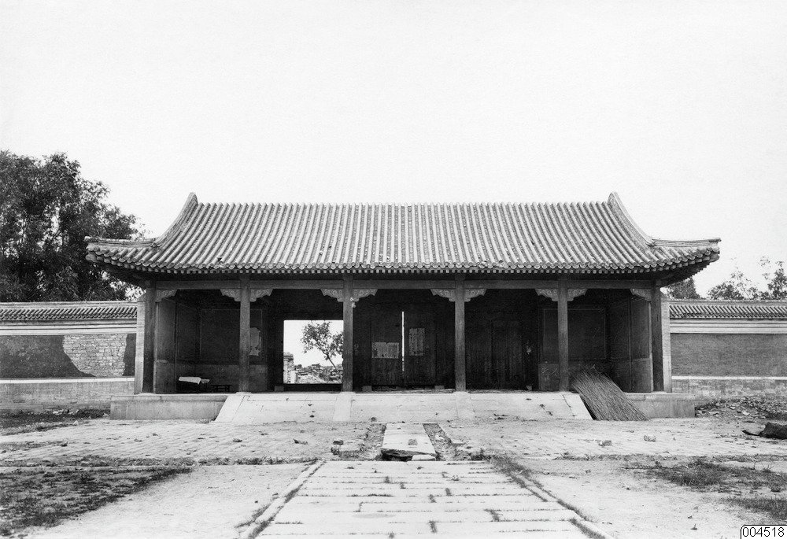

<!-- generated:start (scripts/building_pages.py): do not edit between these markers -->

# YM41: 大宫门 Da Gongmen

The Great Palace Gate (Malone p.68) · Yuanming Yuan

**3D object:** 12 boxes. Open it: `/reconstruction/3d.html?b=YM41`

## What we know

- **Name:** 大宫门 Da Gongmen (S05, S02, S42, S01, S102 · confidence B)
- **English:** The Great Palace Gate (Malone p.68) (S05, S02, S42, S01, S102)
- **Written on the plan:** 圆明园大宫门 (S01 · confidence B)
- **Garden:** Yuanming Yuan (S05, S02, S42, S01, S102)
- **Type:** compound (S05, S02, S42, S01, S102 · confidence B)
- **Built:** 雍正三年 1725 区域 (S42) (S05, S02, S42, S01, S102)
- **Destroyed:** 1860 (S05, S02, S42, S01, S102)
- **Position:** 40.00097, 116.29061. S01 sure (S01 · confidence B)
- **Size in the inventory:** 21.57 × 11.33 m. stated in a source (S01)
- **Note:** Front court of YM01, not a separate album leaf (S02 p.71). Text only here; plan readers can raise to A. (S05, S02, S42, S01, S102)
- **Plan reader's note:** Gate B1186 and everything south of the road: 朝房, 膳房, 清茶房, 银库, 南书房, 宫档房 yards. Mostly blank enclosures. Plan continues south of y 6300 with 石路 and timber fences (see notes) (S01) *(research copy, not public)*
- **How it was read:** sure (S01) *(research copy, not public)*
- **Plan pixels:** 3297, 5935 (S01) *(research copy, not public)*

## Our model now

12 boxes stand in this compound, 9 on blocks drawn on the plan, 3 assumed. Its halls are listed below.

## Inside it (17)

- YM41-01 大宫门门殿
- YM41-02 左右门
- YM41-03 东西夹道门
- YM41-04 外朝房
- YM41-05 东侧衙署直房
- YM41-06 西侧衙署直房
- YM41-07 银库
- YM41-08 南书房
- YM41-09 档案房
- YM41-10 造办处
- YM41-11 药房
- YM41-12 大影壁
- YM41-13 前湖 (扇面湖)
- YM41-B1203
- YM41-B1246
- YM41-B1248
- YM41-B1249

## Pictures (1)

- **P0217** (guess): Sirén, Yuanmingyuan (Old summer palace): Entrance Gate. Entrébyggnad med mur. Genom den öppna porten kan man skymta ruinerna. (undated by holder; Sirén's second trip 1921-23 for this group). http://kulturarvsdata.se/SMVK-OM/Bildarkiv/199629 Research-only: link card.

  

## Texts and drawings (31)

- **E0999** (text, sure): 日下舊聞考 正大光明. 1780s (乾隆 敕撰) · j80:7b · S05. https://github.com/kanripo/KR2k0036/blob/master/KR2k0036_080.txt
  > 大宫門前輦道東西皆有湖是為前湖（圓明園冊）臣等謹按前湖西岸有石刻御製前湖詩
  The lake called 前湖 Front Lake lies east and west of the carriage road before the main gate; the compilers record a stone-cut poem on its west bank.
- **E1000** (text, sure): 日下舊聞考 正大光明. 1780s (乾隆 敕撰) · j80:9a-11a · S05. https://github.com/kanripo/KR2k0036/blob/master/KR2k0036_080.txt
  > 大宫門内為出入賢良門五楹門左右為直房前跨石橋度橋東西朝房各五楹西南為茶膳房再西為繙書房東南為清茶房為軍機處（圓明園冊）臣等謹按出入賢良門額世宗御書是為二宫門凡武職侍衛引見御此門較射左右直房為各部院臣工入直之所東西設兩罩門各衙門奏事由東罩門逓進茶膳房太監人等由西罩門出入門前河形如月中駕石橋三其水自西來東注如意門閘口㑹東園各河而出出入賢良門内為正大光明殿七楹東西配殿各五楹後為壽山殿東為洞明堂（圓明園冊）臣等謹按圓明園四十景中世宗御題四字額者凡十有四正大光明殿其一也餘如牡丹臺今為鏤月開雲蓬萊洲今為蓬島瑶臺乃乾隆九年皇上恭依避暑山莊三十六景四字題額之例更鍚嘉名用昭畫一敬就各條下加按並恭載御製四十景詩至附近各景詩已載御製詩全集者兹不備録又按正大光明殿内聨曰心天之心而宵衣旰食樂民之樂以和性怡情為世宗御書又聨曰遹求寜觀成無逺弗届以對時育物有那其居為皇上御書東壁懸御書周書無逸篇西壁懸豳風圖東為洞明堂世宗御書額
  Through the five-bay 出入賢良門, the second gate with duty rooms and three stone bridges over a moon-shaped canal, are court offices, kitchens, the translation office and the 軍機處 Grand Council. Then 正大光明殿 of seven bays with five-bay side halls, 壽山殿 behind and 洞明堂 to the east. The notes explain the renaming of the fourteen Yongzheng titles under the 1744 four-character scheme, and record the couplets, the 無逸 text on the east wall and the 豳風 picture on the west wall.
- **E2101** (text, sure): 日下舊聞考 大宫门. 1780s (乾隆 敕撰) · j80:8b-9a · S05. https://github.com/kanripo/KR2k0036/blob/master/KR2k0036_080.txt
  > 大宫門五楹門前左右朝房各五楹其後東為宗人府内閣吏部禮部兵部都察院理藩院翰林院詹事府國子監鑾儀衛東四旗各衙門直房東夾道内為銀庫又東北為南書房東南為檔案房西為户部刑部工部欽天監内務府光禄寺通政司大理寺鴻臚寺太常寺太僕寺御書處上駟院武備院西四旗各衙門直房西夾道之西南為造辦處又南為藥房
  The main gate has five bays with five-bay court offices left and right. Behind them the duty rooms of the boards and offices are set out east and west by name, with the silver vault, 南書房 Southern Study and archive room to the east and the 造辦處 Imperial Workshops and pharmacy to the south-west.
- **E1520** (text, sure): 檐曝雜記 卷一. c. 1800, on the Qianlong years · line 45 of the corpus file · S213. https://github.com/garychowcmu/daizhigev20/blob/master/史藏/志存记录/檐曝杂记.txt
  > ○烟火上元夕，西厂舞灯、放烟火最盛。清晨先于圆明园宫门列烟火数十架，药线徐引燃，成界画栏杆五色。每架将完，中复烧出宝塔楼阁之类，并有笼鸽及喜鹊数十在盒中乘火飞出者。未、申之交，驾至西厂。先有八旗骗马诸戏：或一足立鞍凳而驰者；或两足立马背而驰者；或扳马鞍步行而并马驰者；或两人对面驰来，各在马上腾身互换者；或甲腾出，乙在马上戴甲于首而驰者，曲尽马上之奇。日既夕，则楼前舞灯者三千人列队焉，口唱《太平歌》，各执彩灯，循环进止，各依其缀兆，一转旋则三千人排成一“太”字，再转成“平”字，以次作“万”、“岁”字，又以次合成“太平万岁”字，所谓“太平万岁字当中”也。舞罢，则烟火大发，其声如雷霆，火光烛半空，但见千万红鱼奋迅跳跃于云海内，极天下之奇观矣。
  Lantern Festival in the Qianlong years: fireworks first before the main gate, then the emperor at 西廠 山高水長 from mid-afternoon, with Banner trick-riding. An eyewitness of those years.
- **E0415** (poem, sure): 王闓運 圓明園詞. 1871 (同治十年) · whole poem; copy without the 自注 · S203. https://www.douban.com/group/topic/46378693/
  > 宜春苑中萤火飞，建章长乐柳十围。 离宫从来奉游豫，皇居那复在郊圻？ 旧池澄绿流燕蓟，洗马高梁游牧地。 北藩本镇故元都，西山自拥兴王气。 九衢尘起暗连天，辰极星移北斗边。 沟洫填淤成斥卤，宫庭映带觅泉原。 渟泓稍见丹棱泮，陂陀先起畅春园。 畅春风光秀南苑，霓旌凤盖长游宴。 地灵不惜瓮山湖，天题更创圆明殿。 圆明始赐在潜龙，因回邸第作郊宫。 十八篱门随曲涧，七楹正殿倚乔松。 轩堂四十皆依水，山石参差尽亚风。 甘泉避暑因留跸，长杨扈从且弢弓。 纯皇缵业当全盛，江海无波待游幸。 行所留连赏四园，画师写放开双境。 谁道江南风景佳，移天缩地在君怀。 当时只拟成灵囿，小费何曾数露台。 殷勤毋佚箴骄念，岂意元皇失恭俭！ 秋狝俄闻罢木兰，妖氛暗已传离坎。 吏治陵迟民困痛，长鲸跋浪海波枯。 始惊计吏忧财赋，欲卖行宫助转输。 沉吟五十年前事，厝火薪边然已至。 揭竿敢欲犯阿房，探丸早见诛文吏。 此时先帝见忧危，诏选三臣出视师。 宣室无人侍前席，郊坛有恨哭遗黎。 年年辇路看春草，处处伤心对花鸟。 玉女投壶强笑歌，金杯掷酒连昏晓。 四时景物爱郊居，玄冬入内望春初。 袅袅四春随凤辇，沉沉五夜递铜鱼。 内装颇学崔家髻，讽谏频除姜后珥。 玉路旋悲车毂鸣，金銮莫问残灯事。 鼎湖弓剑恨空还，郊垒风烟一炬间。 玉泉悲咽昆明塞，惟有铜犀守荆棘。 青芝岫里狐夜啼，绣漪桥下鱼空泣。 何人老监福园门，曾缀朝班奉至尊。 昔日暄阗厌朝贵，于今寂寞喜游人。 游人朝贵殊暄寂，偶来无复金闺客。 贤良门闭有残砖，光明殿毁寻颓壁。 文宗新构清辉堂，为近前湖纳晓光。 妖梦林神辞二品，佛城舍卫散诸方。 湖中蒲稗依依长，阶前蒿艾萧萧响。 枯树重抽盗作薪，游鳞暂跃惊逢网。 别有开云镂月台，太平三圣昔同来。 宁知乱竹侵苔落，不见春风泣露开。 平湖西去轩亭在，题壁银钩连倒薤。 金梯步步度莲花，绿窗处处留蠃黛。 当时仓卒动铃驼，守宫上直余嫔娥。 芦笳短吹随秋月，豆粥长饥望热河。 上东门开胡雏过，正有王公班道左。 敌兵未爇雍门荻，牧童已见骊山火。 应怜蓬岛一孤臣，欲持高洁比灵均。 丞相避兵生取节，徒人拒寇死当门。 即今福海冤如海，谁信神州尚有神！ 百年成毁何匆促，四海荒残如在目。 丹城紫禁犹可归，岂闻江燕巢林木？ 废宇倾基君好看，艰危始识中兴难。 已惩御史言修复，休遣中官织锦纨。 锦纨枉竭江南赋，鸳文龙爪新还故。 总饶结彩大宫门，何如旧日西湖路。 西湖地薄比郇瑕，武清暂住已倾家。 惟应鱼稻资民利，莫教莺柳斗宫花。 词臣讵解论都赋，挽辂难移幸雒车。 相如徒有上林颂，不遇良时空自嗟。
  A long lament on the garden's rise and destruction. It names the eighteen fence gates, the seven-bay main hall and forty halls by water, then the ruined 賢良門 and 光明殿, the new 清輝堂 of Xianfeng, 舍衛城, 鏤月開雲, and 福海 where the official 文豐 died.
- **E2102** (text, sure): 竹葉亭雜記. early 19th c. · line 41 of the corpus file · S211. https://github.com/garychowcmu/daizhigev20/blob/master/史藏/志存记录/竹叶亭杂记.txt
  > 圆明园宫门内正月十五放和盒，例也。即烟火盒子，大架高悬。一盒三层：第一层“天下太平”四大字；二层鸽雀无数群飞，取放生之意；三层小儿四人击秧歌鼓，唱秧歌，唱“太平天子朝元日，五色云中驾六龙”一首。惟其时余观之朝阳满地，不见灯光矣。后停止。
  Inside the main gate on the 15th of the first month, firework boxes of three tiers were hung on a tall frame, and the practice later stopped.
- **E2124** (text, sure): 養吉齋叢錄 卷四. mid-19th c. (printed 1890s), on earlier reigns · 卷四, line 275 of the corpus file · S202. https://raw.githubusercontent.com/garychowcmu/daizhigev20/master/%E5%8F%B2%E8%97%8F/%E5%BF%97%E5%AD%98%E8%AE%B0%E5%BD%95/%E5%85%BB%E5%90%89%E6%96%8B%E4%B8%9B%E5%BD%95.txt
  > 圆明园之南书房，旧在东如意门外。嘉庆辛酉，于奏事门内赐屋四楹为人直地，与军机直房相邻，而旧直庐亦不废，以内监守之，每奉敕校勘书籍于此。
  The garden's 南書房 stood outside the east 如意門. In 嘉慶辛酉 (1801) a four-bay room was added inside the memorial gate beside the Council office, and the old lodging stayed in use for checking books.
- **E1028** (description, sure): M'Ghee: burning of the audience hall, 19 October. 1860 · p.288 · S242. https://archive.org/details/howwegotintopek01ghegoog
  > and all that now remained was the Hall of Audience already described, and the lodges and buildings between that and the grand entrance ; they were spared to the last, as in them the troops had been quartered.
  60th Rifles and the Punjabis had burned far and wide. About three o'clock the hall was set alight, the roof fell in, then the gate and lodges. Pages 285-287 describe a palace among hills eight or nine miles off, also burned: outside this project, probably 静宜园.
- **E2103** (description, sure): Lucy: the layout before the gate, 6 October. 1860 · p.101 · S247. https://archive.org/details/souvenirsdevoya00lucygoog
  > Sur la droite de ce prolongement était, au fond d'un vaste hémicycle, la grande porte du Palais Impérial.
  Letter: small lake and wood on the left, where they camped; road blocked by a wall, turning at a right angle to a plain grilled door; to the right, at the back of a vast half circle, the great gate.
- **E2104** (description, sure): M'Ghee: the two courts. 1860 · p.203 · S242. https://archive.org/details/howwegotintopek01ghegoog
  > Inside the first entrance-gate there is a large, flagged courtyard, some hundred yards wide by eighty deep ; at each side, both within and without, are guard-rooms.
  Causeway through a sheet of water to the outer gate. A second gate of the same form, then a second court about the same size with the hall on its far side.
- **E2106** (description, sure): Varin: the night reconnaissance through the courts. 1860 · pp.227-228 · S245. https://archive.org/details/expditiondechin00paulgoog
  > et on s'engagea dans une cour immense traversée dans sa dernière partie par un canal revêtu en marbre blanc, et couvert d'un pont, également en marbre, soutenant deux galeries latérales en bois.
  A large space with trees and a lake on one side and the palace on the other, a bare esplanade with regular side buildings, chevaux-de-frise at the entry. Centre gate barred, side doors used. Second enclosure, then a big court crossed by the marble-lined canal and bridge with two wooden galleries. Third enclosure with a wall about 4 m high and two small side doors.
- **E2107** (description, sure): Wolseley: approach by the eastern and western entrances. 1860 · pp.229-230 · S240. https://archive.org/details/narrativeofwarwi00wols
  > There are two entrances to the Imperial residence ; one eastward, the other westward of the bridge.
  East entrance like any yamen, in front a large square with chevaux-de-frise made for show and bridges over a small river, not impressive. The west one, by the river and lofty trees, was the grand one. The eastern one may be 福园门; that is my guess.
- **E2108** (description, sure): Wolseley: causeway and ponds before the gate. 1860 · p.230 · S240. https://archive.org/details/narrativeofwarwi00wols
  > disclosing an open expanse of water, through which the road was carried along a raised causeway, edged upon both sides by rows of trees.
  Artificial ponds with lilies and lotus at the edges, fed by the stream. A temple at the far end of the causeway under lofty trees with mandarin poles before it, General Jamin's headquarters in 1860; the French camp in a grove opposite.
- **E2109** (description, sure): Wolseley: court and gate of 大宫门. 1860 · pp.231-232 · S240. https://archive.org/details/narrativeofwarwi00wols
  > The gateway was at one end of a courtyard, enclosed upon three sides with ranges of guard-houses, handsomely ornamented outside with curious carving, and roofed with variegated tiling.
  Eaves with small birds and beasts, red, white, green, blue and gilt. Beam ends carved and painted. Red doors picked out in gold. Gate sills 2 or 3 ft above the pavement with granite ramps, so no wheeled traffic. Guard-room right and left within.
- **E2110** (description, sure): 6 October 1860: arrival at the Great Palace Gate. 1934 · p.179 · S02. https://archive.org/details/historyofpekings00malo
  > A company of French marines scaled the outer wall and occupied the outer gate and courtyard on the night of October 6th, killing one or two of the defenders and suffering a few wounds themselves.
  French troops arrived at seven in the evening with a British cavalry brigade under Pattle. A few eunuchs defended the gate. From Cordier, quoting Montauban.
- **E2112** (description, sure): Amherst at the gate, 1816. 1934 · pp.173-174 · S02. https://archive.org/details/historyofpekings00malo
  > He had just arrived at daybreak, travel-worn and tired after an all-night ride over the stone road from T'ung Chou to Peking and thence, unexpectedly, on to the gate of the Yuan Ming Yuan.
  Amherst reached the gate at daybreak, refused the immediate audience and left without seeing the garden.
- **E2114** (description, sure): Spirit wall south of the Great Palace Gate, measured by Malone. 1934 · p.69 · S02. https://archive.org/details/historyofpekings00malo
  > On the north side of the Fan Lake and directly south of the gate stood an ornamented spirit wall 137 feet long, over five feet thick, and about 15 feet high.
  大影壁 Da Yingbi, the spirit wall: 137 ft long, over 5 ft thick, about 15 ft high, from Malone's own measurements before it was torn down for its materials. The road ran from it straight north to the gate, between the Fan Lakes; Qianlong's monument of 1763 stood on the west bank.
- **E2115** (description, sure): The Great Palace Gate and the offices before it. 1934 · p.70 · S02. https://archive.org/details/historyofpekings00malo
  > The Great Palace Gate was a roofed building in which hung a tablet inscribed with the name of the garden, Yuan Ming Yuan, written by the Emperor K'ang Hsi.
  大宫门 Da Gongmen: waiting rooms beside the road, behind them offices of the boards and the Eight Banners, the Grand Council, the 南书房 imperial school, treasury, dispensary and kitchens. Note 15 on p.70 lists the offices east and west of the gate by name.
- **E2116** (description, sure): The tea-house Garden of Peace before the Great Gate, Daoguang. 1934 · pp.174-175 · S02. https://archive.org/details/historyofpekings00malo
  > The book of views of various parts of China in which this description appears shows a picture of the tea-house, called the Garden of Peace, standing beyond the Fan Lake and just opposite to the Great Gate of the Palace.
  From 鸿雪因缘图记 (Hung Hsueh Yin Yuan T'u Chi) vol.3 part 2, by a Manchu official. Yellow earth on the road, curtains over side streets, shops closed as the emperor rode by towards the Empress Dowager's garden.
- **E2105** (description, likely): Swinhoe: entry of 7 October and the hall. 1860 · p.294 · S241. https://archive.org/details/narrativeofnorth00swin
  > On the centre of the pavement, and facing the gate, stood the grand reception hall, a large Chinese building, well adorned exteriorly with paint and gilding, and netted with iron wire under the fretted eaves to keep the birds off.
  Smooth marble floor. Throne carved with dragons, which he found on close look to be lesser wood painted as ebony.
- **E2111** (description, likely): 7 October 1860: entry, the audience hall and the emperor's rooms. 1934 · pp.180-181 · S02. https://archive.org/details/historyofpekings00malo
  > We entered the central gateway upon a large paved courtyard, whereon the bodies of two Chinese officials were lying dead.
  Swinhoe, with Montauban at the entry of 7 October (n.17 identifies the dead as the eunuchs of the night before). Through the audience hall to the emperor's bedroom, the English treaty of 1858 on a table; looting began with officers. Foley saw the rooms at 6 and at 11:30 a.m. and the collections much reduced.
- **E2113** (description, likely): Grant's first view, 7 October 1860. 1934 · pp.182-183 · S02. https://archive.org/details/historyofpekings00malo
  > We passed the park walls by a fine old stately gateway, and proceeding up an avenue, came to a range of handsome dwellings roofed over with yellow tiles, turned up at the ends, Chinese fashion.
  Grant: forty small palaces in the grounds, paths in order, ornamental water, the French camped at the entrance of the Great Audience Hall. Main palace held jade, jars, enamels, bronzes, clocks; in a building near it two howitzers from Woolwich given by Macartney. 8 October: gold and silver found in one of the temples and a room of silks and furs, shared between the armies.
- **E2117** (description, sure): 圆明园大宫门区历史文脉调查研究. 2016-09 to 2017-02, posted 2020-08-03 · 圆明园官网 yjbg t20200803_4417131 · S338. https://www.yuanmingyuanpark.cn/xs/yjbg/202008/t20200803_4417131.html
  Park study of about 2 km2 south of the garden wall: 挂甲屯, 西马厂, the 八旗 drill ground and princes' gardens that served the court, their fall after 1860. Abstract on the page, the full text is an attachment.
- **E1013** (description, sure): 圆明园正大光明初探. post n.d. · lswh or jzys list · S337. http://iqh.ruc.edu.cn/old/qdhjylyjzx/xszl/ylfj/2d97c9a95a8442f7abf5b8e453d02fa3.htm
  The whole front court district, built 1725, 370 x 310 m. 大宫门 and 出入贤良门 are five-bay gate halls with 卷棚歇山 roofs on the garden's south wall line. 正大光明殿: seven bays by three, all-round gallery, single eave, grey tile, high base, 36.45 x 16 m, with a terrace and four incense burners. Stresses its garden-like, less formal planning.
- **E2118** (description, sure): 圆明园银库：清朝兴衰晴雨表. post n.d. · lswh · S337. http://iqh.ruc.edu.cn/old/qdhjylyjzx/xszl/xstl/2573bb7ddce64f769e928d8b30b5fdbd.htm
  Traces the 圆明园 treasury as one of three in the Imperial Household's finances: its growth as a measure of Qing strength and of the garden's rise, and its decline to the plunder of 1860 by British and French troops.
- **E2119** (archaeology, sure): 大宫门 河道: 2014 gilt bronze elephant head. 2014 · section on 陈辉 · S333. https://www.visitbeijing.com.cn/article/49Nly85Lvzb
  The park's archaeologist recalls that a heavy lump of mud from the channel side at 大宫门 in 2014 turned out, once cleaned in the lab, to be a gilt bronze elephant head. It was first shown in the 2017 圆明园考古展.
- **E0363** (archaeology, sure): 揭秘圆明园考古, 华西都市报 via 中证网. 2017-07-10 · news, 张中华 and 张利芳 · S140. https://cs.com.cn/ssgs/gssc/201707/t20170710_5365575.html
  Three large campaigns since 1996 yielded over 50,000 finds. The campaign from 2012 dug 桃花洞, 大宫门, 养雀笼, the 海晏堂 water tower and 远瀛观. At 如园 Ru Yuan, the best-preserved of these sites and the first imitation of a Jiangnan garden dug here (19,000 m2 site, 2,800 m2 buildings, 3,800 m2 opened), diggers found 芝兰室, 云萝山馆, 听泉榭, 延清堂, 含碧楼, 挹霞亭, 观丰榭, 引胜轩, rockery, paths and shores, and burnt famille-rose floor tiles in 延清堂.
- **E2120** (archaeology, sure): 大宫门考古成果 announced 2019-01-28, 中新网 via 中国日报网. 2019-01-29 · photo caption · S132. https://cn.chinadaily.com.cn/a/201901/29/WS5c4fad50a31010568bdc713a.html
  The park announced that the dig at 大宫门 Da Gongmen had found the gate hall, the east and west wing gates, the 金水桥 bridge and the river channel, and that the area would be conserved and opened in three display parts.
- **E1017** (archaeology, sure): 正大光明区域考古勘探报告. n.d. · mhymy 档案史料 12324, free part · S102. https://www.mhymy.com/dasl/12324.html
  Report's opening describes three successive courts from 大宫门 to 正大光明殿, 370 m north-south and 310 m east-west between the 如意门 gates, 114,700 m2 of site and 7,000 m2 of buildings, begun 1725. Gate hall of five bays on a base 21.57 x 11.33 m, 0.77 m high; screen wall 41.6 m long, 204.8 m south of the gate terrace.
- **E2121** (archaeology, sure, search index only): 圆明园遗址公园大宫门区域考古发掘简报, 北京市文物研究所, 12 pp.. n.d. · mhymy 档案史料 12331, title only · S154. https://www.mhymy.com/dasl/12331.html
  Listed brief report on the 大宫门 dig; only the title and author are readable here. Marked as a wish.
- **E1018** (reconstruction, sure, search index only): 再现·圆明园——正大光明, 贺艳, 紫禁城. 2011-12 · mhymy qklw 9456 · S341. https://www.mhymy.com/xsjl/qklw/9456.html
  贺艳's reconstruction essay on the court district: built by Yongzheng in 1725 to rule from the garden. East it meets 勤政亲贤, north 寿山 and 前湖, west 长春仙馆.

**On the plan:** Drawn on the plan of the gardens (S01), labelled 圆明园大宫门. https://artmuseum.princeton.edu/collections/objects/138657

## Open questions

- Q3: Which state does S01 draw?
- Q28: 1860 and after, for the site's text

<!-- generated:end -->

## Notes

<!-- Yours: regeneration never touches this part. It goes on the public site; what you write below a line holding only %% private %% stays in the research copy. -->
