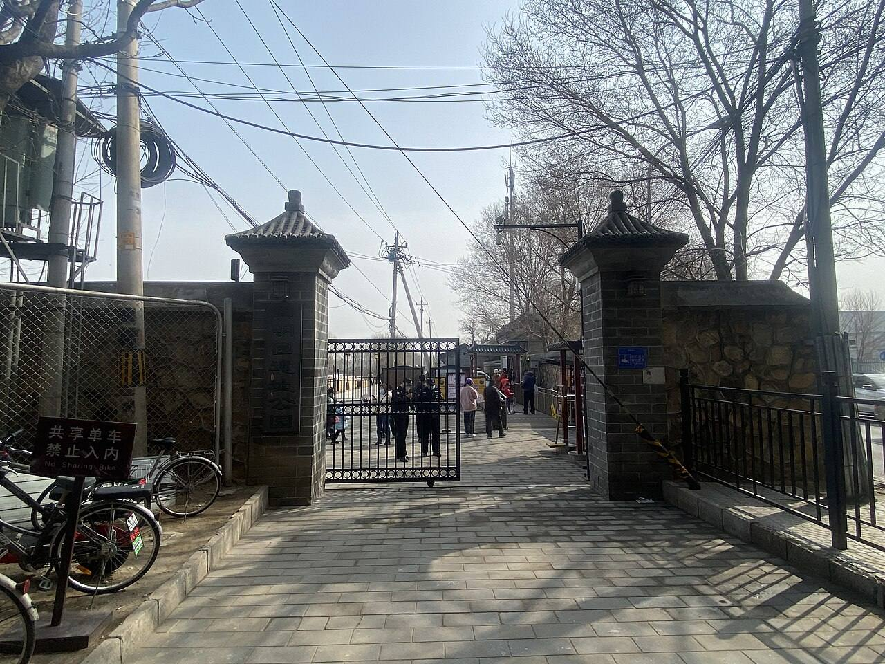
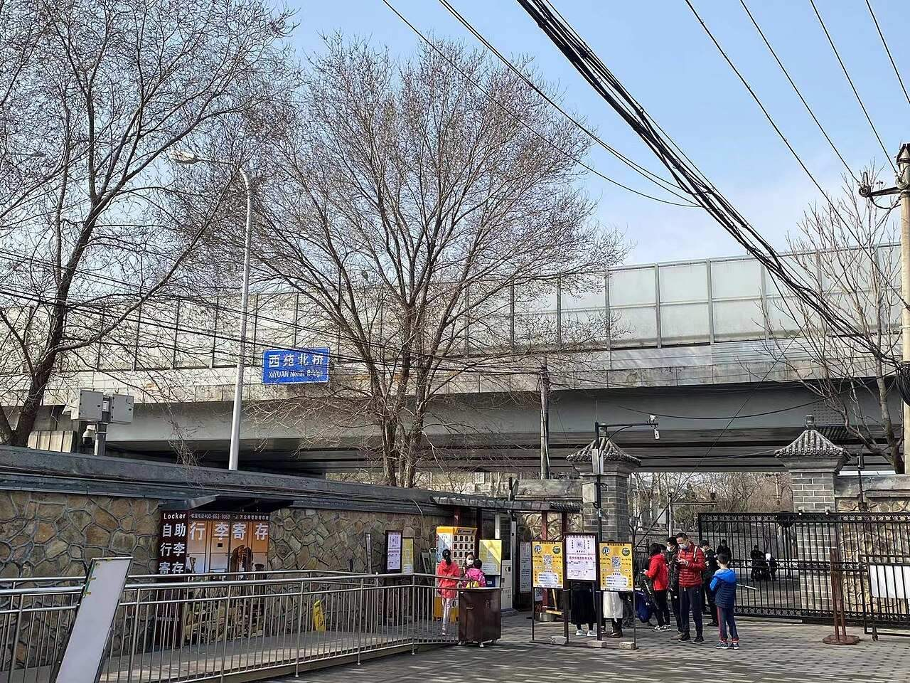

<!-- generated:start (scripts/building_pages.py): do not edit between these markers -->

# YM42: 园门 (十八门) Yuanmen (eighteen gates)

Yuanming Yuan

**3D object:** 9 boxes. Open it: `/reconstruction/3d.html?b=YM42`

## What we know

- **Name:** 园门 (十八门) Yuanmen (eighteen gates) (S05, S01 · confidence B)
- **Garden:** Yuanming Yuan (S05, S01)
- **Type:** gate (S05, S01 · confidence B)
- **Destroyed:** 1860 (S05, S01)
- **Position:** 40.00157, 116.29211. S01 guess (S01 · confidence C)
- **Note:** Grouping row: Rixia lists 18 gates of YM. 3 already rows: 大宫门 (YM41-01), 左右门 (YM41-02), 东西夹道门 (YM41-03), 福园门 (YM40-02). (S05, S01)
- **Plan reader's note:** Gate group, not one place. Only the south pair 东水?门 and 西水?门 in my box, see named.csv (S01) *(research copy, not public)*
- **How it was read:** guess (S01) *(research copy, not public)*
- **Plan pixels:** 3948, 5710 (S01) *(research copy, not public)*

## Our model now

9 boxes stand in this compound, 4 on blocks drawn on the plan, 5 assumed. Its halls are listed below.

## Inside it (12)

- YM42-01 东如意门
- YM42-02 西如意门
- YM42-03 西南门
- YM42-04 水闸门
- YM42-05 藻园门
- YM42-06 东楼门
- YM42-07 铁门
- YM42-08 明春门
- YM42-09 东随墙门
- YM42-10 蕊珠宫门
- YM42-11 西随墙门
- YM42-12 北楼门

## Pictures (2)

- **P0469** (guess): 圆明园藻园门.jpeg (2022-03-13 (Commons DateTimeOriginal)). https://commons.wikimedia.org/wiki/File:%E5%9C%86%E6%98%8E%E5%9B%AD%E8%97%BB%E5%9B%AD%E9%97%A8.jpeg

  

- **P0470** (guess): 圆明园藻园门位于西苑北桥下方.jpeg (2022-03-13 (Commons DateTimeOriginal)). https://commons.wikimedia.org/wiki/File:%E5%9C%86%E6%98%8E%E5%9B%AD%E8%97%BB%E5%9B%AD%E9%97%A8%E4%BD%8D%E4%BA%8E%E8%A5%BF%E8%8B%91%E5%8C%97%E6%A1%A5%E4%B8%8B%E6%96%B9.jpeg

  

## Texts and drawings (4)

- **E2125** (text, sure): 日下舊聞考 园门 (十八门)、水闸三座. 1780s (乾隆 敕撰) · j80:6b-7b · S05. https://github.com/kanripo/KR2k0036/blob/master/KR2k0036_080.txt
  > 園内為門十八南曰大宫門曰左右門曰東西夾道門曰東西如意門曰福園門曰西南門曰水閘門曰藻園門東曰東樓門曰鐡門曰明春門曰隨墻門曰蘂珠宫門西曰隨墻門正北曰北樓門為閘三西南為一空進水閘東北為五空出水閘為一空出水閘（圓明園冊）臣等謹按圓明園之水發源玉泉山由西馬厰入進水閘支流派衍至園内日天琳宇桞浪聞鶯諸處之響水口水勢遂分西北高而東南低五空出水閘在明春門北一空出水閘在蘂珠宫北水出苑牆經長春園出七空閘東入清河
  Lists the eighteen garden gates by compass side (大宫門, 福園門, 藻園門, 明春門, 蘂珠宫門, 北樓門 and others) and the three sluices. The note traces the water: in from 玉泉山 Jade Spring Hill by the south-west one-opening inlet, splitting at 日天琳宇 and 桞浪聞鶯, falling from north-west to south-east, out through the five-opening and one-opening sluices and across Changchun Yuan to the seven-opening sluice 七空閘.
- **E0480** (description, likely): Wolseley: park wall. 1860 · p.229 · S240. https://archive.org/details/narrativeofwarwi00wols
  > At about the distance of every quarter of a mile stands a good-sized guard-house, in which the faithful Tartar watchmen kept guard both day and night over the person and property of their Celestial master.
  High wall all round, called granite by him, not for defence; guard-house about every quarter mile; inside the wall a high earth bank planted with pine and cedar, hiding it. Malone p.218 speaks of a high carved brick wall on the north and west.
- **E2126** (description, sure): 圆明园围墙历史变迁考. 2021 · yjbg · S116. https://www.yuanmingyuanpark.cn/xs/yjbg/202108/t20210831_4483376.html
  Park history of the walls and gates: loss from 1919 onward (army, road stone, sales), rebuilding from 1984 to 2006 on the old line. Historic gates include 明春门, 绿油门, 蕊珠门, 秀清村门, 藻园门, 福缘门.
- **E2127** (drawing, sure): 《国家图书馆藏样式雷图档·圆明园卷初编》: 蕊珠宫门. mostly 道光, 咸丰, 同治 per the publisher · 初编 目录: 蕊珠宫门, p.434 · S13. https://www.nlcpress.com/ProductView.aspx?Id=7642
  The printed facsimile of the National Library of China's Yangshi Lei sheets has a section on this place at p.434 (1 pages, section length worked out from the next heading); sheet titles and numbers are in the volume, ordered from a library.

**On the plan:** Its place is drawn on the plan of the gardens (S01), with no name written. https://artmuseum.princeton.edu/collections/objects/138657

## Evidence for the set of buildings

- Reconstructions and comparables for the whole garden, 圆明园 Yuanming Yuan: see GARDEN-YM

## Open questions

None that name it.

<!-- generated:end -->

## Notes

<!-- Yours: regeneration never touches this part. It goes on the public site; what you write below a line holding only %% private %% stays in the research copy. -->
