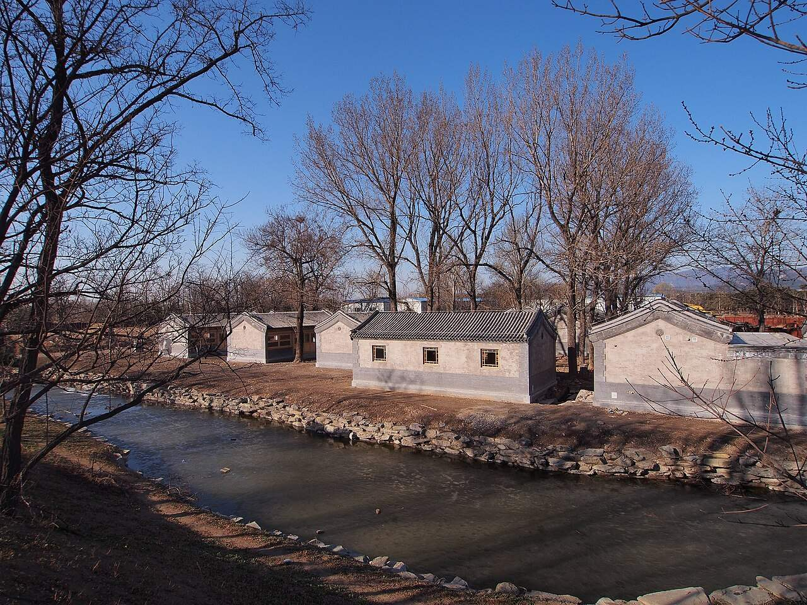

<!-- generated:start (scripts/building_pages.py): do not edit between these markers -->

# YM44: 同乐园 Tongle Yuan

Yuanming Yuan

**3D object:** 19 boxes. Open it: `/reconstruction/3d.html?b=YM44`

## What we know

- **Name:** 同乐园 Tongle Yuan (S05, S02, S43, S41, S01, S360, S310 · confidence A)
- **Garden:** Yuanming Yuan (S05, S02, S43, S41, S01, S360, S310)
- **Type:** compound (S05, S02, S43, S41, S01, S360, S310 · confidence A)
- **Built:** by 1738 (first dated item) (S05, S02, S43, S41, S01, S360, S310)
- **Changed:** 1838: plan to rebuild the 清音阁 stage as two storeys, 3.60 m lower, abandoned after objections (feng shui); kept at three storeys (S05, S02, S43, S41, S01, S360, S310)
- **Destroyed:** 1860 (S05, S02, S43, S41, S01, S360, S310)
- **Position:** 40.00738, 116.29321. S01 sure (S01 · confidence B)
- **Note:** Shown in album leaf YM38 (S41; S02 p.95). 坐石臨流 東為同樂園 [j82:26a]. (S05, S02, S43, S41, S01, S360, S310)
- **Plan reader's note:** Label (4770,2900). Polygon takes the theatre courts south of the canal and the block east of the street north of it (买卖街, text: 中有南北长街). (S01) *(research copy, not public)*
- **How it was read:** sure (S01) *(research copy, not public)*
- **Plan pixels:** 4768, 2900 (S01) *(research copy, not public)*

## Our model now

19 boxes stand in this compound, 19 on blocks drawn on the plan, 0 assumed. Its halls are listed below.

## Inside it (23)

- YM44-01 同乐园看戏楼
- YM44-02 清音阁
- YM44-03 扮戏楼
- YM44-04 东西转角配楼
- YM44-05 永日堂
- YM44-06 南北长街 (买卖街)
- YM44-07 抱朴草堂
- YM44-08 双桥
- YM44-B0397
- YM44-B0413
- YM44-B0414
- YM44-B0438
- YM44-B0439
- YM44-B0440
- YM44-B0446
- YM44-B0447
- YM44-B0489
- YM44-B0492
- YM44-B0493
- YM44-B0494
- YM44-B0516
- YM44-B0536
- YM44-B0550

## Pictures (1)

- **P0487** (guess): 圆明园内的新修建筑 - Refurbished Buildings in Yuanmingyuan Park - 2013.03 - panoramio.jpg (Taken on 13 March 2013 (Commons DateTimeOriginal)). https://commons.wikimedia.org/wiki/File:%E5%9C%86%E6%98%8E%E5%9B%AD%E5%86%85%E7%9A%84%E6%96%B0%E4%BF%AE%E5%BB%BA%E7%AD%91_-_Refurbished_Buildings_in_Yuanmingyuan_Park_-_2013.03_-_panoramio.jpg

  

## Texts and drawings (34)

- **E2146** (text, sure): 日下舊聞考 同乐园、舍卫城. 1780s (乾隆 敕撰) · j82:27b-28b · S05. https://github.com/kanripo/KR2k0036/blob/master/KR2k0036_082.txt
  > 麴院風荷之北為同樂園前後樓各五楹南向其前為清音閣北向東為永日堂中有南北長街街西為抱樸草堂街北度雙橋為舎衛城前樹坊楔三城南面為多寳閣内為山門正殿為壽國壽民後為仁慈殿又後為普福宫城北為最勝閣（圓明園册）臣等謹按永日堂壽國壽民仁慈殿普福宫諸額皆世宗御書舍衛城北坊額曰花界曰香城東曰□湧曰金池西曰曇霏曰珠林多寳閣祀闗帝額曰至聖大勇夀國夀民殿額曰心月妙相仁慈殿額曰具足圓成普福宫額曰瑞應優曇最勝閣坊額曰乾闥持輪曰祗林垂鬘皆御書
  North of 麴院風荷: 同樂園, front and rear five-bay towers facing south, the theatre 清音閣 facing north, 永日堂, a shopping street, 抱樸草堂. North over twin bridges: the walled temple 舎衛城 with three archways, 多寳閣, a gate, 壽國壽民, 仁慈殿, 普福宫 and 最勝閣. The note gives each plaque and arch.
- **E2140** (poem, sure): 御製 同樂園得句. 1791 (御製詩五集) · KR4f0005_454:17b · S201. https://github.com/kanripo/KR4f0005/blob/master/KR4f0005_454.txt
  > 同樂園得句 月餘縈念一朝舒（昨年臈月初二日雪至今月餘矣）同樂顧名幸不虚豈以笙歌為共衆亦惟稼穡是厪予樹生花訝春昌矣麥吐芽欣澤沃如傍晚飄蕭勢未止罷鐙何礙節之初（至晩雪勢尚未止因恐外藩外國人或濕衣履遂命衆不必伺候元宵節前以優遇雪澤而停烟火亦佳話也）
  New Year 1791 at 同樂園: he cancels the fireworks in deep snow so that foreign and frontier guests need not stand in the wet.
- **E1232** (text, sure): 文宗實錄 咸豐二年四月癸卯. 1852 (咸豐二年四月) · 實錄卷之六十 · S207. https://github.com/garychowcmu/daizhigev20/blob/master/史藏/别史/清实录咸丰朝实录.txt
  > 癸卯。上诣桃花春一溪、问皇贵太妃安。奉皇贵太妃、幸同乐园。进膳毕。跪送皇贵太妃、还绮春园。
  The emperor sees the senior consort at 桃花春一溪, the plaque of 竹薖樓 in S05 j80:32a; takes her to 同樂園 to eat; and sees her back to 綺春園, her home.
- **E1557** (text, sure): 文宗實錄 咸豐二年六月. 1852 (咸豐二年六月) · 實錄卷之六十三 · S207. https://github.com/garychowcmu/daizhigev20/blob/master/史藏/别史/清实录咸丰朝实录.txt
  > 上诣安佑宫行礼。○诣绮春园、皇贵太妃前行礼。○御正大光明殿。王以下文武大臣官员、蒙古王贝勒等、行庆贺礼。○幸同乐园。赐王公大臣蒙古王贝勒等食。
  The emperor's birthday round in 1852: rites at 安佑宫, the consort at 綺春園, congratulations in 正大光明殿 and a feast at 同樂園. The halls in use eight years before the end.
- **E2147** (text, sure): 養吉齋叢錄 卷十三. mid-19th c. (printed 1890s), on earlier reigns · 卷十三, line 925 of the corpus file · S202. https://raw.githubusercontent.com/garychowcmu/daizhigev20/master/%E5%8F%B2%E8%97%8F/%E5%BF%97%E5%AD%98%E8%AE%B0%E5%BD%95/%E5%85%BB%E5%90%89%E6%96%8B%E4%B8%9B%E5%BD%95.txt
  > 盖向来即席亲赓者，惟在内与宴之十八人也。又嘉庆丙寅，朱文正公与宴，命所作诗不必面呈，以文正年已七十六，且患目眚故也。又癸亥平定三省教匪，茶宴在同乐园，文正集误作重华宫。向来茶宴，多内直词臣，惟开四库馆时，总纂陆锡熊、纪昀，总校陆费墀，虽非内廷，每宴皆与。乾隆癸亥以后，历年诗题附录于后：乾隆癸亥元宵联句即浮圆子。甲子无。
  The tea party for ending the Three Province rising in 癸亥 (1803) was held at 同樂園.
- **E2148** (text, sure): 養吉齋叢錄 卷十三. mid-19th c. (printed 1890s), on earlier reigns · 卷十三, line 938 of the corpus file · S202. https://raw.githubusercontent.com/garychowcmu/daizhigev20/master/%E5%8F%B2%E8%97%8F/%E5%BF%97%E5%AD%98%E8%AE%B0%E5%BD%95/%E5%85%BB%E5%90%89%E6%96%8B%E4%B8%9B%E5%BD%95.txt
  > 同乐园在圆明园大宫门东，转东楼们，乘舟里许乃至。乾隆间，年例自正月十三日起，在园酬节。宗室王公及外藩、蒙古王公，台吉、额驸、属国陪臣，俱命入座，赐食听戏。又万寿庆节前后数日，亦于此演剧。正屋凡五间，圣驾临莅，主位亦从观焉。诸臣命听戏者，先数日由奏事处以名单奏请。皇子 及内廷王公、大学士、尚书、御前大臣、军机大臣、内务府大臣、南书房供奉翰林皆与。例坐于东西厢，某某同屋一间，亦先期指定。皆赐茶酒果物。演剧台深广约十丈，凡三层，神只仙佛由上一层缒而下，鬼魅则自下一层穴而上。所演有清平见喜、和合呈样、青牛独驾、万年甲子、太平有象、环中九九、瑶林香世界等名目，其余传奇杂出，与外间梨园子弟扮演皆同，特声容之美盛，器服之繁丽，则钩天广乐，固非人世所得见闻。道光间，每日不过演十余出，大抵自辰至申即罢。优伶向由织造、监督、盐政等采选送京，并有眷属同居者，谓之外南府。按：康熙间即南府之名。道光初元，将南府人一概遣还。自后宫内演剧，皆用内监为之。盖亦昭德示俭之一端也。
  The fullest description of 同樂園. Reached by a boat of about a li east of the main gate; banquets from the thirteenth of the first month; a main building of five bays; the guests in side rooms; a three-tier stage about ten zhang deep and wide, with gods let down from the top and demons up from below. Daoguang cut the plays and sent the actors home.
- **E2149** (text, sure): 養吉齋叢錄 卷十三. mid-19th c. (printed 1890s), on earlier reigns · 卷十三, line 939 of the corpus file · S202. https://raw.githubusercontent.com/garychowcmu/daizhigev20/master/%E5%8F%B2%E8%97%8F/%E5%BF%97%E5%AD%98%E8%AE%B0%E5%BD%95/%E5%85%BB%E5%90%89%E6%96%8B%E4%B8%9B%E5%BD%95.txt
  > 按：同乐园听戏，乃行庆令典。至于深宫清暇，宣唤乐工，则随处别有排当，不在此制。
  Note: plays at 同樂園 were for state occasions; those in private took place elsewhere.
- **E2150** (text, sure): 養吉齋叢錄 卷十三. mid-19th c. (printed 1890s), on earlier reigns · 卷十三, line 940 of the corpus file · S202. https://raw.githubusercontent.com/garychowcmu/daizhigev20/master/%E5%8F%B2%E8%97%8F/%E5%BF%97%E5%AD%98%E8%AE%B0%E5%BD%95/%E5%85%BB%E5%90%89%E6%96%8B%E4%B8%9B%E5%BD%95.txt
  > 如嘉庆间宣宗在藩邸，三十寿辰，蒙仁宗于如意洲一片云赏戏，其一事也。又同乐园听戏，向来词臣不与，嘉庆间，始命南书房、翰林与宴。
  Note: Hanlin officials were first admitted to the 同樂園 plays under Jiaqing.
- **E2151** (text, sure): 竹葉亭雜記. early 19th c. · line 37 of the corpus file · S211. https://github.com/garychowcmu/daizhigev20/blob/master/史藏/志存记录/竹叶亭杂记.txt
  > 圆明园福海之东有同乐园，每岁赐诸臣观剧于此。高庙时，每新岁园中设有买卖街，凡古玩估衣以及茶馆饭肆，一切动用诸物悉备，外间所有者无不有之，虽至携小筐卖瓜子者亦备焉。开店者俱以内监为之。其古玩等器，由崇文门监督先期于外城各肆中采择交入，言明价值，具于册。卖去者给值，存者归物。各大臣至园，许竞相购买之。各执事官退出后，日将晡，内宫亦至其肆市物焉。其执事等官，俱得集于酒馆饭肆哺啜，与在外等。馆肆中走堂者，俱挑取外城各肆中之声音响亮、口齿伶俐者充之。每俟驾过店门，则走堂者呼茶，店小二报账，掌柜者核算，众音杂逻，纷纷并起，以为新年游观之乐。至燕九日始辍。盖以九重欲周知民间风景之意也。造办处笔帖式徐君善庆每岁入直，言之最详。晚间仍备嘎嘎灯焉。嘉庆四年此例停止。
  The New Year market of the Qianlong years in the garden, run by eunuchs, with goods chosen from the city's shops and sold at agreed prices; it places 同樂園 east of 福海, which differs from S05.
- **E2162** (poem, sure): 抱朴草堂. 乾隆三十二年 (1767) · v3 p.89, under 坐石临流; source ref 9-266 · S361. https://www.yuanmingyuanpark.cn/xs/yjbg/202008/P020200803382569071850.pdf#page=92
  > 轩楹近觉压华庨，洁治书堂覆草茅。欲拟幽人犹未得，敢言古帝恐成淆。闲披芸简窗前朗，静听松风户外敲。津逮漫言由李葛，仙家与我却无交。
  Poem 抱朴草堂 by the Qianlong Emperor, 1767, filed by the editors under 坐石临流.
- **E2163** (poem, sure): 抱朴草堂口号. 乾隆三十二年 (1767) · v3 p.90, under 坐石临流; source ref 9-273 · S361. https://www.yuanmingyuanpark.cn/xs/yjbg/202008/P020200803382569071850.pdf#page=93
  > 笔砚精良乐一时，便教抒兴与摛词。草堂抱朴名相称，所愧还淳身先之。
  Poem 抱朴草堂口号 by the Qianlong Emperor, 1767, filed by the editors under 坐石临流.
- **E2139** (poem, sure): 同乐园: 乾隆五十六年 poem of the Qianlong Emperor. 乾隆五十六年 (1791), date from the compilation · p.228 item (59), under 同乐园 · S360. https://www.yuanmingyuanpark.cn/xs/yjbg/202007/P020200730387572832602.pdf#page=228
  > 月余萦念一朝舒。昨年臈月初二日雪至今月余矣）同乐顾名幸不虚，岂以笙歌为共众，亦惟稼穑是厪予，树生花讶春昌矣，麦吐芽欣泽沃如，傍晚飘萧势未止，罢镫何碍节之初。至晩雪势尚未止，因恐外藩外国人或湿衣履遂命众不必伺候，元宵节前以优遇雪泽而停烟火亦佳话也，）
  Poem of the Qianlong Emperor at 同乐园, 1791, on banquets and theatre. Year as given by the compilation.
- **E2141** (poem, sure): 永日堂: 嘉庆元年 poem of the Jiaqing Emperor. 嘉庆元年 (1796), date from the compilation · p.236 item (1), under 永日堂 · S360. https://www.yuanmingyuanpark.cn/xs/yjbg/202007/P020200730387572832602.pdf#page=236
  > 佛日光华浮尘屏，湛然圆镜须弥顶，高高宗动列宿悬，极乐安隐瞻胜境。八功德水漾莲池，心香意叶堪引领。至诚瞻礼两足尊，寸衷虔祝春晖永。
  Poem of the Jiaqing Emperor at 永日堂, 1796. Year as given by the compilation.
- **E2142** (poem, sure): 同乐园: 嘉庆二年 poem of the Jiaqing Emperor. 嘉庆二年 (1797), date from the compilation · p.228 item (61), under 同乐园 · S360. https://www.yuanmingyuanpark.cn/xs/yjbg/202007/P020200730387572832602.pdf#page=228
  > 藩部朝正王会开，承欢行庆乐春台，暖敷卉木光风转，泽洽田畴瑞雪培，聆训铭心主诚敬。 （皇父晨夕训政，事无巨细执两用中，惟诚则明，敬胜迪吉，予祇承之下永识弗谖，）祈天孚愿息氛埃。 （湖北教匪窜入黄柏山中，官军四面围合己成釜底游魂，惟吁昊恩助顺迅奏廓清尔， ）箫韶迭奏升平曲，化被三苗圣武恢。 （湖南逆苗平定后官军徇阅各苗寨宣示威德，群苗皆望风归顺歌舞欢欣，因清还界址优与抚恤，从此各安生业边园永靖矣。 ）
  Poem of the Jiaqing Emperor at 同乐园, 1797, on banquets and theatre. Year as given by the compilation.
- **E2143** (poem, sure): 同乐园: 嘉庆三年 poem of the Jiaqing Emperor. 嘉庆三年 (1798), date from the compilation · p.228 item (64), under 同乐园 · S360. https://www.yuanmingyuanpark.cn/xs/yjbg/202007/P020200730387572832602.pdf#page=228
  > 紫轪扶舆宝阁开，氤氲佳气绕层台，宗支深沐帝恩洽，藩部同蒙圣泽培。（年例正月十三日起在御园之同乐园酬节宗室，王公及外藩蒙古王公台吉、额驸属团陪臣俱命入坐，赐食锡赍骈蕃圣恩沦浃者六十余年矣，）星拱北辰昭会极，风行西蜀靖征埃，庆丰图启酬嘉节，后乐先忧至教恢。
  Poem of the Jiaqing Emperor at 同乐园, 1798, on banquets. Year as given by the compilation.
- **E2144** (poem, sure): 永日堂: 嘉庆三年 poem of the Jiaqing Emperor. 嘉庆三年 (1798), date from the compilation · p.236 item (2), under 永日堂 · S360. https://www.yuanmingyuanpark.cn/xs/yjbg/202007/P020200730387572832602.pdf#page=236
  > 春晖拓景夏方长，煦妪永依佛日光。焜耀天中全朗照，波旬销铄殄凶狂。
  Poem of the Jiaqing Emperor at 永日堂, 1798. Year as given by the compilation.
- **E2138** (poem, likely): 恭和御制同乐园得句元韵（159）. 乾隆五十三年 (1788) · v4 p.386, under 春熙院 · S361. https://www.yuanmingyuanpark.cn/xs/yjbg/202008/P020200803382796786124.pdf#page=389
  > 同乐春台品汇舒，六花相映景清虚。来牟大有天贻我，稼穑先知众惬予。点缀园林真沃若，滋培畎亩验膏如。箫韶九奏升平曲，畅发青阳令节初。
  Poem 恭和御制同乐园得句元韵（159） by the Qianlong Emperor, 1788, filed by the editors under 春熙院.
- **E2145** (poem, likely): 同乐园口号. 嘉庆七年 (1802) · v3 p.102, under 同乐园; source ref 2-100 · S361. https://www.yuanmingyuanpark.cn/xs/yjbg/202008/P020200803382569071850.pdf#page=105
  > 春台舒长养，乐与万民同。寰宇诚蕃庶，先忧厪寸衷。
  Poem 同乐园口号 by the Jiaqing Emperor, 1802, filed by the editors under 同乐园.
- **E2067** (description, sure): Scene 38, 坐石临流 Zuoshi Linliu, and 舍卫城 Shewei Cheng. 1934 · p.94 · S02. https://archive.org/details/historyofpekings00malo
  > Not far west of the Happy Sea a granite road between two rows of buildings, which included a theater and which looked like a business street in a city, crossed a bridge over a canal, and led up to a gate in a fortified wall like the entrance of a city.
  Granite road with shops and a theatre, a bridge, then the gate of 舍卫城 (Sravasti) in a walled enclosure with a pailou before it, red-walled temples inside, a similar gate on the north. The small pavilion over a rocky stream gave the scene its name. N.45: yellow glazed tile pieces found by Malone, inscribed She Wei Ch'eng and "made in the 15th year"; probably the 佛城 being built in 1740. The fair of the court was held on this street.
- **E0476** (description, guess): M'Ghee: the grounds and a theatre. 1860 · p.211 · S242. https://archive.org/details/howwegotintopek01ghegoog
  > theatres and their store-houses, filled with all the paraphernalia for masquerades upon a gigantic scale, one theatre and its belongings covering from five to ten acres of ground, all richly planted around;
  Grounds extending six or seven miles by his estimate, summer-houses with yellow porcelain roofs. Which theatre is not stated; 同乐园 is my guess by size.
- **E2466** (description, sure): 同乐园平面图 (record text). record 2020-22 · mhymy dasl/ysltd/7295 · S310. https://www.mhymy.com/dasl/ysltd/7295.html
  Record on 同乐园: the great theatre court in the south-east of 坐石临流, facing 舍卫城 to the north, the 买卖街 to the west, the 永日堂 chapel to the east; c. 1 ha, 4,550 m2 built. No drawing number shown.
- **E2154** (description, sure): 扮戏楼 at 同乐园. 2021 · section on 同乐园 · S43. https://www.yuanmingyuanpark.cn/xs/yjbg/202108/t20210831_4483509.html
  Five-bay dressing building south of the great stage, 22.2 m wide and 6.4 m deep with 1.6 m galleries front and back, then a nine-bay south building behind it.
- **E2156** (description, sure): 圆明园买卖街钩沉. post n.d. · hwyj · S115. http://iqh.ruc.edu.cn/old/qdhjylyjzx/xszl/hwyj/4115411323ba4429a9ecc9ae5b2bc2e5.htm
  The two shop streets. 同乐园's runs over 130 m north-south, split by a stream and 双桥, to the south of 舍卫城, in place by 1744. 含经堂's, dug in 2001-02, has a base 135.65 x about 6.3 m and 28 stoves, so perhaps eating houses. It has 40 shop bays in 9 units, against 10 buildings on the Yangshi Lei plan.
- **E2157** (description, sure): 圆明园同乐园的功能及其文化内涵. post n.d. · lswh · S337. http://iqh.ruc.edu.cn/old/qdhjylyjzx/xszl/ylfj/602fc6cd19de47f8b9fb9d1a693ade5e.htm
  同乐园 Tongle Yuan, part of 坐石临流, was the court's main entertainment quarter, begun early Yongzheng: stage 清音阁, main hall, temple 永日堂 and the shop street. Emperor below and empresses above in the viewing hall; princes and envoys in east and west wings of 14 bays each. Nine upper buildings of 64 bays. Street T-shaped, 120 x 100 m.
- **E2152** (description, sure): 圆明园百景史事分景汇编: 同乐园. 1738-1860 · from p.224, under 同乐园 · S360. https://www.yuanmingyuanpark.cn/xs/yjbg/202007/P020200730387572832602.pdf#page=224
  The garden's theatre: banquets for clansmen, Mongol princes and envoys at New Year and imperial birthdays, recorded from 1738 to 1860. 同乐园: 155 dated items, 1738-1860, of which 6 poems and 149 court records (Qianlong, Jiaqing, Daoguang, Xianfeng); recurring themes: visits to the dowager, banquets, theatre. First dated 1738, last dated 1860.
- **E2153** (description, sure): 圆明园百景史事分景汇编: 永日堂. 1796-1798 · from p.236, under 同乐园 · S360. https://www.yuanmingyuanpark.cn/xs/yjbg/202007/P020200730387572832602.pdf#page=236
  永日堂: 2 dated items, 1796-1798, of which 2 poems (Jiaqing). First dated 1796, last dated 1798.
- **E2068** (description, sure): 圆明园五朝御制诗文集注 v3, editors' note on 坐石临流. 2020 edition · v3 p.88 · S361. https://www.yuanmingyuanpark.cn/xs/yjbg/202008/P020200803382569071850.pdf#page=91
  An overview of a four-part district with the shop street in the middle. 坐石临流 is the cup-floating pavilion; 抱朴草堂 a six-bay reverse hall. It gives 舍卫城 hall by hall (多宝阁, 寿国寿民, 仁慈殿, 普福宫, 最胜阁), and 同乐园: a theatre with towers of five bays, three-bay link, the emperor below and dowager above, facing the three-storey stage 清音阁.
- **E2155** (description, sure, search index only): 《圆明园戏场探微》. S312. https://www.mhymy.com/xsjl/9991.html
  Survey of the gardens' theatres with sizes, from the three-storey stage of 1726 to the indoor stages of the Xianfeng period.
- **E2158** (drawing, sure): 同乐园 烫样. 中国国家博物馆 · S328. https://www.mhymy.com/xwzx/ssrd/13512.html
  Paper model of the Tongle Yuan group under conservation at the National Museum, reported as the clearest surviving record of it, labelled with directions and sizes; made for Tongzhi's project per the report.
- **E2159** (drawing, sure): 清音阁样式雷图. S310. https://www.mhymy.com/dasl/ysltd/7297.html
  Drawing of the Qingyin Ge theatre tower at Tongle Yuan; shelf number and date not seen in the extract. No image here; the site may ask a small payment for the full record.
- **E2472** (drawing, sure): 圆明园同乐园建筑群 烫样 (National Museum of China). not stated · 中国国家博物馆 · S922. https://www.xinhuanet.com/shuhua/20230517/853c8d5fecc64755ade73189babb5a70/c.html
  Card model of the 同乐园 theatre group, conserved by the NMC in 2023 (pigment analysis by Raman spectroscopy). The report calls it key evidence for the layout and forms before the burning but gives no date; S920 lists a 同乐堂 among the Tongzhi models, which may or may not be this one. A 营造学社 photo of the model is reproduced on a bilibili wiki page (link card only).
- **E2071** (drawing, likely): 《国家图书馆藏样式雷图档·圆明园卷初编》: 坐石临流. mostly 道光, 咸丰, 同治 per the publisher · 初编 目录: 坐石临流, pp.229-262 · S13. https://www.nlcpress.com/ProductView.aspx?Id=7642
  The printed facsimile of the National Library of China's Yangshi Lei sheets has a section on this place at pp.229-262 (34 pages, section length worked out from the next heading); sheet titles and numbers are in the volume, ordered from a library.
- **E2072** (drawing, sure, search index only): 同乐园平面图. S310. https://www.mhymy.com/dasl/ysltd/7295.html
  Plan of the great theatre garden, part of Zuoshi Linliu, facing Shewei Cheng to the north; shelf number and date not seen in the extract. No image here; the site may ask a small payment for the full record.
- **E2492** (archaeology, likely): 买卖街 article page citing the 含经堂 dig brief. single page T00121 · S941. https://www.dpm.org.cn/Uploads/pdf/5071/T00121_00.pdf
  Gives the 含经堂 shop-row foundations from the dig brief, 135.65 m N-S and about 63 m E-W, with 28 stoves, so perhaps several eating houses. It also says the 同乐园 shopping street ran straight N-S for over 130 m, crossed by a stream with a double plank bridge 双桥, and split into E and W arms south of 舍卫城.

**On the plan:** Drawn on the plan of the gardens (S01), labelled 同乐园. https://artmuseum.princeton.edu/collections/objects/138657

## Reconstructions by others (1)

Modern interpretation, not evidence.
- **R0148** (physical model, likely): 样式雷烫样 Yangshi Lei card models of Yuanmingyuan: 泉石自娱, 同乐堂, 上下天光, 思顺堂, 天地一家春, 恒春堂, 课农轩, 廓然大公, 勤政殿, 万方安和. 雷氏 Lei family holdings, shown in 故宫 exhibition 营缮之道 《单士元》, Tongzhi period for most, per the report. https://www.thepaper.cn/newsDetail_forward_2201516 Research-only: link card.

## Surviving comparable buildings, not this building (5)

- **T046** 德和园大戏楼 Dehe Yuan Grand Theatre, 颐和园 Summer Palace. Same design family, confidence B, standing: rebuilt 1886. Three-storey stage, two-storey dressing building behind, facing a viewing hall: the full arrangement, and the only one where the viewing hall survives Basis: S404 names it among the 5; search summary (visitbeijing): built for Cixi's 60th birthday, 21 m, three storeys, modelled on 畅音阁, with 7 天井. https://www.stdaily.com/web/gdxw/2024-08/09/content_1969930.html
  - P0574: Summer Palace, Beijing, The Roofs of the Garden of Virtue and Harmony (15585952743). https://commons.wikimedia.org/wiki/File:Summer_Palace,_Beijing,_The_Roofs_of_the_Garden_of_Virtue_and_Harmony_(15585952743).jpg
- **T047** 清音阁 (避暑山庄) Qingyin Ge, Chengde, 避暑山庄 Chengde. Same design family, confidence B, standing: no. Lost, but the statement matters: our stage had a rolled ridge and grey tile, unlike 畅音阁 Basis: S404 names it among the 5 stages; S422 (暢音閣): burned 1945. S422 (颐和园): 德和园 has the structure of the 同乐园 清音阁 and the Chengde 清音阁, unlike 畅音阁 in having a rolled ridge and grey tile. https://zh.wikipedia.org/wiki/暢音閣
- **T048** 畅音阁 Changyin Ge, 宁寿宫 故宫 Forbidden City. Same design family, confidence B, standing: yes. Three stages 福台, 禄台, 寿台, 天井 and 地井, three eaves, tall square plan: what 清音阁 at 同乐园 looked like Basis: S404: 5 three-storey Qing court stages: 同乐园, 德和园, 寿安宫, 畅音阁, 清音阁 (承德). 畅音阁 1772-76, 20.71 m, floor 685.94 m²; standing and intact. Present form after a Jiaqing alteration (search summary). https://www.stdaily.com/web/gdxw/2024-08/09/content_1969930.html
  - P0575: Pavilion of Pleasant Sounds stage 2010 April. https://commons.wikimedia.org/wiki/File:Pavilion_of_Pleasant_Sounds_stage_2010_April.jpg
  - P0576: Changyinge，the palace museum，bejing. https://commons.wikimedia.org/wiki/File:Changyinge%EF%BC%8Cthe_palace_museum%EF%BC%8Cbejing.jpg
- **T050** 阅是楼 Yueshi Lou, 宁寿宫 故宫 Forbidden City. Same design family, confidence B, standing: yes. Viewing hall facing a stage: distance, height, how the emperor sat Basis: S422 (暢音閣): the viewing building facing 畅音阁, 1772. Same pair of stage and viewing hall as our 清音阁 facing 同乐园看戏楼 (S05 j.82 f.27a-b). https://zh.wikipedia.org/wiki/暢音閣
- **T049** 苏州街 (买卖街) Suzhou Street (Maimai Jie), 颐和园 后湖 Summer Palace. Comparable: same court, era or type, confidence B, standing: partly. A court shop-street: shop fronts, signs, width of a lane. Rebuilt in 1990 Basis: Search summary (visitbeijing): the shop street was built under Qianlong after Jiangnan water towns, burned by the Anglo-French force in 1860 and rebuilt on the site in 1990; 60-70 shops, about 270-300 m. Same court idea as our 南北长街 (买卖街) at 同乐园 (S05 j.82 f.27a-28a). https://www.visitbeijing.com.cn/article/4Dn2Zq8jTbN
  - P0577: Suzhou Street in the Summer Palace (20240706121715). https://commons.wikimedia.org/wiki/File:Suzhou_Street_in_the_Summer_Palace_(20240706121715).jpg
  - P0578: Peking Sommerpalast Suzhou Street-20071020-RM-111208. https://commons.wikimedia.org/wiki/File:Peking_Sommerpalast_Suzhou_Street-20071020-RM-111208.jpg

## Evidence for the set of buildings

- Reconstructions and comparables for the whole garden, 圆明园 Yuanming Yuan: see GARDEN-YM

## Open questions

- Q51: Reading the Yangshi Lei records
- Q52: Smaller conflicts
- Q59: Twin claims to hold loosely
- Q86: YM44-06 / CC02-15
- Q104: 烫样 dates
- Q119: Digs
- Q125: Geotagged Commons coverage is thin
- Q168: YM44 清音阁
- Q169: YM44 what_en says nothing of 1860
- Q170: YM44 card model
- Q191: The water layer lacks some ponds and inlets the plan and the leaves show

<!-- generated:end -->

## Notes

<!-- Yours: regeneration never touches this part. It goes on the public site; what you write below a line holding only %% private %% stays in the research copy. -->
