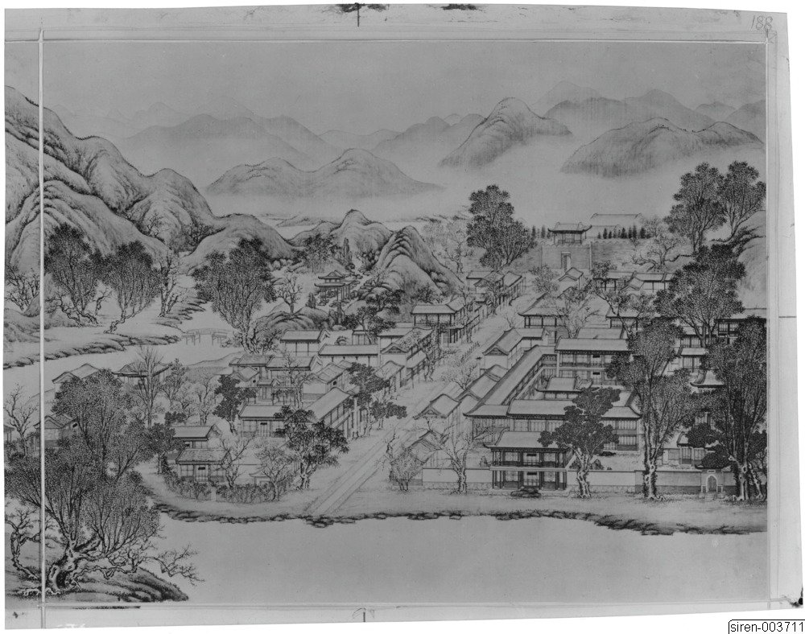
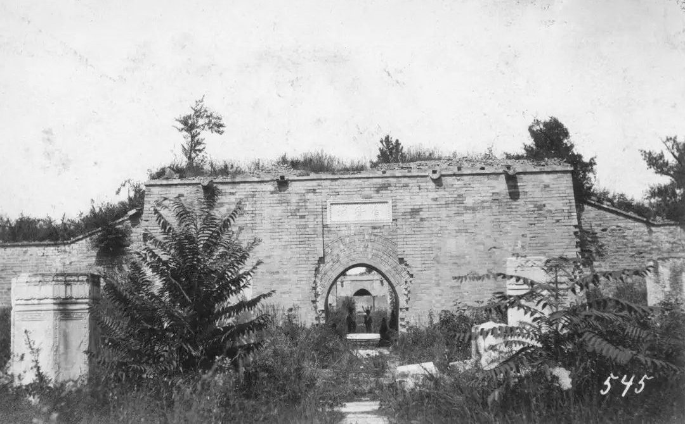

<!-- generated:start (scripts/building_pages.py): do not edit between these markers -->

# YM45: 舍卫城 Shewei Cheng

She Wei Ch'eng or Wall of Sravasti (Malone p.63) · Yuanming Yuan

**3D object:** 40 boxes. Open it: `/reconstruction/3d.html?b=YM45`

## What we know

- **Name:** 舍卫城 Shewei Cheng (S05, S02, S46, S41, S01 · confidence A)
- **English:** She Wei Ch'eng or Wall of Sravasti (Malone p.63) (S05, S02, S46, S41, S01)
- **Garden:** Yuanming Yuan (S05, S02, S46, S41, S01)
- **Type:** temple (S05, S02, S46, S41, S01 · confidence A)
- **Built:** 乾隆五年 1740 (S02 p.63, p.94 n.: 佛城 in the Yuan Ming Yuan Tse Li); plaque 雍正御笔 (S46) (S05, S02, S46, S41, S01)
- **Destroyed:** Looted 1860; 南城门 and plaque stood in an 1882 photograph, gone in an 1900 photograph; walls gone by 1921 (S46); north wall removed 1960s (S06) (S05, S02, S46, S41, S01)
- **Position:** 40.00941, 116.29258. S01 sure (S01 · confidence B)
- **Note:** Shown in album leaf YM38 (S41; S02 p.95). S46: 2019 dig; 南城门 墩台宽15.4 m 进深12.6 m 残高1-1.25 m. S06: 36万+ images (lead). (S05, S02, S46, S41, S01)
- **Plan reader's note:** Label (4615,2190) below the south wall. Outer wall line taken as the edge. (S01) *(research copy, not public)*
- **How it was read:** sure (S01) *(research copy, not public)*
- **Plan pixels:** 4610, 1891 (S01) *(research copy, not public)*

## Our model now

40 boxes stand in this compound, 40 on blocks drawn on the plan, 0 assumed. Its halls are listed below.

## Inside it (38)

- YM45-01 坊楔
- YM45-02 多宝阁
- YM45-03 山门
- YM45-04 寿国寿民殿
- YM45-05 仁慈殿
- YM45-06 普福宫
- YM45-07 最胜阁
- YM45-B0235
- YM45-B0251
- YM45-B0253
- YM45-B0254
- YM45-B0255
- YM45-B0293
- YM45-B0294
- YM45-B0297
- YM45-B0317
- YM45-B0318
- YM45-B0321
- YM45-B0322
- YM45-B0323
- YM45-B0340
- YM45-B0363
- YM45-B0364
- YM45-B0366
- YM45-B0367
- YM45-B0375
- YM45-B0376
- YM45-B0381
- YM45-B0382
- YM45-B0383
- YM45-B0384
- YM45-B0385
- YM45-B0386
- YM45-B0387
- YM45-B0388
- YM45-B0398
- YM45-N01 三世佛殿
- YM45-N02 ??堂

## Pictures (3)

- **P0209** (sure): Sirén, Enligt text under Pl. 188 Kinas trädgårdar Vol. I: Yuanmingyuan. Sheweicheng. Stadsgatan, infattad av butiksbyggnader, ledande upp mot en port i bakgrunden. Målning av Tang Dai (T’ang (undated by holder; Sirén's second trip 1921-23 for this group). http://kulturarvsdata.se/SMVK-OM/Bildarkiv/198820 Research-only: link card.

  

- **P0197** (likely): Shewi City Gate ruins (舍卫城 gate, file name) (1920 (Commons description)). https://commons.wikimedia.org/wiki/File%3AShewi_City_Gate_ruins_in_the_Yuanmingyuan.jpg

  

- **P0198** (likely): Shewi City ruins (舍卫城, file name) (not stated). https://commons.wikimedia.org/wiki/File%3AShewi_City_ruins_of_the_Yuanmingyuan.jpg Research-only: link card.

## Texts and drawings (26)

- **E2146** (text, sure): 日下舊聞考 同乐园、舍卫城. 1780s (乾隆 敕撰) · j82:27b-28b · S05. https://github.com/kanripo/KR2k0036/blob/master/KR2k0036_082.txt
  > 麴院風荷之北為同樂園前後樓各五楹南向其前為清音閣北向東為永日堂中有南北長街街西為抱樸草堂街北度雙橋為舎衛城前樹坊楔三城南面為多寳閣内為山門正殿為壽國壽民後為仁慈殿又後為普福宫城北為最勝閣（圓明園册）臣等謹按永日堂壽國壽民仁慈殿普福宫諸額皆世宗御書舍衛城北坊額曰花界曰香城東曰□湧曰金池西曰曇霏曰珠林多寳閣祀闗帝額曰至聖大勇夀國夀民殿額曰心月妙相仁慈殿額曰具足圓成普福宫額曰瑞應優曇最勝閣坊額曰乾闥持輪曰祗林垂鬘皆御書
  North of 麴院風荷: 同樂園, front and rear five-bay towers facing south, the theatre 清音閣 facing north, 永日堂, a shopping street, 抱樸草堂. North over twin bridges: the walled temple 舎衛城 with three archways, 多寳閣, a gate, 壽國壽民, 仁慈殿, 普福宫 and 最勝閣. The note gives each plaque and arch.
- **E0415** (poem, sure): 王闓運 圓明園詞. 1871 (同治十年) · whole poem; copy without the 自注 · S203. https://www.douban.com/group/topic/46378693/
  > 宜春苑中萤火飞，建章长乐柳十围。 离宫从来奉游豫，皇居那复在郊圻？ 旧池澄绿流燕蓟，洗马高梁游牧地。 北藩本镇故元都，西山自拥兴王气。 九衢尘起暗连天，辰极星移北斗边。 沟洫填淤成斥卤，宫庭映带觅泉原。 渟泓稍见丹棱泮，陂陀先起畅春园。 畅春风光秀南苑，霓旌凤盖长游宴。 地灵不惜瓮山湖，天题更创圆明殿。 圆明始赐在潜龙，因回邸第作郊宫。 十八篱门随曲涧，七楹正殿倚乔松。 轩堂四十皆依水，山石参差尽亚风。 甘泉避暑因留跸，长杨扈从且弢弓。 纯皇缵业当全盛，江海无波待游幸。 行所留连赏四园，画师写放开双境。 谁道江南风景佳，移天缩地在君怀。 当时只拟成灵囿，小费何曾数露台。 殷勤毋佚箴骄念，岂意元皇失恭俭！ 秋狝俄闻罢木兰，妖氛暗已传离坎。 吏治陵迟民困痛，长鲸跋浪海波枯。 始惊计吏忧财赋，欲卖行宫助转输。 沉吟五十年前事，厝火薪边然已至。 揭竿敢欲犯阿房，探丸早见诛文吏。 此时先帝见忧危，诏选三臣出视师。 宣室无人侍前席，郊坛有恨哭遗黎。 年年辇路看春草，处处伤心对花鸟。 玉女投壶强笑歌，金杯掷酒连昏晓。 四时景物爱郊居，玄冬入内望春初。 袅袅四春随凤辇，沉沉五夜递铜鱼。 内装颇学崔家髻，讽谏频除姜后珥。 玉路旋悲车毂鸣，金銮莫问残灯事。 鼎湖弓剑恨空还，郊垒风烟一炬间。 玉泉悲咽昆明塞，惟有铜犀守荆棘。 青芝岫里狐夜啼，绣漪桥下鱼空泣。 何人老监福园门，曾缀朝班奉至尊。 昔日暄阗厌朝贵，于今寂寞喜游人。 游人朝贵殊暄寂，偶来无复金闺客。 贤良门闭有残砖，光明殿毁寻颓壁。 文宗新构清辉堂，为近前湖纳晓光。 妖梦林神辞二品，佛城舍卫散诸方。 湖中蒲稗依依长，阶前蒿艾萧萧响。 枯树重抽盗作薪，游鳞暂跃惊逢网。 别有开云镂月台，太平三圣昔同来。 宁知乱竹侵苔落，不见春风泣露开。 平湖西去轩亭在，题壁银钩连倒薤。 金梯步步度莲花，绿窗处处留蠃黛。 当时仓卒动铃驼，守宫上直余嫔娥。 芦笳短吹随秋月，豆粥长饥望热河。 上东门开胡雏过，正有王公班道左。 敌兵未爇雍门荻，牧童已见骊山火。 应怜蓬岛一孤臣，欲持高洁比灵均。 丞相避兵生取节，徒人拒寇死当门。 即今福海冤如海，谁信神州尚有神！ 百年成毁何匆促，四海荒残如在目。 丹城紫禁犹可归，岂闻江燕巢林木？ 废宇倾基君好看，艰危始识中兴难。 已惩御史言修复，休遣中官织锦纨。 锦纨枉竭江南赋，鸳文龙爪新还故。 总饶结彩大宫门，何如旧日西湖路。 西湖地薄比郇瑕，武清暂住已倾家。 惟应鱼稻资民利，莫教莺柳斗宫花。 词臣讵解论都赋，挽辂难移幸雒车。 相如徒有上林颂，不遇良时空自嗟。
  A long lament on the garden's rise and destruction. It names the eighteen fence gates, the seven-bay main hall and forty halls by water, then the ruined 賢良門 and 光明殿, the new 清輝堂 of Xianfeng, 舍衛城, 鏤月開雲, and 福海 where the official 文豐 died.
- **E0433** (text, sure): 徐樹鈞 圓明園詞序. 1871 (同治十年立秋), recording a visit of 四月十日 · preface, whole · S203. https://www.douban.com/group/topic/46378693/
  > 圆明园在京城西，出平则门三十里，畅春园北里许，世宗皇帝藩邸赐园也。圣祖常游豫西郊，次于丹棱沜，乐其川原，因明武清侯李伟清华园旧址，筑畅春园，藩邸赐园，故在其旁。雍正三年，乃大宫殿朝署之规以避暑听政，前临西山，环以西湖。湖水发源玉泉山，曰瓮山，度宫墙东流入清河，《水经注》所谓“蓟县西湖，绿水澄澹，燕之旧池”者也。东流为洗马沟，东南合高梁之水，故鱼稻饶衍，陂泉交绮。高宗皇帝嗣位，海宇殷阗，八方无事，每岁缔构，专饰园居。大驾南巡，流览湖山风景之胜，图画以归，若海宁安澜园、江宁瞻园、钱塘小有天园、吴县狮子林，皆仿其制，增制园中。列景四十，以四字题匾者为一胜区，一区之内，斋馆无数。复东拓长春，西辟清漪，离宫别馆，月榭风亭，属之西山，所费不计亿万。园地多明权珰别业，或传崇祯末，诸奄皆以珍宝窟宅于兹，乾隆间浚池，发金银数百万，时国运方兴，地不爱宝，上心悦豫，殚精构造，曲尽游观之妙，元明以来，未之闻也。每岁夏幸园中，冬初还宫，内廷大臣，赐第相望，文武侍从，并直园林，入直奏对，昕夕往来，络绎道路，历雍乾嘉道，百余年于兹矣。文宗初，粤寇踞金陵，盗贼蜂起，上初即位，求直言，得胜保、曾国藩、袁甲三三臣，既以塞 、程、徐、陆，先朝重望，相继倾覆，始擢用前言事者，各畀重任，三臣支柱，贼不犯畿。然迭胜迭败，东南数省，蹂躏无完土，上悯苍生之颠沛，慨左右之无人。九年冬，郊宿于斋宫，夜分痛哭，侍臣凄恻。大考翰詹，以宣室前席发题，忧心焦思，伤于祸乱，然后稍自抑解，寄于文酒。以宫中行止有节，尤喜园居，冬至入宫，初正即出。时园中传有四春之宠，皆汉女，分居亭馆，所谓杏花春、武陵春、牡丹春、海棠春者也。然上明于料兵，委权阃外，超次用人，海内称哲。而部寺诸臣，无所磨励，颇袭旧敝。晚得肃顺，敢言自任，故委以谋议。先是道光二十年，英吉利夷船，至广东香港，求通商不得，又以烧烟起衅，执政议和，予海关税银千八百万。英夷请立约，广督耆英，与期十年。届期而徐广缙督两广，夷使至广州，拒不许入，以受封爵，夷酋恨焉，志入广州。咸丰元 [ 九 ] 年，英吉利、法兰西、美利坚各国，乘粤寇鸱张，中国多故，复以轮舶直入大沽台。王僧格林沁，托团练之名，焚其二船，尽击走之。夷人知大皇帝无意于战，特臣民之私愤，乃潜至海岸，买马数千，募群盗为军，半年而成，再犯天津，称西洋马队，闻者恐栗，夷马步登岸，我未陈而敌骑长驱矣。十年六 [ 八 ] 月十六日，上方园居，闻夷骑至通州，仓卒率后嫔幸热河，道路初无供帐，途出密云，御食豆乳麦粥而已。十七日，英夷帅叩东便门，或有闭城者，闻炮而开，王公请和，和议将定。十九日，夷人至圆明园宫门，管园大臣文丰当门说止之，夷兵已去。文都统知奸民将起，环问守卫禁兵，无一在者，乃自索马还内，投福海死。奸人乘时纵火，入宫劫掠，夷人从之，各园皆火发，三昼夜不熄，非独我无官府诘问，夷帅亦不能知也。初英夷使臣巴夏里，已拘刑部，和议成，以礼释囚。于是巴夏里与英帅，各陈兵仗至礼部，订约五十七条，予以海关税银三千六百万，而夷人抵偿圆明园银二十万。王公奏言，未敢斥夷，文丰与主事惠丰，同死于园，不称殉节，但言遭兵燹而已。十一年七月，文宗晏驾热河，今上即位，奉两宫皇太后还京，垂帘十载，巨寇削平。而夷人通商江海，往来贸易，设通商王大臣，以接夷使。然常言：“某省士民毁天主教堂，某省不行其教，某省民教构衅。”日以难我，应之不暇，盖岌岌乎华夷杂处，又忽忽十有一年。园居荒墟，鞠为茂草，西山大寺，夷妇深居，予旅京师，恻然不敢过也。同治十年春，同年王壬父重至辇下，追话旧游，张子雨珊亦以计偕来，约访故宫，因驻守参将廖承恩许为道主。四月十日，命仆马同过绣漪桥，寻清漪园遗迹，颓垣断瓦，零乱榛芜，宫树苍苍，水鸣呜咽。由辇路登廓如亭，南望万寿山，但见牧童樵子，往来林莽间。暮从昆明湖归，桥上铜犀卧荆棘中，犀背御铭，琅然可诵。明日访守园者，得董监，自言：“年七十有余，自道光初入寺园中，今秩五品，居福园门旁。”导予等从瓦砾中，循出入贤良门而北，指勤政、光明、寿山、太和四殿遗址，前湖圆明寝殿五楹，后为奉三无私殿、九州清晏殿各七楹，坏壁犹立，拾级可寻。董监言：“东为天地一家春，后居也，西为乐安和，诸妃嫔贵人居也，洞天深处，皇子居也。清辉殿为文宗重建，与五福堂、镂月开云台、朗吟阁皆不可复识。”镂月开云者，即所谓牡丹春者也。世宗为皇子时，迎圣祖至赐园，而高宗年十二，以皇孙召侍左右，三天子福寿冠前古，集于一堂，高宗后制诗，尝夸乐之。经其废基，裴回惄焉。东渡湖，为苏堤、长春仙馆、藻园，又北为月地云居、舍卫城、日天琳宇、水木明瑟、濂溪乐处，仅约略指视所在。东北至香雪廊，阶前茅荻萧萧，废池可辩，有老监奉茶自石畔出，讶客所从来，颇似桃源人逢渔郎也。渡桥循福海西行，为平湖秋月，水光溶溶，一泻千顷。望蓬岛瑶台，岛上殿宇，犹存数楹，惜无方舟不达。其下流水潺湲，激石成响，董监示予：“此管园大臣文公死所也。”西北至双鹤斋，又西过规月桥，登绮吟堂，经采芝径，折而东，仍出双鹤斋。园中残毁几遍，独存此为劫灰之余，乱草侵阶，窗棂宛在，尤动人禾黍悲耳。双鹤斋西，为溪月松风，翠柏苍藤，沿流覆道，斜日在林，有老宫人驱羊豕下来。东过碧桐书院，地跨池上，东为金鳌，西为玉蝀，坊楔犹存。又东去，皆败坏难寻，遂不复往。莫色沈沈，栖乌乱飞，揖董监，出福园门，还于廖宅。廖，沣州人，字枫亭，少从塞尚阿、僧格林沁军，亦能言行间事，感予来游，颇尽宾主之欢。既夕言归，则礼部放榜日也。雨珊既落第南去，予与壬父每相过从，念言园游，辄惘惘不自得。壬父又曰：“园之盛时，纯皇勒记，必殷殷踵事之戒，然仁宗始罢南幸，宣宗尤忧国贫，秋狝之礼，辍而不举。惟夫张弛之道宜及，嘉道时，补纯皇倦勤之功，而内外大臣，惟务慎节，监司宽厚，牧令昏庸，讳盗容奸，以为安静。八卦妖徒，连兵十载，无生天主，教目滋繁，由游民轻法，刑废不用故也。江淮行宫，既皆斥卖，国之所患，岂在乏财。”又曰：“燕地经安史戎马之迹，爰及辽金，近沙漠之风矣。明太宗以燕王旧居，不务改宅，仍而至今，地利竭矣。又园居单外，非所以驻万乘，废而不居，盖亦时宜。” 予曰：“然，前年御史德泰，请按户亩鳞次捐输，复修园宫。大臣以侈端将启，请旨切责，谪戍未行，愤悔自死。自此莫敢言园居者。而比年备办大婚，费已千万，结彩宫门，至十余万，公奏朝廷动用钱粮，婚以成礼，岂在华饰，若前明户部司官得以谏争，予且建言矣。又予闻慈安太后在文宗时，有脱簪之谏，《关雎》《车舝》之贤，中兴之由也。又园宫未焚前一岁，妖言传上坐寝殿，见白须老翁，自称园神，请辞而去，上梦中加神二品阶，明日，至祠谕祀之，未一期而园毁，岂能定欤？子能诗者，达于政事，曷以风人之意，备《繁霜》《云汉》之采？”于是壬父为《圆明园词》一篇。而周学士（即大学士周祖培）、潘侍郎见之，并叹其伤心感人，笔墨通于情性。予以此诗可传后来，虑夫代远年逝，传闻失实，词中所述，罔有征者，乃为文以序之。同治十年立秋日，长沙徐树钧撰。
  A walk through the ruins eleven years after the destruction, guided by an old eunuch who had served since the 1820s. It says which sites could still be read, and that 雙鶴齋 with its surroundings alone stood, as did some rooms on 蓬島瑶臺 and the 金鼇 and 玉蝀 arches. Its account of 1860 credits the first fires to local robbers, which differs from the British and French record in S02.
- **E2164** (poem, sure): 湛然室: 乾隆二十五年 poem of the Qianlong Emperor. 乾隆二十五年 (1760), date from the compilation · p.223 item (1), under 湛然室 · S360. https://www.yuanmingyuanpark.cn/xs/yjbg/202007/P020200730387572832602.pdf#page=223
  > 结宇非山嵕，亦复离水裔。灌木蓊蔚间，拂檐足葱翠。湛然之谓何，循名可晰义。譬彼方寸镜，其照乃无际。室中无长物，矫情我弗贵。澄兹空洞縁，受彼万物备。
  Poem of the Qianlong Emperor at 湛然室, 1760, on reading. Year as given by the compilation.
- **E2165** (poem, sure): 悦霁亭: 乾隆二十六年 poem of the Qianlong Emperor. 乾隆二十六年 (1761), date from the compilation · p.223 item (1), under 悦霁亭 · S360. https://www.yuanmingyuanpark.cn/xs/yjbg/202007/P020200730387572832602.pdf#page=223
  > 春末夏初歌悦霁，十年一遇信艰逄。良辰美景能无乐，戒满撝谦益有颙。
  Poem of the Qianlong Emperor at 悦霁亭, 1761, on the view. Year as given by the compilation.
- **E2166** (poem, sure): 悦霁亭: 乾隆二十七年 poem of the Qianlong Emperor. 乾隆二十七年 (1762), date from the compilation · p.223 item (2), under 悦霁亭 · S360. https://www.yuanmingyuanpark.cn/xs/yjbg/202007/P020200730387572832602.pdf#page=223
  > 四日快晴始慰然，昨夜骤霖复怅惘。讵予无屋足避漏，心切小民怨咨想。今朝此亭信可悦，大霁虗明怡万象。旋愁旋喜毋固必，或者予衷失涵养。观过知仁縁厪农，自解自怜 自偶赏。
  Poem of the Qianlong Emperor at 悦霁亭, 1762, on the view. Year as given by the compilation.
- **E2167** (poem, sure): 湛然室: 乾隆二十七年 poem of the Qianlong Emperor. 乾隆二十七年 (1762), date from the compilation · p.223 item (2), under 湛然室 · S360. https://www.yuanmingyuanpark.cn/xs/yjbg/202007/P020200730387572832602.pdf#page=223
  > 如镜空明如水澈，物形不示照随来。谩言假藉虚题额，此室何曾定见赅。
  Poem of the Qianlong Emperor at 湛然室, 1762, on reading. Year as given by the compilation.
- **E2168** (poem, sure): 悦霁亭: 乾隆三十六年 poem of the Qianlong Emperor. 乾隆三十六年 (1771), date from the compilation · p.224 item (3), under 悦霁亭 · S360. https://www.yuanmingyuanpark.cn/xs/yjbg/202007/P020200730387572832602.pdf#page=224
  > 云浄寥天片不留，晴风送爽度梧楸。问予悦霁縁何悦，都为三农可卜秋。
  Poem of the Qianlong Emperor at 悦霁亭, 1771, on the view. Year as given by the compilation.
- **E2169** (poem, sure): 舍卫城: 嘉庆元年 poem of the Jiaqing Emperor. 嘉庆元年 (1796), date from the compilation · p.224 item (1), under 舍卫城 · S360. https://www.yuanmingyuanpark.cn/xs/yjbg/202007/P020200730387572832602.pdf#page=224
  > 黄金布满地，鬘陀香气清。极乐须弥界，中有舍卫城。光华常不夜，寂寞忘世情。一心证忍辱，智果能圆成。入门即实际，切戒我慢生。
  Poem of the Jiaqing Emperor at 舍卫城, 1796. Year as given by the compilation.
- **E2170** (poem, sure): 湛然室: 嘉庆二年 poem of the Jiaqing Emperor. 嘉庆二年 (1797), date from the compilation · p.223 item (4), under 湛然室 · S360. https://www.yuanmingyuanpark.cn/xs/yjbg/202007/P020200730387572832602.pdf#page=223
  > 曲折缘廊丈室开，湛然原自本根来。天心月皎光华现，水面风披波浪催。照物因形悬宝鉴，集虚观我蕴灵台。察情顺应无成见，洗涤琢磨性海培。
  Poem of the Jiaqing Emperor at 湛然室, 1797. Year as given by the compilation.
- **E2171** (poem, sure): 舍卫城: 嘉庆二年 poem of the Jiaqing Emperor. 嘉庆二年 (1797), date from the compilation · p.224 item (2), under 舍卫城 · S360. https://www.yuanmingyuanpark.cn/xs/yjbg/202007/P020200730387572832602.pdf#page=224
  > 极乐道场谁得到，佛城即此可瞻依。色声相泯宗风阐，欢喜心钦爱日晖。见月空中真本幻，拈花镜裹是仍非。虔祈奋迅狮王力，迅伏邪氛正教归。
  Poem of the Jiaqing Emperor at 舍卫城, 1797. Year as given by the compilation.
- **E1261** (text, sure): Qing record, overview item 91. 道光十九年十一月 (1839) · p.25, 综述 item 91 · S360. https://www.yuanmingyuanpark.cn/xs/yjbg/202007/P020200730387572832602.pdf#page=25
  > 该首领太监等均著留发当差，有年老不愿留发者，听其在原处当差，终身而止，亦不必上殿念经。
  1839 order ending the use of eunuchs as monks at the garden's temples, naming 慈云普护, 舍卫城, 永日堂, 广育宫, 关帝庙, 法慧寺, 河神庙.
- **E2172** (poem, likely): 舍卫城瞻礼. 嘉庆二年 (1797) · v3 p.109, under 舍卫城; source ref 1-283 · S361. https://www.yuanmingyuanpark.cn/xs/yjbg/202008/P020200803382569071850.pdf#page=112
  > 极乐道埸谁得到，佛城即此可瞻依。色声相泯宗风阐，欢喜心钦爱日晖。见月空中真本幻，拈花镜里是仍非。虔祈奋迅狮王力，迅伏邪氛正教归。
  Poem 舍卫城瞻礼 by the Jiaqing Emperor, 1797, filed by the editors under 舍卫城.
- **E2173** (poem, likely): 舍卫城瞻礼. 嘉庆三年 (1798) · v3 p.109, under 舍卫城; source ref 1-388 · S361. https://www.yuanmingyuanpark.cn/xs/yjbg/202008/P020200803382569071850.pdf#page=112
  > 法王筵宇仿西方，绀盖珠旙七宝装。半偈总包福靡际，瓣香永祝寿无疆。虔祈雪沛良田润，亟愿魔消慧日光。震旦雷音启群蛰，昭苏六道感恩滂。
  Poem 舍卫城瞻礼 by the Jiaqing Emperor, 1798, filed by the editors under 舍卫城.
- **E2067** (description, sure): Scene 38, 坐石临流 Zuoshi Linliu, and 舍卫城 Shewei Cheng. 1934 · p.94 · S02. https://archive.org/details/historyofpekings00malo
  > Not far west of the Happy Sea a granite road between two rows of buildings, which included a theater and which looked like a business street in a city, crossed a bridge over a canal, and led up to a gate in a fortified wall like the entrance of a city.
  Granite road with shops and a theatre, a bridge, then the gate of 舍卫城 (Sravasti) in a walled enclosure with a pailou before it, red-walled temples inside, a similar gate on the north. The small pavilion over a rocky stream gave the scene its name. N.45: yellow glazed tile pieces found by Malone, inscribed She Wei Ch'eng and "made in the 15th year"; probably the 佛城 being built in 1740. The fair of the court was held on this street.
- **E2160** (description, likely): Attiret: the fair. 1743 · [pp.26-31] · S157. https://faculty.bard.edu/~louis/gardens/attiretaccount.html
  > There is one Quarter for those who sell Silks, and another for those who sell Cloth; one Street for Porcelain, and another for Varnish-works.
  Held several times a year, played by eunuchs, with real goods entrusted by Peking merchants. Princes rarely admitted, and then only after the women had left.
- **E2174** (description, likely): Attiret: the little town. 1743 · [pp.23-24] · S157. https://faculty.bard.edu/~louis/gardens/attiretaccount.html
  > It has Four Gates, answering the Four principal Points of the Compass; with Towers, Walls, Parapets, and Battlements. It has it's Streets, Squares, Temples, Exchanges, Markets, Shop, Tribunals, Palaces, and a Port for Vessels.
  A small walled town reached by a nearly straight road from the emperor's palace, each side near a mile by his figure; S02 p.136 n. thinks the figure includes the shop street. Malone identifies it with 舍卫城 and the street south of it.
- **E2178** (description, likely): Varin: a walled temple with thousands of niches. 1860 · pp.240-241 · S245. https://archive.org/details/expditiondechin00paulgoog
  > Les murailles de la pagode, formant au sommet une galerie très-large et surélevée de trois mètres, étaient divisées en un nombre infini de petites niches ornées de statuettes en bronze doré,
  Walls 8 m high, enclosing by his figure 800 by 500 m, with small temples inside and a very large statuette count that he himself calls an estimate. Figures clearly high; the form fits 舍卫城. Opposite it a nearly equal palace used as a store of silks. Then a lake round the concubines' palace.
- **E2000** (description, sure): Site status table, about 2011: scattered remains only. c. 2011 · 系列06 repost, status table · S356. https://blog.sina.com.cn/s/blog_c27029650101itzz.html
  Scenes with only scattered, incomplete building remains in the same table. 方壶胜境 is listed separately as the one with fairly complete remains not yet tidied up. 紫碧山房, 舍卫城 and 如园 have been dug since.
- **E2179** (description, sure): 舍卫城 多宝阁, 城隍庙, 龙王庙; 买卖街 龙王庙 (S47 sections 2.14-2.15). 2012, citing archive and Qing texts · p.116; table rows 24-27 · S47. https://www.dpm.org.cn/Uploads/File/2018/06/15/u5b23730ae0e5a.pdf
  多宝阁, the gate tower at the south of the city, three bays and hip-and-gable, housed Guandi. A 城隍庙 with flagpoles stood in the city by 1777, place unknown. Yangshi Lei plans show two more one-bay dragon-king shrines of the 坐石临流 area: west of 买卖街, and outside the east side of 舍卫城 by the water.
- **E2156** (description, likely): 圆明园买卖街钩沉. post n.d. · hwyj · S115. http://iqh.ruc.edu.cn/old/qdhjylyjzx/xszl/hwyj/4115411323ba4429a9ecc9ae5b2bc2e5.htm
  The two shop streets. 同乐园's runs over 130 m north-south, split by a stream and 双桥, to the south of 舍卫城, in place by 1744. 含经堂's, dug in 2001-02, has a base 135.65 x about 6.3 m and 28 stoves, so perhaps eating houses. It has 40 shop bays in 9 units, against 10 buildings on the Yangshi Lei plan.
- **E2175** (description, sure): 圆明园百景史事分景汇编: 湛然室. 1760-1797 · from p.223, under 舍卫城 · S360. https://www.yuanmingyuanpark.cn/xs/yjbg/202007/P020200730387572832602.pdf#page=223
  湛然室: 4 dated items, 1760-1797, of which 4 poems (Qianlong, Jiaqing); recurring themes: reading. First dated 1760, last dated 1797.
- **E2176** (description, sure): 圆明园百景史事分景汇编: 悦霁亭. 1761-1771 · from p.223, under 舍卫城 · S360. https://www.yuanmingyuanpark.cn/xs/yjbg/202007/P020200730387572832602.pdf#page=223
  悦霁亭: 3 dated items, 1761-1771, of which 3 poems (Qianlong); recurring themes: the view. First dated 1761, last dated 1771.
- **E2177** (description, sure): 圆明园百景史事分景汇编: 舍卫城. 1796-1797 · from p.224, under 舍卫城 · S360. https://www.yuanmingyuanpark.cn/xs/yjbg/202007/P020200730387572832602.pdf#page=224
  舍卫城: 2 dated items, 1796-1797, of which 2 poems (Jiaqing). First dated 1796, last dated 1797.
- **E2068** (description, sure): 圆明园五朝御制诗文集注 v3, editors' note on 坐石临流. 2020 edition · v3 p.88 · S361. https://www.yuanmingyuanpark.cn/xs/yjbg/202008/P020200803382569071850.pdf#page=91
  An overview of a four-part district with the shop street in the middle. 坐石临流 is the cup-floating pavilion; 抱朴草堂 a six-bay reverse hall. It gives 舍卫城 hall by hall (多宝阁, 寿国寿民, 仁慈殿, 普福宫, 最胜阁), and 同乐园: a theatre with towers of five bays, three-bay link, the emperor below and dowager above, facing the three-storey stage 清音阁.
- **E2180** (archaeology, sure): 仅存于图纸上的圆明园舍卫城到底什么样, 北京日报. 2020-01-09 · news, 张中华 · S46. https://view.inews.qq.com/k/20200108A0M0Q400
  First season at 舍卫城 Shewei Cheng, 2019-06-05 to 12-10, 500 m2: south gate, wall stretches and ramps, processional road, guard rooms, culvert. Gate tower base 15.4 x 12.6 m, up to 1.25 m high, with a 三合土 core, brick retaining walls and 0.7 m stone facing, and a covered drain under the passage. The guard rooms beside the gate do not sit where the Yangshi Lei drawing shows them.

**On the plan:** Drawn on the plan of the gardens (S01), labelled 舍卫城. https://artmuseum.princeton.edu/collections/objects/138657

## Reconstructions by others (3)

Modern interpretation, not evidence.
- **R0007** (3D model, likely): 北京旅游网: 108 scenes digitised. 数字圆明园 team. https://www.visitbeijing.com.cn/article/49Nly85Lvzb Research-only: link card.
- **R0324** (paper figure, sure): 舍卫城 south gate, first dig phase 2019, press report of the plan against Yangshi Lei drawings. 北京市文物研究所, 2020. https://news.qq.com/rain/a/20200108A0M0Q400 Research-only: link card.
- **R0308** (paper figure, sure): 《圆明园新证》: reading of Palace Museum plan No. 1704, stripped of its later paste-ups to the Qianlong layout of about 1779. . http://iqh.ruc.edu.cn/old/qdhjylyjzx/xszl/xstl/1c9094aef4f041148f15883c7c266cb9.htm Research-only: link card.

## Surviving comparable buildings, not this building (3)

- **T051** 宿云檐 (贝阙) Suyun Yan (Bei Que), 颐和园 Summer Palace. Comparable: same court, era or type, confidence B, standing: yes. Gate tower over a passage holding Guandi Basis: S05 j.82 f.28a: 舍卫城 南门 多宝阁 祀关帝, Guandi over the gate. S422: 贝阙, a garden gate tower of Qianlong's time with a silver Guandi on top. https://zh.wikipedia.org/wiki/颐和园
  - P0665: Su Yun Yan of Summer Palace. https://commons.wikimedia.org/wiki/File:Su_Yun_Yan_of_Summer_Palace.jpg
  - P0666: Gate Tower of Cloud-Retaining Eaves, Summer Palace, Beijing. https://commons.wikimedia.org/wiki/File:Gate_Tower_of_Cloud-Retaining_Eaves,_Summer_Palace,_Beijing.jpg
- **T052** 文昌阁 (颐和园) Wenchang Ge, Summer Palace, 颐和园 Summer Palace. Comparable: same court, era or type, confidence C, standing: rebuilt 1886. Masonry town gate with a tower on it, as the 墩台 of ours (15.4 m wide, S107) Basis: S422: a city-gate type building; the Qingyi Yuan east-south gate with a three-storey tower, reduced to two at the rebuild. https://zh.wikipedia.org/wiki/颐和园
  - P0694: Belvedere of the God of Literature, Summer Palace, Beijing, 6–18 October, 1860. https://commons.wikimedia.org/wiki/File:Belvedere_of_the_God_of_Literature,_Summer_Palace,_Beijing,_6%E2%80%9318_October,_1860.jpg
  - P0695: 2014.08.27.142230 Wenchang Ge (Wenchang Tower) Summer Palace Beijing. https://commons.wikimedia.org/wiki/File:2014.08.27.142230_Wenchang_Ge_(Wenchang_Tower)_Summer_Palace_Beijing.jpg
- **T053** 须弥灵境 with 苏州街 Sumeru temple above Suzhou Street, 颐和园 后山 Summer Palace. Comparable: same court, era or type, confidence C, standing: partly. Sequence: a play street leading to a sacred precinct Basis: No text pairs them. S05 j.82 f.27b-28a: ours runs shop street, double bridge, temple-town. S422 and search: the Summer Palace also joins a court shop street and a temple on one axis. https://zh.wikipedia.org/wiki/颐和园
  - P0577: Suzhou Street in the Summer Palace (20240706121715). https://commons.wikimedia.org/wiki/File:Suzhou_Street_in_the_Summer_Palace_(20240706121715).jpg
  - P0578: Peking Sommerpalast Suzhou Street-20071020-RM-111208. https://commons.wikimedia.org/wiki/File:Peking_Sommerpalast_Suzhou_Street-20071020-RM-111208.jpg
  - P0591: 2014.08.27.124619 Sumeru Lingjing Summer Palace Beijing. https://commons.wikimedia.org/wiki/File:2014.08.27.124619_Sumeru_Lingjing_Summer_Palace_Beijing.jpg
  - P0592: Gfp-beijing-summer-garden-palace-temple-building. https://commons.wikimedia.org/wiki/File:Gfp-beijing-summer-garden-palace-temple-building.jpg

## Evidence for the set of buildings

- Reconstructions and comparables for the whole garden, 圆明园 Yuanming Yuan: see GARDEN-YM

## Open questions

- Q45: Halls in the texts with no row
- Q52: Smaller conflicts
- Q56: Reconstructions against the period evidence

<!-- generated:end -->

## Notes

<!-- Yours: regeneration never touches this part. It goes on the public site; what you write below a line holding only %% private %% stays in the research copy. -->
