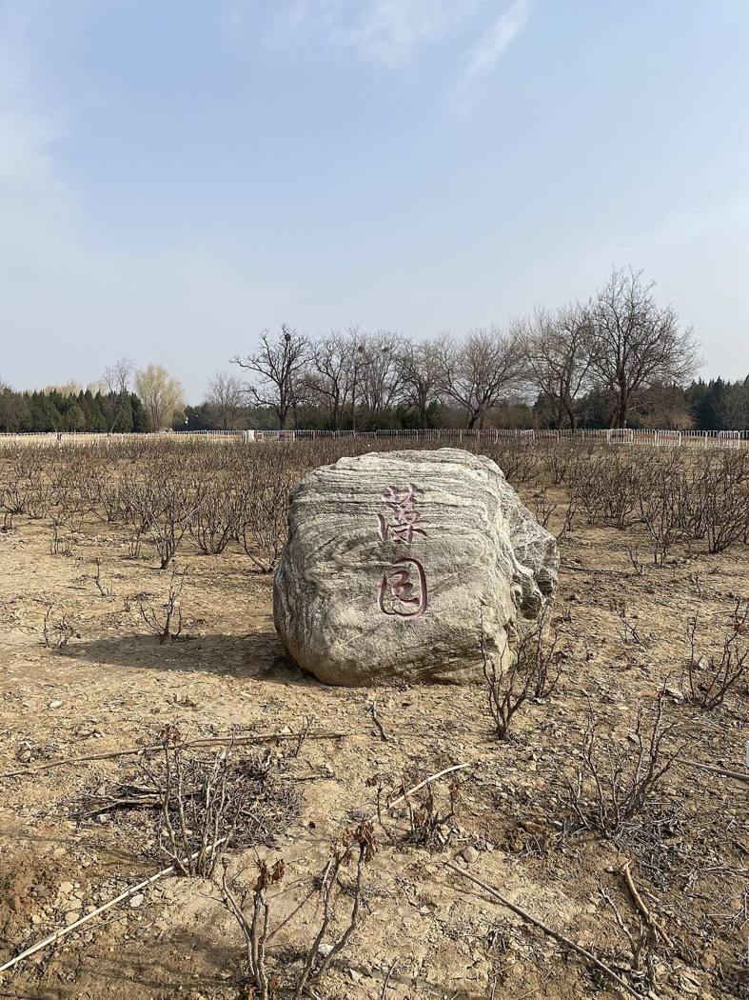

<!-- generated:start (scripts/building_pages.py): do not edit between these markers -->

# YM47: 藻园 Zao Yuan

Ts'ao Yuan, Garden of Aquatic Grasses (Malone p.81) · Yuanming Yuan

**3D object:** 17 boxes. Open it: `/reconstruction/3d.html?b=YM47`

## What we know

- **Name:** 藻园 Zao Yuan (S05, S02, S42, S01, S337 · confidence B)
- **English:** Ts'ao Yuan, Garden of Aquatic Grasses (Malone p.81) (S05, S02, S42, S01, S337)
- **Garden:** Yuanming Yuan (S05, S02, S42, S01, S337)
- **Type:** compound (S05, S02, S42, S01, S337 · confidence B)
- **Built:** brick dated 1751 found on site (S02 p.81 n.); 1752 (S05, S02, S42, S01, S337)
- **Destroyed:** 林渊锦镜 survived 1860; later loss (S05, S02, S42, S01, S337)
- **Position:** 40.00115, 116.28396. S01 sure (S01 · confidence B)
- **Note:** S42: 南北长190, 东西宽125, 占地2.3万 m2; 勘探 建筑环船坞 南北105, 东西95. Not in the album. (S05, S02, S42, S01, S337)
- **Plan reader's note:** Label at (853,5513). Two parts joined by long galleries. (S01) *(research copy, not public)*
- **How it was read:** sure (S01) *(research copy, not public)*
- **Plan pixels:** 600, 5500 (S01) *(research copy, not public)*

## Our model now

17 boxes stand in this compound, 17 on blocks drawn on the plan, 0 assumed. Its halls are listed below.

## Inside it (19)

- YM47-01 旷然堂
- YM47-02 贮清书屋
- YM47-03 夕佳书屋
- YM47-04 镜澜榭
- YM47-05 凝眺楼
- YM47-06 怀新馆
- YM47-07 湛碧轩
- YM47-08 湛清华
- YM47-AW022
- YM47-AW023
- YM47-B1002
- YM47-B1040
- YM47-B1041
- YM47-B1076
- YM47-B1106
- YM47-N01 自远轩
- YM47-N02 ?琴??
- YM47-N03 粹藻楼
- YM47-N04 ??琴峡

## Pictures (1)

- **P0397** (likely): 圆明园藻园.jpeg (2022-03-13 (Commons DateTimeOriginal)). https://commons.wikimedia.org/wiki/File:%E5%9C%86%E6%98%8E%E5%9B%AD%E8%97%BB%E5%9B%AD.jpeg

  

## Texts and drawings (70)

- **E2244** (text, sure): 日下舊聞考 藻园. 1780s (乾隆 敕撰) · j81:8b-9a · S05. https://github.com/kanripo/KR2k0036/blob/master/KR2k0036_081.txt
  > 長春仙館由西南門迤西為藻園内為曠然堂五楹堂後為貯清書屋曠然堂東池上為夕佳書屋稍北為鏡瀾榭東南樓為凝眺為懷新館西北為湛碧軒西南為湛清華（圓明園冊）臣等謹按藻園曠然堂諸額皆皇上御書
  Out by the south-west gate of 長春仙館: 藻園 with the five-bay 曠然堂, 貯清書屋, 夕佳書屋, 鏡瀾榭, the tower 凝眺, 懷新館, 湛碧軒 and 湛清華.
- **E2214** (poem, sure): 御製 藻園五詠. 1761 (御製詩三集) · KR4f0005_177:27b-28b · S201. https://github.com/kanripo/KR4f0005/blob/master/KR4f0005_177.txt
  > 藻園五詠 石　莫謂一拳小請㸔九仭髙飛来舞鸞鳯捲去擁波濤得受衣冠拜誰能繩墨操置之滄海上端合駕神鼇 泉　牆外引髙水流為石下泉雖云因假藉亦自有淪漣可愛一泓貯寜湏百道懸回回縈碧澗琴語聴成連 松　放幹遲楊栁大材不速成卅年纔入畫九夏正當楹蔽日衣衫□疏風几席清如逄橘中叟借與置棋枰 蓮　榖雨分秧藕三庚吐蕊蓮育才應育徳稱潔不稱妍露葉含香細風葩入影鮮何湏渉江采俯檻便芳搴 鶴　胎仙抱卵成埭畔引教行雖覺同厮飬猶㸔是傲生身無入俗韻喉有唳霜聲設使冲霄去可能識玉京
  Five poems on 藻園: its rock, its spring water led in from over the wall, its pines, its lotus and its cranes.
- **E2225** (poem, sure): 粹藻樓. 乾隆三十二年 1767 · KR4f0005_228:16a · S201. https://github.com/kanripo/KR4f0005
  > 每以不恒到當前景似新落花浮水靣宻葉䕶簷脣
  Settles the plan label ?藻楼 of 藻园.
- **E0433** (text, sure): 徐樹鈞 圓明園詞序. 1871 (同治十年立秋), recording a visit of 四月十日 · preface, whole · S203. https://www.douban.com/group/topic/46378693/
  > 圆明园在京城西，出平则门三十里，畅春园北里许，世宗皇帝藩邸赐园也。圣祖常游豫西郊，次于丹棱沜，乐其川原，因明武清侯李伟清华园旧址，筑畅春园，藩邸赐园，故在其旁。雍正三年，乃大宫殿朝署之规以避暑听政，前临西山，环以西湖。湖水发源玉泉山，曰瓮山，度宫墙东流入清河，《水经注》所谓“蓟县西湖，绿水澄澹，燕之旧池”者也。东流为洗马沟，东南合高梁之水，故鱼稻饶衍，陂泉交绮。高宗皇帝嗣位，海宇殷阗，八方无事，每岁缔构，专饰园居。大驾南巡，流览湖山风景之胜，图画以归，若海宁安澜园、江宁瞻园、钱塘小有天园、吴县狮子林，皆仿其制，增制园中。列景四十，以四字题匾者为一胜区，一区之内，斋馆无数。复东拓长春，西辟清漪，离宫别馆，月榭风亭，属之西山，所费不计亿万。园地多明权珰别业，或传崇祯末，诸奄皆以珍宝窟宅于兹，乾隆间浚池，发金银数百万，时国运方兴，地不爱宝，上心悦豫，殚精构造，曲尽游观之妙，元明以来，未之闻也。每岁夏幸园中，冬初还宫，内廷大臣，赐第相望，文武侍从，并直园林，入直奏对，昕夕往来，络绎道路，历雍乾嘉道，百余年于兹矣。文宗初，粤寇踞金陵，盗贼蜂起，上初即位，求直言，得胜保、曾国藩、袁甲三三臣，既以塞 、程、徐、陆，先朝重望，相继倾覆，始擢用前言事者，各畀重任，三臣支柱，贼不犯畿。然迭胜迭败，东南数省，蹂躏无完土，上悯苍生之颠沛，慨左右之无人。九年冬，郊宿于斋宫，夜分痛哭，侍臣凄恻。大考翰詹，以宣室前席发题，忧心焦思，伤于祸乱，然后稍自抑解，寄于文酒。以宫中行止有节，尤喜园居，冬至入宫，初正即出。时园中传有四春之宠，皆汉女，分居亭馆，所谓杏花春、武陵春、牡丹春、海棠春者也。然上明于料兵，委权阃外，超次用人，海内称哲。而部寺诸臣，无所磨励，颇袭旧敝。晚得肃顺，敢言自任，故委以谋议。先是道光二十年，英吉利夷船，至广东香港，求通商不得，又以烧烟起衅，执政议和，予海关税银千八百万。英夷请立约，广督耆英，与期十年。届期而徐广缙督两广，夷使至广州，拒不许入，以受封爵，夷酋恨焉，志入广州。咸丰元 [ 九 ] 年，英吉利、法兰西、美利坚各国，乘粤寇鸱张，中国多故，复以轮舶直入大沽台。王僧格林沁，托团练之名，焚其二船，尽击走之。夷人知大皇帝无意于战，特臣民之私愤，乃潜至海岸，买马数千，募群盗为军，半年而成，再犯天津，称西洋马队，闻者恐栗，夷马步登岸，我未陈而敌骑长驱矣。十年六 [ 八 ] 月十六日，上方园居，闻夷骑至通州，仓卒率后嫔幸热河，道路初无供帐，途出密云，御食豆乳麦粥而已。十七日，英夷帅叩东便门，或有闭城者，闻炮而开，王公请和，和议将定。十九日，夷人至圆明园宫门，管园大臣文丰当门说止之，夷兵已去。文都统知奸民将起，环问守卫禁兵，无一在者，乃自索马还内，投福海死。奸人乘时纵火，入宫劫掠，夷人从之，各园皆火发，三昼夜不熄，非独我无官府诘问，夷帅亦不能知也。初英夷使臣巴夏里，已拘刑部，和议成，以礼释囚。于是巴夏里与英帅，各陈兵仗至礼部，订约五十七条，予以海关税银三千六百万，而夷人抵偿圆明园银二十万。王公奏言，未敢斥夷，文丰与主事惠丰，同死于园，不称殉节，但言遭兵燹而已。十一年七月，文宗晏驾热河，今上即位，奉两宫皇太后还京，垂帘十载，巨寇削平。而夷人通商江海，往来贸易，设通商王大臣，以接夷使。然常言：“某省士民毁天主教堂，某省不行其教，某省民教构衅。”日以难我，应之不暇，盖岌岌乎华夷杂处，又忽忽十有一年。园居荒墟，鞠为茂草，西山大寺，夷妇深居，予旅京师，恻然不敢过也。同治十年春，同年王壬父重至辇下，追话旧游，张子雨珊亦以计偕来，约访故宫，因驻守参将廖承恩许为道主。四月十日，命仆马同过绣漪桥，寻清漪园遗迹，颓垣断瓦，零乱榛芜，宫树苍苍，水鸣呜咽。由辇路登廓如亭，南望万寿山，但见牧童樵子，往来林莽间。暮从昆明湖归，桥上铜犀卧荆棘中，犀背御铭，琅然可诵。明日访守园者，得董监，自言：“年七十有余，自道光初入寺园中，今秩五品，居福园门旁。”导予等从瓦砾中，循出入贤良门而北，指勤政、光明、寿山、太和四殿遗址，前湖圆明寝殿五楹，后为奉三无私殿、九州清晏殿各七楹，坏壁犹立，拾级可寻。董监言：“东为天地一家春，后居也，西为乐安和，诸妃嫔贵人居也，洞天深处，皇子居也。清辉殿为文宗重建，与五福堂、镂月开云台、朗吟阁皆不可复识。”镂月开云者，即所谓牡丹春者也。世宗为皇子时，迎圣祖至赐园，而高宗年十二，以皇孙召侍左右，三天子福寿冠前古，集于一堂，高宗后制诗，尝夸乐之。经其废基，裴回惄焉。东渡湖，为苏堤、长春仙馆、藻园，又北为月地云居、舍卫城、日天琳宇、水木明瑟、濂溪乐处，仅约略指视所在。东北至香雪廊，阶前茅荻萧萧，废池可辩，有老监奉茶自石畔出，讶客所从来，颇似桃源人逢渔郎也。渡桥循福海西行，为平湖秋月，水光溶溶，一泻千顷。望蓬岛瑶台，岛上殿宇，犹存数楹，惜无方舟不达。其下流水潺湲，激石成响，董监示予：“此管园大臣文公死所也。”西北至双鹤斋，又西过规月桥，登绮吟堂，经采芝径，折而东，仍出双鹤斋。园中残毁几遍，独存此为劫灰之余，乱草侵阶，窗棂宛在，尤动人禾黍悲耳。双鹤斋西，为溪月松风，翠柏苍藤，沿流覆道，斜日在林，有老宫人驱羊豕下来。东过碧桐书院，地跨池上，东为金鳌，西为玉蝀，坊楔犹存。又东去，皆败坏难寻，遂不复往。莫色沈沈，栖乌乱飞，揖董监，出福园门，还于廖宅。廖，沣州人，字枫亭，少从塞尚阿、僧格林沁军，亦能言行间事，感予来游，颇尽宾主之欢。既夕言归，则礼部放榜日也。雨珊既落第南去，予与壬父每相过从，念言园游，辄惘惘不自得。壬父又曰：“园之盛时，纯皇勒记，必殷殷踵事之戒，然仁宗始罢南幸，宣宗尤忧国贫，秋狝之礼，辍而不举。惟夫张弛之道宜及，嘉道时，补纯皇倦勤之功，而内外大臣，惟务慎节，监司宽厚，牧令昏庸，讳盗容奸，以为安静。八卦妖徒，连兵十载，无生天主，教目滋繁，由游民轻法，刑废不用故也。江淮行宫，既皆斥卖，国之所患，岂在乏财。”又曰：“燕地经安史戎马之迹，爰及辽金，近沙漠之风矣。明太宗以燕王旧居，不务改宅，仍而至今，地利竭矣。又园居单外，非所以驻万乘，废而不居，盖亦时宜。” 予曰：“然，前年御史德泰，请按户亩鳞次捐输，复修园宫。大臣以侈端将启，请旨切责，谪戍未行，愤悔自死。自此莫敢言园居者。而比年备办大婚，费已千万，结彩宫门，至十余万，公奏朝廷动用钱粮，婚以成礼，岂在华饰，若前明户部司官得以谏争，予且建言矣。又予闻慈安太后在文宗时，有脱簪之谏，《关雎》《车舝》之贤，中兴之由也。又园宫未焚前一岁，妖言传上坐寝殿，见白须老翁，自称园神，请辞而去，上梦中加神二品阶，明日，至祠谕祀之，未一期而园毁，岂能定欤？子能诗者，达于政事，曷以风人之意，备《繁霜》《云汉》之采？”于是壬父为《圆明园词》一篇。而周学士（即大学士周祖培）、潘侍郎见之，并叹其伤心感人，笔墨通于情性。予以此诗可传后来，虑夫代远年逝，传闻失实，词中所述，罔有征者，乃为文以序之。同治十年立秋日，长沙徐树钧撰。
  A walk through the ruins eleven years after the destruction, guided by an old eunuch who had served since the 1820s. It says which sites could still be read, and that 雙鶴齋 with its surroundings alone stood, as did some rooms on 蓬島瑶臺 and the 金鼇 and 玉蝀 arches. Its account of 1860 credits the first fires to local robbers, which differs from the British and French record in S02.
- **E0451** (text, sure): 圆明园遗址的遗产价值与申遗构想: the buildings left after 1860, citing 刘敦桢 1933. post n.d. · ylfj, note 34: 刘敦桢, 同治重修圆明园史料, 营造学社汇刊 1933(2) · S337. http://iqh.ruc.edu.cn/old/qdhjylyjzx/xszl/ylfj/9a322b5384ab4c17af0dd577d4f96ca6.htm
  Lists 17 buildings left after the burning of 1860, after 刘敦桢: 紫碧山房, 顺木天, 鱼跃鸢飞, 课农轩, 藏舟坞, 慎修思永, 知过堂, 双鹤斋, 蓬岛瑶台, 魁星楼, 文昌阁, 林渊锦镜, 春雨轩; 海岳开襟; 庄严法界, 正觉寺 and a 大宫门 in 万春园. The paper's aim is to hold any new display to this 1860 state.
- **E2208** (poem, sure): 贮清书屋: 乾隆十八年 poem of the Qianlong Emperor. 乾隆十八年 (1753), date from the compilation · p.185 item (2), under 贮清书屋 · S360. https://www.yuanmingyuanpark.cn/xs/yjbg/202007/P020200730387572832602.pdf#page=185
  > 石上架山居，石势不可止。覆瓦于其上，贮石我屋里。受润无内外，皴缛苔纹起。张为生色屏，卧作醉道士。回头望山石，原不分彼此。
  Poem of the Qianlong Emperor at 贮清书屋, 1753, on reading. Year as given by the compilation.
- **E2209** (poem, sure): 夕佳书屋: 乾隆二十四年 poem of the Qianlong Emperor. 乾隆二十四年 (1759), date from the compilation · p.183 item (1), under 夕佳书屋 · S360. https://www.yuanmingyuanpark.cn/xs/yjbg/202007/P020200730387572832602.pdf#page=183
  > 得胜虽各殊，称心斯为快。岂必在深谷，假山有清会。依依含夕阳，气佳屏一帯。屋名取陶诗，寓意夫何 害。既兴高贤慕，亦切叔世戒。
  Poem of the Qianlong Emperor at 夕佳书屋, 1759, on reading. Year as given by the compilation.
- **E2210** (poem, sure): 湛清华轩: 乾隆二十四年 poem of the Qianlong Emperor. 乾隆二十四年 (1759), date from the compilation · p.183 item (1), under 湛清华轩 · S360. https://www.yuanmingyuanpark.cn/xs/yjbg/202007/P020200730387572832602.pdf#page=183
  > 筑墙所戒雕，结宇惟期朴。翳然水木佳，俯仰兴堪托。去情希得神，忘筌有真乐。三复谢家诗，清风穆如邈。
  Poem of the Qianlong Emperor at 湛清华轩, 1759, on the view. Year as given by the compilation.
- **E2211** (poem, sure): 镜澜榭: 乾隆二十四年 poem of the Qianlong Emperor. 乾隆二十四年 (1759), date from the compilation · p.183 item (1), under 镜澜榭 · S360. https://www.yuanmingyuanpark.cn/xs/yjbg/202007/P020200730387572832602.pdf#page=183
  > 阶俯琳池镜一泓，妍媸惟待物来呈。莫嫌冰渚波澜少，拭雪菱花越様明。
  Poem of the Qianlong Emperor at 镜澜榭, 1759, on the view. Year as given by the compilation.
- **E2212** (poem, sure): 怀新馆: 乾隆二十五年 poem of the Qianlong Emperor. 乾隆二十五年 (1760), date from the compilation · p.184 item (1), under 怀新馆 · S360. https://www.yuanmingyuanpark.cn/xs/yjbg/202007/P020200730387572832602.pdf#page=184
  > 吐穗抽苗蔚露浓，景光真足庆良农。隐翁佳句从来忆，幸是今年始一逢。
  Poem of the Qianlong Emperor at 怀新馆, 1760. Year as given by the compilation.
- **E2213** (poem, sure): 贮清书屋: 乾隆二十五年 poem of the Qianlong Emperor. 乾隆二十五年 (1760), date from the compilation · p.185 item (1), under 贮清书屋 · S360. https://www.yuanmingyuanpark.cn/xs/yjbg/202007/P020200730387572832602.pdf#page=185
  > 㠎嶫复崚嶒，千回将万层。云闗纔得叩，石磴更须登。步处那辞倦，坐来实絶胜。龙标工比物，一片玉壶冰。
  Poem of the Qianlong Emperor at 贮清书屋, 1760, on reading. Year as given by the compilation.
- **E2269** (poem, sure): 湛碧轩. 乾隆二十五年 (1760) · v3 p.218, under 藻园; source ref 7-276 · S361. https://www.yuanmingyuanpark.cn/xs/yjbg/202008/P020200803382569071850.pdf#page=221
  > 冻解濩索流澌，湛然凝碧一池。朅览楣间题额，真是应节及时。
  Poem 湛碧轩 by the Qianlong Emperor, 1760, filed by the editors under 藻园.
- **E2215** (poem, sure): 湛清华轩: 乾隆二十六年 poem of the Qianlong Emperor. 乾隆二十六年 (1761), date from the compilation · p.183 item (2), under 湛清华轩 · S360. https://www.yuanmingyuanpark.cn/xs/yjbg/202007/P020200730387572832602.pdf#page=183
  > 水木清华处，轩楹秀野间。抽书惟汲古，搜句亦消闲。梯浪鸥朋聚，构巢燕子还。迩来晴雨若，茂对得怡颜。
  Poem of the Qianlong Emperor at 湛清华轩, 1761. Year as given by the compilation.
- **E2216** (poem, sure): 湛碧轩: 乾隆二十六年 poem of the Qianlong Emperor. 乾隆二十六年 (1761), date from the compilation · p.185 item (1), under 湛碧轩 · S360. https://www.yuanmingyuanpark.cn/xs/yjbg/202007/P020200730387572832602.pdf#page=185
  > 初生水色绿于筠，静敛东风不作沦。自是春光还改故，那能人意免欢新。
  Poem of the Qianlong Emperor at 湛碧轩, 1761, on the view. Year as given by the compilation.
- **E2217** (poem, sure): 藻园: 乾隆二十六年 poem of the Qianlong Emperor. 乾隆二十六年 (1761), date from the compilation · p.182 item (1), under 藻园 · S360. https://www.yuanmingyuanpark.cn/xs/yjbg/202007/P020200730387572832602.pdf#page=182
  > 莫谓一拳小，请看九仭高。飞来舞鸾鳯，卷去拥波涛。得受衣冠拜，谁能绳墨操。置之沧海上，端合驾神鳌。”“墙外引高水，流为石下泉。虽云因假藉，亦自有沦涟。可爱一泓贮，寜湏百道悬。回回萦碧涧，琴语聴成连。
  Poem of the Qianlong Emperor at 藻园, 1761, on the view. Year as given by the compilation.
- **E2218** (poem, sure): 履吉斋: 乾隆三十一年 poem of the Qianlong Emperor. 乾隆三十一年 (1766), date from the compilation · p.186 item (1), under 履吉斋 · S360. https://www.yuanmingyuanpark.cn/xs/yjbg/202007/P020200730387572832602.pdf#page=186
  > 辞玩象兼观，韦编在座端。幽人坦彼易，君子定斯难。十笏容非窄，四时居得安。考祥縁视履，惕息敢盘桓。
  Poem of the Qianlong Emperor at 履吉斋, 1766. Year as given by the compilation.
- **E2219** (poem, sure): 旷然堂: 乾隆三十一年 poem of the Qianlong Emperor. 乾隆三十一年 (1766), date from the compilation · p.183 item (1), under 旷然堂 · S360. https://www.yuanmingyuanpark.cn/xs/yjbg/202007/P020200730387572832602.pdf#page=183
  > 林木翳然处，视听却旷然。盖无系于物，率可得乎天。不爱花锦绣，宁须禽管弦。芸编足讨绎，久矣共周旋。
  Poem of the Qianlong Emperor at 旷然堂, 1766, on the view. Year as given by the compilation.
- **E2220** (poem, sure): 晴望楼: 乾隆三十一年 poem of the Qianlong Emperor. 乾隆三十一年 (1766), date from the compilation · p.187 item (1), under 晴望楼 · S360. https://www.yuanmingyuanpark.cn/xs/yjbg/202007/P020200730387572832602.pdf#page=187
  > 登楼必有望，要在合其宜。雨泽初沾后，晴光欲散时。山容翠螺染，水态碧漪披。设若苏髯腹，知无拾级期。
  Poem of the Qianlong Emperor at 晴望楼, 1766, on rain and the view. Year as given by the compilation.
- **E2221** (poem, sure): 溜琴亭: 乾隆三十一年 poem of the Qianlong Emperor. 乾隆三十一年 (1766), date from the compilation · p.186 item (1), under 溜琴亭 · S360. https://www.yuanmingyuanpark.cn/xs/yjbg/202007/P020200730387572832602.pdf#page=186
  > 攫醳无劳指，宫商会以神。一般水与石，协律胜泠纶。
  Poem of the Qianlong Emperor at 溜琴亭, 1766. Year as given by the compilation.
- **E2222** (poem, sure): 自远轩: 乾隆三十一年 poem of the Qianlong Emperor. 乾隆三十一年 (1766), date from the compilation · p.186 item (1), under 自远轩 · S360. https://www.yuanmingyuanpark.cn/xs/yjbg/202007/P020200730387572832602.pdf#page=186
  > 依旷开轩榭，延虚彻牖窗。骋怀真自远，游目致无双。风柳金揺展，露筠玉润摐。天然称点笔，不识可如扛。”自远轩在藻园最北小院内，南向殿三间，四围有廊，外檐悬乾隆三十年（1767）御书“自远轩”匾。乾隆“自远轩”诗句云：“偶读明泉诗，文轩题自远。”又云：“地亦岂须偏，心亦不期远。一室四海遥，民难常念轸。渊明昔高致，借以名御园。
  Poem of the Qianlong Emperor at 自远轩, 1766, on the view. Year as given by the compilation.
- **E2265** (poem, sure): 贮清书屋. 乾隆三十一年 (1766) · v3 p.221, under 藻园; source ref 9-176 · S361. https://www.yuanmingyuanpark.cn/xs/yjbg/202008/P020200803382569071850.pdf#page=224
  > 引流绕砌宛成池，小小书窗恰受宜。设曰一尘不到处，已居二谛落诠时。
  Poem 贮清书屋 by the Qianlong Emperor, 1766, filed by the editors under 藻园.
- **E2270** (poem, sure): 自远轩. 乾隆三十一年 (1766) · v3 p.221, under 藻园; source ref 9-172 · S361. https://www.yuanmingyuanpark.cn/xs/yjbg/202008/P020200803382569071850.pdf#page=224
  > 依旷开轩榭，延虚徹牖窗。骋怀真自远，游目致无双。风柳金摇展，露筠玉润摐。天然称点笔，不识可如扛。
  Poem 自远轩 by the Qianlong Emperor, 1766, filed by the editors under 藻园.
- **E2223** (poem, sure): 晴望楼: 乾隆三十二年 poem of the Qianlong Emperor. 乾隆三十二年 (1767), date from the compilation · p.187 item (2), under 晴望楼 · S360. https://www.yuanmingyuanpark.cn/xs/yjbg/202007/P020200730387572832602.pdf#page=187
  > 迩常沾渥雨，更喜雨随晴。岂待高楼望，真宜沃土耕。继斯时若贶，又可屡绥赓。伫俟西成近，越殷颙企情。
  Poem of the Qianlong Emperor at 晴望楼, 1767, on rain and the view. Year as given by the compilation.
- **E2224** (poem, sure): 粹藻楼: 乾隆三十二年 poem of the Qianlong Emperor. 乾隆三十二年 (1767), date from the compilation · p.187 item (1), under 粹藻楼 · S360. https://www.yuanmingyuanpark.cn/xs/yjbg/202007/P020200730387572832602.pdf#page=187
  > 每以不恒到，当前景似新。落花浮水面，密叶护檐唇。有触皆含理，无缘弗契神。如云抒藻思，亦欲粹而纯。
  Poem of the Qianlong Emperor at 粹藻楼, 1767. Year as given by the compilation.
- **E2226** (poem, sure): 自远轩: 乾隆三十三年 poem of the Qianlong Emperor. 乾隆三十三年 (1768), date from the compilation · p.186 item (2), under 自远轩 · S360. https://www.yuanmingyuanpark.cn/xs/yjbg/202007/P020200730387572832602.pdf#page=186
  > 心远地自偏，地偏心自远。相需相得彰，渊明语犹隐。然吾请进之，出处不同轸。为彼畸人言，逸致自无损。庙堂勤治理，高闲岂敬谨。谠言与正人，方当引而近。寓意偶不妨，是以名御苑。
  Poem of the Qianlong Emperor at 自远轩, 1768, on the view. Year as given by the compilation.
- **E2271** (poem, sure): 自远轩题句. 乾隆三十四年 (1769) · v3 p.222, under 藻园; source ref 10-594 · S361. https://www.yuanmingyuanpark.cn/xs/yjbg/202008/P020200803382569071850.pdf#page=225
  > 地亦岂须偏，心亦不期远。一室四海遥，民艰常念轸。渊明昔高致，藉以名御苑。寓意斯偶可，责实或成损。正复廑滇师，何时奏凯返。
  Poem 自远轩题句 by the Qianlong Emperor, 1769, filed by the editors under 藻园.
- **E2227** (poem, sure): 晴望楼: 乾隆四十一年 poem of the Qianlong Emperor. 乾隆四十一年 (1776), date from the compilation · p.188 item (8), under 晴望楼 · S360. https://www.yuanmingyuanpark.cn/xs/yjbg/202007/P020200730387572832602.pdf#page=188
  > 既雨人心即向晴，高楼纵目惬遥情。村村场圃堆新麦，持穂都期饼饵成。
  Poem of the Qianlong Emperor at 晴望楼, 1776, on the harvest. Year as given by the compilation.
- **E2228** (poem, sure): 怀新馆: 乾隆四十六年 poem of the Qianlong Emperor. 乾隆四十六年 (1781), date from the compilation · p.184 item (2), under 怀新馆 · S360. https://www.yuanmingyuanpark.cn/xs/yjbg/202007/P020200730387572832602.pdf#page=184
  > 陶诗本意在良苗，我欲通之正此朝。何必昌昌夸竞节，雅宜黙黙始含韶。盆中淡白舒梅蕚，墙外轻黄上柳条。物意皆然民岂不，早循汉诏布恩饶。（新正加恩各直省展赈缓征，借给牛具耔种次第施行。）
  Poem of the Qianlong Emperor at 怀新馆, 1781. Year as given by the compilation.
- **E2229** (poem, sure): 自远轩: 乾隆四十六年 poem of the Qianlong Emperor. 乾隆四十六年 (1781), date from the compilation · p.187 item (6), under 自远轩 · S360. https://www.yuanmingyuanpark.cn/xs/yjbg/202007/P020200730387572832602.pdf#page=187
  > 亭轩率与名，不可屈指数。然每循其名，责实不遑处。譬之兹自远，宁谓地偏所。其义亦有二，臧否殊茹吐。嗜欲当远之，克己宣尼语。贤良岂宜远，宜以为翼辅。拈句非玩景，求益在近取。几杖胥有铭，吾当师周武。
  Poem of the Qianlong Emperor at 自远轩, 1781, on state papers. Year as given by the compilation.
- **E2267** (poem, sure): 怀新馆. 乾隆四十八年 (1783) · v3 p.224, under 藻园; source ref 14-732 · S361. https://www.yuanmingyuanpark.cn/xs/yjbg/202008/P020200803382569071850.pdf#page=227
  > 春德在发生，春物胥应时。色色与形形，不识还不知。青帝抚顺则，煦妪群雍滋。新亦非有为，怀亦本无私。是谓一大公，易理诠庖羲。
  Poem 怀新馆 by the Qianlong Emperor, 1783, filed by the editors under 藻园.
- **E2268** (poem, sure): 怀新馆有会. 乾隆五十一年 (1786) · v3 p.224, under 藻园; source ref 16-551 · S361. https://www.yuanmingyuanpark.cn/xs/yjbg/202008/P020200803382569071850.pdf#page=227
  > 怀新出陶言，盖以谓良苗。初春非其时，而其义已包。试看天地间，物物都含韶。含即怀之义，韶则新为昭。汉诏絜矩民，允为治法标。
  Poem 怀新馆有会 by the Qianlong Emperor, 1786, filed by the editors under 藻园.
- **E2230** (poem, sure): 湛碧轩: 乾隆五十五年 poem of the Qianlong Emperor. 乾隆五十五年 (1790), date from the compilation · p.185 item (2), under 湛碧轩 · S360. https://www.yuanmingyuanpark.cn/xs/yjbg/202007/P020200730387572832602.pdf#page=185
  > 水裔构文轩，其名曰湛碧。碧待湛为澄，澄则碧呈色。能所本相资，胥有为法格。云何臻无为，轩弗言脉脉。
  Poem of the Qianlong Emperor at 湛碧轩, 1790, on the view. Year as given by the compilation.
- **E2231** (poem, sure): 粹藻楼: 乾隆五十五年 poem of the Qianlong Emperor. 乾隆五十五年 (1790), date from the compilation · p.187 item (2), under 粹藻楼 · S360. https://www.yuanmingyuanpark.cn/xs/yjbg/202007/P020200730387572832602.pdf#page=187
  > 春物未薫馨，春楼颜粹藻。可知藴酿中，自具作昌道。譬之于为文，一泻有何好。
  Poem of the Qianlong Emperor at 粹藻楼, 1790, on the view. Year as given by the compilation.
- **E2232** (poem, sure): 怀新馆: 乾隆五十七年 poem of the Qianlong Emperor. 乾隆五十七年 (1792), date from the compilation · p.185 item (7), under 怀新馆 · S360. https://www.yuanmingyuanpark.cn/xs/yjbg/202007/P020200730387572832602.pdf#page=185
  > 稚春尚含淑，安得有良苗。是馆曰怀新，岂非津逮陶。然而有说焉，万物一元包。何物而无怀，何新弗由韶。吾意与之然，读易増逍遥。
  Poem of the Qianlong Emperor at 怀新馆, 1792. Year as given by the compilation.
- **E2233** (poem, sure): 履吉斋: 乾隆五十八年 poem of the Qianlong Emperor. 乾隆五十八年 (1793), date from the compilation · p.186 item (2), under 履吉斋 · S360. https://www.yuanmingyuanpark.cn/xs/yjbg/202007/P020200730387572832602.pdf#page=186
  > 斋额卦之履，元吉在上九。易道所包广，亦在人自取。履上即乾上，五爻历以久。进退不失正，考祥庆大有。其验四年间，昊恩能若否。
  Poem of the Qianlong Emperor at 履吉斋, 1793. Year as given by the compilation.
- **E2234** (poem, sure): 旷然堂: 乾隆五十八年 poem of the Qianlong Emperor. 乾隆五十八年 (1793), date from the compilation · p.183 item (2), under 旷然堂 · S360. https://www.yuanmingyuanpark.cn/xs/yjbg/202007/P020200730387572832602.pdf#page=183
  > 溪堂枕碧漪，明照暎檐楣。长物本无矣，虚怀自有之。风轻纨弗起，月浄鉴恒披。絜矩于何是，施乎政允宜。
  Poem of the Qianlong Emperor at 旷然堂, 1793, on escaping the heat. Year as given by the compilation.
- **E2235** (poem, sure): 贮清书屋: 乾隆五十八年 poem of the Qianlong Emperor. 乾隆五十八年 (1793), date from the compilation · p.186 item (5), under 贮清书屋 · S360. https://www.yuanmingyuanpark.cn/xs/yjbg/202007/P020200730387572832602.pdf#page=186
  > 书屋由来称贮清，谓无些子俗尘萦。设如以小喻其大，方寸之中八表呈。
  Poem of the Qianlong Emperor at 贮清书屋, 1793, on reading. Year as given by the compilation.
- **E2264** (poem, sure): 题旷然堂. 乾隆五十八年 (1793) · v3 p.227, under 藻园; source ref 18-586 · S361. https://www.yuanmingyuanpark.cn/xs/yjbg/202008/P020200803382569071850.pdf#page=230
  > 溪堂枕碧漪，明照映檐楣。长物本无矣，虚怀自有之。风轻纨弗起，月净鉴恒披。絜矩于何是，施乎政允宜
  Poem 题旷然堂 by the Qianlong Emperor, 1793, filed by the editors under 藻园.
- **E2266** (poem, sure): 夕佳书屋有会. 乾隆五十九年 (1794) · v3 p.227, under 藻园; source ref 18-716 · S361. https://www.yuanmingyuanpark.cn/xs/yjbg/202008/P020200803382569071850.pdf#page=230
  > 御园惟假山，陶诗似不伦。然而吾名之，问何尊所闻。曾忆宋儒语，宵得
  Poem 夕佳书屋有会 by the Qianlong Emperor, 1794, filed by the editors under 藻园.
- **E2236** (poem, sure): 湛碧轩: 乾隆六十年 poem of the Qianlong Emperor. 乾隆六十年 (1795), date from the compilation · p.185 item (3), under 湛碧轩 · S360. https://www.yuanmingyuanpark.cn/xs/yjbg/202007/P020200730387572832602.pdf#page=185
  > 湖裔有轩久，湛碧宿所名。其义固因水，乃兹来见冰。俯景别生会，虚实象殊呈。结为冰静寂，化原水动顷。而其湛与碧，本一非二形。更绎两字间，动输觉静赢。以其无波澜，澄心者自明。
  Poem of the Qianlong Emperor at 湛碧轩, 1795, on the view. Year as given by the compilation.
- **E2237** (poem, sure): 藻园: 嘉庆元年 poem of the Jiaqing Emperor. 嘉庆元年 (1796), date from the compilation · p.182 item (2), under 藻园 · S360. https://www.yuanmingyuanpark.cn/xs/yjbg/202007/P020200730387572832602.pdf#page=182
  > 卉木春敷藻，韶华布小园。仙都时发育，灵境日孳蕃。池北藤盈架，阶西竹护门。长松风谡谡，晤对欲忘言。
  Poem of the Jiaqing Emperor at 藻园, 1796, on the view. Year as given by the compilation.
- **E2238** (poem, sure): 夕佳书屋: 嘉庆二年 poem of the Jiaqing Emperor. 嘉庆二年 (1797), date from the compilation · p.184 item (2), under 夕佳书屋 · S360. https://www.yuanmingyuanpark.cn/xs/yjbg/202007/P020200730387572832602.pdf#page=184
  > 返照在遥岭，书窗纳景光。山容开远绘，波影动斜阳。檐雀寻巢急，林鸦择树忙。夕佳更清迥，渐觉月辉扬。
  Poem of the Jiaqing Emperor at 夕佳书屋, 1797, on reading and the view. Year as given by the compilation.
- **E2239** (poem, sure): 藻园. 嘉庆二年 (1797) · v3 p.228, under 藻园; source ref 1-237 · S361. https://www.yuanmingyuanpark.cn/xs/yjbg/202008/P020200803382569071850.pdf#page=231
  > 园门傍溪湄，缘径多奇石。嵯岈列屏山，境仿三吴迹。藤萝绕架繁，经春叠阴碧。近得微雨滋，益觉含润泽。非欣景物清，所喜洽阡陌。祝愿屡丰年，早兆仓箱积。几余偶遨游，再沛心方适。
  Poem 藻园 by the Jiaqing Emperor, 1797, filed by the editors under 藻园.
- **E2240** (poem, sure): 藻园. 嘉庆二年 (1797) · v3 p.229, under 藻园; source ref 1-277 · S361. https://www.yuanmingyuanpark.cn/xs/yjbg/202008/P020200803382569071850.pdf#page=232
  > 华藻天敷贯四时，不关秋色满东篱。黄蕤灿灿阶头布，红叶离离林角垂。山外霞光明涧底，云中鸿影落川湄。慰心畿甸农功毕，纳稼于茅又及期。
  Poem 藻园 by the Jiaqing Emperor, 1797, filed by the editors under 藻园.
- **E2241** (poem, sure): 夕佳书屋: 嘉庆三年 poem of the Jiaqing Emperor. 嘉庆三年 (1798), date from the compilation · p.184 item (4), under 夕佳书屋 · S360. https://www.yuanmingyuanpark.cn/xs/yjbg/202007/P020200730387572832602.pdf#page=184
  > 斜晖印疎林，清光岩壑敛。纳景夕更佳，影叠池波潋。众绿透紫红，画法妙烘染。牛羊下遥坡，鸦背金万点。少焉月出东，琼辉上冉冉。
  Poem of the Jiaqing Emperor at 夕佳书屋, 1798, on reading and the view. Year as given by the compilation.
- **E2242** (poem, sure): 藻园: 嘉庆三年 poem of the Jiaqing Emperor. 嘉庆三年 (1798), date from the compilation · p.183 item (5), under 藻园 · S360. https://www.yuanmingyuanpark.cn/xs/yjbg/202007/P020200730387572832602.pdf#page=183
  > 傍水清华湛，依墙曲径分。小亭青接沼，高柳绿连云。岚黛涵空影，波光叠锦纹。艳阳好佳日，四壁掞天文。
  Poem of the Jiaqing Emperor at 藻园, 1798, on the view. Year as given by the compilation.
- **E2243** (poem, sure): 湛清华轩: 嘉庆二十年 poem of the Jiaqing Emperor. 嘉庆二十年 (1815), date from the compilation · p.183 item (3), under 湛清华轩 · S360. https://www.yuanmingyuanpark.cn/xs/yjbg/202007/P020200730387572832602.pdf#page=183
  > 挹爽轩庭灏景賖，四围水木湛清华。芰荷香远汀前漾，杨柳阴浓堤畔遮。波静槛边印明镜，山连楼角写余霞。南湖佳境天然具，试放轻舟溯岸涯。
  Poem of the Jiaqing Emperor at 湛清华轩, 1815, on the view. Year as given by the compilation.
- **E1524** (description, sure): 玉明 侍游御園記 (in 蕉軒隨錄). 1856 (咸豐六年七月二十一日) · 蕉軒隨錄, 御園侍游 (line 336 of the corpus file) · S210. https://github.com/garychowcmu/daizhigev20/blob/master/史藏/志存记录/蕉轩随录.txt
  > ◎御园侍游玉将军（明）有《侍游御园记》，成竹坪同年（林）曾属予代作跋语，恭书于后。按，《记》云：“咸丰六年秋七月二十一日，奉旨：本日散朝后，著玉明、肃顺自备鞍马，午初一刻进西南门，在山高水长伺候。有顷，上从内乘船，至山高水长后阁扇下船，出前门，谕玉明、肃顺暨珠勒亨、西拉布、托云、德勒格尔、伊勒东阿等脱去外褂。上乘马，命七臣随行。自山高水长游藻园，至厂地，过汇芳书院，复由紫碧山房至鱼跃鸢飞少坐。过蕊珠宫门，至黄花磴进茶毕，往西洋楼海宴堂，至转马台，过小角门，至狮子林清淑斋赏饭。左右四卓，命七臣坐，并奉温谕可饱食，非外边筵宴比也。上命膳房先给七臣面各一器，上进面，复进饭，颁赏御用菜蔬，七臣叩头谢。上进粥，复赏粥毕。随驾起行，由宝相寺、法慧寺、谐奇趣过明春门，至雷峰夕照马头，坐如在天上船，游福海。上命笔砚作诗毕，至渊氵亭镜澈马头下船。进丽春门骑马，由旧园东墙根过敷春堂，游西大堤汉城关，至含辉楼下马，命七臣散归。玉明自道光十一年由侍卫擢厕御前二十余年，仰邀优渥，得遍瞻御园盛景。欣感之余，谨作记以纪荣遇。”
  A rare first-hand record of a day in the garden four years before its destruction. The emperor takes seven officials by a named route from 山高水長 through 藻園, 彚芳書院, 紫碧山房 and 魚躍鳶飛, past 蕊珠宫門, on to 海宴堂 in the 西洋樓, a meal at 清淑齋 in 獅子林, 寳相寺, 法慧寺, 諧奇趣, by boat on 福海, then 敷春堂 and 含暉楼. All were standing then.
- **E2258** (description, sure): 藻园 Zao Yuan, not in the album. 1934 · pp.80-81 · S02. https://archive.org/details/historyofpekings00malo
  > It seems to have included an informal arrangement of buildings, pools, hills, and a boathouse.
  South-west corner of the garden, not among the Forty Scenes. Informal buildings, pools, hills and a boathouse. Malone found a brick dated 1751 on site and suggests it is later than the album of 1744.
- **E1011** (description, sure): Site status table, about 2011: nothing visible, or built over. c. 2011 · 系列06 repost, status table · S356. https://blog.sina.com.cn/s/blog_c27029650101itzz.html
  Same table. In it the first group shows no visible remains; 得全阁, 流香渚, 凤麟洲, 涵秋馆, 蔚藻堂, 中和堂, 敷春堂 and 心镜轩 have service buildings on them, and 含晖楼, 澄心堂, 延寿寺, 清夏堂 and 喜雨山房 are occupied by other institutions. 澹泊宁静 and several others have been dug since, so this is out of date for them.
- **E0377** (description, guess): 1873 survey as reported: 林渊锦镜. 2011-; 2010 · zh.wikipedia 圆明园; 阙维民 2010 citing 刘敦桢 1933 · S06. https://zh.wikipedia.org/wiki/圆明园
  The survivors of 1860 listed in the survey of 1873 include 林渊锦镜. S06 and a modern list put it in 长春园. 阙维民 writes 林渊锦镜（藻园）. Which is right, we can't say; CC21 has no position yet. The primary source is on the wish list.
- **E2245** (description, sure): 圆明园百景史事分景汇编: 贮清书屋. 1753-1793 · from p.185, under 藻园 · S360. https://www.yuanmingyuanpark.cn/xs/yjbg/202007/P020200730387572832602.pdf#page=185
  贮清书屋: 5 dated items, 1753-1793, of which 5 poems (Qianlong); recurring themes: reading. First dated 1753, last dated 1793.
- **E2246** (description, sure): 圆明园百景史事分景汇编: 夕佳书屋. 1759-1798 · from p.183, under 藻园 · S360. https://www.yuanmingyuanpark.cn/xs/yjbg/202007/P020200730387572832602.pdf#page=183
  夕佳书屋: 4 dated items, 1759-1798, of which 4 poems (Qianlong, Jiaqing); recurring themes: reading, the view. First dated 1759, last dated 1798.
- **E2247** (description, sure): 圆明园百景史事分景汇编: 湛清华轩. 1759-1815 · from p.183, under 藻园 · S360. https://www.yuanmingyuanpark.cn/xs/yjbg/202007/P020200730387572832602.pdf#page=183
  湛清华轩: 3 dated items, 1759-1815, of which 3 poems (Qianlong, Jiaqing); recurring themes: the view. First dated 1759, last dated 1815.
- **E2248** (description, sure): 圆明园百景史事分景汇编: 镜澜榭. 1759-1759 · from p.183, under 藻园 · S360. https://www.yuanmingyuanpark.cn/xs/yjbg/202007/P020200730387572832602.pdf#page=183
  镜澜榭: 1 dated items, 1759-1759, of which 1 poems (Qianlong); recurring themes: the view. First dated 1759, last dated 1759.
- **E2249** (description, sure): 圆明园百景史事分景汇编: 怀新馆. 1760-1792 · from p.184, under 藻园 · S360. https://www.yuanmingyuanpark.cn/xs/yjbg/202007/P020200730387572832602.pdf#page=184
  The compiler places it in the south court of 凝眺楼 in 藻园, a north-facing hall, with the name taken from Tao Yuanming. 怀新馆: 7 dated items, 1760-1792, of which 7 poems (Qianlong); recurring themes: the view. First dated 1760, last dated 1792.
- **E2250** (description, sure): 圆明园百景史事分景汇编: 湛碧轩. 1761-1795 · from p.185, under 藻园 · S360. https://www.yuanmingyuanpark.cn/xs/yjbg/202007/P020200730387572832602.pdf#page=185
  湛碧轩: 3 dated items, 1761-1795, of which 3 poems (Qianlong); recurring themes: the view. First dated 1761, last dated 1795.
- **E2251** (description, sure): 圆明园百景史事分景汇编: 藻园. 1761-1798 · from p.182, under 藻园 · S360. https://www.yuanmingyuanpark.cn/xs/yjbg/202007/P020200730387572832602.pdf#page=182
  The compiler describes it as a staging point between the garden and the western parks, mostly small study rooms and open halls. 藻园: 5 dated items, 1761-1798, of which 5 poems (Qianlong, Jiaqing); recurring themes: the view. First dated 1761, last dated 1798.
- **E2252** (description, sure): 圆明园百景史事分景汇编: 履吉斋. 1766-1793 · from p.186, under 藻园 · S360. https://www.yuanmingyuanpark.cn/xs/yjbg/202007/P020200730387572832602.pdf#page=186
  履吉斋: 2 dated items, 1766-1793, of which 2 poems (Qianlong). First dated 1766, last dated 1793.
- **E2253** (description, sure): 圆明园百景史事分景汇编: 旷然堂. 1766-1793 · from p.183, under 藻园 · S360. https://www.yuanmingyuanpark.cn/xs/yjbg/202007/P020200730387572832602.pdf#page=183
  旷然堂: 2 dated items, 1766-1793, of which 2 poems (Qianlong); recurring themes: the view, escaping the heat. First dated 1766, last dated 1793.
- **E2254** (description, sure): 圆明园百景史事分景汇编: 晴望楼. 1766-1776 · from p.187, under 藻园 · S360. https://www.yuanmingyuanpark.cn/xs/yjbg/202007/P020200730387572832602.pdf#page=187
  晴望楼: 8 dated items, 1766-1776, of which 8 poems (Qianlong); recurring themes: rain, the harvest, the view. First dated 1766, last dated 1776.
- **E2255** (description, sure): 圆明园百景史事分景汇编: 溜琴亭. 1766-1766 · from p.186, under 藻园 · S360. https://www.yuanmingyuanpark.cn/xs/yjbg/202007/P020200730387572832602.pdf#page=186
  溜琴亭: 1 dated items, 1766-1766, of which 1 poems (Qianlong). First dated 1766, last dated 1766.
- **E2256** (description, sure): 圆明园百景史事分景汇编: 自远轩. 1766-1781 · from p.186, under 藻园 · S360. https://www.yuanmingyuanpark.cn/xs/yjbg/202007/P020200730387572832602.pdf#page=186
  自远轩: 6 dated items, 1766-1781, of which 6 poems (Qianlong); recurring themes: the view, state papers. First dated 1766, last dated 1781.
- **E2257** (description, sure): 圆明园百景史事分景汇编: 粹藻楼. 1767-1790 · from p.187, under 藻园 · S360. https://www.yuanmingyuanpark.cn/xs/yjbg/202007/P020200730387572832602.pdf#page=187
  粹藻楼: 2 dated items, 1767-1790, of which 2 poems (Qianlong); recurring themes: the view. First dated 1767, last dated 1790.
- **E2259** (description, sure): 圆明园五朝御制诗文集注 v3, editors' note on 藻园. 2020 edition · v3 p.217 · S361. https://www.yuanmingyuanpark.cn/xs/yjbg/202008/P020200803382569071850.pdf#page=220
  About mid-Qianlong in the south-west corner: five-bay 旷然堂, 贮清书屋, a pool with 溜琴亭, 自远轩, a thirteen-bay boat dock with a route to 畅春园, 粹藻楼, 凝眺楼, 怀新馆, 夕佳书屋, 镜澜榭, 湛碧轩, 湛清华轩, 响琴峡. The gate leads to a road west to 清漪园.
- **E2260** (description, sure, search index only): 藻园 scene card. n.d. · mhymy jqjs 11634 · S340. https://www.mhymy.com/ymss/jqjs/11634.html
  South-west corner against the walls, an imitation Jiangnan garden, 190 x 125 m, 23,000 m2.
- **E2261** (drawing, likely): 《国家图书馆藏样式雷图档·圆明园卷初编》: 澡园. mostly 道光, 咸丰, 同治 per the publisher · 初编 目录: 澡园, pp.173-176 · S13. https://www.nlcpress.com/ProductView.aspx?Id=7642
  The printed facsimile of the National Library of China's Yangshi Lei sheets has a section on this place at pp.173-176 (4 pages, section length worked out from the next heading); sheet titles and numbers are in the volume, ordered from a library.
- **E0540** (drawing, sure, search index only): 圆明园河道泊岸总平面图. 乾隆四十至四十九年, 嘉庆八至十六年间局部修改 (dating on the record) · 国家图书馆善本部 样043-1号 · S310. https://www.mhymy.com/dasl/ysltd/9509.html
  Plan of Yuanming Yuan's waterways and embankments, c. 1775-84 with changes between 1803 and 1811, about 1:200, damaged in places, with a sketch of Zao Yuan in the lower right corner. No image here; the site may ask a small payment for the full record.
- **E2262** (plan, sure): 圆明园新证, 端木泓: dated additions shown on plan 1704. post n.d. · tables 1 and 2 · S337. http://iqh.ruc.edu.cn/old/qdhjylyjzx/xszl/xstl/1c9094aef4f041148f15883c7c266cb9.htm
  Tables of when things were added, drawn from archives to date the plan's layers: 藻园 1752, 廓然大公 eight views 1754, 春雨轩 1755, 藏密楼 1758, 多稼轩 ten views 1759, 紫碧山房 1760, 安澜园 and 澄练楼 1763, 若帆之阁 1764, 汇万总春之庙 1769, 文源阁 1775, 法源楼 1779; after: 兰亭八柱 1779, 知过堂 1782, 课农轩 1816, 涵月楼 1827. The most useful single dating table found.
- **E2263** (archaeology, sure): 圆明园藻园遗址考古发掘报告. survey from 1994-08-31 · mhymy 档案史料 11828, free part · S156. https://www.mhymy.com/dasl/11828.html
  Survey occasioned by a planned miniature-garden project of 1994 (about 130,000 m2), of which 110,000 m2 was probed, chiefly 藻园 Zao Yuan, 十三所 and 山高水长 Shangao Shuichang. 藻园's buildings lie around a boat dock in an L plan, about 105 m north-south by 95 m east-west.

**On the plan:** Drawn on the plan of the gardens (S01), labelled 藻园. https://artmuseum.princeton.edu/collections/objects/138657

## Open questions

- Q1: Target state
- Q18: Plan labels vs text names at 藻园, 月地云居, 日天琳宇 etc
- Q45: Halls in the texts with no row
- Q52: Smaller conflicts

<!-- generated:end -->

## Notes

<!-- Yours: regeneration never touches this part. It goes on the public site; what you write below a line holding only %% private %% stays in the research copy. -->
