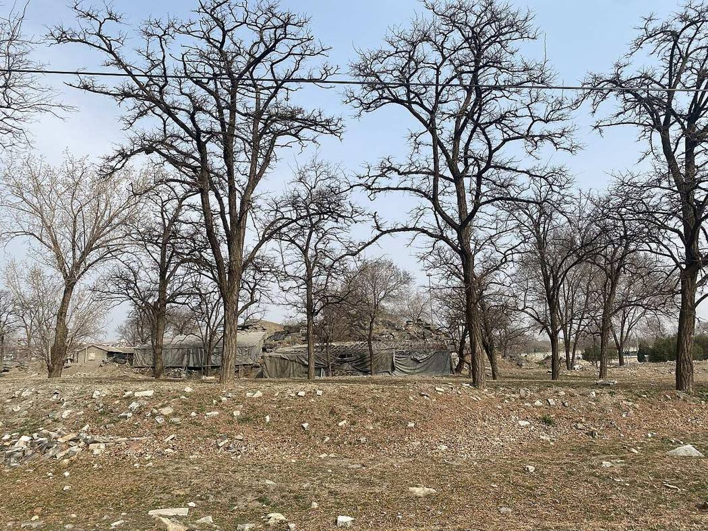

<!-- generated:start (scripts/building_pages.py): do not edit between these markers -->

# YM48: 紫碧山房 Zibi Shanfang

The Cold Hill, Han Shan (Malone p.88) · Yuanming Yuan

**3D object:** 14 boxes. Open it: `/reconstruction/3d.html?b=YM48`

## What we know

- **Name:** 紫碧山房 Zibi Shanfang (S05, S02, S41, S06, S01, S337, S361 · confidence B)
- **English:** The Cold Hill, Han Shan (Malone p.88) (S05, S02, S41, S06, S01, S337, S361)
- **Garden:** Yuanming Yuan (S05, S02, S41, S06, S01, S337, S361)
- **Type:** compound (S05, S02, S41, S06, S01, S337, S361 · confidence B)
- **Built:** after 1744, date unknown (not in the album); 1760 (S05, S02, S41, S06, S01, S337, S361)
- **Changed:** c. 1760 rebuilt (S05, S02, S41, S06, S01, S337, S361)
- **Destroyed:** 1860; on the 1873 survival list (S06); survived 1860; later loss; inner gate, 乐在人和, 顺木天 survived 1860; lost around 1900 (S05, S02, S41, S06, S01, S337, S361)
- **Position:** 40.01104, 116.28266. S01 sure (S01 · confidence B)
- **Note:** Not in the album, the one scene not painted (S41). Highest hill: 58.16 m elevation on the 1965 survey (S41). Malone p.65 n. dates it unknown; S41 says it existed by 1744. after1860: main hall survived 1860 (with 顺木天); lost around 1900 (S337, E0451; E2315). (S05, S02, S41, S06, S01, S337, S361)
- **Plan reader's note:** Label in the south court. Malone p.88: rock hill in the NW corner north of the wall (Cold Hill). (S01) *(research copy, not public)*
- **How it was read:** sure (S01) *(research copy, not public)*
- **Plan pixels:** 628, 560 (S01) *(research copy, not public)*

## Our model now

14 boxes stand in this compound, 14 on blocks drawn on the plan, 0 assumed. Its halls are listed below.

## Inside it (16)

- YM48-01 横云堂
- YM48-02 紫碧山房正宇
- YM48-03 石帆室
- YM48-04 丰乐轩
- YM48-05 霁华楼
- YM48-06 景晖楼
- YM48-07 澄素楼
- YM48-08 引溪亭
- YM48-B0010
- YM48-B0033
- YM48-B0054
- YM48-B0055
- YM48-B0057
- YM48-N01 乐在人和
- YM48-N02 含??
- YM48-N03 宫门

## Pictures (1)

- **P0459** (likely): 圆明园紫碧山房景色.jpeg (2022-03-13 (Commons DateTimeOriginal)). https://commons.wikimedia.org/wiki/File:%E5%9C%86%E6%98%8E%E5%9B%AD%E7%B4%AB%E7%A2%A7%E5%B1%B1%E6%88%BF%E6%99%AF%E8%89%B2.jpeg

  

## Texts and drawings (64)

- **E2302** (text, sure): 丰乐轩 in 紫碧山房. 1780s · j81:25a · S05. https://github.com/kanripo/KR2k0036/blob/master/KR2k0036_081.txt
  > 鴻慈永祜後垣西北為紫碧山房前宇為横雲堂山房東巖洞中為石帆室東南為豐樂軒北為霽華樓
  S05 puts 丰乐轩 south-east of 石帆室 in 紫碧山房.: S01 labels it in YM22.
- **E2303** (text, sure): 日下舊聞考 紫碧山房. 1780s (乾隆 敕撰) · j81:25a-25b · S05. https://github.com/kanripo/KR2k0036/blob/master/KR2k0036_081.txt
  > 鴻慈永祜後垣西北為紫碧山房前宇為横雲堂山房東巖洞中為石帆室東南為豐樂軒北為霽華樓迤東為景暉樓横雲堂西池上為澄素樓西北為引溪亭（圎圓明園册）臣等謹按紫碧山房額有二其一恭懸正宇内一懸穿堂門檐與引溪亭額皆世宗御書紫碧山房正宇檐額曰樂在人和及横雲堂諸額皆皇上御書
  North-west beyond the rear wall of 鴻慈永祜: 紫碧山房 with 横雲堂, the cave room 石帆室, 豐樂軒, 霽華樓, 景暉樓, 澄素樓 on the pond and 引溪亭.
- **E2304** (text, sure): 紫碧山房 正宇: 乐在人和. 1780s · j81:25b · S05. https://github.com/kanripo/KR2k0036/blob/master/KR2k0036_081.txt
  > 紫碧山房正宇檐額曰樂在人和
  The plan label 乐?人和 is the plaque on the main hall of 紫碧山房. The same words hang inside 澹怀堂 of 长春园 (j83:3a): that is another hall.
- **E2273** (poem, sure): 御製 紫碧山房題句. 1761 (御製詩三集) · KR4f0005_173:13b-14a · S201. https://github.com/kanripo/KR4f0005/blob/master/KR4f0005_173.txt
  > 紫碧山房題句 山房卜築已多年雲構恒瞻聖藻懸卓爾仰懐仁者樂佳哉常契畫中禪趙家粉夲饒仙趣陶氏清辭無俗縁最愛夕陽西下際鶴林髙致㑹當前
  A long-built retreat with Yongzheng's plaques, best at sunset.
- **E2287** (poem, sure): 御製 紫碧山房. 1764 (御製詩三集) · KR4f0005_199:1b · S201. https://github.com/kanripo/KR4f0005/blob/master/KR4f0005_199.txt
  > 紫碧山房 因迥為髙本不艱逺竒近概獻誰慳康功北郭桑麻裏爽氣西山襟袖間詩意乗空每有㑹畫家縮地此為閑是真佳處宜常坐坐便思回奈少閒
  Built up on high ground for far views: farmland to the north, and the air of the Western Hills.
- **E0451** (text, sure): 圆明园遗址的遗产价值与申遗构想: the buildings left after 1860, citing 刘敦桢 1933. post n.d. · ylfj, note 34: 刘敦桢, 同治重修圆明园史料, 营造学社汇刊 1933(2) · S337. http://iqh.ruc.edu.cn/old/qdhjylyjzx/xszl/ylfj/9a322b5384ab4c17af0dd577d4f96ca6.htm
  Lists 17 buildings left after the burning of 1860, after 刘敦桢: 紫碧山房, 顺木天, 鱼跃鸢飞, 课农轩, 藏舟坞, 慎修思永, 知过堂, 双鹤斋, 蓬岛瑶台, 魁星楼, 文昌阁, 林渊锦镜, 春雨轩; 海岳开襟; 庄严法界, 正觉寺 and a 大宫门 in 万春园. The paper's aim is to hold any new display to this 1860 state.
- **E2285** (poem, likely): 題豐樂軒. 乾隆二十六年 1761 · KR4f0005_173:14b; run with 紫碧山房題句, 納翠軒, 石帆室 · S201. https://github.com/kanripo/KR4f0005
  > 文軒額取郭槖傳學圃因之亦課田欲阜吾民無别術䖍恭一意為祈年
  The poems on it sit in runs on 紫碧山房 halls, and tie it to 学圃 and 郭橐驼 like 顺木天. A note of 1787 says the plaque is by Yongzheng.
- **E2354** (poem, likely): 顺木天 and 学圃: note on 景暉樓. 乾隆二十六年 1761 · KR4f0005_176:4b · S201. https://github.com/kanripo/KR4f0005
  > 木天思栁著（是處藝果種蔬亭曰順木天圃曰學圃）學圃緬樊諏
  The note makes clear that 顺木天 is a pavilion in the fruit and vegetable plot called 学圃. The 学圃 of QC70 in Qichun Yuan is a different place.
- **E2272** (poem, sure): 丰乐轩: 乾隆二十六年 poem of the Qianlong Emperor. 乾隆二十六年 (1761), date from the compilation · p.201 item (1), under 丰乐轩 · S360. https://www.yuanmingyuanpark.cn/xs/yjbg/202007/P020200730387572832602.pdf#page=201
  > 文轩额取郭槖传，学圃因之亦课田。欲阜吾民无别术，䖍恭一意为祈年。
  Poem of the Qianlong Emperor at 丰乐轩, 1761, on the harvest. Year as given by the compilation.
- **E2274** (poem, sure): 景晖楼: 乾隆二十六年 poem of the Qianlong Emperor. 乾隆二十六年 (1761), date from the compilation · p.199 item (1), under 景晖楼 · S360. https://www.yuanmingyuanpark.cn/xs/yjbg/202007/P020200730387572832602.pdf#page=199
  > 因迥得高楼，䟽前纳远畴。木天思柳著，（是处艺果种蔬，亭曰顺木天，圃曰学圃）学圃缅樊诹。揽景既无尽，延晖每为留。剏名非屡易，漫拟诮昭州。
  Poem of the Qianlong Emperor at 景晖楼, 1761. Year as given by the compilation.
- **E2275** (poem, sure): 横云堂: 乾隆二十六年 poem of the Qianlong Emperor. 乾隆二十六年 (1761), date from the compilation · p.196 item (1), under 横云堂 · S360. https://www.yuanmingyuanpark.cn/xs/yjbg/202007/P020200730387572832602.pdf#page=196
  > 穿池出余土，为山凡几篑。事半得倍功，轩堂因迥置。虽无九仞高，颇有横云致。西峰近在望，暎带岚霭气。既惬昭旷观，兼饶窈窕意。八伯彼休进，肤寸吾恒思。崇朝为春霖，利农斯上瑞。
  Poem of the Qianlong Emperor at 横云堂, 1761. Year as given by the compilation.
- **E2276** (poem, sure): 横云堂: 乾隆二十六年 poem of the Qianlong Emperor. 乾隆二十六年 (1761), date from the compilation · p.196 item (2), under 横云堂 · S360. https://www.yuanmingyuanpark.cn/xs/yjbg/202007/P020200730387572832602.pdf#page=196
  > 向日横云出想象，今朝真个是横云。宁云恋岫高陵表，几觉衣襟合莫分。时露曦光旋叆叇，微飘雨点更氤氲。无厌又冀优沾霈，观过吾縁望岁殷。
  Poem of the Qianlong Emperor at 横云堂, 1761, on the harvest and the view. Year as given by the compilation.
- **E2277** (poem, sure): 澄素楼: 乾隆二十六年 poem of the Qianlong Emperor. 乾隆二十六年 (1761), date from the compilation · p.197 item (1), under 澄素楼 · S360. https://www.yuanmingyuanpark.cn/xs/yjbg/202007/P020200730387572832602.pdf#page=197
  > 层屋镜中央，石桥接径长。春秋风月趣，上下水天光。澄到尘无处，素先绘有常。不忘参理性，揽景定何妨。
  Poem of the Qianlong Emperor at 澄素楼, 1761, on the view. Year as given by the compilation.
- **E2278** (poem, sure): 石帆室: 乾隆二十六年 poem of the Qianlong Emperor. 乾隆二十六年 (1761), date from the compilation · p.198 item (1), under 石帆室 · S360. https://www.yuanmingyuanpark.cn/xs/yjbg/202007/P020200730387572832602.pdf#page=198
  > 峰如倒插室如浮，便拟称帆恰当不。忆似田盘精舍里，石林云海泛虚舟。
  Poem of the Qianlong Emperor at 石帆室, 1761, on the view. Year as given by the compilation.
- **E2279** (poem, sure): 石帆室: 乾隆二十六年 poem of the Qianlong Emperor. 乾隆二十六年 (1761), date from the compilation · p.198 item (2), under 石帆室 · S360. https://www.yuanmingyuanpark.cn/xs/yjbg/202007/P020200730387572832602.pdf#page=198
  > 宁湏五两始飘扬，容裔摩空几幅张。讵必赋吴将志越，已看引汉更牵湘。惊涛骇浪曾何有，抹月批风是所常。无恙迥悬云海阔，祗疑牛渚泛仙航。
  Poem of the Qianlong Emperor at 石帆室, 1761, on the view. Year as given by the compilation.
- **E2280** (poem, sure): 紫碧山房: 乾隆二十六年 poem of the Qianlong Emperor. 乾隆二十六年 (1761), date from the compilation · p.195 item (1), under 紫碧山房 · S360. https://www.yuanmingyuanpark.cn/xs/yjbg/202007/P020200730387572832602.pdf#page=195
  > 山房卜筑已多年，云构恒瞻圣藻悬。卓尔仰怀仁者乐，佳哉常契画中禅。赵家粉本饶仙趣，陶氏清辞无俗縁。最爱夕阳西下际，鹤林高致会当前。
  Poem of the Qianlong Emperor at 紫碧山房, 1761. Year as given by the compilation.
- **E2281** (poem, sure): 纳翠轩: 乾隆二十六年 poem of the Qianlong Emperor. 乾隆二十六年 (1761), date from the compilation · p.199 item (1), under 纳翠轩 · S360. https://www.yuanmingyuanpark.cn/xs/yjbg/202007/P020200730387572832602.pdf#page=199
  > 十笏不为仄，诸峰无尽竒。窗棱惟秀色，画格是神姿。葪夫何有，郁葱常若斯。设将拟芥子，纳千百湏弥。
  Poem of the Qianlong Emperor at 纳翠轩, 1761, on the view. Year as given by the compilation.
- **E2282** (poem, sure): 纳翠轩: 乾隆二十六年 poem of the Qianlong Emperor. 乾隆二十六年 (1761), date from the compilation · p.199 item (2), under 纳翠轩 · S360. https://www.yuanmingyuanpark.cn/xs/yjbg/202007/P020200730387572832602.pdf#page=199
  > 假山植真树，当春亦向荣。何必分宾主，都来强与名。
  Poem of the Qianlong Emperor at 纳翠轩, 1761, on the view. Year as given by the compilation.
- **E2283** (poem, sure): 翼翠亭: 乾隆二十六年 poem of the Qianlong Emperor. 乾隆二十六年 (1761), date from the compilation · p.200 item (1), under 翼翠亭 · S360. https://www.yuanmingyuanpark.cn/xs/yjbg/202007/P020200730387572832602.pdf#page=200
  > 园林无真山，假山古即真。是处颇峭蒨，老松况作鳞。一笠栖其上，翼然俯嶙峋。翠雨落天花，不藉天女纷。意在山水间，睪缅欧阳文。
  Poem of the Qianlong Emperor at 翼翠亭, 1761, on the view. Year as given by the compilation.
- **E2284** (poem, sure): 霁华楼: 乾隆二十六年 poem of the Qianlong Emperor. 乾隆二十六年 (1761), date from the compilation · p.199 item (1), under 霁华楼 · S360. https://www.yuanmingyuanpark.cn/xs/yjbg/202007/P020200730387572832602.pdf#page=199
  > 初収宿雨霁华披，近远峰峦濯翠姿。却似高楼解著语，壁间宜有喜晴诗。
  Poem of the Qianlong Emperor at 霁华楼, 1761. Year as given by the compilation.
- **E2319** (poem, sure): 横云堂. 乾隆二十六年 (1761) · v3 p.121, under 紫碧山房; source ref 8-416 · S361. https://www.yuanmingyuanpark.cn/xs/yjbg/202008/P020200803382569071850.pdf#page=124
  > 向日横云出想像，今朝真个是横云。寜云恋岫髙陵表，几觉衣襟合莫分。时露曦光旋叆叇，微飘雨点更氤氲。无厌又冀优霑霈，观过吾缘望岁殷。
  Poem 横云堂 by the Qianlong Emperor, 1761, filed by the editors under 紫碧山房.
- **E2320** (poem, sure): 横云堂放歌. 乾隆二十六年 (1761) · v3 p.122, under 紫碧山房; source ref 8-425 · S361. https://www.yuanmingyuanpark.cn/xs/yjbg/202008/P020200803382569071850.pdf#page=125
  > 今岁书堂初断手，颜以横云因兴偶。却是往往叶嘉占，盛名难副兹诚副。入夏云生每作风，已恐春膏或孤负。昨夜浓阴喜达晨，急霔徐霏彻夕久。横云今日信横云，配藜荟蔚滃户牖。八伯兴歌迹漫希，一犁透润泽诚厚。
  Poem 横云堂放歌 by the Qianlong Emperor, 1761, filed by the editors under 紫碧山房.
- **E2321** (poem, sure): 石帆室. 乾隆二十六年 (1761) · v3 p.120, under 紫碧山房; source ref 8-386 · S361. https://www.yuanmingyuanpark.cn/xs/yjbg/202008/P020200803382569071850.pdf#page=123
  > 宁须五两始飘扬，容裔摩空几幅张。讵必赋吴将志越，已看引汉更牵湘。惊涛骇浪曾何有，抹月批风是所常。无恙回悬云海阔，只疑牛渚泛仙航。
  Poem 石帆室 by the Qianlong Emperor, 1761, filed by the editors under 紫碧山房.
- **E2323** (poem, sure): 题丰乐轩. 乾隆二十六年 (1761) · v3 p.120, under 紫碧山房; source ref 8-386 · S361. https://www.yuanmingyuanpark.cn/xs/yjbg/202008/P020200803382569071850.pdf#page=123
  > 文轩额取郭橐传，学圃因之亦课田。欲阜吾民无别术，虔恭一意为祈年。
  Poem 题丰乐轩 by the Qianlong Emperor, 1761, filed by the editors under 紫碧山房.
- **E2325** (poem, sure): 题霁华楼. 乾隆二十六年 (1761) · v3 p.122, under 紫碧山房; source ref 8-450 · S361. https://www.yuanmingyuanpark.cn/xs/yjbg/202008/P020200803382569071850.pdf#page=125
  > 初收宿雨霁华披，近远峰峦濯翠姿。却似高楼解著语，壁间宜有喜晴诗。
  Poem 题霁华楼 by the Qianlong Emperor, 1761, filed by the editors under 紫碧山房.
- **E2328** (poem, sure): 澄素楼作. 乾隆二十六年 (1761) · v3 p.122, under 紫碧山房; source ref 8-439 · S361. https://www.yuanmingyuanpark.cn/xs/yjbg/202008/P020200803382569071850.pdf#page=125
  > 层屋静中央，石桥接迳长。春秋风月趣，上下水天光。澄到尘无处，素先绘有常。不忘参理性，揽景定何妨。
  Poem 澄素楼作 by the Qianlong Emperor, 1761, filed by the editors under 紫碧山房.
- **E2286** (poem, sure): 霁华楼: 乾隆二十七年 poem of the Qianlong Emperor. 乾隆二十七年 (1762), date from the compilation · p.199 item (2), under 霁华楼 · S360. https://www.yuanmingyuanpark.cn/xs/yjbg/202007/P020200730387572832602.pdf#page=199
  > 傍晩快晴定，山楼登霁华。鱼鳞消薄霭，鸦背爓轻霞。稍释愁霖叹，敢言即景嘉。浃旬希例此，庶慰上农家。
  Poem of the Qianlong Emperor at 霁华楼, 1762, on the view. Year as given by the compilation.
- **E2326** (poem, sure): 霁华楼. 乾隆二十七年 (1762) · v3 p.123, under 紫碧山房; source ref 8-585 · S361. https://www.yuanmingyuanpark.cn/xs/yjbg/202008/P020200803382569071850.pdf#page=126
  > 傍晚快晴定，山楼登霁华。鱼鳞消薄霭，鸦背焰轻霞。稍释愁霖叹，敢言即景嘉。浃旬希例此，庶慰上农家。
  Poem 霁华楼 by the Qianlong Emperor, 1762, filed by the editors under 紫碧山房.
- **E2288** (poem, sure): 紫碧山房. 乾隆二十九年 (1764) · v3 p.123, under 紫碧山房; source ref 8-749 · S361. https://www.yuanmingyuanpark.cn/xs/yjbg/202008/P020200803382569071850.pdf#page=126
  > 因迥为高本不艰，远奇近概献谁悭。康功北郭桑麻里，爽气西山襟袖间。诗意乘空每有会，画家缩地此为闲。是真佳处宜常坐，坐便思回奈少闲。
  Poem 紫碧山房 by the Qianlong Emperor, 1764, filed by the editors under 紫碧山房.
- **E2289** (poem, sure): 紫碧山房: 乾隆二十九年 poem of the Qianlong Emperor. 乾隆二十九年 (1764), date from the compilation · p.195 item (2), under 紫碧山房 · S360. https://www.yuanmingyuanpark.cn/xs/yjbg/202007/P020200730387572832602.pdf#page=195
  > 因迥为高本不艰，远竒近概献谁悭。康功北郭桑麻里，爽气西山襟袖间。诗意乘空每有会，画家缩地此为闲。是真佳处宜常坐，坐便思回奈少闲。
  Poem of the Qianlong Emperor at 紫碧山房, 1764, on the view. Year as given by the compilation.
- **E2322** (poem, sure): 石帆室. 乾隆三十一年 (1766) · v3 p.125, under 紫碧山房; source ref 9-151 · S361. https://www.yuanmingyuanpark.cn/xs/yjbg/202008/P020200803382569071850.pdf#page=128
  > 万石磊嵚㟢，小斋倚石为。飞来若无定，浮去竟何之。讵藉风添力，端因雪有姿。如询停舣处，只在白云涯。
  Poem 石帆室 by the Qianlong Emperor, 1766, filed by the editors under 紫碧山房.
- **E2324** (poem, sure): 丰乐轩. 乾隆三十二年 (1767) · v3 p.126, under 紫碧山房; source ref 9-293 · S361. https://www.yuanmingyuanpark.cn/xs/yjbg/202008/P020200803382569071850.pdf#page=129
  > 北村缀景有田园，学圃兼将学稼论。望矣因之号丰乐，诚然实不易由言。
  Poem 丰乐轩 by the Qianlong Emperor, 1767, filed by the editors under 紫碧山房.
- **E2290** (poem, sure): 翼翠亭: 乾隆三十四年 poem of the Qianlong Emperor. 乾隆三十四年 (1769), date from the compilation · p.200 item (2), under 翼翠亭 · S360. https://www.yuanmingyuanpark.cn/xs/yjbg/202007/P020200730387572832602.pdf#page=200
  > 若飞檐翼虚而敞，过雨林姿生翠攒。色相设从禽谱觅，不为凰即定为鸾。
  Poem of the Qianlong Emperor at 翼翠亭, 1769, on the view. Year as given by the compilation.
- **E2291** (poem, sure): 丰乐轩: 乾隆四十二年 poem of the Qianlong Emperor. 乾隆四十二年 (1777), date from the compilation · p.201 item (4), under 丰乐轩 · S360. https://www.yuanmingyuanpark.cn/xs/yjbg/202007/P020200730387572832602.pdf#page=201
  > 昨秋各省丰者多，近始京畿达远省。况是弄田灌溉勤，自宜仓箱堆积整。十岁中鲜四五遇，丰则丰矣乐艰骋。缱彼胼手胝足民，虽亦逢稔称厚幸。官租私债仍当还，几曾温饱亲受领。敬体前题识农艰，（轩额乃皇考御书也）惟有祈年志䖍永。
  Poem of the Qianlong Emperor at 丰乐轩, 1777, on the harvest. Year as given by the compilation.
- **E2292** (poem, sure): 丰乐轩: 乾隆五十年 poem of the Qianlong Emperor. 乾隆五十年 (1785), date from the compilation · p.201 item (5), under 丰乐轩 · S360. https://www.yuanmingyuanpark.cn/xs/yjbg/202007/P020200730387572832602.pdf#page=201
  > 御园隙地多弄田，轩名丰乐祈农寓。去岁北省率有秋，弄田益庆仓箱裕。然而斯庆岂易得，十岁难逢五六遇。人益滋而谷益贵，歉必增价丰如故。（承平生齿日繁，谷价日贵，而百物亦因之日昻。间遇歉岁必至増价，及丰收而价仍不减，实事势相因难以就平也。）谷贵诸物胥价贵，往往十年倍其数。持盈保泰实艰㢤，长此安穷吾益惧。
  Poem of the Qianlong Emperor at 丰乐轩, 1785, on the harvest. Year as given by the compilation.
- **E2329** (poem, sure): 澄素楼. 乾隆五十五年 (1790) · v3 p.131, under 紫碧山房; source ref 17-177 · S361. https://www.yuanmingyuanpark.cn/xs/yjbg/202008/P020200803382569071850.pdf#page=134
  > 澄素固在溪，而楼适溪上。溪澄楼亦澄，曰二原一样。然人弗拾级，孰能知其状。得一则含三，天成坦荡荡。万理顺其然，夫岂劳施张。
  Poem 澄素楼 by the Qianlong Emperor, 1790, filed by the editors under 紫碧山房.
- **E2293** (poem, sure): 霁华楼: 乾隆五十六年 poem of the Qianlong Emperor. 乾隆五十六年 (1791), date from the compilation · p.199 item (6), under 霁华楼 · S360. https://www.yuanmingyuanpark.cn/xs/yjbg/202007/P020200730387572832602.pdf#page=199
  > 春园桃李未芳菲，堤柳盆梅露意微。舒迭恰欣逢霁景，物华天宝运神机。
  Poem of the Qianlong Emperor at 霁华楼, 1791, on the view. Year as given by the compilation.
- **E2294** (poem, sure): 横云堂: 乾隆五十七年 poem of the Qianlong Emperor. 乾隆五十七年 (1792), date from the compilation · p.197 item (12), under 横云堂 · S360. https://www.yuanmingyuanpark.cn/xs/yjbg/202007/P020200730387572832602.pdf#page=197
  > 横云自以高得名，而我每来不同情。望雨时至心为喜，畏雨时至心为怦。雨乎云乎岂知此，无心出岫写我楹。即今亟望沾霈之，优雪怦然朝暮恒。情萦安得望畏喜，怦齐置却与云同。
  Poem of the Qianlong Emperor at 横云堂, 1792, on the view. Year as given by the compilation.
- **E2295** (poem, sure): 翼翠亭: 乾隆五十七年 poem of the Qianlong Emperor. 乾隆五十七年 (1792), date from the compilation · p.200 item (7), under 翼翠亭 · S360. https://www.yuanmingyuanpark.cn/xs/yjbg/202007/P020200730387572832602.pdf#page=200
  > 千林突兀未含青，那得蓊蒙翠翼亭。却看如斯突兀者，翠中来也不曾停。
  Poem of the Qianlong Emperor at 翼翠亭, 1792, on the view. Year as given by the compilation.
- **E2296** (poem, sure): 纳翠轩: 乾隆五十八年 poem of the Qianlong Emperor. 乾隆五十八年 (1793), date from the compilation · p.200 item (7), under 纳翠轩 · S360. https://www.yuanmingyuanpark.cn/xs/yjbg/202007/P020200730387572832602.pdf#page=200
  > 文轩疎且敞，佳景纳无遗。然值春方孟，千林翠未披。顾名似略孤，其副亦有时。因而生别会，趣佳在先期。及至当目前，熟见复何竒。寄语欲速人，诸宜絜矩思。
  Poem of the Qianlong Emperor at 纳翠轩, 1793, on the view. Year as given by the compilation.
- **E2327** (poem, sure): 景晖楼(18-591). 乾隆五十八年 (1793) · v3 p.133, under 紫碧山房 · S361. https://www.yuanmingyuanpark.cn/xs/yjbg/202008/P020200803382569071850.pdf#page=136
  > 冬景过寒夏景烈，惟欣春景霭和晖。安尧温舜有如此，四表三苗无不归。
  Poem 景晖楼(18-591) by the Qianlong Emperor, 1793, filed by the editors under 紫碧山房.
- **E2297** (poem, sure): 紫碧山房歌(1-130). 嘉庆元年 (1796) · v3 p.133, under 紫碧山房 · S361. https://www.yuanmingyuanpark.cn/xs/yjbg/202008/P020200803382569071850.pdf#page=136
  > 御园西北山势雄，回蹊叠石磴道崇。高岩低涧相映带，曲廊幽室连珠栊。峰顶翼然一亭子，旷览周原开百里。灵境题额仰宪皇，智水仁山本至理。登临几暇非遨游，待泽情殷阅绿畴。举头只有天在上，愿鉴微忱宵旰忧。
  Poem 紫碧山房歌(1-130) by the Jiaqing Emperor, 1796, filed by the editors under 紫碧山房.
- **E2298** (poem, sure): 石帆室: 嘉庆二年 poem of the Jiaqing Emperor. 嘉庆二年 (1797), date from the compilation · p.198 item (6), under 石帆室 · S360. https://www.yuanmingyuanpark.cn/xs/yjbg/202007/P020200730387572832602.pdf#page=198
  > 石舫翼然碧溪浒，筑成船室具帆橹。凭窗延览镜清澄，未许鸣桡过前浦。光含天水图画披，浴鹭浮鸥自转移。盘石根基任诚重，济川作楫还系思。
  Poem of the Jiaqing Emperor at 石帆室, 1797, on the view. Year as given by the compilation.
- **E2299** (poem, sure): 澄素楼: 嘉庆二十二年 poem of the Jiaqing Emperor. 嘉庆二十二年 (1817), date from the compilation · p.197 item (3), under 澄素楼 · S360. https://www.yuanmingyuanpark.cn/xs/yjbg/202007/P020200730387572832602.pdf#page=197
  > 小楼石洞 右，凭槛望西山。村外排青嶂，峰头袅翠鬟。试耕园户队，习射羽林班。教养无非事，力勤警怠顽。（楼在御园西北隅，俯临稻畦，暇时来观稼穑，近于十九年命内务府添建营房，训练士卒，亦兵农不可偏废之意耳）
  Poem of the Jiaqing Emperor at 澄素楼, 1817. Year as given by the compilation.
- **E2300** (poem, sure): 澄素楼: 嘉庆二十五年 poem of the Jiaqing Emperor. 嘉庆二十五年 (1820), date from the compilation · p.198 item (6), under 澄素楼 · S360. https://www.yuanmingyuanpark.cn/xs/yjbg/202007/P020200730387572832602.pdf#page=198
  > 拾级上层楼，春郊韶景悠。线青新柳曳，眉翠远山浮。小溆波初活，平畴麦始抽。阳和盎品物，仁政及时修。
  Poem of the Jiaqing Emperor at 澄素楼, 1820, on the harvest and the view. Year as given by the compilation.
- **E2301** (poem, sure): 紫碧山房: 咸丰五年 poem of the Xianfeng Emperor. 咸丰五年 (1855), date from the compilation · p.196 item (11), under 紫碧山房 · S360. https://www.yuanmingyuanpark.cn/xs/yjbg/202007/P020200730387572832602.pdf#page=196
  > 楼高始觉太虚宽，无限诗情结古欢。此日登临供点笔，何人酩酊倩扶冠。千峯从翠澄秋宇，一雁摇空送早寒。处处茅檐真乐意，豳风图画坐中看。雅集山庄礼数宽，惊人老句寄遥欢。凭将往代忠兼讽，好励今时衣与冠。玉岭鸦翻余落日，纸窗虫啮透轻寒。归桡沿路撷芳便，篱菊高低镜里看。
  Poem of the Xianfeng Emperor at 紫碧山房, 1855, on the view. Year as given by the compilation.
- **E1524** (description, sure): 玉明 侍游御園記 (in 蕉軒隨錄). 1856 (咸豐六年七月二十一日) · 蕉軒隨錄, 御園侍游 (line 336 of the corpus file) · S210. https://github.com/garychowcmu/daizhigev20/blob/master/史藏/志存记录/蕉轩随录.txt
  > ◎御园侍游玉将军（明）有《侍游御园记》，成竹坪同年（林）曾属予代作跋语，恭书于后。按，《记》云：“咸丰六年秋七月二十一日，奉旨：本日散朝后，著玉明、肃顺自备鞍马，午初一刻进西南门，在山高水长伺候。有顷，上从内乘船，至山高水长后阁扇下船，出前门，谕玉明、肃顺暨珠勒亨、西拉布、托云、德勒格尔、伊勒东阿等脱去外褂。上乘马，命七臣随行。自山高水长游藻园，至厂地，过汇芳书院，复由紫碧山房至鱼跃鸢飞少坐。过蕊珠宫门，至黄花磴进茶毕，往西洋楼海宴堂，至转马台，过小角门，至狮子林清淑斋赏饭。左右四卓，命七臣坐，并奉温谕可饱食，非外边筵宴比也。上命膳房先给七臣面各一器，上进面，复进饭，颁赏御用菜蔬，七臣叩头谢。上进粥，复赏粥毕。随驾起行，由宝相寺、法慧寺、谐奇趣过明春门，至雷峰夕照马头，坐如在天上船，游福海。上命笔砚作诗毕，至渊氵亭镜澈马头下船。进丽春门骑马，由旧园东墙根过敷春堂，游西大堤汉城关，至含辉楼下马，命七臣散归。玉明自道光十一年由侍卫擢厕御前二十余年，仰邀优渥，得遍瞻御园盛景。欣感之余，谨作记以纪荣遇。”
  A rare first-hand record of a day in the garden four years before its destruction. The emperor takes seven officials by a named route from 山高水長 through 藻園, 彚芳書院, 紫碧山房 and 魚躍鳶飛, past 蕊珠宫門, on to 海宴堂 in the 西洋樓, a meal at 清淑齋 in 獅子林, 寳相寺, 法慧寺, 諧奇趣, by boat on 福海, then 敷春堂 and 含暉楼. All were standing then.
- **E2314** (description, likely): Han Shan, the Cold Hill, and the wall north of the shrine. 1934 · p.88 · S02. https://archive.org/details/historyofpekings00malo
  > In the very northwest end of this section stood a hill built up almost entirely of rocks, with paths leading to caves in the hill and pleasure houses on the summit.
  A wall runs east across the whole garden north of the shrine. In the north-west end a hill of rocks called Han Shan, with caves and pleasure houses, climbed by the emperor on the ninth of the ninth moon (Yuan's memorandum). Malone does not tie it to a scene; 紫碧山房 is my reading by position.
- **E2000** (description, sure): Site status table, about 2011: scattered remains only. c. 2011 · 系列06 repost, status table · S356. https://blog.sina.com.cn/s/blog_c27029650101itzz.html
  Scenes with only scattered, incomplete building remains in the same table. 方壶胜境 is listed separately as the one with fairly complete remains not yet tidied up. 紫碧山房, 舍卫城 and 如园 have been dug since.
- **E2495** (description, sure): List of the excavated sites of the Yuanmingyuan, 1994-2024 (贾贯峰, 圆明园研究 83). 2024-11-11 · section on the site museum, para. starting 圆明园是我国第一批国家考古遗址公园 · S946. https://www.yuanmingyuanpark.cn/xs/ktsb/202411/t20241111_4732355.html
  Since the first formal digs at 藻园 and 十三所 in 1994, the important sites excavated are 含经堂, 澹怀堂, 大宫门, 养雀笼, 谐奇趣, 海晏堂, 远瀛观, 桃花洞, 如园, 紫碧山房, 舍卫城 and 澹泊宁静 (written just as the 2024 文源阁 dig ended). The site museum is to centre on 正觉寺, with a planned museum at 大宫门.
- **E2305** (description, sure): 圆明园百景史事分景汇编: 丰乐轩. 1761-1814 · from p.200, under 紫碧山房 · S360. https://www.yuanmingyuanpark.cn/xs/yjbg/202007/P020200730387572832602.pdf#page=200
  The compiler describes a three-bay hall with galleries all round facing north, with Yongzheng's plaque and a gallery running north-east to the farm plot 学圃. 丰乐轩: 16 dated items, 1761-1814, of which 16 poems (Qianlong, Jiaqing); recurring themes: the harvest, the view. First dated 1761, last dated 1814.
- **E2306** (description, sure): 圆明园百景史事分景汇编: 景晖楼. 1761-1761 · from p.198, under 紫碧山房 · S360. https://www.yuanmingyuanpark.cn/xs/yjbg/202007/P020200730387572832602.pdf#page=198
  景晖楼: 1 dated items, 1761-1761, of which 1 poems (Qianlong). First dated 1761, last dated 1761.
- **E2307** (description, sure): 圆明园百景史事分景汇编: 横云堂. 1761-1792 · from p.196, under 紫碧山房 · S360. https://www.yuanmingyuanpark.cn/xs/yjbg/202007/P020200730387572832602.pdf#page=196
  横云堂: 12 dated items, 1761-1792, of which 12 poems (Qianlong); recurring themes: the view, the harvest, rain. First dated 1761, last dated 1792.
- **E2308** (description, sure): 圆明园百景史事分景汇编: 澄素楼. 1761-1820 · from p.197, under 紫碧山房 · S360. https://www.yuanmingyuanpark.cn/xs/yjbg/202007/P020200730387572832602.pdf#page=197
  A Jiaqing note of 1817 puts it in the north-west corner over the rice fields, with new barracks added near it in 1814. 澄素楼: 6 dated items, 1761-1820, of which 6 poems (Qianlong, Jiaqing); recurring themes: the view, the harvest. First dated 1761, last dated 1820.
- **E2309** (description, sure): 圆明园百景史事分景汇编: 石帆室. 1761-1797 · from p.198, under 紫碧山房 · S360. https://www.yuanmingyuanpark.cn/xs/yjbg/202007/P020200730387572832602.pdf#page=198
  石帆室: 6 dated items, 1761-1797, of which 6 poems (Qianlong, Jiaqing); recurring themes: the view. First dated 1761, last dated 1797.
- **E2310** (description, sure): 圆明园百景史事分景汇编: 紫碧山房. 1761-1855 · from p.195, under 紫碧山房 · S360. https://www.yuanmingyuanpark.cn/xs/yjbg/202007/P020200730387572832602.pdf#page=195
  The compiler calls it the highest point of the garden, called also 寒山, enlarged in 1760 after the Second Southern Tour, in imitation of Suzhou's 寒山. 紫碧山房: 11 dated items, 1761-1855, of which 11 poems (Qianlong, Jiaqing, Daoguang, Xianfeng); recurring themes: the view. First dated 1761, last dated 1855.
- **E2311** (description, sure): 圆明园百景史事分景汇编: 纳翠轩. 1761-1793 · from p.199, under 紫碧山房 · S360. https://www.yuanmingyuanpark.cn/xs/yjbg/202007/P020200730387572832602.pdf#page=199
  纳翠轩: 7 dated items, 1761-1793, of which 7 poems (Qianlong); recurring themes: the view. First dated 1761, last dated 1793.
- **E2312** (description, sure): 圆明园百景史事分景汇编: 翼翠亭. 1761-1792 · from p.200, under 紫碧山房 · S360. https://www.yuanmingyuanpark.cn/xs/yjbg/202007/P020200730387572832602.pdf#page=200
  翼翠亭: 7 dated items, 1761-1792, of which 7 poems (Qianlong); recurring themes: the view. First dated 1761, last dated 1792.
- **E2313** (description, sure): 圆明园百景史事分景汇编: 霁华楼. 1761-1791 · from p.199, under 紫碧山房 · S360. https://www.yuanmingyuanpark.cn/xs/yjbg/202007/P020200730387572832602.pdf#page=199
  霁华楼: 6 dated items, 1761-1791, of which 6 poems (Qianlong); recurring themes: the view. First dated 1761, last dated 1791.
- **E2315** (description, sure): 圆明园五朝御制诗文集注 v3, editors' note on 紫碧山房. 2020 edition · v3 p.118 · S361. https://www.yuanmingyuanpark.cn/xs/yjbg/202008/P020200803382569071850.pdf#page=121
  Enlarged about 1760: inner gate, 含余清, the octagonal 翼翠亭, 丰乐轩, 纳翠轩, the boat-shaped 石帆室, the three-storey 景晖楼, 横云堂, a five-bay main hall 乐在人和, 澄素楼, 霁华楼. After 1860 the inner gate, main hall and 顺木天 pavilion survived under guard and were lost around 1900, say the editors.
- **E2316** (description, sure): 圆明园百景史事分景汇编: 紫碧山房. undated · from p.194, under 紫碧山房 · S360. https://www.yuanmingyuanpark.cn/xs/yjbg/202007/P020200730387572832602.pdf#page=194
  The compiler calls it the highest point of the garden, called also 寒山, enlarged in 1760 after the Second Southern Tour, in imitation of Suzhou's 寒山. 紫碧山房: short note in the compilation, no dated items.
- **E2317** (drawing, sure): 《国家图书馆藏样式雷图档·圆明园卷初编》: 紫碧山房. mostly 道光, 咸丰, 同治 per the publisher · 初编 目录: 紫碧山房, pp.387-396 · S13. https://www.nlcpress.com/ProductView.aspx?Id=7642
  The printed facsimile of the National Library of China's Yangshi Lei sheets has a section on this place at pp.387-396 (10 pages, section length worked out from the next heading); sheet titles and numbers are in the volume, ordered from a library.
- **E2262** (plan, sure): 圆明园新证, 端木泓: dated additions shown on plan 1704. post n.d. · tables 1 and 2 · S337. http://iqh.ruc.edu.cn/old/qdhjylyjzx/xszl/xstl/1c9094aef4f041148f15883c7c266cb9.htm
  Tables of when things were added, drawn from archives to date the plan's layers: 藻园 1752, 廓然大公 eight views 1754, 春雨轩 1755, 藏密楼 1758, 多稼轩 ten views 1759, 紫碧山房 1760, 安澜园 and 澄练楼 1763, 若帆之阁 1764, 汇万总春之庙 1769, 文源阁 1775, 法源楼 1779; after: 兰亭八柱 1779, 知过堂 1782, 课农轩 1816, 涵月楼 1827. The most useful single dating table found.
- **E2318** (archaeology, sure): 紫碧山房 2017, 新京报 via 中新网. 2017-12-15 · passage on 紫碧山房 · S132. https://www.chinanews.com.cn/sh/2017/12-15/8400775.shtml
  紫碧山房 Zibi Shanfang, the highest point of the garden in the far north-west, yielded a service house, gate, the halls 紫碧山房, 含余清 and 澄素楼, a landing, stone bridge, walls, roads, channel and hill. Remains absent from the documents also appeared: an earlier wall footing with its apron, a retaining wall of the hill, a semicircular landing, a drain and a stone path.

**On the plan:** Drawn on the plan of the gardens (S01), labelled 紫碧山房. https://artmuseum.princeton.edu/collections/objects/138657

## Reconstructions by others (1)

Modern interpretation, not evidence.
- **R0308** (paper figure, likely): 《圆明园新证》: reading of Palace Museum plan No. 1704, stripped of its later paste-ups to the Qianlong layout of about 1779. . http://iqh.ruc.edu.cn/old/qdhjylyjzx/xszl/xstl/1c9094aef4f041148f15883c7c266cb9.htm Research-only: link card.

## Evidence for the set of buildings

- Reconstructions and comparables for the whole garden, 圆明园 Yuanming Yuan: see GARDEN-YM

## Open questions

- Q29: Hills
- Q39: 丰乐轩 YM22-02
- Q45: Halls in the texts with no row
- Q47: How much burned, and when
- Q138: E0451 (刘敦桢 via S337) lists 17 buildings left after 1860, eight of them in wave-2 scenes (Y
- Q142: No album leaves exist for YM47 藻园, YM48 紫碧山房, YM49 若帆之阁, YM50 三潭印月, YM51 课农轩 (not among th

<!-- generated:end -->

## Notes

<!-- Yours: regeneration never touches this part. It goes on the public site; what you write below a line holding only %% private %% stays in the research copy. -->
