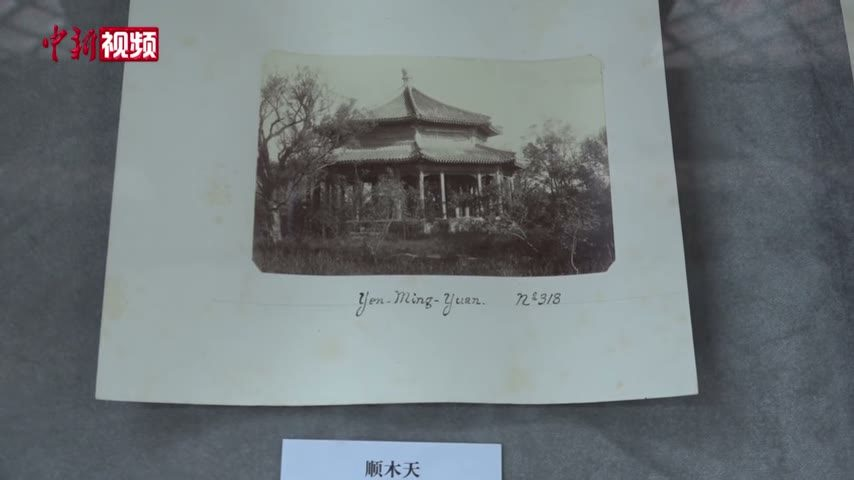

<!-- generated:start (scripts/building_pages.py): do not edit between these markers -->

# YM52-N01: 顺木天 Shun Mu Tian

Yuanming Yuan

**3D object:** 1 box. Open it: `/reconstruction/3d.html?b=YM52-N01`

**Part of:** YM52 顺木天

## What we know

- **Name:** 顺木天 Shun Mu Tian (S01, S360 · confidence B)
- **Garden:** Yuanming Yuan (S01, S360)
- **Type:** other (S01, S360 · confidence B)
- **Built:** by 1759 (first dated item) (S01, S360)
- **Destroyed:** 1860 (S01, S360)
- **Position:** 40.01122, 116.28656. S01 sure (S01 · confidence B)
- **Size in the inventory:** 11.0 × 12.7 m. S01 plan px / hall scale (S01)
- **Plan reader's note:** Octagon. rect=46,42,0 (S01) *(research copy, not public)*
- **How it was read:** sure (S01) *(research copy, not public)*
- **Plan pixels:** 2152, 692 (S01) *(research copy, not public)*

## Our model now

A plain box on the block drawn on the Qing plan S01: position and frontage from the plan, heights and roof from the typology of its hall class. It will be updated as the research goes on.

- **Box:** 11 × 12.7 m, side hall
- **Heights:** platform 0.54 m, eave 3.64 m, ridge 6.02 m above the ground
- **Roof:** gable 硬山 or 悬山, rolled ridge 卷棚, 2 parallel rolls 勾连搭, grey tile
- **Faces:** 174.9° from north
- **Confidence:** B

## Pictures (1)

- **P0712** (likely): 顺木天 (exhibition label); mount inscribed Yen-Ming-Yuan Nº 318 (1882, as said in the clip by 刘阳 Liu Yang (S650); S651 gives 1882 for Semalle). https://commons.wikimedia.org/wiki/File:2021-02-24_圆明园中西建筑如何过渡_未彻底损毁前珍贵影像公布.webm Research-only: link card.

  

## Texts and drawings (4)

- **E2354** (poem, sure): 顺木天 and 学圃: note on 景暉樓. 乾隆二十六年 1761 · KR4f0005_176:4b · S201. https://github.com/kanripo/KR4f0005
  > 木天思栁著（是處藝果種蔬亭曰順木天圃曰學圃）學圃緬樊諏
  The note makes clear that 顺木天 is a pavilion in the fruit and vegetable plot called 学圃. The 学圃 of QC70 in Qichun Yuan is a different place.
- **E2353** (poem, sure): 顺木天（学圃）: 乾隆二十四年 poem of the Qianlong Emperor. 乾隆二十四年 (1759), date from the compilation · p.203 item (1), under 顺木天（学圃） · S360. https://www.yuanmingyuanpark.cn/xs/yjbg/202007/P020200730387572832602.pdf#page=203
  > 北村有隙地，种树还艺蔬。清溪贯其间，不井可辘轳。将谓无愁旱，川涸圃渐枯。乃悟凡百为，省力非良图。” “雨足百糓滋，我圃亦日好。烟甲黄转绿，萎叶润苏槁。果可待秋实，菜即摘露晓。圃人乃色欣，资益良不少。高谢汉阴翁，懃恁瓮自抱。”“年年问所获，不偿灌艺资。信斯恒失利，外应无圃师。我非事辜榷，人情亦欲知。为公与自为，所差在毫厘。既惭彼刍荛，小节应听之。”“樊迟请学圃，子云小人哉。偶观自无碍，町疃左右开。顺木为政方，佐糓祈年怀。”“漾舟进圃门，夹岸菁葱美。云凑又霏丝，便因观雨里。既易寜忘艰，对此还思彼。于焉乐生意，亦以参物理。光明祝匏瓜，吾谋非为己。
  Poem of the Qianlong Emperor at 顺木天（学圃）, 1759. Year as given by the compilation.
- **E2355** (poem, sure): 顺木天（学圃）: 嘉庆三年 poem of the Jiaqing Emperor. 嘉庆三年 (1798), date from the compilation · p.203 item (2), under 顺木天（学圃） · S360. https://www.yuanmingyuanpark.cn/xs/yjbg/202007/P020200730387572832602.pdf#page=203
  > 为学知不足，古籍宜时亲。莅政必探本，法言守先民。要道傅精一，君德止于仁。九有皆胞与，推诚接臣邻。就将勉践行，风俗思化淳。所慰邪略戢，尤愿靖蜀尘。调御愧乏术，品类难陶甄。修已安百姓，孔训宜遵循。
  Poem of the Jiaqing Emperor at 顺木天（学圃）, 1798. Year as given by the compilation.
- **E2356** (description, sure): 圆明园百景史事分景汇编: 顺木天（学圃）. 1759-1798 · from p.203, under 紫碧山房 · S360. https://www.yuanmingyuanpark.cn/xs/yjbg/202007/P020200730387572832602.pdf#page=203
  顺木天（学圃）: 2 dated items, 1759-1798, of which 2 poems (Qianlong, Jiaqing). First dated 1759, last dated 1798.

**On the plan:** Drawn on the plan of the gardens (S01), labelled 顺木天. https://artmuseum.princeton.edu/collections/objects/138657

## Evidence for the set of buildings

- Evidence for the whole compound 顺木天: see YM52
- Reconstructions and comparables for the whole garden, 圆明园 Yuanming Yuan: see GARDEN-YM
- Standing buildings comparable to a side hall (not this building): see CLASS-side_hall

## Open questions

- Q54: Timber buildings standing in 1882 (Round 5)

<!-- generated:end -->

## Notes

<!-- Yours: regeneration never touches this part. It goes on the public site; what you write below a line holding only %% private %% stays in the research copy. -->
