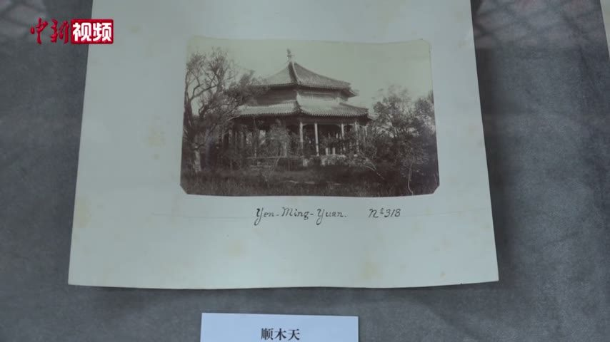

<!-- generated:start (scripts/building_pages.py): do not edit between these markers -->

# YM52: 顺木天 Shunmu Tian

Yuanming Yuan

**3D object:** 1 box. Open it: `/reconstruction/3d.html?b=YM52`

## What we know

- **Name:** 顺木天 Shunmu Tian (S06, S01, S337, S361 · confidence B)
- **Garden:** Yuanming Yuan (S06, S01, S337, S361)
- **Type:** compound (S06, S01, S337, S361 · confidence B)
- **Destroyed:** survived 1860 per 1873 survey (S06); survived 1860; later loss (S06, S01, S337, S361)
- **Position:** 40.01122, 116.28656. S01 sure (S01 · confidence B)
- **Note:** Named only in the 1873 survey via S06. Not in S05 j80-82. Position: plan readers. octagonal pavilion (S361, v3 p.118). (S06, S01, S337, S361)
- **Plan reader's note:** Label beside an octagon inside a ring, with a crescent to the north. No detected block. (S01) *(research copy, not public)*
- **How it was read:** sure (S01) *(research copy, not public)*
- **Plan pixels:** 2152, 692 (S01) *(research copy, not public)*

## Our model now

1 boxes stand in this compound, 1 on blocks drawn on the plan, 0 assumed. Its halls are listed below.

## Inside it (1)

- YM52-N01 顺木天

## Pictures (1)

- **P0712** (likely): 顺木天 (exhibition label); mount inscribed Yen-Ming-Yuan Nº 318 (1882, as said in the clip by 刘阳 Liu Yang (S650); S651 gives 1882 for Semalle). https://commons.wikimedia.org/wiki/File:2021-02-24_圆明园中西建筑如何过渡_未彻底损毁前珍贵影像公布.webm Research-only: link card.

  

## Texts and drawings (7)

- **E2354** (poem, sure): 顺木天 and 学圃: note on 景暉樓. 乾隆二十六年 1761 · KR4f0005_176:4b · S201. https://github.com/kanripo/KR4f0005
  > 木天思栁著（是處藝果種蔬亭曰順木天圃曰學圃）學圃緬樊諏
  The note makes clear that 顺木天 is a pavilion in the fruit and vegetable plot called 学圃. The 学圃 of QC70 in Qichun Yuan is a different place.
- **E0451** (text, sure): 圆明园遗址的遗产价值与申遗构想: the buildings left after 1860, citing 刘敦桢 1933. post n.d. · ylfj, note 34: 刘敦桢, 同治重修圆明园史料, 营造学社汇刊 1933(2) · S337. http://iqh.ruc.edu.cn/old/qdhjylyjzx/xszl/ylfj/9a322b5384ab4c17af0dd577d4f96ca6.htm
  Lists 17 buildings left after the burning of 1860, after 刘敦桢: 紫碧山房, 顺木天, 鱼跃鸢飞, 课农轩, 藏舟坞, 慎修思永, 知过堂, 双鹤斋, 蓬岛瑶台, 魁星楼, 文昌阁, 林渊锦镜, 春雨轩; 海岳开襟; 庄严法界, 正觉寺 and a 大宫门 in 万春园. The paper's aim is to hold any new display to this 1860 state.
- **E2353** (poem, sure): 顺木天（学圃）: 乾隆二十四年 poem of the Qianlong Emperor. 乾隆二十四年 (1759), date from the compilation · p.203 item (1), under 顺木天（学圃） · S360. https://www.yuanmingyuanpark.cn/xs/yjbg/202007/P020200730387572832602.pdf#page=203
  > 北村有隙地，种树还艺蔬。清溪贯其间，不井可辘轳。将谓无愁旱，川涸圃渐枯。乃悟凡百为，省力非良图。” “雨足百糓滋，我圃亦日好。烟甲黄转绿，萎叶润苏槁。果可待秋实，菜即摘露晓。圃人乃色欣，资益良不少。高谢汉阴翁，懃恁瓮自抱。”“年年问所获，不偿灌艺资。信斯恒失利，外应无圃师。我非事辜榷，人情亦欲知。为公与自为，所差在毫厘。既惭彼刍荛，小节应听之。”“樊迟请学圃，子云小人哉。偶观自无碍，町疃左右开。顺木为政方，佐糓祈年怀。”“漾舟进圃门，夹岸菁葱美。云凑又霏丝，便因观雨里。既易寜忘艰，对此还思彼。于焉乐生意，亦以参物理。光明祝匏瓜，吾谋非为己。
  Poem of the Qianlong Emperor at 顺木天（学圃）, 1759. Year as given by the compilation.
- **E2355** (poem, sure): 顺木天（学圃）: 嘉庆三年 poem of the Jiaqing Emperor. 嘉庆三年 (1798), date from the compilation · p.203 item (2), under 顺木天（学圃） · S360. https://www.yuanmingyuanpark.cn/xs/yjbg/202007/P020200730387572832602.pdf#page=203
  > 为学知不足，古籍宜时亲。莅政必探本，法言守先民。要道傅精一，君德止于仁。九有皆胞与，推诚接臣邻。就将勉践行，风俗思化淳。所慰邪略戢，尤愿靖蜀尘。调御愧乏术，品类难陶甄。修已安百姓，孔训宜遵循。
  Poem of the Jiaqing Emperor at 顺木天（学圃）, 1798. Year as given by the compilation.
- **E1276** (description, sure): 圆明园景点建筑命名对古代文学遗产的继承与发展. post n.d. · lswh · S337. http://iqh.ruc.edu.cn/old/qdhjylyjzx/xszl/jzys/dede1cad62ea454f85d22aca8ad15328.htm
  How scene and hall names come from literature: 上下天光 from 范仲淹, 杏花春馆 from 杜牧, 武陵春色 from 陶渊明, 坐石临流 from 兰亭, and 丰乐轩 and 顺木天 from 柳宗元. It also quotes the 陶渊明 line 平畴交远风. It places 丰乐轩, three bays facing north, in the 紫碧山房 scene.
- **E2356** (description, sure): 圆明园百景史事分景汇编: 顺木天（学圃）. 1759-1798 · from p.203, under 紫碧山房 · S360. https://www.yuanmingyuanpark.cn/xs/yjbg/202007/P020200730387572832602.pdf#page=203
  顺木天（学圃）: 2 dated items, 1759-1798, of which 2 poems (Qianlong, Jiaqing). First dated 1759, last dated 1798.
- **E2315** (description, sure): 圆明园五朝御制诗文集注 v3, editors' note on 紫碧山房. 2020 edition · v3 p.118 · S361. https://www.yuanmingyuanpark.cn/xs/yjbg/202008/P020200803382569071850.pdf#page=121
  Enlarged about 1760: inner gate, 含余清, the octagonal 翼翠亭, 丰乐轩, 纳翠轩, the boat-shaped 石帆室, the three-storey 景晖楼, 横云堂, a five-bay main hall 乐在人和, 澄素楼, 霁华楼. After 1860 the inner gate, main hall and 顺木天 pavilion survived under guard and were lost around 1900, say the editors.

**On the plan:** Drawn on the plan of the gardens (S01), labelled 顺木天. https://artmuseum.princeton.edu/collections/objects/138657

## Evidence for the set of buildings

- Reconstructions and comparables for the whole garden, 圆明园 Yuanming Yuan: see GARDEN-YM

## Open questions

- Q54: Timber buildings standing in 1882 (Round 5)
- Q138: E0451 (刘敦桢 via S337) lists 17 buildings left after 1860, eight of them in wave-2 scenes (Y

<!-- generated:end -->

## Notes

<!-- Yours: regeneration never touches this part. It goes on the public site; what you write below a line holding only %% private %% stays in the research copy. -->
