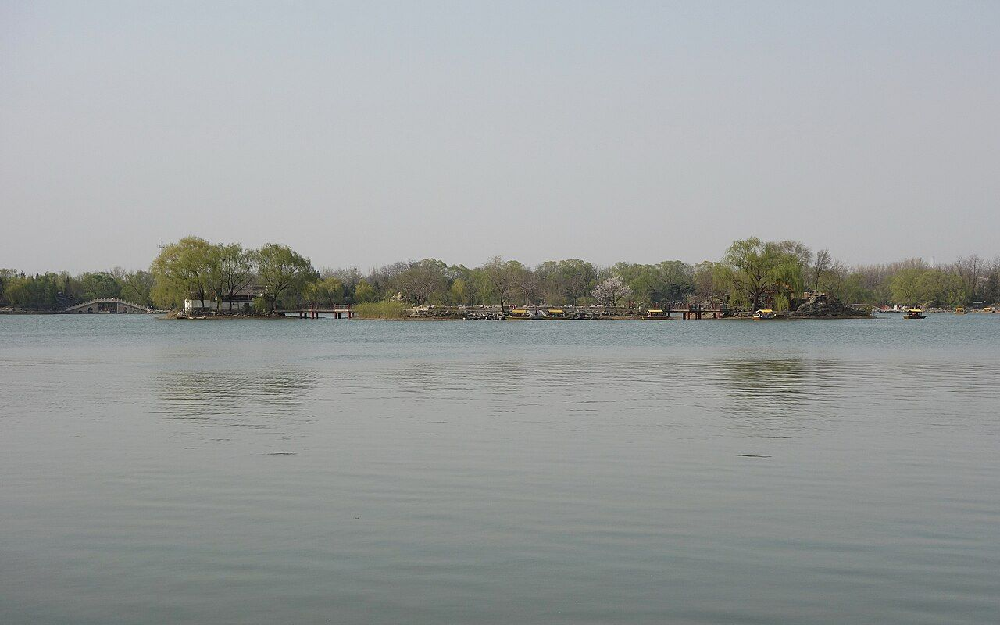
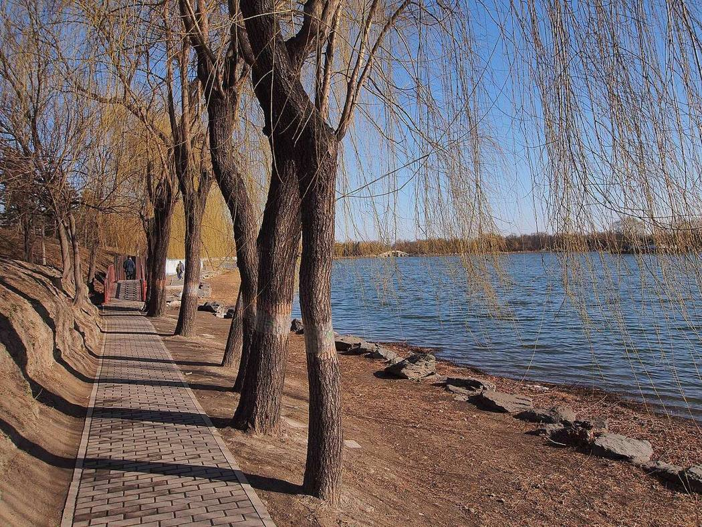
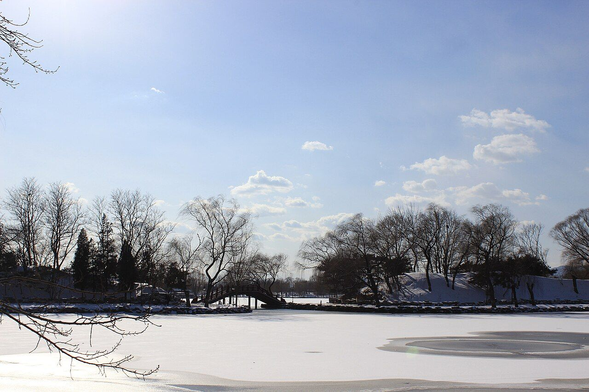

<!-- generated:start (scripts/building_pages.py): do not edit between these markers -->

# YM54: 福海 Fu Hai

The Happy Sea (Malone p.93) · Yuanming Yuan

**3D object:** none yet.

## What we know

- **Name:** 福海 Fu Hai (S05, S02, S01 · confidence B)
- **English:** The Happy Sea (Malone p.93) (S05, S02, S01)
- **Garden:** Yuanming Yuan (S05, S02, S01)
- **Type:** other (S05, S02, S01 · confidence B)
- **Destroyed:** n/a (water) (S05, S02, S01)
- **Position:** 40.00768, 116.29835. S01 sure (S01 · confidence B)
- **Note:** Lake, not destroyed. Malone: almost half a mile a side. 周廣凡數頃. Lower level 44.14 m near 澡身浴德 (S41 from the 1965 survey). Stone edge removed 1960s (S06). (S05, S02, S01)
- **Plan reader's note:** Label (6990,3210) beside Malone 32. Polygon simplified from region R0002. (S01) *(research copy, not public)*
- **How it was read:** sure (S01) *(research copy, not public)*
- **Plan pixels:** 6990, 3210 (S01) *(research copy, not public)*

## Our model now

No box in the 3D view: the plan shows no building here, or a plot, water, a hill or a name only.

## Pictures (3)

- **P0387** (sure): 蓬岛瑶台 20130414.JPG (2013-04-14 16:15:23 (Commons DateTimeOriginal)). https://commons.wikimedia.org/wiki/File:%E8%93%AC%E5%B2%9B%E7%91%B6%E5%8F%B0_20130414.JPG

  

- **P0393** (sure): 福海西岸 - West Bank of Fuhai Lake - 2013.03 - panoramio.jpg (Taken on 13 March 2013 (Commons DateTimeOriginal)). https://commons.wikimedia.org/wiki/File:%E7%A6%8F%E6%B5%B7%E8%A5%BF%E5%B2%B8_-_West_Bank_of_Fuhai_Lake_-_2013.03_-_panoramio.jpg

  

- **P0394** (likely): 圆明园 福海 (60359218).jpeg (8 February 2014, 19:41:22 (UTC) (Commons DateTimeOriginal)). https://commons.wikimedia.org/wiki/File:%E5%9C%86%E6%98%8E%E5%9B%AD_%E7%A6%8F%E6%B5%B7_(60359218).jpeg

  

## Texts and drawings (36)

- **E1870** (text, sure): 日下舊聞考 澡身浴德、福海. 1780s (乾隆 敕撰) · j82:14a-14b · S05. https://github.com/kanripo/KR2k0036/blob/master/KR2k0036_082.txt
  > 澡身浴徳在福海西南隅即澄虛榭正宇三楹東嚮南為含清暉北為涵妙識折而西向為静香館又西為解愠書屋西南為曠然閣（圓明園册）臣等謹按福海亦稱東湖周廣凡數頃澡身浴徳四十景之一也額為皇上御書聫曰好雨知時岑巒添逺碧薰風叶奏殿閣有餘清亦御書
  In the south-west corner of 福海: 澡身浴徳, the three-bay 澄虛榭 facing east, with 含清暉, 涵妙識, 静香館, 解愠書屋 and 曠然閣. The note calls 福海 also 東湖 East Lake, several qing around.
- **E1912** (text, sure): 日下舊聞考 平湖秋月、福海. 1780s (乾隆 敕撰) · j82:15b · S05. https://github.com/kanripo/KR2k0036/blob/master/KR2k0036_082.txt
  > 平湖秋月在福海西北隅正宇三楹西為流水音東北出山口臨河為花嶼蘭皋折而東南度橋為兩峯挿雲又東南為山水樂其北為君子軒為藏密樓（圓明園册）臣等謹按平湖秋月四十景之一額為世宗御書流水音花嶼蘭皋諸額為皇上御書
  In the north-west corner of 福海: 平湖秋月, three bays, with 流水音, 花嶼蘭皋, 兩峯挿雲, 山水樂, 君子軒 and 藏密樓.
- **E1933** (text, sure): 日下舊聞考 蓬岛瑶台、福海. 1780s (乾隆 敕撰) · j82:16b-17a · S05. https://github.com/kanripo/KR2k0036/blob/master/KR2k0036_082.txt
  > 蓬島瑶臺在福海中央門三楹南嚮正殿七楹殿前東為暢襟樓西為神洲三島東偏為隨安室西偏為日日平安報好音由蓬島瑶臺東南度橋為東島有亭為瀛海仙山西北度橋為北島正宇三楹（圓明園册）臣等謹按蓬島瑶臺四十景之一舊名蓬萊洲後易今名額為皇上御書門額曰鏡中閣與暢襟樓隨安室額皆御書神洲三島日日平安報好音瀛海仙山諸額皆世宗御書
  Centre of 福海: a three-bay gate facing south and seven-bay main hall, with 暢襟樓, 神洲三島, 隨安室 and 日日平安報好音; bridges to an east isle with the pavilion 瀛海仙山 and a north isle with a three-bay range. Formerly 蓬萊洲.
- **E1954** (text, sure): 日下舊聞考 接秀山房、福海. 1780s (乾隆 敕撰) · j82:17b-18a · S05. https://github.com/kanripo/KR2k0036/blob/master/KR2k0036_082.txt
  > 接秀山房在福海東隅正宇三楹西嚮後稍東為琴趣軒其北方樓為尋雲東南為澄練樓樓後為怡然書屋尋雲樓稍東佛室為安隠幢接秀山房之南為攬翠亭（圓明園册）臣等謹按接秀山房四十景之一與攬翠亭額皆世宗御書琴趣軒尋雲諸額皆皇上御書
  East of 福海: 接秀山房, three bays facing west, with 琴趣軒, the square tower 尋雲, 澄練樓, 怡然書屋, the Buddha room 安隠幢 and 攬翠亭.
- **E2015** (text, sure): 日下舊聞考 涵虚朗鉴、福海. 1780s (乾隆 敕撰) · j82:21a-21b · S05. https://github.com/kanripo/KR2k0036/blob/master/KR2k0036_082.txt
  > 涵虛朗鑑在福海東即雷峯夕照正宇其北稍西為惠如春又東北為尋雲榭又北為貽蘭庭為會心不逺其南為臨衆芳為雲錦墅為菊秀松㽔為萬景天全（明圓園册）臣等謹按涵虛朗鑑四十景之一額為皇上御書舊懸湖西澄虛榭後移置湖東雷峯夕照軒宇内惠如春尋雲榭諸額亦御書
  East of 福海: 涵虛朗鑑, the main range of 雷峯夕照, with 惠如春, 尋雲榭, 貽蘭庭, 會心不逺, 臨衆芳, 雲錦墅, 菊秀松㽔 and 萬景天全. The plaque first hung at 澄虛榭 on the west shore and was moved here, which explains why the 1744 preface places the scene on the west.
- **E2032** (text, sure): 日下舊聞考 廓然大公、福海. 1780s (乾隆 敕撰) · j82:22b-23a · S05. https://github.com/kanripo/KR2k0036/blob/master/KR2k0036_082.txt
  > 福海西北隅平湖秋月之西為廓然大公正宇七楹前為雙鶴齋西北為規月橋東北為綺吟堂又北為採芝徑又北徑巖洞而西為峭蒨居北垣門外有樓為天真可佳峭蒨居西為披雲徑又西亭為啟秀又西稍南為韻石淙西北平臺臨池為芰荷深處垣外為影山樓雙鶴齋西為環秀山房西北為臨湖樓（圓明園册）臣等謹按廓然大公四十景之一額為皇上御書雙鶴齋採芝徑天真可佳芰荷深處影山樓環秀山房臨湖樓諸額皆世宗御書峭蒨居披雲徑諸額皆皇上御書
  West of 平湖秋月: 廓然大公, seven bays, with 雙鶴齋 in front, the 規月橋, 綺吟堂, 採芝徑, 峭蒨居, 天真可佳, 披雲徑, 啟秀, 韻石淙, 芰荷深處, 影山樓, 環秀山房 and 臨湖樓.
- **E2359** (poem, sure): 御製 句為韻賦詩原韻. 1762 (御製詩三集) · KR4f0005_188:8a-9a · S201. https://github.com/kanripo/KR4f0005/blob/master/KR4f0005_188.txt
  > 句為韻賦詩原韻 …福海一百頃（御園東池為福海也皇考時所命名）周遭十一橋…
  Part of a long poem of 1762. It calls the lake a hundred qing round, with eleven bridges, and the note says the east lake of the garden is 福海, named by Yongzheng.
- **E1927** (poem, sure): 御製 端陽日奉皇太后觀龍舟. 1764 (御製詩三集) · KR4f0005_202:11b-12a · S201. https://github.com/kanripo/KR4f0005/blob/master/KR4f0005_202.txt
  > 端陽日奉皇太后觀龍舟 麥臨芒種蔚禾田應莭亶宜侍糉筵沅浦寜須問芳芷湯泉恰已貢新蓮欣陪鳯扇如恒月訝指龍舟忽隔年蓬島瑶䑓（在福海中為圓明園四十）（景之一嵗嵗扵此奉皇太后觀龍舟）仙樂奏董雙成至按氷絃
  Dragon boat day. His note says that every year he brought his mother to 蓬島瑶臺 to watch the boats.
- **E1929** (poem, sure): 御製 蓬島瑤臺. 1772 (御製詩四集) · KR4f0005_282:2a · S201. https://github.com/kanripo/KR4f0005/blob/master/KR4f0005_282.txt
  > 蓬島瑤臺 蓬島瑶臺福海中（蓬島瑶臺圓明圍四十景之一福海亦舊名也）往來祇藉舟相通昨近冰脆魚陟負拕床弗可舟艱衝還宮四日倐瞥眼再來春水呈溶溶鳴榔直到鏡中閣（臺南門也）迴看畫舫浮雲空若臺若榭皆熟境庭松峙翠盆花紅不如可望不可即引人企思翻無窮
  Reached only by boat, and over ice when the water is frozen. His note calls 鏡中閣 the south gate of the terrace, and he mentions courtyard pines and potted flowers.
- **E1942** (poem, sure): 御製 暢襟樓. 1796 (御製詩餘集) · KR4f0005_500:9b · S201. https://github.com/kanripo/KR4f0005/blob/master/KR4f0005_500.txt
  > 暢襟樓 樓據湖中央（是湖為園中㝡廣廓者向名福海）四面雅宜望因有暢襟名畫意鏡面漾是實還是虚胸襟原可暢而我值盼捷南瞻益惆悵似樓隠笑人底須拾級訪
  Written in retirement. The tower stands in the middle of the lake that the note calls the widest in the garden, 福海.
- **E0415** (poem, sure): 王闓運 圓明園詞. 1871 (同治十年) · whole poem; copy without the 自注 · S203. https://www.douban.com/group/topic/46378693/
  > 宜春苑中萤火飞，建章长乐柳十围。 离宫从来奉游豫，皇居那复在郊圻？ 旧池澄绿流燕蓟，洗马高梁游牧地。 北藩本镇故元都，西山自拥兴王气。 九衢尘起暗连天，辰极星移北斗边。 沟洫填淤成斥卤，宫庭映带觅泉原。 渟泓稍见丹棱泮，陂陀先起畅春园。 畅春风光秀南苑，霓旌凤盖长游宴。 地灵不惜瓮山湖，天题更创圆明殿。 圆明始赐在潜龙，因回邸第作郊宫。 十八篱门随曲涧，七楹正殿倚乔松。 轩堂四十皆依水，山石参差尽亚风。 甘泉避暑因留跸，长杨扈从且弢弓。 纯皇缵业当全盛，江海无波待游幸。 行所留连赏四园，画师写放开双境。 谁道江南风景佳，移天缩地在君怀。 当时只拟成灵囿，小费何曾数露台。 殷勤毋佚箴骄念，岂意元皇失恭俭！ 秋狝俄闻罢木兰，妖氛暗已传离坎。 吏治陵迟民困痛，长鲸跋浪海波枯。 始惊计吏忧财赋，欲卖行宫助转输。 沉吟五十年前事，厝火薪边然已至。 揭竿敢欲犯阿房，探丸早见诛文吏。 此时先帝见忧危，诏选三臣出视师。 宣室无人侍前席，郊坛有恨哭遗黎。 年年辇路看春草，处处伤心对花鸟。 玉女投壶强笑歌，金杯掷酒连昏晓。 四时景物爱郊居，玄冬入内望春初。 袅袅四春随凤辇，沉沉五夜递铜鱼。 内装颇学崔家髻，讽谏频除姜后珥。 玉路旋悲车毂鸣，金銮莫问残灯事。 鼎湖弓剑恨空还，郊垒风烟一炬间。 玉泉悲咽昆明塞，惟有铜犀守荆棘。 青芝岫里狐夜啼，绣漪桥下鱼空泣。 何人老监福园门，曾缀朝班奉至尊。 昔日暄阗厌朝贵，于今寂寞喜游人。 游人朝贵殊暄寂，偶来无复金闺客。 贤良门闭有残砖，光明殿毁寻颓壁。 文宗新构清辉堂，为近前湖纳晓光。 妖梦林神辞二品，佛城舍卫散诸方。 湖中蒲稗依依长，阶前蒿艾萧萧响。 枯树重抽盗作薪，游鳞暂跃惊逢网。 别有开云镂月台，太平三圣昔同来。 宁知乱竹侵苔落，不见春风泣露开。 平湖西去轩亭在，题壁银钩连倒薤。 金梯步步度莲花，绿窗处处留蠃黛。 当时仓卒动铃驼，守宫上直余嫔娥。 芦笳短吹随秋月，豆粥长饥望热河。 上东门开胡雏过，正有王公班道左。 敌兵未爇雍门荻，牧童已见骊山火。 应怜蓬岛一孤臣，欲持高洁比灵均。 丞相避兵生取节，徒人拒寇死当门。 即今福海冤如海，谁信神州尚有神！ 百年成毁何匆促，四海荒残如在目。 丹城紫禁犹可归，岂闻江燕巢林木？ 废宇倾基君好看，艰危始识中兴难。 已惩御史言修复，休遣中官织锦纨。 锦纨枉竭江南赋，鸳文龙爪新还故。 总饶结彩大宫门，何如旧日西湖路。 西湖地薄比郇瑕，武清暂住已倾家。 惟应鱼稻资民利，莫教莺柳斗宫花。 词臣讵解论都赋，挽辂难移幸雒车。 相如徒有上林颂，不遇良时空自嗟。
  A long lament on the garden's rise and destruction. It names the eighteen fence gates, the seven-bay main hall and forty halls by water, then the ruined 賢良門 and 光明殿, the new 清輝堂 of Xianfeng, 舍衛城, 鏤月開雲, and 福海 where the official 文豐 died.
- **E0441** (text, sure): 清稗類鈔 宮苑類 圓明園被灾. 1917 · line 2096 of the corpus file · S214. https://github.com/garychowcmu/daizhigev20/blob/master/子藏/类书/清稗类钞.txt
  > 圆明园被灾咸丰庚申十月十六日，英法联军至天津，文宗方园居，闻敌至通州，仓卒率后妃幸热河。十九日，英人至圆明园宫门，管园大臣文丰当门说止之。敌兵已去，文知奸人必乘间起，守卫禁兵无一在者，索马还内，投福海死。奸人乘时纵火，入宫劫掠，敌兵从之，火三昼夜不熄。
  Its account of 1860 repeats the 徐樹鈞 preface: the official 文豐 drowns himself in 福海 and local robbers start the fires. See the question on this claim.
- **E1889** (text, sure): 養吉齋叢錄 卷十四. mid-19th c. (printed 1890s), on earlier reigns · 卷十四, line 954 of the corpus file · S202. https://raw.githubusercontent.com/garychowcmu/daizhigev20/master/%E5%8F%B2%E8%97%8F/%E5%BF%97%E5%AD%98%E8%AE%B0%E5%BD%95/%E5%85%BB%E5%90%89%E6%96%8B%E4%B8%9B%E5%BD%95.txt
  > 自后遇午日，宫中每以龙舟酬节。圣祖御制有五日泛舟赐大臣侍卫宴诗。乾隆间，五日则奉慈舆至御园观龙舟。圣驾在望瀛洲，亭名。王公大臣及内廷诃臣亦得与宴赏。其东则蓬岛、瑶台，皇太后观竞渡处也。嘉庆间，移于澄虚榭宴赏。高宗诗云：「中流九龙舟，谁肯相参差。」仁宗诗云：「九龙顺轨原无竞。」据此可识龙舟之数。又按：北地四、五月往往少雨，如届节未沛甘霖，即罢此戏。道光初年，尚沿竞 渡故事。其后停止。
  Dragon boat day on 福海: the emperor in the 望瀛洲 pavilion under Qianlong with his mother on the 蓬島瑶臺 to the east; moved to 澄虛榭 under Jiaqing; stopped under Daoguang. Nine boats by the poems.
- **E2363** (text, sure): 嘯亭續錄 卷一. early 19th c. · 卷一 · S205. https://zh.wikisource.org/wiki/嘯亭雜錄
  > 乾隆初，上於端午日命内侍习竞渡於福海中，皆畫船箫鼓，飛龍{{PUA|}}首，絡繹於鲸波怒浪之間。蘭桡鼓动，旌旗荡漾，颇有江乡竞渡之意。每召近侍王公觀阅，以聯上下之情。今上親政后，亦屡循舊制觀之，然每以雨澤愆期，罢演者多矣。
  Early in Qianlong's reign the dragon boat race on 福海 used painted boats with music. Under Jiaqing it was often cancelled when the rains failed.
- **E2364** (text, sure): 嘯亭雜錄 卷一. early 19th c. · 卷一 · S205. https://zh.wikisource.org/wiki/嘯亭雜錄
  > 世宗馭下嚴肅，然每假以辭色，以聯上下之情。丙午秋，特宴文武大僚於乾清宮，賦詩飲酒。每佳時令節，必賜諸王大臣遊宴，泛舟福海，賞花釣魚，竟日乃散。故當時堂廉之間，歡若父子，無不可達之情也。
  Yongzheng invited princes and ministers on festival days to boat on 福海, enjoy flowers and fish, and stay all day.
- **E0445** (text, guess): 清史稿 文宗本紀 咸豐十年八月癸未. 1927, on 1860 · 卷二十, 咸豐十年八月癸未 · S204. https://zh.wikisource.org/wiki/清史稿/卷20
  > 圓明園災，常嬪薨，內務府大臣、尚書文豐死之。
  The official record says only that the garden had a disaster by fire, that the imperial concubine 常嬪 died and that the official 文豐 died. It names no one as responsible at this place.
- **E2362** (text, guess): 養吉齋叢錄 卷十四. mid-19th c. (printed 1890s), on earlier reigns · 卷十四, line 960 of the corpus file · S202. https://raw.githubusercontent.com/garychowcmu/daizhigev20/master/%E5%8F%B2%E8%97%8F/%E5%BF%97%E5%AD%98%E8%AE%B0%E5%BD%95/%E5%85%BB%E5%90%89%E6%96%8B%E4%B8%9B%E5%BD%95.txt
  > 乾隆间，放河灯多在御园湖中，或在山庄，则亦设盂兰盆，放河灯。高宗尝言，山庄盂兰盆及河灯，所费不过数百金也。
  Water lanterns were mostly set on the garden's lake under Qianlong; the text names no lake.
- **E2358** (poem, sure): 福海: 乾隆六年 poem of the Qianlong Emperor. 乾隆六年 (1741), date from the compilation · p.253 item (2), under 福海 · S360. https://www.yuanmingyuanpark.cn/xs/yjbg/202007/P020200730387572832602.pdf#page=253
  > 太液微风漾，轻舟任所之。可知娱目地，总是读书时。比德观荷芰，忘机狎鹭鸶。卧游看未足，烟景座中移。
  Poem of the Qianlong Emperor at 福海, 1741, on the view. Year as given by the compilation.
- **E2360** (poem, sure): 福海: 乾隆三十年 poem of the Qianlong Emperor. 乾隆三十年 (1765), date from the compilation · p.253 item (6), under 福海 · S360. https://www.yuanmingyuanpark.cn/xs/yjbg/202007/P020200730387572832602.pdf#page=253
  > 又泛平安月镜居（舟名泛月所恒御）冰轮高烛皎含虚。蛮笺象管相陪处，昨岁景光昨夕如。木兰沙浦好乘凉，䨲影相将送夕阳。却是微风工凑拍，闪轻金縠卷银塘。望前雅合早登舟，一捻钩痕见举头。日渐移东渐升晚，再生西已是金秋。影蘸楼台香度荷，小游不问夜如何。（每泛月不过戌末而罢从未入夜）御湖清概还如昔，祗觉星星点鬓多。
  Poem of the Qianlong Emperor at 福海, 1765, on boating. Year as given by the compilation.
- **E2361** (poem, sure): 福海: 乾隆三十七年 poem of the Qianlong Emperor. 乾隆三十七年 (1772), date from the compilation · p.253 item (7), under 福海 · S360. https://www.yuanmingyuanpark.cn/xs/yjbg/202007/P020200730387572832602.pdf#page=253
  > 蓬岛瑶台福海中， （蓬岛瑶台圆明围四十景之一福海亦旧名也）往来祇藉舟相通。昨近冰脆鱼陟负，拕床弗可舟艰冲。还宫四日倐瞥眼，再来春水呈溶溶。鸣榔直到镜中阁，（台南门也）回看画舫浮云空。若台若榭皆熟境，庭松峙翠盆花红。不如可望不可即，引人企思翻无穷。
  Poem of the Qianlong Emperor at 福海, 1772, on boating and the view. Year as given by the compilation.
- **E1951** (poem, sure): 观澜堂: 嘉庆二十四年 poem of the Jiaqing Emperor. 嘉庆二十四年 (1819), date from the compilation · p.272 item (1), under 观澜堂 · S360. https://www.yuanmingyuanpark.cn/xs/yjbg/202007/P020200730387572832602.pdf#page=272
  > 福海新波千顷宽， 堂开东岸对漪澜。金鳞映日轻霞漾，碧浪含风薄縠攒。和蔼韶光明远岫，微茫云影印遥滩。田功肇始仲春届，观我观民得大观。
  Poem of the Jiaqing Emperor at 观澜堂, 1819, on the view. Year as given by the compilation.
- **E1952** (poem, sure): 观澜堂: 嘉庆二十四年 poem of the Jiaqing Emperor. 嘉庆二十四年 (1819), date from the compilation · p.273 item (2), under 观澜堂 · S360. https://www.yuanmingyuanpark.cn/xs/yjbg/202007/P020200730387572832602.pdf#page=273
  > 八窗印晴晖，空明临碧沼。远岭写春霞，绮影绘天表。蓬岛水中央，金碧浮㵿渺。漪澜送暖飔，岸角迭环绕。昨岁驻渝关，沧溟观浩淼。心境养虚明，眼界随大小。
  Poem of the Jiaqing Emperor at 观澜堂, 1819, on the view. Year as given by the compilation.
- **E1953** (poem, sure): 观澜堂: 咸丰七年 poem of the Xianfeng Emperor. 咸丰七年 (1857), date from the compilation · p.274 item (13), under 观澜堂 · S360. https://www.yuanmingyuanpark.cn/xs/yjbg/202007/P020200730387572832602.pdf#page=274
  > 御苑东偏蓬岛南，山妆翠髻水拖蓝。连云远树分浓淡，点浪轻鸥见两三。鼓枻湖心波皛皛，停桡岸角柳毶毶。虚堂旷览足怡悦，霁景澄鲜上下含。
  Poem of the Xianfeng Emperor at 观澜堂, 1857, on boating. Year as given by the compilation.
- **E2366** (description, sure): Attiret: shores of 福海, aviaries and fish. 1743 · [pp.17-20] · S157. https://faculty.bard.edu/~louis/gardens/attiretaccount.html
  > It takes up a very large Space; and is all surrounded with a Lattice-work of Brass-wire: in which the Openings are so very fine and small, as to prevent the fish from wandering into the main waters.
  Quays of smooth stone or rock-work, terraces, palaces rising in tiers, groves of several kinds. Network houses half in the water for waterfowl, small menageries, and the largest fish reservoir, closed by brass wire. Which shore is not stated.
- **E2367** (description, sure): Attiret: 福海 and 蓬岛瑶台. 1743 · [pp.16-17] · S157. https://faculty.bard.edu/~louis/gardens/attiretaccount.html
  > But what is the most charming Thing of all, is an Island or Rock in the Middle of this Sea; rais'd, in a natural and rustic Manner, about Six Foot above the Surface of the Water. On this Rock there is a little Palace; which however contains a hundred different Apartments. It has Four Fronts;
  Lake near five miles round in this translation. Island palace on a rock about 6 ft above the water, a hundred rooms, four fronts, with views of all shores. Identified with 福海 by S02 p.135.
- **E2368** (description, sure): Attiret: 福海 with boats and fireworks. 1743 · [pp.20-21] · S157. https://faculty.bard.edu/~louis/gardens/attiretaccount.html
  > but above all, on some fine Night, when the Fire-works are play'd off there; at which time they have Illuminations in all the Palaces, all the Boats, and almost on every Tree.
  Gilt and varnished boats for air, fishing and water jousts; fireworks and illuminations.
- **E1524** (description, sure): 玉明 侍游御園記 (in 蕉軒隨錄). 1856 (咸豐六年七月二十一日) · 蕉軒隨錄, 御園侍游 (line 336 of the corpus file) · S210. https://github.com/garychowcmu/daizhigev20/blob/master/史藏/志存记录/蕉轩随录.txt
  > ◎御园侍游玉将军（明）有《侍游御园记》，成竹坪同年（林）曾属予代作跋语，恭书于后。按，《记》云：“咸丰六年秋七月二十一日，奉旨：本日散朝后，著玉明、肃顺自备鞍马，午初一刻进西南门，在山高水长伺候。有顷，上从内乘船，至山高水长后阁扇下船，出前门，谕玉明、肃顺暨珠勒亨、西拉布、托云、德勒格尔、伊勒东阿等脱去外褂。上乘马，命七臣随行。自山高水长游藻园，至厂地，过汇芳书院，复由紫碧山房至鱼跃鸢飞少坐。过蕊珠宫门，至黄花磴进茶毕，往西洋楼海宴堂，至转马台，过小角门，至狮子林清淑斋赏饭。左右四卓，命七臣坐，并奉温谕可饱食，非外边筵宴比也。上命膳房先给七臣面各一器，上进面，复进饭，颁赏御用菜蔬，七臣叩头谢。上进粥，复赏粥毕。随驾起行，由宝相寺、法慧寺、谐奇趣过明春门，至雷峰夕照马头，坐如在天上船，游福海。上命笔砚作诗毕，至渊氵亭镜澈马头下船。进丽春门骑马，由旧园东墙根过敷春堂，游西大堤汉城关，至含辉楼下马，命七臣散归。玉明自道光十一年由侍卫擢厕御前二十余年，仰邀优渥，得遍瞻御园盛景。欣感之余，谨作记以纪荣遇。”
  A rare first-hand record of a day in the garden four years before its destruction. The emperor takes seven officials by a named route from 山高水長 through 藻園, 彚芳書院, 紫碧山房 and 魚躍鳶飛, past 蕊珠宫門, on to 海宴堂 in the 西洋樓, a meal at 清淑齋 in 獅子林, 寳相寺, 法慧寺, 諧奇趣, by boat on 福海, then 敷春堂 and 含暉楼. All were standing then.
- **E2370** (description, sure): 福海 Fu Hai, the Happy Sea. 1934 · p.93 · S02. https://archive.org/details/historyofpekings00malo
  > It was roughly square in shape, measured almost a half mile on a side, and contained three small but beautiful islands in the middle.
  Also called the East Lake, the largest lake of the garden, about half a mile a side, joined by a narrow opening to the lake before 方壶胜境. Eight of the forty views belong to it, scenes 30 to 37.
- **E2369** (description, likely): Wen Feng, keeper of the palace, drowned. 1934 · p.185 · S02. https://archive.org/details/historyofpekings00malo
  > The body was afterwards found in one of the lakes, and Hang-ki returned to Pekin.
  Chinese tradition has Wen Feng (文丰, my reading of the characters) drown himself in 福海 after the fall of the gate; Grant reports the search by 恒祺 Hengqi on 10 October and the finding of the body in one of the lakes. Grant also reports Chinese authorities reoccupied the place the day the French left, and five were put to death for looting.
- **E0528** (description, sure): 清宮詞 note. Republic period · line 540 of the corpus file · S215. https://github.com/garychowcmu/daizhigev20/blob/master/诗藏/词集/清宫词.txt
  Note: says British and French troops burned the garden on 八月二十二日 and looted 清漪 and 静明 on the next two days; 文豐 died in 福海 and 泰清's family died by fire.
- **E2019** (description, likely): 圆明园福海东岸历史建筑方位考, 圆明园研究 78期. 2024-03-04 · xs/ktsb/202403/t20240304_4643616 · S338. https://www.yuanmingyuanpark.cn/xs/ktsb/202403/t20240304_4643616.html
  Shows that plans disagree on which hall is which along the east shore of 福海: the 1936 Beiping survey, the 1979 He and Zeng plan and the 2010 百景图志 each label differently. Checking Yangshi Lei drawings and texts against the sites, it reads the surviving bases north to south as 贻兰亭, 会心不远, 寻云榭, 惠如春, 雷峰夕照, 临众芳, 云锦墅, 观澜堂. It notes no scientific dig has been done here.
- **E2365** (description, sure): 圆明园百景史事分景汇编: 福海. 1741-1858 · from p.253, under 蓬岛瑶台 · S360. https://www.yuanmingyuanpark.cn/xs/yjbg/202007/P020200730387572832602.pdf#page=253
  福海: 28 dated items, 1741-1858, of which 26 poems and 2 court records (Qianlong, Jiaqing, Daoguang, Xianfeng); recurring themes: boating, the view, escaping the heat. First dated 1741, last dated 1858.
- **E1956** (description, sure): 圆明园百景史事分景汇编: 观澜堂. 1819-1857 · from p.272, under 观澜堂 · S360. https://www.yuanmingyuanpark.cn/xs/yjbg/202007/P020200730387572832602.pdf#page=272
  The compiler says 观鱼跃 was pulled down about 1817 for a new south-facing hall of five bays in three rolls, like 慎德堂 and the largest on 福海. 观澜堂: 13 dated items, 1819-1857, of which 13 poems (Jiaqing, Daoguang, Xianfeng); recurring themes: the view, boating, rain. First dated 1819, last dated 1857.
- **E1875** (description, sure): 圆明园五朝御制诗文集注 v2, editors' note on 澡身浴德. 2020 edition · v2 p.336 · S361. https://www.yuanmingyuanpark.cn/xs/yjbg/202008/P020200803382343267004.pdf#page=339
  A three-bay hall 澄虚榭 facing east at the south-west of 福海, with 含清晖, 涵妙识, 静香馆, 解愠书屋, 旷然阁 near. North are 延真院, 溪山罨画, the square 望瀛洲, 深柳读书堂, 溪月松风. Emperors watched the dragon boats from here.
- **E1937** (description, sure): 圆明园五朝御制诗文集注 v2, editors' note on 蓬岛瑶台. 2020 edition · v2 p.388 · S361. https://www.yuanmingyuanpark.cn/xs/yjbg/202008/P020200803382343267004.pdf#page=391
  Yongzheng's 蓬莱洲, on the islands in 福海. Gate 镜中阁, seven-bay two-roll main hall with a five-bay annex, 畅襟楼, 神洲三岛, 留春殿, 日日平安报好音; an east island with a hexagonal pavilion and a north island. The editors say being in the water spared it in 1860, and it burned in the seventh month of 1870.
- **E1876** (description, sure): 圆明园百景史事分景汇编: 澡身浴德. undated · from p.258, under 澡身浴德 · S360. https://www.yuanmingyuanpark.cn/xs/yjbg/202007/P020200730387572832602.pdf#page=258
  The compiler describes 澄虚榭, a three-bay hall facing east at the south-west of 福海, and the square shore pavilion 望瀛洲 from which Qianlong watched dragon boats; Jiaqing watched from 澄虚榭. 澡身浴德: short note in the compilation, no dated items.

**On the plan:** Drawn on the plan of the gardens (S01), labelled 福海. https://artmuseum.princeton.edu/collections/objects/138657

## Evidence for the set of buildings

- Reconstructions and comparables for the whole garden, 圆明园 Yuanming Yuan: see GARDEN-YM

## Open questions

- Q1: Target state
- Q10: 涵虚朗鉴
- Q30: Water
- Q42: East shore of 福海
- Q52: Smaller conflicts

<!-- generated:end -->

## Notes

<!-- Yours: regeneration never touches this part. It goes on the public site; what you write below a line holding only %% private %% stays in the research copy. -->
