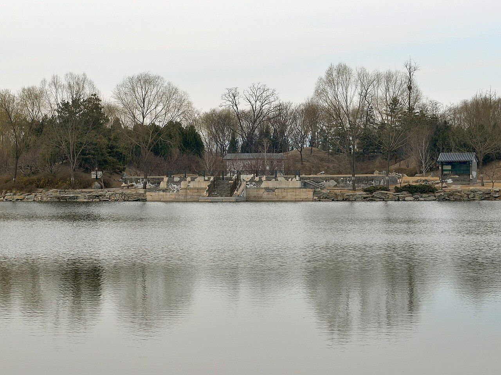
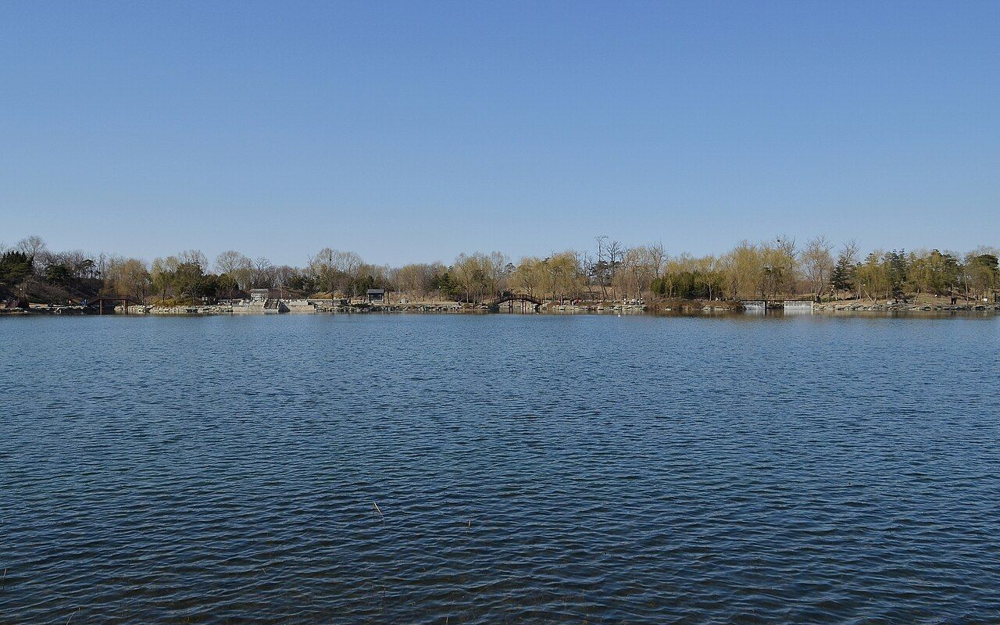
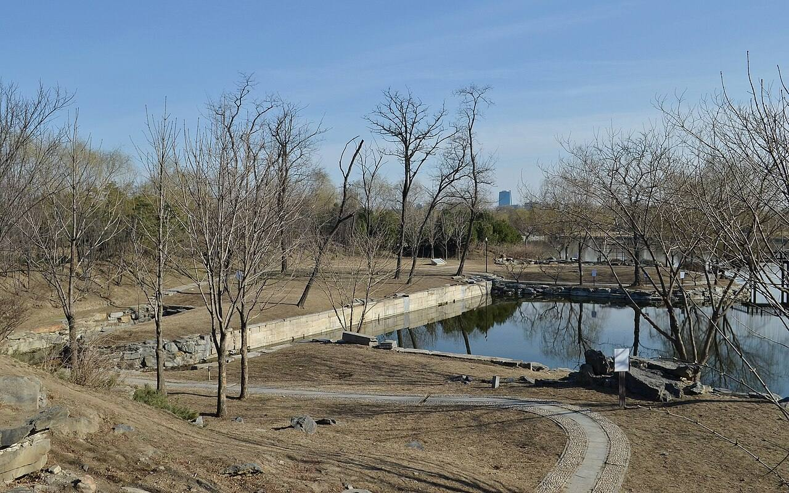

<!-- generated:start (scripts/building_pages.py): do not edit between these markers -->

# YM55: 后湖 Hou Hu

Back Lake (Malone p.79) · Yuanming Yuan

**3D object:** none yet.

## What we know

- **Name:** 后湖 Hou Hu (S05, S02, S01 · confidence B)
- **English:** Back Lake (Malone p.79) (S05, S02, S01)
- **Garden:** Yuanming Yuan (S05, S02, S01)
- **Type:** other (S05, S02, S01 · confidence B)
- **Destroyed:** n/a (water) (S05, S02, S01)
- **Position:** 40.00479, 116.29009. S01 sure (S01 · confidence B)
- **Note:** Ringed by nine islands YM03-YM11 (S02 p.79). (S05, S02, S01)
- **Plan reader's note:** Lake, region R0012; no polygon, it is water. Label written 後湖 (S01) *(research copy, not public)*
- **How it was read:** sure (S01) *(research copy, not public)*
- **Plan pixels:** 3310, 3930 (S01) *(research copy, not public)*

## Our model now

No box in the 3D view: the plan shows no building here, or a plot, water, a hill or a name only.

## Pictures (4)

- **P0373** (sure): 上下天光遗址 20130318.JPG (2013-03-18 15:40:29 (Commons DateTimeOriginal)). https://commons.wikimedia.org/wiki/File:%E4%B8%8A%E4%B8%8B%E5%A4%A9%E5%85%89%E9%81%97%E5%9D%80_20130318.JPG

  

- **P0395** (sure): Yuanmingyuan lake of Jiuzhou 20130324.JPG (2013-03-24 15:01:36 (Commons DateTimeOriginal)). https://commons.wikimedia.org/wiki/File:Yuanmingyuan_lake_of_Jiuzhou_20130324.JPG

  

- **P0372** (likely): 慈云普护遗址 20130324.JPG (2013-03-24 16:01:22 (Commons DateTimeOriginal)). https://commons.wikimedia.org/wiki/File:%E6%85%88%E4%BA%91%E6%99%AE%E6%8A%A4%E9%81%97%E5%9D%80_20130324.JPG

  

- **P0796** (guess): Yuanmingyuan lake1.jpg (not stated (Commons file page)). https://commons.wikimedia.org/wiki/File:Yuanmingyuan_lake1.jpg

## Texts and drawings (6)

- **E1129** (text, sure): 日下舊聞考 九洲清晏. 1780s (乾隆 敕撰) · j80:20b-23b · S05. https://github.com/kanripo/KR2k0036/blob/master/KR2k0036_080.txt
  > 正大光明後有湖亦稱前湖湖正北為圓明園殿五楹後為奉三無私殿七楹又後為九州清宴殿七楹東為天地一家春西為樂安和又西為清暉閣閣前為露香齋左為茹古堂為松雲樓右為涵徳書屋（圓明園冊）臣等謹按九州清宴額世宗御書四十景之一也前第一層殿恭懸聖祖御書圓明園額聨曰每對青山緑水㑹心處一邱一壑總自天恩浩蕩常從霽月光風悦目時一草一木莫非帝徳高深世宗藩邸時書聨曰恤小民之依所其無逸稽古人之徳彰厥有常皇上御書第二層為奉三無私殿内恭懸皇上御書聖祖仁皇帝聖訓曰天下之治亂休咎皆係人主之一身一心政令之設必當遠慮深謀以防後悔周詳籌度計及久長不可為近名邀利之舉不可用一已偏執之見採羣言以廣益合衆志以成城始為無偏無黨之道孝者百行之原不孝之人斷不可用義者萬事之本非義之事必不可為孝以立身義以制事無是二者雖君臣父子不能保也世宗憲皇帝聖訓曰敬天法祖勤政親賢愛民擇吏除暴安良勿過寛柔勿過嚴猛同氣至親實為一體誠心友愛休戚相闗時聞正言日行正事弗為小人所誘弗為邪説所惑聖祖所貽之宗室宜親國家所用之賢良宜保自然和氣致祥綿宗社萬年之慶額曰清虚靜泰聨曰澗泉無操琴泠然善也風竹有聲畫顧而樂之寳座聨曰所無逸而居動靜適徴仁智體有常以治照臨並叶清寜皇上御書九州清宴殿後額曰蔚然深秀聨曰紅篆爐烟看氣直緑苞庭竹愛心虛與樂安和清暉閣諸額皆御書清暉閣北壁懸圓明園全圖乾隆二年命畫院郎世寜唐岱孫祐沈源張萬邦丁觀鵬恭繪御題大觀二字並題聨曰稽古重圖書義存無逸三宗訓勤民咨稼穡事著豳風七月篇
  North across the lake behind the audience hall: 圓明園殿 (five bays), 奉三無私殿 (seven), 九州清宴殿 (seven), with 天地一家春 to the east, 樂安和 to the west, then 清暉閣 with 露香齋, 茹古堂, 松雲樓 and 涵徳書屋. The note gives the plaques and full text of the Kangxi and Yongzheng instructions on the second hall's wall. On the north wall of 清暉閣 hung the 圓明園全圖 painted in 乾隆二年 (1737) by 郎世寜 Castiglione, 唐岱, 孫祐, 沈源, 張萬邦 and 丁觀鵬.
- **E1260** (text, sure): 日下舊聞考 慈云普护. 1780s (乾隆 敕撰) · j80:35b-36b · S05. https://github.com/kanripo/KR2k0036/blob/master/KR2k0036_080.txt
  > 碧桐書院之西為慈雲普䕶前殿南臨後湖三楹為歡喜佛塲其北樓宇三楹有慈雲普䕶額上奉觀音大士下祀關聖帝君東偏為龍王殿祀圓明園昭福龍王（圓明園冊）臣等謹按慈雲普䕶四十景之一也與歡喜佛塲額皆世宗御書龍王殿額曰如祈應禱關帝殿額曰昭明宇宙皆世宗御書又龍王殿額曰功宣普潤聨曰正中徳備乾符應利濟恩敷解澤流皇上御書
  West of 碧桐書院 on the Back Lake 後湖: a three-bay front hall (歡喜佛塲), a three-bay tower with Guanyin above and Guandi below, and an eastern 龍王殿 for the garden's 昭福 dragon king.
- **E1272** (text, sure): 日下舊聞考 上下天光. 1780s (乾隆 敕撰) · j80:37a-37b · S05. https://github.com/kanripo/KR2k0036/blob/master/KR2k0036_080.txt
  > 慈雲普䕶之西臨湖有樓上下各三楹為上下天光左右各有六方亭後為平安院（圓明園冊）臣等謹按上下天光四十景之一也額為皇上御書聨曰雲水澄鮮一㡧波光開罨畫煙嵐杳藹四圍山色浸分奩亦御書右六方亭額曰飲和及平安院額皆世宗御書左六方亭額曰竒賞皇上御書
  West of 慈雲普䕶 on the lake: a tower of three bays on two floors called 上下天光, a six-sided pavilion on each side (飲和, 竒賞), and 平安院 behind.
- **E1295** (poem, guess): 世宗 沿湖遊覽至菜圃作. 雍正 (四宜堂集, undated) · KR4f0002_029:5a · S200. https://github.com/kanripo/KR4f0002/blob/master/KR4f0002_029.txt
  > 沿湖遊覽至菜圃作 一行白鷺引舟行十畝紅蕖觧笑迎疊澗湍流清俗念平湖烟景動閒情竹蔵茅舎踈籬遶蝶聚𤓰畦晚照明最是小園饒野致菜花香裏轆轤聲
  Going by boat along the lake to the vegetable garden: white egrets, red lotus, thatched huts and melon beds, with the sound of a well sweep.
- **E1153** (description, sure): Scene 3, 九洲清晏 Jiuzhou Qingyan: the emperor's apartments. 1934 · pp.77-79 · S02. https://archive.org/details/historyofpekings00malo
  > The island occupied by the imperial residence is the largest of all and is so covered with buildings and courtyards that there is room for only a little ornamental rock work and almost no artificial hills.
  On the island north of the hall across the Front Lake: 圆明园殿 on the south, a court, a seven-bay hall, a second court, then 九洲清晏 facing the Back Lake. The 1737 map by Castiglione and five Chinese artists hung in 清晖阁 in the western half. Nine islands, scenes 3 to 11, each with two to four bridges. Note 30: a pasted sheet on the Official Map shows a later rearrangement here.
- **E2371** (description, likely): Varin: behind the palace, and a European building with Gobelins. 1860 · p.240 · S245. https://archive.org/details/expditiondechin00paulgoog
  > Dans un de ces palais, bâti dans le style Louis XV, on voyait une série de chambres revêtues de tapis des Gobelins aux armes de France,
  Behind the palace a much larger lake with three buildings; then a maze of canals, lakes and hills with secondary palaces long abandoned and used as stores. The European one held Gobelins and portraits, in poor state. Building not named.

**On the plan:** Drawn on the plan of the gardens (S01), labelled 后湖. https://artmuseum.princeton.edu/collections/objects/138657

## Reconstructions by others (2)

Modern interpretation, not evidence.
- **R0026** (aerial view, likely, search index only): 九洲景区俯瞰复原图. . https://www.mhymy.com/szfy/2635.html Research-only: link card.
- **R0031** (video, likely, search index only): [央美]九洲区域复原视频. 中央美术学院圆明园研究中心 (央美 tag; the page names it, per search extract). https://www.mhymy.com/szfy/fysp/14948.html Research-only: link card.

## Evidence for the set of buildings

- Reconstructions and comparables for the whole garden, 圆明园 Yuanming Yuan: see GARDEN-YM

## Open questions

None that name it.

<!-- generated:end -->

## Notes

<!-- Yours: regeneration never touches this part. It goes on the public site; what you write below a line holding only %% private %% stays in the research copy. -->
