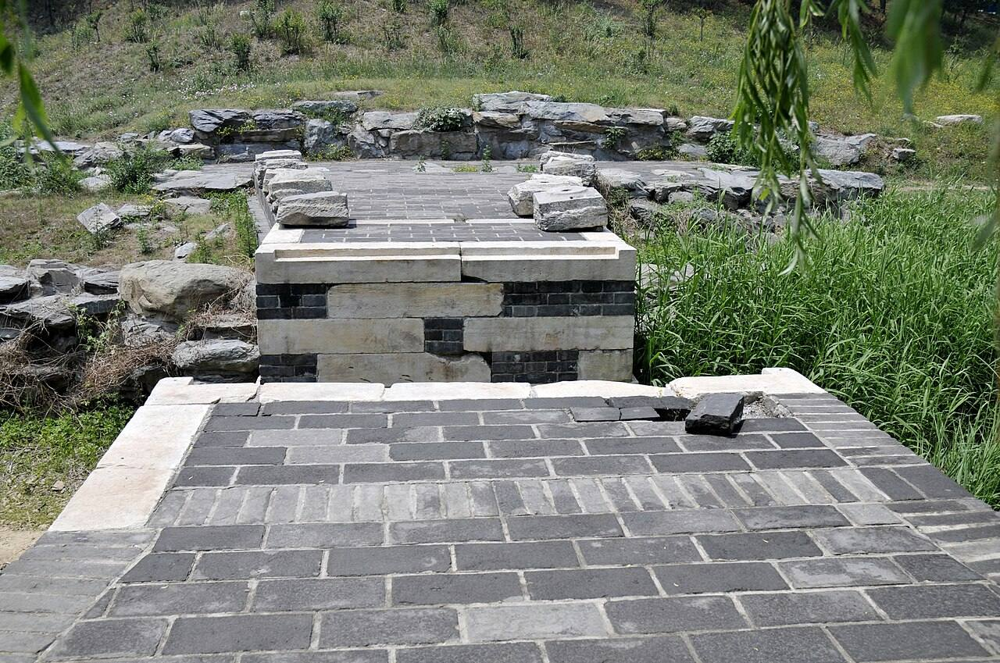

<!-- generated:start (scripts/building_pages.py): do not edit between these markers -->

# YM59: 铺面房 Pu Mian Fang

Yuanming Yuan

**3D object:** 14 boxes. Open it: `/reconstruction/3d.html?b=YM59`

## What we know

- **Name:** 铺面房 Pu Mian Fang (S01 · confidence B)
- **Garden:** Yuanming Yuan (S01)
- **Type:** compound (S01 · confidence B)
- **Destroyed:** 1860 (S01)
- **Position:** 40.00185, 116.28761. S01 sure (S01 · confidence B)
- **Plan reader's note:** Long walled yard with rows along the east wall; label 铺面房 (shop-front rooms) at (2118,5331). Missing from inventory (S01) *(research copy, not public)*
- **How it was read:** sure (S01) *(research copy, not public)*
- **Plan pixels:** 2100, 5330 (S01) *(research copy, not public)*

## Our model now

14 boxes stand in this compound, 14 on blocks drawn on the plan, 0 assumed. Its halls are listed below.

## Inside it (13)

- YM59-B0962
- YM59-B0963
- YM59-B0977
- YM59-B0978
- YM59-B1005
- YM59-B1008
- YM59-B1010
- YM59-B1011
- YM59-B1013
- YM59-B1046
- YM59-B1047
- YM59-B1079
- YM59-N01 铺面房

## Pictures (1)

- **P0494** (guess): 断桥遗址 - panoramio.jpg (Taken on 27 May 2011 (Commons DateTimeOriginal)). https://commons.wikimedia.org/wiki/File:%E6%96%AD%E6%A1%A5%E9%81%97%E5%9D%80_-_panoramio.jpg

  

## Texts and drawings (2)

- **E2372** (description, guess): 圆明园买卖街钩沉: the sets of 铺面房. reprint 2021; 《圆明园研究》第14期 · section 一 · S222. http://iqh.ruc.edu.cn/old/qdhjylyjzx/xszl/hwyj/4115411323ba4429a9ecc9ae5b2bc2e5.htm
  The three gardens have two shopping streets, 同乐园 and 含经堂, plus small groups of shops elsewhere such as at 北远山村 and behind 西峰秀色. The 铺面房 yard YM59 in the far south-west is none of those named. It fits by name only: its use stays a guess.
- **E2373** (description, guess): 铺面房: forms and scale, for YM59 if shops. reprint 2021 · S222 sections 二, 四 · S222. http://iqh.ruc.edu.cn/old/qdhjylyjzx/xszl/hwyj/4115411323ba4429a9ecc9ae5b2bc2e5.htm
  Shop bays are about 3.2 m wide and 4.8 m deep, in rows, with flat-roof 拍子, 牌楼 or two-storey fronts. 含经堂's row: 135.65 m long, 6.3 m deep, 40 bays; A late Yangshi Lei plan of the 同乐园 street marks offices, not shops, in the old shop buildings, so a label 铺面房 need not mean shops at YM59: unproven.

**On the plan:** Drawn on the plan of the gardens (S01), labelled 铺面房. https://artmuseum.princeton.edu/collections/objects/138657

## Evidence for the set of buildings

- Reconstructions and comparables for the whole garden, 圆明园 Yuanming Yuan: see GARDEN-YM

## Open questions

None that name it.

<!-- generated:end -->

## Notes

<!-- Yours: regeneration never touches this part. It goes on the public site; what you write below a line holding only %% private %% stays in the research copy. -->
