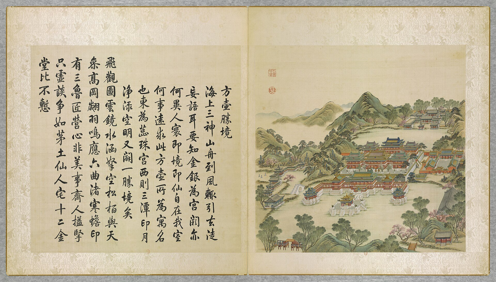

<!-- generated:start (scripts/building_pages.py): do not edit between these markers -->

# YM75: 天宇空明 Tian Yu Kong Ming

Yuanming Yuan

**3D object:** 4 boxes. Open it: `/reconstruction/3d.html?b=YM75`

## What we know

- **Name:** 天宇空明 Tian Yu Kong Ming (S01, S360, S361 · confidence B)
- **Garden:** Yuanming Yuan (S01, S360, S361)
- **Type:** compound (S01, S360, S361 · confidence B)
- **Built:** by 1796 (first dated item); 1740 (S01, S360, S361)
- **Destroyed:** 1860 (S01, S360, S361)
- **Position:** 40.01304, 116.30031. S01 sure (S01 · confidence B)
- **Bays:** 5 in the texts (S01, S360, S361)
- **Plan reader's note:** Labels 天宇空明, 澄景堂, 清旷楼. Inventory YM50-01..04. North shore of the lake R0055, as Malone says: another palace across the lake to the north. (S01) *(research copy, not public)*
- **How it was read:** sure (S01) *(research copy, not public)*
- **Plan pixels:** 8066, 419 (S01) *(research copy, not public)*

## Our model now

4 boxes stand in this compound, 4 on blocks drawn on the plan, 0 assumed. Its halls are listed below.

## Inside it (4)

- YM75-B0028
- YM75-B0042
- YM75-B0044
- YM75-B0045

## Pictures (1)

- **P0029** (likely): 方壺勝境 Fanghu shengjing [Site merveilleux du Vase carré] (圓明園四十景, 第29景) (1744 (BnF record: 1744年，清朝乾隆九年)). https://commons.wikimedia.org/wiki/File%3A%E5%9C%93%E6%98%8E%E5%9C%92%E5%9B%9B%E5%8D%81%E6%99%AF_-_%28%E6%B8%85%29%E5%94%90%E5%B2%B1%E3%80%81%E6%B2%88%E6%BA%90%E5%90%88%E7%95%AB_%3B_%28%E4%B9%BE%E9%9A%86%E5%90%9F%E8%AF%97%EF%BC%8C%E6%B1%AA%E7%94%B1%E6%95%A6%E4%BB%A3%E4%B9%A6%29_-_btv1b55008362z_%28088_of_124%29.jpg

  

## Texts and drawings (13)

- **E2342** (text, sure): 日下舊聞考 三潭印月、天宇空明. 1780s (乾隆 敕撰) · j82:13b-14a · S05. https://github.com/kanripo/KR2k0036/blob/master/KR2k0036_082.txt
  > 方壺勝境西北為三潭印月又西北度橋為天宇空明其後為澄景堂堂東為清曠樓西為華照樓（圓明園册）臣等謹按三潭印月天宇空明諸額皆皇上御書
  North-west of 方壺勝境: 三潭印月; then over a bridge 天宇空明 with 澄景堂, 清曠樓 and 華照樓 behind.
- **E2386** (text, sure): 《日下舊聞考》 on 天宇空明. 乾隆, 1780s · j82:13b-14a · S05. https://www.kanripo.org/text/KR2k0036/082
  > 方壺勝境西北為三潭印月又西北度橋為天宇空明其後為澄景堂堂東為清曠樓西為華照樓
  Across a bridge north-west of 方壶胜境, with 澄景堂 behind and 清旷楼, 华照楼 on the two sides.
- **E2381** (poem, sure): 天宇空明. 嘉庆元年 (1796) · v3 p.201, under 天宇空明; source ref 1-179 · S361. https://www.yuanmingyuanpark.cn/xs/yjbg/202008/P020200803382569071850.pdf#page=204
  > 纤云尽卷响调刁，爽豁高空净泬寥。霜满危崖林寂寂，烟开极浦草萧萧。水凝淡绿层波皱，柳结轻黄明岁条。更上山楼舒远目，雁飞天末影迢迢。
  Poem 天宇空明 by the Jiaqing Emperor, 1796, filed by the editors under 天宇空明.
- **E2382** (poem, sure): 天宇空明: 嘉庆元年 poem of the Jiaqing Emperor. 嘉庆元年 (1796), date from the compilation · p.271 item (1), under 天宇空明 · S360. https://www.yuanmingyuanpark.cn/xs/yjbg/202007/P020200730387572832602.pdf#page=271
  > 好雨新晴天宇清，蔚蓝澄澈印空明。波光百顷槛前接，山色千重云外横。是处亭台皆胜赏，知时卉木尽敷荣。良辰恰应花朝候，游览还殷省岁情。
  Poem of the Jiaqing Emperor at 天宇空明, 1796, on rain and the view. Year as given by the compilation.
- **E2383** (poem, sure): 天宇空明: 嘉庆二年 poem of the Jiaqing Emperor. 嘉庆二年 (1797), date from the compilation · p.271 item (2), under 天宇空明 · S360. https://www.yuanmingyuanpark.cn/xs/yjbg/202007/P020200730387572832602.pdf#page=271
  > 秋水净洲渚，一色涵太空。拏舟到村墅，泛泛明镜中。高朗映澄碧，白日辉苍穹。云雾绝形迹，寒林振天风。萧萧落木叶，灿灿摇岸枫。青女妙裁剪，艳胜春园红。放棹过前浦，长栏东复东。汀傍有文馆，鸣桡路可通。系缆枯柳下，惊起沙际鸿。
  Poem of the Jiaqing Emperor at 天宇空明, 1797, on boating. Year as given by the compilation.
- **E2384** (poem, sure): 天宇空明. 嘉庆三年 (1798) · v3 p.203, under 天宇空明; source ref 1-385 · S361. https://www.yuanmingyuanpark.cn/xs/yjbg/202008/P020200803382569071850.pdf#page=206
  > 序临秋杪尤宜霁，雾敛西峰尽放晴。风过闲庭增飒爽，日辉高宇倍晶莹。嘉禾全获上丰庆，劲旅云屯余孽惊。延览慰心欣称景，太空澄澈远崖清。
  Poem 天宇空明 by the Jiaqing Emperor, 1798, filed by the editors under 天宇空明.
- **E2385** (poem, sure): 天宇空明: 道光四年 poem of the Daoguang Emperor. 道光四年 (1824), date from the compilation · p.272 item (5), under 天宇空明 · S360. https://www.yuanmingyuanpark.cn/xs/yjbg/202007/P020200730387572832602.pdf#page=272
  > 日午平湖好放舟，淡云浅浪写高秋。遥汀芦白雁初下，野岸槲黄蝉巳收。坠叶遇风偏瑟瑟，疎钟隔水何悠悠。朅来旷览空明景，岂为感观诗句酬。
  Poem of the Daoguang Emperor at 天宇空明, 1824, on the view. Year as given by the compilation.
- **E1011** (description, sure): Site status table, about 2011: nothing visible, or built over. c. 2011 · 系列06 repost, status table · S356. https://blog.sina.com.cn/s/blog_c27029650101itzz.html
  Same table. In it the first group shows no visible remains; 得全阁, 流香渚, 凤麟洲, 涵秋馆, 蔚藻堂, 中和堂, 敷春堂 and 心镜轩 have service buildings on them, and 含晖楼, 澄心堂, 延寿寺, 清夏堂 and 喜雨山房 are occupied by other institutions. 澹泊宁静 and several others have been dug since, so this is out of date for them.
- **E2387** (description, sure): 圆明园百景史事分景汇编: 天宇空明. 1796-1824 · from p.271, under 天宇空明 · S360. https://www.yuanmingyuanpark.cn/xs/yjbg/202007/P020200730387572832602.pdf#page=271
  天宇空明: 5 dated items, 1796-1824, of which 5 poems (Jiaqing, Daoguang); recurring themes: the view, rain, boating. First dated 1796, last dated 1824.
- **E2388** (description, sure): 圆明园五朝御制诗文集注 v3, editors' note on 天宇空明. 2020 edition · v3 p.194 · S361. https://www.yuanmingyuanpark.cn/xs/yjbg/202008/P020200803382569071850.pdf#page=197
  Begun 1740 in the north-east corner: a five-bay main hall with a square double-eaved waterside pavilion, a five-bay rear hall 澄景堂, 清旷楼 of seven bays on two floors, 华照楼, 怡情邱壑. It looks out north over the rice fields.
- **E2389** (drawing, sure): 《国家图书馆藏样式雷图档·圆明园卷初编》: 天宇空明. mostly 道光, 咸丰, 同治 per the publisher · 初编 目录: 天宇空明, pp.415-418 · S13. https://www.nlcpress.com/ProductView.aspx?Id=7642
  The printed facsimile of the National Library of China's Yangshi Lei sheets has a section on this place at pp.415-418 (4 pages, section length worked out from the next heading); sheet titles and numbers are in the volume, ordered from a library.
- **E1857** (plan, sure): 《圆明园四十景》图的价值: 方壶胜境 leaf. 2020 · jzys · S337. http://iqh.ruc.edu.cn/old/qdhjylyjzx/xszl/jzys/8eef05885c3e4279ae0132f1a37a13c9.htm
  Says the 方壶胜境 leaf also shows its neighbours: 蕊珠宫 east, the three small stone pagodas and pavilions of 三潭印月 west, 天宇空明 north, two timber bridges south. So one leaf can witness several objects.
- **E2262** (plan, sure): 圆明园新证, 端木泓: dated additions shown on plan 1704. post n.d. · tables 1 and 2 · S337. http://iqh.ruc.edu.cn/old/qdhjylyjzx/xszl/xstl/1c9094aef4f041148f15883c7c266cb9.htm
  Tables of when things were added, drawn from archives to date the plan's layers: 藻园 1752, 廓然大公 eight views 1754, 春雨轩 1755, 藏密楼 1758, 多稼轩 ten views 1759, 紫碧山房 1760, 安澜园 and 澄练楼 1763, 若帆之阁 1764, 汇万总春之庙 1769, 文源阁 1775, 法源楼 1779; after: 兰亭八柱 1779, 知过堂 1782, 课农轩 1816, 涵月楼 1827. The most useful single dating table found.

**On the plan:** Drawn on the plan of the gardens (S01), labelled 天宇空明. https://artmuseum.princeton.edu/collections/objects/138657

## Evidence for the set of buildings

- Reconstructions and comparables for the whole garden, 圆明园 Yuanming Yuan: see GARDEN-YM

## Open questions

None that name it.

<!-- generated:end -->

## Notes

<!-- Yours: regeneration never touches this part. It goes on the public site; what you write below a line holding only %% private %% stays in the research copy. -->
