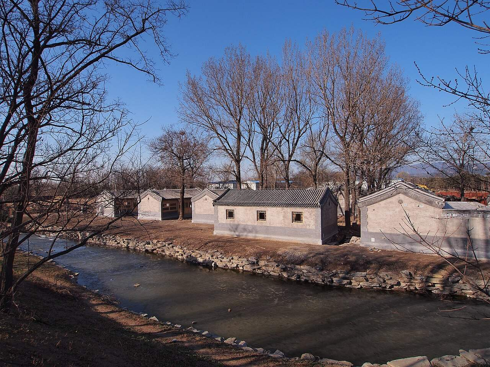

<!-- generated:start (scripts/building_pages.py): do not edit between these markers -->

# YM77: 山高先得月 Shan Gao Xian De Yue

Yuanming Yuan

**3D object:** 3 boxes. Open it: `/reconstruction/3d.html?b=YM77`

## What we know

- **Name:** 山高先得月 Shan Gao Xian De Yue (S01 · confidence B)
- **Garden:** Yuanming Yuan (S01)
- **Type:** compound (S01 · confidence B)
- **Destroyed:** 1860 (S01)
- **Position:** 40.00849, 116.29490. S01 sure (S01 · confidence B)
- **Plan reader's note:** Label (5540,2560), with 得 written beside the column. OSM 山高先得月 maps to (5572,2554). Not in inventory. (S01) *(research copy, not public)*
- **How it was read:** sure (S01) *(research copy, not public)*
- **Plan pixels:** 5572, 2530 (S01) *(research copy, not public)*

## Our model now

3 boxes stand in this compound, 3 on blocks drawn on the plan, 0 assumed. Its halls are listed below.

## Inside it (3)

- YM77-B0415
- YM77-B0416
- YM77-N01 山高先得月

## Pictures (1)

- **P0487** (guess): 圆明园内的新修建筑 - Refurbished Buildings in Yuanmingyuan Park - 2013.03 - panoramio.jpg (Taken on 13 March 2013 (Commons DateTimeOriginal)). https://commons.wikimedia.org/wiki/File:%E5%9C%86%E6%98%8E%E5%9B%AD%E5%86%85%E7%9A%84%E6%96%B0%E4%BF%AE%E5%BB%BA%E7%AD%91_-_Refurbished_Buildings_in_Yuanmingyuan_Park_-_2013.03_-_panoramio.jpg

  

## Texts and drawings (0)

None of its own.

**On the plan:** Drawn on the plan of the gardens (S01), labelled 山高先得月. https://artmuseum.princeton.edu/collections/objects/138657

**Searched and not found:** No text or drawing names it in 日下旧闻考 j80-82, the Qianlong poems on Kanripo, 養吉齋叢錄, Malone 1934, the witnesses of 1860, what search indexes show of the Yangshi Lei drawings.

## Open questions

None that name it.

<!-- generated:end -->

## Notes

<!-- Yours: regeneration never touches this part. It goes on the public site; what you write below a line holding only %% private %% stays in the research copy. -->
