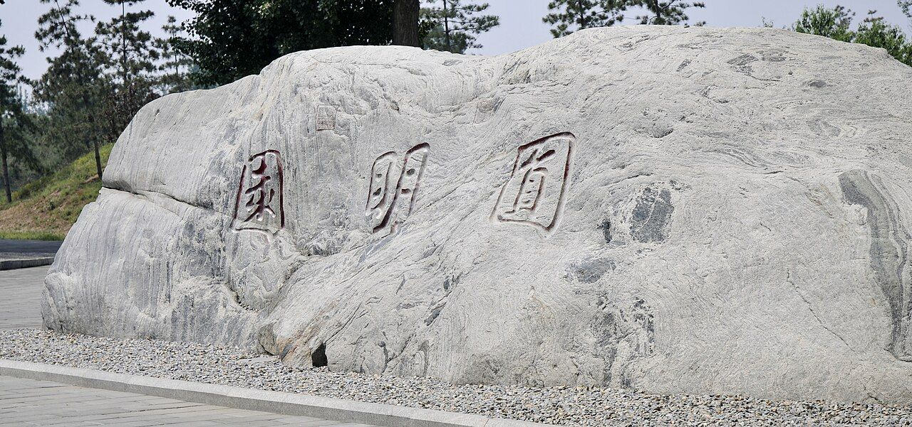

<!-- generated:start (scripts/building_pages.py): do not edit between these markers -->

# YM83: 春和镇 Chun He Zhen

Yuanming Yuan

**3D object:** 6 boxes. Open it: `/reconstruction/3d.html?b=YM83`

## What we know

- **Name:** 春和镇 Chun He Zhen (S01 · confidence B)
- **Garden:** Yuanming Yuan (S01)
- **Type:** compound (S01 · confidence B)
- **Destroyed:** 1860 (S01)
- **Position:** 40.00464, 116.29505. S01 likely (S01 · confidence B)
- **Plan reader's note:** Label reads 春和镇 at (5270,4520). Text YM39-08: 宁和镇, 设城关. Same position by the text (SE of 饮练长虹, gate 东楼门 beyond). First character clearly not 宁. (S01) *(research copy, not public)*
- **How it was read:** likely (S01) *(research copy, not public)*
- **Plan pixels:** 5300, 4440 (S01) *(research copy, not public)*

## Our model now

6 boxes stand in this compound, 6 on blocks drawn on the plan, 0 assumed. Its halls are listed below.

## Inside it (6)

- YM83-B0774
- YM83-B0844
- YM83-B0845
- YM83-B0846
- YM83-B0881
- YM83-B0882

## Pictures (1)

- **P0486** (guess): 圆明园山石 - panoramio.jpg (Taken on 27 May 2011 (Commons DateTimeOriginal)). https://commons.wikimedia.org/wiki/File:%E5%9C%86%E6%98%8E%E5%9B%AD%E5%B1%B1%E7%9F%B3_-_panoramio.jpg

  

## Texts and drawings (3)

- **E0390** (text, sure): 東樓門 south-east of 宁和镇. 1780s · j82:28a · S05. https://github.com/kanripo/KR2k0036/blob/master/KR2k0036_082.txt
  > 又東南度橋折而北設城闗為寧和鎮其東南為東樓門
  Places the gate: south-east of the 城关 of 宁和镇. On S01 the label read ?楼门 (G17) stands on the east lane just south of G33, the X-marked square on the road at 春和镇 (the later name of 宁和镇). This settles the reading 东楼门.
- **E2393** (text, likely): 《日下舊聞考》 on 寧和鎮, the plan's 春和镇. 乾隆, 1780s · j82:27b · S05. https://www.kanripo.org/text/KR2k0036/082
  > 飲練長虹又東南度橋折而北設城闗為寧和鎮其東南為東樓門
  Rixia gives 寧和鎮, a gate fort. S01 reads 春和镇. Possibly a plate change after 1780s or a misreading; no other source found.
- **E2081** (description, likely): 圆明园五朝御制诗文集注 v3, editors' note on 曲院风荷. 2020 edition · v3 p.112 · S361. https://www.yuanmingyuanpark.cn/xs/yjbg/202008/P020200803382569071850.pdf#page=115
  Modelled on the West Lake scene. Five-bay hall, Buddhist tower 洛伽胜境, a nine-arch bridge with archways 金鳌 and 玉蝀, 四围佳丽, 饮练长虹, then 宁和镇, renamed 春和镇 early in Daoguang's reign to avoid a name taboo. West of it the village 村庄房.

**On the plan:** Drawn on the plan of the gardens (S01), labelled 春和镇. https://artmuseum.princeton.edu/collections/objects/138657

## Open questions

None that name it.

<!-- generated:end -->

## Notes

<!-- Yours: regeneration never touches this part. It goes on the public site; what you write below a line holding only %% private %% stays in the research copy. -->
