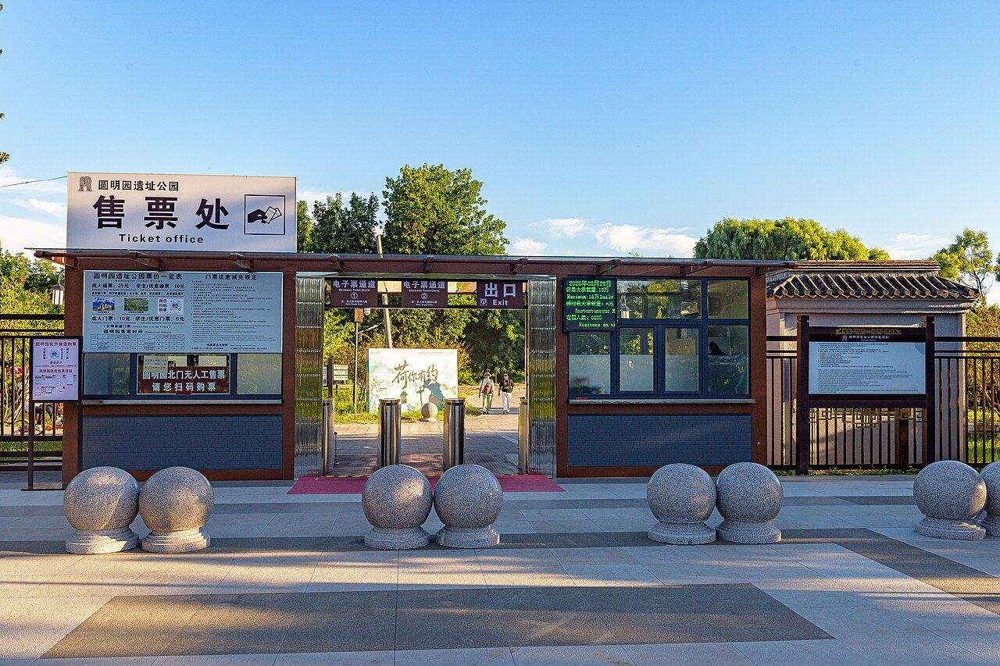

<!-- generated:start (scripts/building_pages.py): do not edit between these markers -->

# YM86: 大北门 Da Bei Men

Yuanming Yuan

**3D object:** 2 boxes. Open it: `/reconstruction/3d.html?b=YM86`

## What we know

- **Name:** 大北门 Da Bei Men (S01 · confidence B)
- **Garden:** Yuanming Yuan (S01)
- **Type:** compound (S01 · confidence B)
- **Destroyed:** 1860 (S01)
- **Position:** 40.01251, 116.29296. S01 sure (S01 · confidence B)
- **Plan reader's note:** G04, label (4940,380). Text 北楼门 (YM42-12). Guard rooms B0015, B0016 either side, arched forecourt north. (S01) *(research copy, not public)*
- **How it was read:** sure (S01) *(research copy, not public)*
- **Plan pixels:** 4962, 328 (S01) *(research copy, not public)*

## Our model now

2 boxes stand in this compound, 2 on blocks drawn on the plan, 0 assumed. Its halls are listed below.

## Inside it (2)

- YM86-B0015
- YM86-B0016

## Pictures (1)

- **P0471** (guess): North gate of Yuanmingyuan Park (20260829174306).jpg (2026-08-29 17:43:06 (Commons DateTimeOriginal)). https://commons.wikimedia.org/wiki/File:North_gate_of_Yuanmingyuan_Park_(20260829174306).jpg

  

## Texts and drawings (5)

- **E2396** (description, sure): 鱼跃鸢飞总平面图, list card. special/yslt, card of ysltd/11992 · S310. https://www.mhymy.com/special/yslt
  The site's card for this plan places the 鱼跃鸢飞 Yuyue Yuanfei scene just inside 大北门 Da Beimen, the Great North Gate, which it says was also called 北楼门 Beilou Men; this is the site's modern description, not a statement read on the sheet.
- **E2394** (description, likely): 北门 in orders of 1733-34 (see the S47 rows); yaffin 北楼门. 1733-34; n.d. blog · S47 pp.113-114; S356 系列09 no.25 · S47. https://blog.sina.com.cn/s/blog_65fec3ab0100sv4p.html
  The orders call it 北门. A blog of about 2011 says 大北门 is also called 北楼门, as S05's list has it, north of 鱼跃鸢飞 on the garden axis.
- **E2336** (description, likely): 若帆之阁 北门 土地庙, 山神庙 (S47 section 2.8). 2012, citing archive and Qing texts · p.114; table rows 18-19 · S47. https://www.dpm.org.cn/Uploads/File/2018/06/15/u5b23730ae0e5a.pdf
  An order of 1734 places an earth god in a small one-bay room west of the north-gate Guandi temple, and a mountain god in the fold of the hills west of the north gate. Both sit close inside the north gate of the garden.
- **E2395** (description, likely): 北门内 水关 小庙 (S47 section 2.7). 2012, citing archive and Qing texts · p.113 · S47. https://www.dpm.org.cn/Uploads/File/2018/06/15/u5b23730ae0e5a.pdf
  Orders of 1733-34 speak of a rain-god shrine at the rushing water north-west of 北苑山房 inside 北门, and of 北门内水关之河北小庙: so a water gate stood just inside the north gate by then.
- **E1744** (description, sure): 圆明园五朝御制诗文集注 v2, editors' note on 鱼跃鸢飞. 2020 edition · v2 p.235 · S361. https://www.yuanmingyuanpark.cn/xs/yjbg/202008/P020200803382343267004.pdf#page=238
  Built under Yongzheng, inside the great north gate: a double-eaved tower of two floors astride a stream, five bays each way with doors on four sides, plaques on each. 畅观轩, 铺翠环流, 传妙, 多子亭 stand by it. It survived 1860 and was lost around 1900, say the editors.

**On the plan:** Drawn on the plan of the gardens (S01), labelled 大北门. https://artmuseum.princeton.edu/collections/objects/138657

## Evidence for the set of buildings

- Reconstructions and comparables for the whole garden, 圆明园 Yuanming Yuan: see GARDEN-YM

## Open questions

- Q186: Which line on the plan is the garden wall on the north and west of Yuanming Yuan?

<!-- generated:end -->

## Notes

<!-- Yours: regeneration never touches this part. It goes on the public site; what you write below a line holding only %% private %% stays in the research copy. -->
