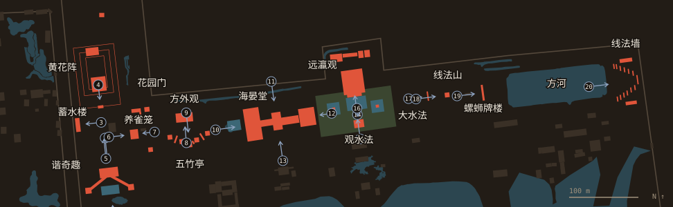

# 西洋楼 Xiyang Lou: the overview

The European palaces at the north edge of 长春园 Changchun Yuan, the part of the gardens whose ruins survive. Round 6 went through them building by building, so the next round can model them. One dossier per main building: `<ID>-<slug>/README.md`, `<ID>-<slug>/dimensions.json`. The public page is `site/xiyanglou/index.html`, built from these by `scripts/xiyanglou_page.py`.

**Files here.** Hand-edited after Round 6, first merged by `docs/rounds/common/palace_r6_merge.py`: `views.csv` (picture, row, side, what shows, state, reliability, camera), `dimensions.csv` (every figure, with its method and source), `boxes.csv` (what the 3D boxes take), `materials.csv`, `fragments.csv`, `rephoto.csv`, `best.csv`, `facts.csv`, `impressions.csv` (every impression of the plates found), `viewpoints.csv`, `parts.csv` (the unnamed rows, identified), `about.json` (the text, EN and a zh draft). Written by `scripts/xiyanglou_dossiers.py`: the dossiers and the tables below.

## The layout

A T of two strips (S604 through S415; S603): the west arm runs north-south, about 320 × 85 m, with 谐奇趣 XY01 and its pool at the south, 蓄水楼 XY02 and 花园门 XY03 next, the maze 黄花阵 XY04 and its hall behind, and a hill pavilion XY04-N02. The east strip runs about 770 m along the north wall on the strip's grid of 82-86° (run on OSM's ruins, `boxes.csv`): the gate 养雀笼 XY05, 方外观 XY06 and 五竹亭 XY07 facing each other in a garden, 海晏堂 XY08, then the cross-axis of 远瀛观 XY09, 大水法 XY10 and 观水法 XY11, and last 线法山 XY12, 螺蛳牌楼 XY13, 方河 XY14 and 线法墙 XY15. Through the georeference the whole measures 804-817 m against 855-860 m stated (Q63).

## The order of building

- **1747:** the west strip begins: 谐奇趣, the machine and first fountain "at the end of autumn" (S257 p.414, S02 pp.139-140; S603 p.123). West strip done by 1751 (S603, S54 lead). 蓄水楼's machine with it.
- **1756-59:** the second phase (S603 p.123), to which the new machinery of 1757 belongs (S600 Table 2). 养雀笼 1759 (S310 extract); 海晏堂 basically finished 1759 as 水法殿十一间楼, its board hung from 1781 (S310); 大水法 and 观水法 with it (S310 extract).
- **1768 or 1783:** 远瀛观, its nozzle of 1782 (S600) for 1783 (S42), against Durand's 1768 (S603). Q24.
- **1781-86:** the plates (S873). The strip's state on them is the one modelled.

## The water

Water came from the north by sluice, and was raised at 蓄水楼 and 海晏堂. Machines on the Belidor model with crank and pistons, wheels turned by mules or men, from 1747; new machinery 1757; the wheel at 蓄水楼 failed 1763, then windlasses; the machines ordered reused as metal and timber in 1795, pipes and tanks left, by Shingei's reading (S600). Reservoir 锡海 27.36 × 5.92 × 1.44 m (S109, S06, S600), one filling about 160 m³. Pipes of copper, thick as a man's body for the mains (Bourgeois, S258), tin for some runs (S600); lead is only Belidor's material. The claim that the fountains stopped when Benoist died in 1774 does not hold (S258, S600). No Archimedes screw at 蓄水楼 in what was read of S600.

## What survives

On the ground, by building: the dossiers. Clearing by year (S847, S820): 1976 first; 1977 观水法; 1978-83 远瀛观, 大水法, 线法山; 1987-88 万花阵; 1990s from 海晏堂 to 谐奇趣; 2001 tidied as a closed area; digs 2015-16. Many stones were not put back in place (S821): a stone's position today is not evidence for 1860.

## Modelling priority

Decision, with the counts in the table below as of this round:

1. **谐奇趣 XY01 first.** It is the only building seen from south, north and east before it fell: 5 of Ohlmer's views of 1873, free under the PD tags on Commons (Q50), with plates 1 and 2 for the front and back, and the two plates' heights agree (top eave 15.1 ± 1.5 m, ridge 18.3 ± 1.8 m). The published digital model (S108) states its method, and its forms are in print. Weakness: no absolute survey in reach (Q72); widths rest on the plan and rubble.
2. **大水法 XY10 with 远瀛观 XY09 second.** The only group with a published survey of the ground (S603: 110 × 60 m, 18 m basins, 62 m apart; terrace and post grid), the best-known ruin, frontal plates, 1873 and today from the same axis. Weakness: S603 leaves 远瀛观's order open (Q67), and most above the walls rests on one plate each.
3. **方外观 XY06:** small, with a stated L × l × H (S603) and a good frontal plate: a fast, honest model, roof from the plate only.
4. **海晏堂 XY08** has the most evidence by side, all four plates and the bronze heads, but it is the largest and its long fronts rest on mirror plates (Q70): do it once the method is proved.
5. **观水法 XY11** is small, and can ride with the second group; the rest (养雀笼, 蓄水楼, 花园门, 线法山, 螺蛳牌楼, 线法墙, 五竹亭) are plate-only and can be massed from their dimension sheets.

<!-- generated:start (scripts/xiyanglou_dossiers.py): do not edit between these markers -->

## The buildings, as measured here

Pictures per side count `views.csv` rows, parts included. S N E W are façades; O all else.

| Id | Name | Pictures | S | N | E | W | O | Figures a | b | c | d | e | Dossier |
|---|---|---|---|---|---|---|---|---|---|---|---|---|---|
| XY01 | 谐奇趣 Xieqiqu | 61 | 26 | 10 | 7 | 0 | 16 | 4 | 20 | 25 | 5 | 2 | [XY01-xieqiqu](XY01-xieqiqu/README.md) |
| XY02 | 蓄水楼 Xushui Lou | 10 | 5 | 1 | 3 | 0 | 1 | 1 | 2 | 11 | 0 | 2 | [XY02-xushui-lou](XY02-xushui-lou/README.md) |
| XY03 | 花园门 Huayuan Men | 7 | 2 | 1 | 0 | 0 | 4 | 0 | 3 | 9 | 5 | 0 | [XY03-huayuan-men](XY03-huayuan-men/README.md) |
| XY04 | 黄花阵 Huanghua Zhen | 22 | 16 | 0 | 0 | 0 | 6 | 0 | 18 | 8 | 0 | 8 | [XY04-huanghua-zhen](XY04-huanghua-zhen/README.md) |
| XY05 | 养雀笼 Yangque Long | 13 | 0 | 0 | 7 | 3 | 3 | 0 | 5 | 11 | 0 | 0 | [XY05-yangque-long](XY05-yangque-long/README.md) |
| XY06 | 方外观 Fangwai Guan | 24 | 18 | 1 | 0 | 0 | 4 | 3 | 12 | 9 | 4 | 0 | [XY06-fangwai-guan](XY06-fangwai-guan/README.md) |
| XY07 | 五竹亭 Wuzhu Ting | 4 | 0 | 2 | 0 | 0 | 2 | 0 | 4 | 9 | 0 | 0 | [XY07-wuzhu-ting](XY07-wuzhu-ting/README.md) |
| XY08 | 海晏堂 Haiyan Tang | 66 | 6 | 5 | 13 | 20 | 21 | 8 | 36 | 28 | 3 | 9 | [XY08-haiyan-tang](XY08-haiyan-tang/README.md) |
| XY09 | 远瀛观 Yuanying Guan | 40 | 32 | 1 | 1 | 0 | 6 | 4 | 15 | 10 | 0 | 4 | [XY09-yuanying-guan](XY09-yuanying-guan/README.md) |
| XY10 | 大水法 Da Shuifa | 26 | 22 | 2 | 1 | 0 | 1 | 8 | 22 | 10 | 0 | 2 | [XY10-da-shuifa](XY10-da-shuifa/README.md) |
| XY11 | 观水法 Guan Shuifa | 16 | 0 | 12 | 0 | 0 | 4 | 1 | 6 | 8 | 6 | 0 | [XY11-guan-shuifa](XY11-guan-shuifa/README.md) |
| XY12 | 线法山 Xianfa Shan | 10 | 1 | 0 | 0 | 4 | 5 | 0 | 6 | 11 | 0 | 2 | [XY12-xianfa-shan](XY12-xianfa-shan/README.md) |
| XY13 | 螺蛳牌楼 Luosi Pailou | 4 | 0 | 0 | 0 | 1 | 2 | 0 | 4 | 6 | 0 | 0 | [XY13-luosi-pailou](XY13-luosi-pailou/README.md) |
| XY14 | 方河 Fang He | 4 | 0 | 0 | 0 | 1 | 3 | 0 | 7 | 2 | 0 | 0 | [XY14-fang-he](XY14-fang-he/README.md) |
| XY15 | 线法墙 Xianfa Qiang | 3 | 1 | 0 | 0 | 1 | 1 | 0 | 23 | 7 | 0 | 2 | [XY15-xianfa-qiang](XY15-xianfa-qiang/README.md) |

## The plates and where they were drawn from

Viewpoints are estimates, with a focal length carried from plate 2: `viewpoints.csv` says how. Shown as arrows on `site/xiyanglou/keyplan.svg`, made by `scripts/xiyanglou_page.py` from our own layers only.

| Plate | Title | Picture | Best free copy listed | Impressions listed | Viewpoint | Looks | Distance |
|---|---|---|---|---|---|---|---|
| 1 | 谐奇趣南面 | P0041 | Chester Beatty Library, Dublin, 2400 px | 6 | 40.01051, 116.30254 | 354° | 69 ± 14 m |
| 2 | 谐奇趣北面 | P0042 | 故宫博物院 Palace Museum, Beijing, 2400 px | 6 | 40.01165, 116.30238 | 174° | 43 ± 10 m |
| 3 | 蓄水楼东面 | P0043 | 故宫博物院 Palace Museum, Beijing, 2400 px | 5 | 40.01185, 116.30231 | 264° | 31 ± 12 m |
| 4 | 花园门北面 | P0044 | 故宫博物院 Palace Museum, Beijing, 2400 px | 5 | 40.01234, 116.30226 | 174° | 30 ± 12 m |
| 5 | 花园正面 | P0045 | 故宫博物院 Palace Museum, Beijing, 2400 px | 5 | 40.01138, 116.30239 | 354° | 76 ± 30 m |
| 6 | 养雀笼西面 | P0046 | 故宫博物院 Palace Museum, Beijing, 2400 px | 6 | 40.01166, 116.30244 | 84° | 31 ± 12 m |
| 7 | 养雀笼东面 | P0047 | 故宫博物院 Palace Museum, Beijing, 2400 px | 6 | 40.01173, 116.30322 | 264° | 24 ± 10 m |
| 8 | 方外观正面 | P0048 | 故宫博物院 Palace Museum, Beijing, 2400 px | 5 | 40.01159, 116.30376 | 355° | 33 ± 12 m |
| 9 | 竹亭北面 | P0049 | 故宫博物院 Palace Museum, Beijing, 2400 px | 6 | 40.01198, 116.30375 | 174° | 47 ± 20 m |
| 10 | 海晏堂西面 | P0050 | 故宫博物院 Palace Museum, Beijing, 2400 px | 5 | 40.01176, 116.30425 | 82° | 43 ± 15 m |
| 11 | 海晏堂北面 | P0051 | not stated on Commons, 3792 px | 6 | 40.01239, 116.30519 | 172° | 51 ± 18 m |
| 12 | 海晏堂东面 | P0052 | 故宫博物院 Palace Museum, Beijing, 2400 px | 5 | 40.01197, 116.30622 | 262° | 24 ± 10 m |
| 13 | 海晏堂南面 | P0053 | not stated on Commons, 3788 px | 6 | 40.01135, 116.30539 | 352° | 51 ± 18 m |
| 14 | 远瀛观正面 | P0054 | 故宫博物院 Palace Museum, Beijing, 2400 px | 5 | 40.01195, 116.30665 | 352° | 39 ± 14 m |
| 15 | 大水法正面 | P0055 | 故宫博物院 Palace Museum, Beijing, 2400 px | 6 | 40.01164, 116.30670 | 352° | 62 ± 22 m |
| 16 | 观水法正面 | P0056 | 故宫博物院 Palace Museum, Beijing, 2400 px | 5 | 40.01204, 116.30665 | 172° | 17 ± 8 m |
| 17 | 线法山门正面 | P0057 | 故宫博物院 Palace Museum, Beijing, 2400 px | 5 | 40.01216, 116.30752 | 83° | 27 ± 10 m |
| 18 | 线法山正面 | P0058 | 故宫博物院 Palace Museum, Beijing, 2400 px | 5 | 40.01216, 116.30764 | 83° | 45 ± 18 m |
| 19 | 线法山东门 | P0059 | Honolulu Museum of Art, 3780 px | 6 | 40.01220, 116.30834 | 83° | 36 ± 15 m |
| 20 | 湖东线法画 | P0060 | 故宫博物院 Palace Museum, Beijing, 2400 px | 5 | 40.01232, 116.31057 | 83° | 58 ± 20 m |

Every impression: `impressions.csv`, 111 rows. In git: Palace Museum copies at 2400 px as P0041-P0060; the Chester Beatty plate 1 as P0223. Full size: `research/raw/plates/`, local.

## Materials: what holds for the group

| Part | What | Colour | Source | Grade | Seen |
|---|---|---|---|---|---|
| wall | Construction stated by the park's recent writers: timber columns inside, brick round them, marble outermost, with glazed ornament set in by mortise |  | S824 | B | snippet |
| ornament | Glazed pieces with Western ornament, dug up on the Xiyang Lou site; 5 chosen for repair from 2020 | 黄绿 yellow-green, 天青 sky-blue, 翡翠 emerald (S824); 'yellow, green, blue' (S820) | S824;S820;S825 | B | viewed |
| ornament | Glazed shell, flower, feather and scroll fittings for the façades, moulded on a buff body | turquoise-blue, 孔雀蓝-like; the museum's word: turquoise-blue. The colour is that of the pieces, unfaded under glaze | S827 | B | viewed |
| ornament | Statuettes for fountains, and 'shields and trophies of European designs', made in the Peking glazed-tile works; seen by Bushell in European museums | Other pieces in the same passage have turquoise blue and soft colours on purple pedestals: he doesn't tie those to the Italian palace | S250 | B | viewed |
| roof | Witness of about 1876: one pavilion still with a Chinese-style roof of glazed tiles; other buildings only walls with faience ornament | violet and green tiles; ornament of all colours | S828;S415 | B | viewed |
| roof | Malone 1934, on the group: glazed tiles in striking colour combinations; no colour per building | not stated | S02 | B | viewed |
| roof | Beurdeley 1971 as quoted by Rabreau: roofs yellow, blue or green; brick walls with red plaster; white marble pilasters. Rabreau's general account: massive marble or stone with coloured brick-and-faience facing and glazed roofs. Modern statements, no source given in the quote | 黄 蓝 绿 roof; red wall plaster (Beurdeley); yellow on any given roof stays unproved | S415 | C | viewed |
| wall | Wrought iron grille designed by Castiglione for 'the second European house' and carried out by the palace's workmen under Thébault |  | S258 | A | viewed |
| wall | Glazed windows in a European house of the park, by contrast with ordinary paper |  | S258 | A | viewed |
| fountain | Pipes: copper, thick as a man's body for the mains (Bourgeois; S258); copper reported at 养雀笼 (S820); tin for some runs (S600); S361 v4 p.121: 44 copper tubes round each 13-stage tower of 大水法; reservoir 锡海 in name lined with tin |  | S258;S820;S600;S361 | B | viewed |
| ornament | V&A group photograph of five Wylde pieces: turquoise palmette or shell with pearls and turquoise feathers; a cream-white flower on a green leaf; a brown-glazed band with bead moulding and a rectangular socket in its top; a dark-blue band with interlace | turquoise, dark blue, cream-white, green, brown | S827 | B | viewed |
| roof | RULE FOR THE MODELS, as far as evidence goes: stone frame white marble; infill grey brick; glazed ornament in turquoise, dark blue, green, cream, brown, and others; roofs of Chinese form in glazed tile, of colours attested only as violet and green on one surviving roof (Choutzé) and 'rainbow' in general. Yellow ridge, 宝石蓝, 明黄 on any given roof: no witness found: guess. The plates are black and white. Any coloured render by Tsinghua or others is a modern reconstruction's guess | see text | S828;S837;S827;S02;S153 | C | viewed |

## Fragments that are not tied to one building, or not Xiyang Lou at all

| Row | What | Now at | Moved | Source | Grade | Note |
|---|---|---|---|---|---|---|
| GARDEN:XY | Seven openwork balustrade or stair-rail posts, called 石柱 or 'columns' in the press; white marble with relief flowers and scrolling geometric ornament, about 0.8 to 0.92 m high | Yuanmingyuan: shown at 正觉寺 from 13 Oct 2023; 圆明园博物馆 | Left China in the Republic according to the 2023 authentication; Munthe (1864-1935) shipped objects to Bergen from 1907; part held back in the USA after an attempted sale to the Los Angeles County museum in 1926; given to the Bergen museum 1961-64; arrived Beijing 20 June 2023, handed to the park 21 June 2023 | S810;S811;S812;S813 | B | CORRECTION TO THE BRIEF: the 2014 reports said they would go to Peking University in autumn 2014. That did not happen: the agreement dates from December 2013, and the columns reached Beijing only in June 2023, and went to the park, not to PKU, which co-hosted the show. Also: the common phrase 'looted 1860' sits badly with the same report's statement that the holder got them in the Republic; S812: 'It is not known how Munthe acquired the columns'. Removal from a ruin after 1860 is likelier than loot in 1860: inference, C. Seven of 21 at KODE, so 14 stayed in Bergen (S812). |
| GARDEN:XY | 71 stone pieces, the display 残雕沉思 in the Xiyang Lou area | 西洋楼 遗址区 |  | S815 | B | No list seen; pieces not tied to buildings. |
| CC10 | Stone plaque 熙春洞 in Qianlong's hand (NOT Xiyang Lou fabric, though it stood beside it) | Returned from 翠园 in April 2018; planned for 天心水面 display | 翠园 until 2018 | S814 | B | The press calls it related to 西洋楼; it belongs to 泽兰堂. |
| GARDEN:ALL | Pair of stone lions and some carvings: said to be from 圆明园, building not stated | Returned 2009 | 1920s to 西交民巷87号院; returned 2009 | S817 | C | Not to be tied to the XY: lions also stood on plate 4 (XY03), so a tie would be a guess. |
| YM17 | 华表 of 安佑宫: white marble, about 8 m high, octagonal 须弥座 1.24 m high, cloud and coiled-dragon relief. NOT Xiyang Lou | Two at Peking University before the 办公楼 inside the west gate; the other two at the National Library on 文津街 | 1925: three brought to the Yenching campus, the fourth went to the city and in 1931 lay in front of 天安门 south of the road. When the library's 文津街 building rose, one of Yenching's spare ones was to join it; a mix-up left neither pair matched, so PKU's two differ in thickness | S818 | B | Claim holds, on a contemporary campus paper at second hand. Primary source is 《燕京大学校刊》: wish. For our purposes: Chinese axis material, keep out of the XY. |
| GARDEN:XY | Stone left in the ruin after the 1980s clearance: state as cleaned up, not as found | Xiyang Lou site | Clearance about 1980-85; before that much was under earth by 1960 | S821 | B | Important for models: a stone's position today is not evidence of its position of 1860 without checking. 3D scanning of stones from 2009 on is meant to place them. Tsinghua's work; cite as fact, second-hand. |
| GARDEN:XY | V&A C.382-1912: glazed shell with scrolls and leaf at the sides, on a triangular plan, 34.5 × 38 × 23 cm. The record's material says stoneware with turquoise glaze, its description earthenware: conflict inside the record | Victoria and Albert Museum, London | Bought or gathered by C. H. Wylde, V&A Keeper of Ceramics; his report says that on 3 January 1912 he 'was able to secure a few fragments', which the V&A reads as collected from the ruins on site; accessioned 1912 | S827 | B | Best-dated physical witness of glazed ornament found: viewed (research look). Shows the form and the colour. Not looted in 1860: gathered in 1912, so the press's sweep over 'looted' does not apply. Wylde's attribution to Kangxi and to French Jesuits is wrong on the date. |
| GARDEN:XY | V&A C.375-1912 (shell, 7.5 in wide), C.376-1912 (bird's feathers in high relief, 6.75 in), C.377-1912 (flower, 5.5 in), C.378-1912 (band in relief, 3.625 in): pieces of the same six-piece Wylde lot | Victoria and Albert Museum, London | As C.382-1912 | S827 | B | The PHYS field is repeated across the lot (shell), and SUM varies: use SUM. Five of six seen; C.379 to C.381 not in the search. |
| GARDEN:XY | V&A 186-1904: part of a brick moulded with leaf scrolls on two sides, yellow glaze on five sides, 19.4 × 7.6 cm; 185-1904: part of a round medallion with part of a dragon, turquoise-blue, 7.9 cm across | Victoria and Albert Museum, London | Given 1904 | S827 | C | Not to be counted as XY until the V&A's text is read in full. A dragon medallion is not a European motif, though plates mix them. |
| GARDEN:XY | Glazed capitals and ornament photographed in the park's store in 1983 by Rabreau: figs 43-48, capital and ornament in glazed ceramic | Park store (1983) |  | S415 | B | Figures not usable, captions only used here. Page to check. |
| GARDEN:XY | Abroad, what is NOT Xiyang Lou stone: Fontainebleau's 中国馆 (1863 on) holds objects taken in 1860 (enamel, gold dragons, jade), never building stone; a Paris museum, 康有为's 欹规味 and 薛福成's 东方博物院 (Guimet, by my reading of the name): 玉印 and objects; British Museum and V&A enamels and lacquer per Bushell 1904-05. These are objects from the garden's stores, not from the European palaces' fabric | Fontainebleau, Guimet, BM, V&A | 1860-63 | S836;S250 | B | The only Xiyang Lou building fabric located abroad in this search: 14 stone posts left in Bergen (S812), and V&A's glazed ornament. British Museum, Rijksmuseum, Museum der Kulturen Basel: nothing found in one search: see the wish. |
| YM17 | 办公楼 forecourt at PKU: 丹墀 / 丹陛石 and a pair of stone 麒麟. University pages say 载涛 took them from the garden to 朗润园; Malone says some marble from the Ancestral Shrine 安佑宫 stands at Yenching. NOT Xiyang Lou | Peking University, before 办公楼 | Via 朗润园 per search summaries of PKU pages | S02;S818 | C | News.pku page could not be read by fetch (96 bytes). |
| YM38 | 兰亭八柱碑亭 (八角 stone pavilion with eight inscribed pillars), and 青云片 stone. NOT Xiyang Lou | 北京 中山公园, 来今雨轩 west | Removed from the ruin; year not on the page read | S842 | C | Claim of 圆明园 holds generally; building ties are my matching of the common story with our ids. These two are not XY. XY stone was at 中山公园 too: see the 汉白玉 balustrade row (S847). |
| GARDEN:ALL | Where dispersed pieces are listed in Beijing per the 中央美院 database project: 故宫, 国博, 首博, 石刻博物馆, 保利博物馆, 中山公园, 颐和园, 国家图书馆古籍馆, 北京大学, 清华大学, and temples, hotels, houses, private hands; 苏州. Abroad: BM, V&A, Fontainebleau, 台北故宫. Stone and 琉璃 are separate categories | as listed |  | S843 | B | Not checked piece by piece: 颐和园, 北海, 景山, 中南海, 北京动物园, 恭王府, 故宫 got no XY item in this round's searches. Absence here is not absence: see the wish. |
| GARDEN:XY | 汉白玉 balustrades of the Xiyang Lou, part | 圆明园 | Stood in 中山公园; brought back in the clearing of 1978-83 | S847 | B | The one case of Xiyang Lou stone at 中山公园 found; so the earlier row that nothing XY came from there is corrected by this one. The same sentence: a 流杯亭 base came back from PKU: not XY. |

Dimension figures in all: 453, of which on a named building 430: a 29, b 183, c 164, d 23, e 31.

<!-- generated:end -->
